# Reference process: Negotiate the Definitive Agreements

`ref/pc/negotiate-the-definitive-agreements v1`

**value stream:** [Recommendation-to-Close](../../streams/private-capital/recommendation-to-close.md)
The term sheet is signed and the lawyers take over the drafting. The
deal-structurer agent instructs outside counsel with the signed terms and
the committee's conditions, reads every draft back against the term
sheet, and makes sure each diligence finding is written in as a promise
from the other side, a condition to closing, an indemnity or a change to
the price. The redline-reviewer agent splits each markup that comes back
into one item per changed clause and marks it as standard text, an
approved fallback or new text nobody has agreed before, and the
returns-modeler agent prices every change that moves value. The deal lead
partner and counsel decide each clause, and a change that moves a term
past the committee's approval goes back to the committee. Nothing is
signed here. The run closes when both sides confirm one clean text and the
conditions to closing are handed to the closing.

## The goals

- Agree the final text within [6 weeks]
- Hold the return within [1 point] of the approval
- Hold legal fees under [1%] of the deal value
- Keep surprise claims after closing at [zero]

## The activities

| # | Activity | What happens | Agents |
|---|---|---|---|
| 1 | Take in the Signed Term Sheet | the signed terms and the committee's conditions | [deal-structurer](../../agents/deal-structurer.md) |
| 2 | Instruct Outside Counsel | the terms, the conditions and the timetable | deal lead partner (person) · deal-structurer |
| 3 | Fix the Starting Text | whose form, which version, which fallbacks apply | [redline-reviewer](../../agents/redline-reviewer.md) · outside counsel (person) |
| 4 | Prepare the First Draft | the first full draft of each agreement | outside counsel (person) · deal-structurer |
| 5 | Read the Draft Against the Term Sheet | every clause traced to a term sheet line | deal-structurer |
| 6 | Write the Diligence Findings In | each finding as a promise, a condition or a price | deal-structurer · outside counsel (person) |
| 7 | Split the Markup into Clauses | each change from the other side as one item | redline-reviewer |
| 8 | Classify Each Change | standard, an approved fallback, or new text | redline-reviewer |
| 9 | Price the Changes That Move Value | what each change does to the return | [returns-modeler](../../agents/returns-modeler.md) |
| 10 | Decide Each Clause | accepted, countered or refused, with who decided | deal lead partner (person) · outside counsel (person) |
| 11 | Take a Moved Term Back to Committee | a term past the approval goes back for a vote | deal lead partner (person) · deal-structurer |
| 12 | Send the Counter-Markup | the firm's answer to the round, in one draft | outside counsel (person) · redline-reviewer |
| 13 | Work the Round Trips | each round read against the last copy sent | redline-reviewer · deal-structurer |
| 14 | Agree the Disclosure Schedules | each exception read against what diligence found | outside counsel (person) · deal-structurer |
| 15 | Settle the Ancillary Agreements | the side documents the main agreement relies on | deal lead partner (person) · returns-modeler |
| 16 | Check the Final Return | the agreed text modeled against the approval | returns-modeler |
| 17 | Confirm the Agreed Text | one clean text both sides call the agreement | redline-reviewer · outside counsel (person) |
| 18 | Hand the Text to the Closing | the agreed text and every condition to closing | deal-structurer |

**Venture and buyout.** In venture, the round's documents are usually
close to a standard form, so most of the work is in the few terms that
depart from it. In a buyout, the debt financing is negotiated with the
lenders at the same time, and management's equity and the shares it
rolls over are settled before the text is agreed.

## The graph

```mermaid
flowchart LR
  T([a term sheet is signed]) --> A1[1. Take in the Signed Term Sheet]
  A1 --> A2[2. Instruct Outside Counsel]
  A2 --> A3[3. Fix the Starting Text]
  A3 --> A4[4. Prepare the First Draft]
  A4 --> A5[5. Read the Draft Against the Term Sheet]
  A5 -. the draft does not match the term sheet .-> A4
  A5 --> A6[6. Write the Diligence Findings In]
  A6 --> A7[7. Split the Markup into Clauses]
  A7 --> A8[8. Classify Each Change]
  A8 --> A9[9. Price the Changes That Move Value]
  A9 --> A10[10. Decide Each Clause]
  A10 -. a change moves a term past the approval .-> A11[11. Take a Moved Term Back to Committee]
  A11 -. the committee has answered .-> A10
  A10 --> A12[12. Send the Counter-Markup]
  A12 --> A13[13. Work the Round Trips]
  A13 -. a new markup comes back .-> A7
  A13 --> A14[14. Agree the Disclosure Schedules]
  A13 --> A15[15. Settle the Ancillary Agreements]
  A14 -. a disclosure takes the value out of a promise .-> A9
  A14 --> A16[16. Check the Final Return]
  A15 --> A16
  A16 -. the return falls below the approval .-> A11
  A16 --> A17[17. Confirm the Agreed Text]
  A17 -. the two clean copies do not match .-> A13
  A17 --> A18[18. Hand the Text to the Closing]
  A18 --> DONE([one agreed text, with every condition to closing listed])
```



## The document, with the blanks marked

```
PROCESS: definitive agreements  id: <team>/negotiate-the-definitive-agreements   v1
from: ref/pc/negotiate-the-definitive-agreements v1
owner: <who>                          effective: <date>
trigger: a term sheet is signed and handed on, in <your deal pipeline>
         watch: record=<signed term sheet> system=<your deal pipeline>
                change=<a signed term sheet is handed to the agreements>
concurrency: runs may overlap - one deal has one agreements run at a
             time, and <how many> deals may be in drafting at once
goal: one agreed text within <weeks> of the signed term sheet and before
      the exclusivity ends, with every clause traced to the term sheet or
      named as new, every committee condition written in or waived in
      writing, and the return still inside the approval
phases:
  take-in-term-sheet       - human: the signed term sheet, the committee's
                             conditions, the open diligence findings and
                             the exclusivity end date
                             owner: deal-structurer
                             after: trigger
                             automation: <level>
  instruct-counsel         - human: outside counsel briefed with the
                             terms, the conditions, the timetable and the
                             fee estimate <your finance role> approved
                             owner: <your deal lead role>
                             after: take-in-term-sheet
                             by: <days>       automation: <level>
  fix-starting-text        - runs collect-and-report: whose form the
                             drafting starts from, at which version, and
                             which fallbacks the firm has already accepted
                             owner: redline-reviewer
                             after: instruct-counsel
                             automation: <level>
  prepare-draft            - human: the first full draft of each
                             agreement, from the firm's side or received
                             from the other side's counsel
                             owner: <your counsel role>
                             after: fix-starting-text
                             by: <weeks>      automation: <level>
  read-against-term-sheet  - runs assessment: every clause traced to the
                             term sheet line it comes from, and every
                             clause with no line behind it named as new
                             owner: deal-structurer
                             after: prepare-draft
                             automation: <level>
  write-findings-in        - runs assessment: each finding the committee
                             conditioned on carried as a promise, a
                             condition to closing, an indemnity or a
                             change to the price, or listed as waived
                             owner: deal-structurer
                             after: read-against-term-sheet
                             automation: <level>
  split-markup             - runs collect-and-report: the other side's
                             markup split into one item per changed
                             clause, both texts side by side
                             owner: redline-reviewer
                             after: write-findings-in or work-round-trips
                             automation: <level>
  classify-changes         - runs assessment: each change marked standard
                             text, an approved fallback or new text, and
                             every change made without tracking named
                             owner: redline-reviewer
                             after: split-markup
                             automation: <level>
  price-changes            - runs assessment: what each change that moves
                             value does to the return, the risk or the
                             cash at closing
                             owner: returns-modeler
                             after: classify-changes or agree-schedules
                             automation: <level>
  decide-clauses           - convenes decide-and-announce: each clause
                             accepted, countered or refused with its
                             reason, and clauses only a lawyer may answer
                             decided by <your counsel role>
                             owner: <your deal lead role>
                             after: price-changes
                             by: <days>       automation: <level>
  take-to-committee        - convenes decide-and-announce: a change that
                             moves a term past the approval, taken back
                             with its price as a new run of
                             ref/pc/decide-at-investment-committee
                             owner: <your deal lead role>
                             after: decide-clauses or check-final-return
                             by: <days>       automation: <level>
  send-counter             - human: the firm's answer to the round in one
                             draft, with every departure from standard
                             text listed beside its approver
                             owner: <your counsel role>
                             after: decide-clauses
                             automation: <level>
  work-round-trips         - runs roll-call: each round read against the
                             copy last sent, every open clause listed with
                             its owner, until no clause is open
                             owner: redline-reviewer
                             after: send-counter
                             every: <cadence> automation: <level>
  agree-schedules          - runs assessment: each exception the other
                             side discloses read against what diligence
                             found, and every surprise named
                             owner: <your counsel role>
                             after: work-round-trips
                             by: <days>       automation: <level>
  settle-ancillaries       - human: the side documents the agreement relies
                             on, such as the shareholders' agreement, the
                             financing and management's equity, agreed
                             owner: <your deal lead role>
                             after: work-round-trips
                             by: <days>       automation: <level>
  check-final-return       - runs assessment: the agreed text, the
                             schedules and the side documents modeled once
                             more, and the return set beside the approval
                             owner: returns-modeler
                             after: agree-schedules + settle-ancillaries
                             automation: <level>
  confirm-text             - convenes approval: both sides confirm one
                             clean text as the agreement, and the two
                             copies are compared word for word
                             owner: redline-reviewer
                             after: check-final-return
                             by: <days>       automation: <level>
  hand-to-closing          - human: the agreed text, every condition to
                             closing and every signer named in it handed to
                             ref/pc/run-the-closing
                             owner: deal-structurer
                             after: confirm-text
                             automation: <level>
run-scoped:
  position-log - runs collect-and-report        owner: deal-structurer
                 from: take-in-term-sheet  until: run close
  exclusivity  - runs roll-call                 owner: deal-structurer
                 every: <cadence>
                 from: instruct-counsel    until: confirm-text
  deal-costs   - runs allocate-and-reconcile    owner: <your finance role>
                 from: instruct-counsel    until: run close
handoffs:
  take-in-term-sheet -> instruct-counsel [signed-terms]: the signed term
    sheet, the conditions, the open findings and the exclusivity end date
  instruct-counsel -> fix-starting-text [counsel-instructions]: what
    counsel was told, the timetable and the approved fee estimate
  fix-starting-text -> prepare-draft [starting-text]: the form, its
    version and the fallbacks already accepted
  prepare-draft -> read-against-term-sheet [first-draft]: the full draft
    of each agreement at a version
  read-against-term-sheet -> write-findings-in [traced-draft]: each
    clause traced to a term sheet line, or named as new
  write-findings-in -> split-markup [draft-with-findings]: the draft as
    sent, with each finding marked where it was written in
  split-markup -> classify-changes [clause-items]: one item per changed
    clause, both texts side by side
  classify-changes -> price-changes [classified-changes]: each change with
    its class, and every untracked change named
  price-changes -> decide-clauses [priced-changes]: each change that moves
    value, with its effect on the return
  decide-clauses -> send-counter [clause-decisions]: each clause closed
    as accepted, countered or refused, with who decided
  take-to-committee -> decide-clauses [committee-answer]: the committee's
    answer on the moved term, and any new limit it set
  send-counter -> work-round-trips [counter-markup]: the version sent back
    and the date
  work-round-trips -> agree-schedules / settle-ancillaries [settled-text]:
    the text with no clause open, at a version
  agree-schedules -> check-final-return [disclosure-read]: every
    disclosure read against diligence, and every surprise priced
  settle-ancillaries -> check-final-return [side-documents]: the side
    documents as agreed, at their versions
  check-final-return -> confirm-text [final-return]: the return on the
    whole package beside the return the committee approved
  confirm-text -> hand-to-closing [agreed-text]: the one clean text both
    sides confirmed, with its version and date
deviations:
  read-against-term-sheet -> prepare-draft [draft-off-term-sheet]: the
    draft does not say what the term sheet said, so the clause is drafted
    again against the line it should match
  decide-clauses -> take-to-committee [term-past-approval]: a change moves
    a term past the committee's approval, so it goes back to the committee
    before anything is agreed on it
  take-to-committee -> decide-clauses [committee-answered]: the committee
    has answered, so the clause is decided inside what it allowed
  work-round-trips -> split-markup [new-markup]: a new markup comes back,
    so it is split and read against the copy last sent
  agree-schedules -> price-changes [disclosure-guts-promise]: a
    disclosure takes the value out of a promise the price relied on, so
    it is priced as a change to the deal
  check-final-return -> take-to-committee [return-below-approval]: the
    whole package returns less than the committee approved, so it goes
    back to the committee before the text is confirmed
  confirm-text -> work-round-trips [copies-differ]: the two clean copies
    do not match, so the round trips reopen on the clauses that differ
bindings:
  roster:  <who holds each role - agents claiming the abstract agents
           above, and named people for the deal lead partner and the
           outside counsel>
  systems: the deal pipeline (write), the contract system (write),
           the data room (read), the clause record (write),
           the investment model (write), the decision record (read)
  data:    the signed term sheet <version>, the committee decision
           <version>, the diligence findings <version>, <your standard
           deal forms> <version>, <your approved fallbacks> <version>
policy:
  every clause traces to a line of the signed term sheet, or is named as
    new and decided as new
  a change that moves a term past the committee's approval goes back to
    the committee, and is never settled in the margin of a draft
  every finding the committee conditioned on appears in the agreement as
    a promise, a condition, an indemnity or a price change, or is waived
    in writing by <who>
  a clause only a lawyer may answer is answered by <your counsel role>
  an untracked change is raised with the other side by name and is never
    accepted quietly
  both sides confirm one clean text before anything goes to signature,
    and signing happens in the closing
  the exclusivity end date is watched, and an extension is agreed in
    writing before it passes
  deal costs are recorded as they are incurred and charged as <your
    expense policy> sets, including when the deal does not close
measures:
  cycle time: <weeks> from the signed term sheet to the agreed text
  approval discipline: <target> share of agreed terms inside the
                       committee's first approval
  volume: <agreements per period>
  quality gate: every clause traces to the term sheet or is named as new,
                and every committee condition is written in or waived in
                writing
```

## The failure edges

- **The draft does not say what the term sheet said.** The
  deal-structurer agent names the clause and the term sheet line it
  should match, and counsel drafts it again. Whichever of the two is
  wrong is corrected on the record before the draft goes to the other
  side.
- **A change moves a term past the approval.** The clause stays open and
  goes back to the committee with its price. The deal lead partner does
  not agree it at the table and seek approval afterward, and the other
  side is told the clause is with the committee.
- **A new markup comes back.** The redline-reviewer agent reads it
  against the copy the firm last sent, so a change slipped in without
  tracking is found and raised with the other side by name.
- **A disclosure takes the value out of a promise.** A schedule that
  discloses the very problem a promise was meant to cover leaves the
  promise worth nothing. The returns-modeler agent prices it as a change
  to the deal, and it is decided like any other clause.
- **The whole package returns less than the approval.** Clauses that are
  each acceptable can add up to a deal the committee did not approve.
  The final return is read across the agreement, the schedules and the
  side documents together, and a shortfall goes back to the committee.
- **The two clean copies do not match.** The round trips reopen on the
  clauses that differ, and neither side's copy is treated as the
  agreement until both are the same text.
- **The exclusivity runs out while drafting is still open.** The
  deal-structurer agent raises the end date ahead of time, and the deal
  lead partner agrees an extension in writing or accepts the risk that
  the company talks to others. The risk is recorded either way.
- **The trigger fires while a run is in flight.** One deal has one
  agreements run at a time. A term sheet signed again on new terms
  replaces the first as the text every clause is read against, and the
  clauses already decided are read once more against it.
- **A run is abandoned.** The deal stops before the text is agreed. The
  other side is told in writing and by whom, counsel is told to stop
  work, the drafts are closed at their last version, the deal costs are
  reconciled and charged as the expense policy sets, and the reason goes
  onto the deal's record.
