# Reference process: Negotiate the Fund Terms and Side Letters

`ref/pc/negotiate-the-fund-terms-and-side-letters v1`

**value stream:** [Raising a fund](../../streams/private-capital/strategy-to-fund.md)
An investor that means to commit sends its comments on the limited
partnership agreement (LPA) and the side letter it wants. This process
logs every ask in the investor's own words, reads the markup clause by
clause against the agreement at its version and the fallbacks the
partners approved, and checks what other investors already hold, because
a term given to one investor can be claimed by others under their most
favored nation (MFN) clauses. Each ask is priced with the chief financial
officer (CFO) in fees, carried interest, work and precedent. The
negotiation coordinator answers the asks the mandate already covers, and
the managing partner decides every ask past it. A change that every
investor gets is made once in the master agreement. The side letter is
drafted, the final text is read back against the log, and the side
letter keeper turns every promise into an obligation with an owner. The
run closes when the agreement and the side letter are agreed and ready to
sign at the investor's close.

**delivers:** agreement, agreed fund terms and side letters

**starts:** on an event, an investor that means to commit sends its comments and side letter asks

## The goals

- Settle every side letter [5 days] before its close
- Win commitments from [90%] of negotiating investors
- Keep fee discounts under [10%] of fee income

## The activities

| # | Activity | What happens | Agents |
|---|---|---|---|
| 1 | Take in the Investor's Comments | the LPA markup, the side letter asks, the close | [negotiation-coordinator](../../agents/negotiation-coordinator.md) |
| 2 | Read the Firm's Negotiating Mandate | the fallbacks and limits the partners approved | negotiation-coordinator |
| 3 | Log Every Ask | each ask numbered, in the investor's own words | negotiation-coordinator |
| 4 | Read the Markup Clause by Clause | each changed clause beside the agreed text | [redline-reviewer](../../agents/redline-reviewer.md) |
| 5 | Classify Each Change | standard text, approved fallback, or new text | redline-reviewer · fund counsel (person) |
| 6 | Check What Other Investors Already Hold | side letters signed, and who has an MFN right | [side-letter-keeper](../../agents/side-letter-keeper.md) |
| 7 | Read the Legal and Tax Asks | what the investor's own rules make it ask for | fund counsel (person) · redline-reviewer |
| 8 | Price Each Ask | the cost in fees, carry, work and precedent | negotiation-coordinator · CFO (person) |
| 9 | Answer the Asks Inside the Mandate | the asks the approved fallbacks already cover | negotiation-coordinator |
| 10 | Decide the Asks Past the Mandate | the managing partner gives, trades or refuses | managing partner (person) · negotiation-coordinator |
| 11 | Send the Firm's Position | one written answer to every ask | negotiation-coordinator · fund counsel (person) |
| 12 | Close the Remaining Asks | each one closed as given, traded or refused | negotiation-coordinator · investor relations lead (person) |
| 13 | Change the Master Agreement Once | a change every investor gets, made in one place | fund counsel (person) · redline-reviewer |
| 14 | Draft the Side Letter | the agreed asks written as one letter | fund counsel (person) · side-letter-keeper |
| 15 | Read the Final Text Against the Log | every clause matched to a closed ask | redline-reviewer · negotiation-coordinator |
| 16 | Record Each Promise as an Obligation | every clause with its owner, trigger and date | side-letter-keeper |
| 17 | Mark the Terms Others May Elect | which terms fall under the MFN clauses | side-letter-keeper |
| 18 | Hand On to the Close | the agreed text ready to sign at the close | negotiation-coordinator |

Comments on the partnership agreement come from many investors at once,
and most firms take them in a round before each close. One investor's
comments and side letter are one run, and the runs in a round share the
master agreement, so a change made in one run is read into every other
run that is still open.

## The graph

```mermaid
flowchart LR
  T([an investor that means to commit sends its comments and side letter asks]) --> A1[1. Take in the Investor's Comments]
  A1 --> A2[2. Read the Firm's Negotiating Mandate]
  A2 --> A3[3. Log Every Ask]
  A3 --> A4[4. Read the Markup Clause by Clause]
  A4 --> A5[5. Classify Each Change]
  A3 --> A6[6. Check What Other Investors Already Hold]
  A3 --> A7[7. Read the Legal and Tax Asks]
  A5 --> A8[8. Price Each Ask]
  A6 --> A8
  A7 --> A8
  A8 --> A9[9. Answer the Asks Inside the Mandate]
  A8 --> A10[10. Decide the Asks Past the Mandate]
  A9 --> A11[11. Send the Firm's Position]
  A10 --> A11
  A11 --> A12[12. Close the Remaining Asks]
  A12 -. the investor counters past the mandate .-> A10
  A12 --> A13[13. Change the Master Agreement Once]
  A12 --> A14[14. Draft the Side Letter]
  A13 --> A15[15. Read the Final Text Against the Log]
  A14 --> A15
  A15 -. the text does not say what was agreed .-> A14
  A15 -. a settled ask is reopened in the text .-> A12
  A15 --> A16[16. Record Each Promise as an Obligation]
  A16 --> A17[17. Mark the Terms Others May Elect]
  A17 --> A18[18. Hand On to the Close]
  A18 --> DONE([the agreement and the side letter are agreed, with every promise listed as an obligation])
```



## The document, with the blanks marked

```
PROCESS: fund terms and side letters  id: <team>/negotiate-the-fund-terms-and-side-letters   v1
from: ref/pc/negotiate-the-fund-terms-and-side-letters v1
owner: <who>                          effective: <date>
trigger: an investor that has stated a commitment under
         ref/pc/work-an-investor-prospect sends its comments on the
         partnership agreement or its side letter asks, by <the comment
         deadline for the close>
         watch: record=<investor comments> system=<your CRM>
                change=<an investor's markup or side letter request is
                logged>
concurrency: one run per investor per fund - the runs before one close
             share the master agreement, and <how many> run at once
goal: every investor's comments and side letter closed by <days> before
      its close, inside the mandate the partners approved, with every
      promise in a side letter recorded as an obligation with an owner
phases:
  take-in-comments  - human: the investor's markup of the partnership
                      agreement, its side letter asks, the close it is
                      aiming for and the person negotiating for it
                      owner: negotiation-coordinator  after: trigger
                      automation: <level>
  read-mandate      - runs assessment: the fallbacks, the limits and the
                      terms the partners will not move, at the version
                      in force for this fund
                      owner: negotiation-coordinator
                      after: take-in-comments   automation: <level>
  log-asks          - runs collect-and-report: every ask from the markup
                      and the side letter request, numbered, in the
                      investor's own words
                      owner: negotiation-coordinator  after: read-mandate
                      automation: <level>
  read-markup       - runs assessment: each changed clause set beside
                      the agreement at its version, one item per change
                      owner: redline-reviewer      after: log-asks
                      automation: <level>
  classify-changes  - runs assessment: each change marked as standard
                      text, an approved fallback, or new text nobody has
                      agreed before
                      owner: redline-reviewer      after: read-markup
                      automation: <level>
  check-holdings    - runs assessment: the side letters already signed
                      or agreed for this fund, and which investors hold
                      an MFN right that would reach each ask
                      owner: side-letter-keeper    after: log-asks
                      automation: <level>
  read-legal-asks   - runs assessment: the asks the investor's own law,
                      tax position or charter requires, such as reporting
                      for a tax-exempt investor or the confidentiality
                      limits of a public plan
                      owner: <your fund counsel role>  after: log-asks
                      by: <days>                   automation: <level>
  price-asks        - runs assessment: each ask priced in fees, carried
                      interest, extra work for the firm, and what it
                      would cost if every investor with an MFN right
                      elected it
                      owner: negotiation-coordinator
                      after: classify-changes + check-holdings +
                      read-legal-asks
                      by: <days>                   automation: <level>
  answer-inside     - human: each ask the approved fallbacks cover
                      answered with that fallback, and each ask the
                      mandate refuses answered with the refusal
                      owner: negotiation-coordinator  after: price-asks
                      automation: <level>
  decide-past       - convenes decide-and-announce: the managing partner
                      gives, trades or refuses each ask past the mandate,
                      and any move of the mandate is recorded with a date
                      owner: <your managing partner role>
                      after: price-asks            by: <days>
                      automation: <level>
  send-position     - human: one written answer to every ask, sent to
                      the investor's counsel, with the reason for each
                      refusal
                      owner: negotiation-coordinator
                      after: answer-inside + decide-past
                      by: <days>                   automation: <level>
  close-asks        - human: the investor's replies worked through one
                      at a time, each ask closed as given, traded or
                      refused, with the person on each side who agreed
                      owner: negotiation-coordinator
                      after: send-position         by: <weeks>
                      automation: <level>
  change-master     - human: a change that every investor gets made once
                      in the master agreement, and every other open run
                      told of it
                      owner: <your fund counsel role>
                      after: close-asks            by: <days>
                      automation: <level>
  draft-letter      - human: the asks agreed for this investor written as
                      one side letter, each clause tied to its closed ask
                      owner: <your fund counsel role>
                      after: close-asks            by: <days>
                      automation: <level>
  read-final-text   - runs assessment: every clause of the master
                      agreement change and the side letter matched to a
                      closed ask in the log, and anything unmatched named
                      owner: redline-reviewer
                      after: change-master + draft-letter
                      automation: <level>
  record-obligations - system: every side letter clause held as an
                      obligation, with the person who owns it, what sets
                      it off, and the date it is due
                      owner: side-letter-keeper
                      after: read-final-text       automation: <level>
  mark-electable    - runs assessment: which terms in this letter other
                      investors may elect under their MFN clauses, and
                      which are excluded under <your MFN exclusions>
                      owner: side-letter-keeper
                      after: record-obligations    automation: <level>
  hand-on           - convenes briefing: the agreed agreement and side
                      letter handed to ref/pc/hold-a-fund-close as ready
                      to sign
                      owner: negotiation-coordinator
                      after: mark-electable        automation: <level>
run-scoped:
  ask-log    - runs collect-and-report       owner: negotiation-coordinator
               from: log-asks       until: run close
  close-date - runs roll-call
               owner: <your investor relations role>
               every: <cadence>
               from: take-in-comments  until: hand-on
handoffs:
  take-in-comments -> read-mandate [investor-comments]: the markup, the
    side letter asks, the target close and the investor's negotiator
  read-mandate -> log-asks [negotiating-mandate]: the mandate at its
    version, with the fallbacks and the fixed terms
  log-asks -> read-markup / check-holdings / read-legal-asks
    [ask-list]: every ask, numbered, in the investor's own words
  read-markup -> classify-changes [clause-changes]: each changed clause
    beside the agreed text
  classify-changes -> price-asks [classified-changes]: each change as
    standard, fallback or new, with the clause it touches
  check-holdings -> price-asks [existing-holdings]: what other investors
    already hold, and who could elect each ask under an MFN right
  read-legal-asks -> price-asks [legal-asks]: the asks the investor's
    own rules require, and the reason for each
  price-asks -> answer-inside / decide-past [priced-asks]: each ask
    with its cost, its MFN reach, and whether the mandate covers it
  answer-inside / decide-past -> send-position [ask-answers]: each ask
    with the firm's answer and the person who gave it
  send-position -> close-asks [firm-position]: the written answer to
    every ask, at a version, as sent
  close-asks -> change-master / draft-letter [closed-asks]: every ask
    closed as given, traded or refused, with both sides' agreement
  change-master -> read-final-text [master-change]: the change to the
    master agreement at a version, and the runs told of it
  draft-letter -> read-final-text [side-letter-draft]: the side letter
    at a version, each clause tied to its closed ask
  read-final-text -> record-obligations [agreed-text]: the agreed text,
    every clause matched to the log
  record-obligations -> mark-electable [obligation-list]: every promise
    as an obligation with an owner, a trigger and a date
  mark-electable -> hand-on [electable-terms]: the terms others may
    elect, and the exclusions that apply
deviations:
  close-asks -> decide-past [counter-past-mandate]: the investor
    counters past the mandate, so the counter is refused at the table
    and taken to the managing partner
  read-final-text -> draft-letter [text-does-not-match]: the text does
    not say what was agreed, so the clause is drafted again against the
    closed ask it should match
  read-final-text -> close-asks [settled-ask-reopened]: a settled ask is
    reopened in the text, so it goes back to the table and the earlier
    close stays in the log
bindings:
  roster:  <who holds each role - agents claiming the abstract agents
           above, and named people for the managing partner, the CFO,
           fund counsel and the investor relations lead>
  systems: the document store (write), the CRM (read), <your side letter
           register> (write), <your redline tools> (write), the fund
           model (read)
  data:    the partnership agreement <version>, the negotiating mandate
           <version>, <your MFN exclusions>, the signed side letters for
           the fund, the ask log, the fund strategy <version>
policy:
  no term crosses the table before the mandate covers it or the managing
    partner has decided it
  an ask is priced for what it would cost if every investor with an MFN
    right elected it
  a change every investor gets is made once in the master agreement and
    never in one investor's side letter
  every promise in a side letter becomes an obligation with an owner
    before the letter is signed
  every ask is closed in writing, and an ask agreed only in a call is
    written into the log before it counts
  a move of the mandate is the managing partner's, in writing, with a
    date
  terms are never agreed with one investor that the offering memorandum
    tells every investor they will not get
measures:
  cycle time: <days> from the comments arriving to the text agreed
  mandate discipline: <target> share of asks closed inside the mandate
  volume: <side letters per fund>
  quality gate: every clause in the agreed text traces to a closed ask,
                and every side letter clause is an obligation with an
                owner
```

## The failure edges

- **The investor counters past the mandate.** The counter is refused at
  the table and taken to the managing partner. Only the managing partner
  moves the mandate, and a move is recorded with a date so the next
  investor's runs read the new mandate.
- **The text does not say what was agreed.** The redline-reviewer agent
  names the clause and the closed ask it should match. Counsel drafts it
  again, and whichever of the two is wrong is corrected on the record
  before anything goes to the close.
- **A settled ask is reopened in the text.** The ask goes back to the
  table, and the earlier close stays in the log with its date. It is
  never settled in the margin of a draft.
- **An ask would reach every investor through the MFN clauses.** The
  side-letter-keeper agent shows who could elect it, and the price is
  read at that size. A term that is affordable for one investor and too
  costly for all goes to the managing partner, who may refuse it or give
  it only in a form the exclusions cover.
- **Two investors ask for terms that cannot both be given.** An exclusive
  right promised to one, or a reporting format that conflicts with
  another's, is found when the holdings are checked. The managing partner
  decides, and the investor that does not get its ask is told in writing.
- **The close date arrives with asks still open.** The investor relations
  lead asks the investor whether it will join the next close instead.
  The run moves to the later close, and the investor is never admitted
  on terms still being argued.
- **The trigger fires while a run is in flight.** Fresh comments from the
  same investor join its open run and are logged as new asks. Comments
  from another investor are their own run, and a change to the master
  agreement in any run is read into every other run that is open.
- **A run is abandoned.** The investor is told the negotiation has
  stopped and by whom. Any change already made to the master agreement
  for this investor alone is reversed before the close, the log is
  closed with its open asks listed, and no obligation is recorded for a
  letter that was never agreed.
