# Reference process: Offer a Co-Investment

`ref/pc/offer-a-co-investment v1`

**value stream:** [Committee approval and closing](../../streams/private-capital/recommendation-to-close.md)
The committee has approved a deal that is larger than the fund will take
alone, or the firm is leading a round it means to share. The
investor-relations-manager agent works out what is left to place and who
is entitled to an offer, and the mandate-check agent reads each candidate
and each allocation against the firm's allocation policy, the side letters
that grant co-investment rights, the restricted list and the conflicts.
Candidates sign confidentiality before they see anything, and all of them
receive the same materials, the same answers and the same deadline. Their
amounts are allocated in the order the policy sets, the chief compliance
officer approves the allocations, and those who were offered and given
less than they asked for are told why. The run closes when each
allocation is recorded with its reason and each co-investor's documents
and money are part of the closing.

**delivers:** sheet, a co-investment allocation

**starts:** on an event, an approved deal is larger than the fund will take alone

## The goals

- Place the amount within [15 days] of approval
- Place [100%] of what the fund will not take
- Keep allocation complaints at [zero]

## The activities

| # | Activity | What happens | Agents |
|---|---|---|---|
| 1 | Take in the Deal and the Amount to Place | the deal, the fund's share and what is left | [investor-relations-manager](../../agents/investor-relations-manager.md) |
| 2 | Check the Fund's Own Share | the fund's share against its concentration limits | [mandate-check](../../agents/mandate-check.md) |
| 3 | Read the Allocation Policy | who is offered, in what order and at what size | mandate-check |
| 4 | List Who Is Entitled to an Offer | rights holders, existing investors and other firms | investor-relations-manager · mandate-check |
| 5 | Check Each Candidate for Conflicts | conflicts, the restricted list and eligibility | mandate-check |
| 6 | Agree the Offer List | who is offered, in what order, with the reason | deal lead partner (person) · investor-relations-manager |
| 7 | Sign Confidentiality with Each Candidate | each candidate bound before it sees any material | fund signatory (person) · investor-relations-manager |
| 8 | Send the Offer | the terms, the size, the fees and the deadline | investor-relations-manager |
| 9 | Answer the Candidates' Questions | answers from the memo, shared with every candidate | investor-relations-manager · deal lead partner (person) |
| 10 | Collect the Amounts | each candidate's amount, by the deadline | investor-relations-manager |
| 11 | Allocate Under the Policy | amounts set by the policy's order and caps | mandate-check · investor-relations-manager |
| 12 | Check Each Allocation | each allocation tested against the policy | mandate-check |
| 13 | Approve the Allocations | the compliance officer approves who gets what | chief compliance officer (person) |
| 14 | Confirm Each Co-Investor's Commitment | the amount, the vehicle and the documents | investor-relations-manager |
| 15 | Tell Those Cut Back or Left Out | the outcome and the reason, in the policy's terms | investor-relations-manager |
| 16 | Hand the Co-Investors to the Closing | their documents and their money join the closing | investor-relations-manager |
| 17 | Record Each Allocation and Its Reason | who was offered, what each got, and why | mandate-check · investor-relations-manager |

**Venture and buyout.** In venture, the lead firm syndicates the round,
sharing it with other firms and with the company's existing investors.
In a buyout, the share the fund will not take goes mostly to the fund's
own investors.

## The graph

```mermaid
flowchart LR
  T([an approved deal is larger than the fund will take alone]) --> A1[1. Take in the Deal and the Amount to Place]
  A1 --> A2[2. Check the Fund's Own Share]
  A2 -. the fund will take the whole deal .-> A17[17. Record Each Allocation and Its Reason]
  A2 --> A3[3. Read the Allocation Policy]
  A3 --> A4[4. List Who Is Entitled to an Offer]
  A4 --> A5[5. Check Each Candidate for Conflicts]
  A5 -. a candidate has a conflict .-> A4
  A5 --> A6[6. Agree the Offer List]
  A6 --> A7[7. Sign Confidentiality with Each Candidate]
  A7 --> A8[8. Send the Offer]
  A8 --> A9[9. Answer the Candidates' Questions]
  A9 --> A10[10. Collect the Amounts]
  A10 -. the offer falls short of the amount .-> A4
  A10 --> A11[11. Allocate Under the Policy]
  A11 --> A12[12. Check Each Allocation]
  A12 -. an allocation breaks the policy .-> A11
  A12 --> A13[13. Approve the Allocations]
  A13 -. the approver sends it back .-> A11
  A13 --> A14[14. Confirm Each Co-Investor's Commitment]
  A14 -. a co-investor drops out .-> A11
  A14 --> A15[15. Tell Those Cut Back or Left Out]
  A14 --> A16[16. Hand the Co-Investors to the Closing]
  A15 --> A17
  A16 --> A17
  A17 --> DONE([every allocation recorded with its reason, and the co-investors in the closing])
```



## The document, with the blanks marked

```
PROCESS: offer a co-investment        id: <team>/offer-a-co-investment   v1
from: ref/pc/offer-a-co-investment v1
owner: <who>                          effective: <date>
trigger: a confirmed committee decision names an amount the fund will not
         take alone, or the deal lead opens a round to other investors,
         in <your decision record>
         watch: record=<committee decision> system=<your decision record>
                change=<an approved deal names an amount to offer>
concurrency: runs may overlap - one deal has one co-investment run at a
             time, and <how many> offers may be open at once
goal: the amount the fund will not take placed within <days> of the
      approval, with every allocation made in the order the policy sets,
      approved by <your compliance role>, and recorded with its reason
      before the closing
phases:
  take-in-deal        - human: the approved deal, the fund's share, the
                        amount left to place and the closing date it has
                        to meet
                        owner: investor-relations-manager
                        after: trigger                automation: <level>
  check-fund-share    - runs assessment: the fund's own share against its
                        concentration limits and the capital it has left,
                        so the amount to place is the right one
                        owner: mandate-check          after: take-in-deal
                        automation: <level>
  read-policy         - runs collect-and-report: the allocation policy at
                        its version, the side letters that grant
                        co-investment rights, and any pro rata rights in
                        the company's documents
                        owner: mandate-check     after: check-fund-share
                        automation: <level>
  list-entitled       - runs collect-and-report: every investor, existing
                        shareholder and other firm entitled to or eligible
                        for an offer, in the order the policy sets
                        owner: investor-relations-manager
                        after: read-policy            automation: <level>
  check-candidates    - runs assessment: each candidate against the
                        conflicts register, the restricted list, the
                        eligibility rules and <your investor screening>
                        owner: mandate-check          after: list-entitled
                        automation: <level>
  agree-offer-list    - convenes decide-and-announce: who is offered, in
                        what order and at what size, with the policy line
                        behind each place on the list
                        owner: <your deal lead role>
                        after: check-candidates       automation: <level>
  sign-confidentiality - convenes approval: a confidentiality agreement
                        signed by <your fund signatory role> and by each
                        candidate before any material reaches it
                        owner: <your fund signatory role>
                        after: agree-offer-list       automation: never
  send-offer          - system: the terms, the size, the fees and carried
                        interest the co-investment charges, the share of
                        costs if the deal does not close, and the deadline
                        owner: investor-relations-manager
                        after: sign-confidentiality   automation: <level>
  answer-questions    - human: each candidate's questions answered from
                        the memo and the data room, and each answer shared
                        with every candidate
                        owner: investor-relations-manager
                        after: send-offer             by: <days>
                        automation: <level>
  collect-amounts     - runs collect-and-report: each candidate's amount
                        in writing by the deadline, and a silence recorded
                        as a decline
                        owner: investor-relations-manager
                        after: answer-questions       automation: <level>
  allocate            - runs allocate-and-reconcile: the amounts set in the
                        policy's order and within its caps, adding up to
                        the amount to place
                        owner: mandate-check          after: collect-amounts
                        automation: <level>
  check-allocations   - runs assessment: each allocation tested against
                        the policy, the side letter rights and the
                        conflicts, with the policy line it rests on
                        owner: mandate-check          after: allocate
                        automation: <level>
  approve-allocations - convenes approval: <your compliance role> approves
                        the allocations as a whole, and any departure from
                        the policy with its reason in writing
                        owner: <your compliance role>
                        after: check-allocations      by: <days>
                        automation: never
  confirm-commitments - human: each co-investor's amount, the vehicle it
                        invests through and the documents it signs,
                        confirmed in writing
                        owner: investor-relations-manager
                        after: approve-allocations    by: <days>
                        automation: <level>
  tell-cut-back       - human: each candidate given less than it asked
                        for, or nothing, told the outcome and the reason
                        in the terms of the policy
                        owner: investor-relations-manager
                        after: confirm-commitments    automation: <level>
  hand-to-closing     - human: each co-investor's documents, amounts and
                        payment details handed to ref/pc/run-the-closing
                        owner: investor-relations-manager
                        after: confirm-commitments    automation: <level>
  record-allocations  - system: who was offered, what each asked for and
                        got, and the policy line behind each allocation,
                        written to the allocation record
                        owner: mandate-check
                        after: tell-cut-back + hand-to-closing, or
                        check-fund-share when nothing is offered
                        automation: <level>
run-scoped:
  deadline - runs roll-call             owner: investor-relations-manager
             every: <cadence>
             from: send-offer        until: collect-amounts
  register - runs collect-and-report    owner: mandate-check
             from: list-entitled     until: run close
handoffs:
  take-in-deal -> check-fund-share [amount-to-place]: the deal, the
    fund's share, the amount left and the closing date
  check-fund-share -> read-policy [fund-share-check]: the fund's share
    read against its limits, and the amount to place confirmed
  read-policy -> list-entitled [allocation-rules]: the policy at its
    version, the side letter rights and any pro rata rights
  list-entitled -> check-candidates [candidate-list]: every candidate, in
    the policy's order, with the right or rule that puts it there
  check-candidates -> agree-offer-list [screened-candidates]: each
    candidate cleared or held, with every conflict found
  agree-offer-list -> sign-confidentiality [offer-list]: who is offered,
    in what order and at what size
  sign-confidentiality -> send-offer [signed-confidentiality]: each
    candidate's signed agreement and the date it was signed
  send-offer -> answer-questions [offer-sent]: the offer each candidate
    received, at one version, and the deadline
  answer-questions -> collect-amounts [shared-answers]: every question and
    answer, as every candidate saw them
  collect-amounts -> allocate [amounts-asked]: each candidate's amount in
    writing, and each silence recorded as a decline
  allocate -> check-allocations [draft-allocations]: the amounts in the
    policy's order, adding up to the amount to place
  check-allocations -> approve-allocations [checked-allocations]: each
    allocation with the policy line it rests on
  approve-allocations -> confirm-commitments [approved-allocations]: the
    approved allocations and any departure with its reason
  confirm-commitments -> tell-cut-back / hand-to-closing
    [confirmed-commitments]: each co-investor's amount, its vehicle and
    its documents
  tell-cut-back -> record-allocations [outcome-notices]: what each
    candidate was told and the date
  hand-to-closing -> record-allocations [closing-entries]: the
    co-investors as entered in the closing run
deviations:
  check-fund-share -> record-allocations [no-offer-needed]: the fund will
    take the whole deal inside its limits, so nothing is offered and the
    record says so with the reason
  check-candidates -> list-entitled [candidate-conflicted]: a candidate
    has a conflict, so it is held off the list until <your compliance
    role> clears it, and the list is drawn again
  collect-amounts -> list-entitled [offer-short]: the amounts fall short
    of what must be placed, so the next group in the policy's order is
    listed and offered
  check-allocations -> allocate [allocation-off-policy]: an allocation
    breaks the policy, so the amounts are set again
  approve-allocations -> allocate [approver-sends-back]: the approver
    sends the allocations back, so they are set again against the lines
    the approver named
  confirm-commitments -> allocate [co-investor-drops-out]: a co-investor
    drops out, so its amount is allocated again in the policy's order
bindings:
  roster:  <who holds each role - agents claiming the abstract agents
           above, and named people for the deal lead partner, the chief
           compliance officer and the fund signatory>
  systems: the customer relationship management system, or CRM (write),
           the data room (write), the investor portal (write),
           the decision record (read), the allocation record (write),
           the signature system (trigger), the notification channel
           (write)
  data:    <your co-investment allocation policy> <version>, the side
           letters that grant co-investment rights, the restricted list
           <version>, <your conflicts policy> <version>, <your expense
           policy> <version>, the term sheet at its signed version
policy:
  the allocation policy is applied as written, and a departure from it
    is approved by <your compliance role> in writing, with its reason
  no candidate sees material about the company before its
    confidentiality agreement is signed
  every candidate in one round of the offer gets the same materials, the
    same answers and the same deadline
  the offer states the fees and carried interest the co-investment
    charges, including where it charges none
  the costs of a deal that does not close are shared with co-investors as
    <your expense policy> sets, and the offer says so before anyone commits
  an investor whose side letter grants a co-investment right is offered
    as the side letter says
  every signature is a human gate and is never delegated to an agent
  every allocation is recorded with its reason before the closing
measures:
  cycle time: <days> from the approval to confirmed commitments
  placement: <target> share of the amount placed by the deadline
  volume: <offers per period>
  quality gate: every allocation names the policy line it rests on, and
                every candidate cut back or left out was told why
```

## The failure edges

- **The fund will take the whole deal.** The mandate-check agent finds
  the fund's share inside its limits and nothing is offered. The record
  says so with the reason, so that an investor who later asks why it saw
  no offer gets an answer from the record.
- **A candidate has a conflict.** The candidate is held off the list until
  the compliance officer clears it, and the list is drawn again without
  it. A candidate that sits on another side of the deal never sees the
  material while the question is open.
- **The offer falls short.** The next group in the policy's order is
  listed and offered, under the same terms and a new deadline. When the
  last group still leaves a gap, the deal lead partner takes it to the
  committee to resize the fund's share or the deal.
- **An allocation breaks the policy.** The amounts are set again before
  anyone sees them. An allocation that favors one investor outside the
  written order is the failure this process exists to prevent, and it is
  never fixed by a note in the file.
- **The approver sends the allocations back.** They are set again against
  the lines the approver named, and the approver sees the whole set once
  more before any commitment is confirmed.
- **A co-investor drops out.** Its amount is allocated again in the
  policy's order. When the closing date leaves no time to offer it again,
  the deal lead partner decides with the compliance officer how the gap
  is filled, and the decision is recorded as a departure from the policy.
- **A candidate asks a question the others did not.** The answer goes to
  every candidate in the round. An answer given to one investor alone
  hands it an edge the policy never granted.
- **The trigger fires while a run is in flight.** One deal has one
  co-investment run at a time. A change in the amount to place, from a
  new committee decision, reopens the run at the allocation, and every
  candidate already offered is told the new size.
- **A run is abandoned.** The deal stops or the fund takes the whole of
  it. Every candidate is told the offer is withdrawn, material shared
  under confidentiality is returned or destroyed as the agreements
  require, the costs already incurred are shared as the expense policy
  sets, and the record says why the offer ended.
