# Reference process: Plan the Exit

`ref/pc/plan-the-exit v1`

**value stream:** [Hold-to-Exit](../../streams/private-capital/hold-to-exit.md)
A holding has done what the fund bought it to do, a buyer has called, or
the fund is nearing the end of its term, and the partners need a way
out. This process reads what the fund holds and what it can force,
works out the routes open to it, and lists the buyers who would pay and
why. Each route is modeled for what it would return and how long it
would take, beside the return from holding on. The issues a buyer would
find first are named, and the work that would fix them before marketing
is planned. The route is agreed with the company's chief executive
officer (CEO), its management and its board, the price the fund will
accept is set, and the investment committee approves the start. The run
closes when an approved exit plan with a route, a timing and a floor
price has been handed to the process that carries it out, or when the
decision to hold is on the record.

**delivers:** document

## The goals

- Approve an exit plan within [8 weeks]
- Set the floor price at [2.5x] the fund's cost
- Exit within [12 months] of the plan

## The activities

| # | Activity | What happens | Agents |
|---|---|---|---|
| 1 | Take in the Reason to Exit | the thesis delivered, an offer, or the fund's term | [exit-planner](../../agents/exit-planner.md) · deal lead partner (person) |
| 2 | Read What the Fund Holds and Can Force | shares, drag and tag rights, director rights, consents | exit-planner |
| 3 | Read the Fund's Term and Timing | the fund's end date, extensions and the hold so far | exit-planner |
| 4 | List the Routes Open to the Fund | a sale, a listing, a share sale or a refinancing | exit-planner |
| 5 | List the Likely Buyers | who would pay, why, and what they have bought before | [researcher](../../agents/researcher.md) · exit-planner |
| 6 | Read the Market for Each Route | recent sales and listings, and how they were priced | researcher |
| 7 | Model Each Route's Return | proceeds, multiple and time to cash for each route | [returns-modeler](../../agents/returns-modeler.md) |
| 8 | Find What Would Lower the Price | the issues a buyer's diligence would find first | exit-planner · deal lead partner (person) |
| 9 | Plan the Work before Marketing | what to fix, tidy or prove before buyers look | exit-planner · portfolio company CEO (person) |
| 10 | Agree the Route with Management | the CEO and the team agree the route and their part | deal lead partner (person) · portfolio company CEO (person) |
| 11 | Settle Management's Terms for the Exit | what management earns on the exit, and stays for | deal lead partner (person) · exit-planner |
| 12 | Take the Plan to the Company's Board | the board hears the plan and votes on its part | portfolio company board (person) · deal lead partner (person) |
| 13 | Set the Price the Fund Will Accept | the floor for each route, below which the fund holds | returns-modeler · deal lead partner (person) |
| 14 | Write the Exit Paper | route, timing, buyers, return and floor in one paper | exit-planner |
| 15 | Decide at the Investment Committee | the committee approves the start, or does not | investment committee (person) · [decision-coordinator](../../agents/decision-coordinator.md) |
| 16 | Record the Decision | the decision, its conditions and any dissent | decision-coordinator |
| 17 | Hand the Plan to the Process That Runs It | to the sale, the share sale or the sell-down | exit-planner |

**Venture and buyout.** A venture fund seldom controls when a company
is sold, so the plan works through the company's board and its
founders, and selling the fund's shares to another investor is one
route the fund can take on its own. A buyout fund sets the timing
itself, and a refinancing that pays the fund a dividend from new
borrowing is one route before a sale.

The routes are carried out elsewhere. A sale of the company, or of the
fund's shares alone, runs as `ref/pc/run-a-sale-process`. A listing is
run by the company and the banks that underwrite it, and the fund's
part in it is its board vote, the lock-up it signs and any shares it
sells in the offering. The shares it keeps afterwards go to
`ref/pc/sell-down-a-public-position`, and a dividend from a refinancing
reaches the fund's investors through `ref/pc/make-a-distribution`.

## The graph

```mermaid
flowchart LR
  T([a reason to exit a holding is raised]) --> A1[1. Take in the Reason to Exit]
  A1 --> A2[2. Read What the Fund Holds and Can Force]
  A1 --> A3[3. Read the Fund's Term and Timing]
  A2 --> A4[4. List the Routes Open to the Fund]
  A3 --> A4
  A4 --> A5[5. List the Likely Buyers]
  A4 --> A6[6. Read the Market for Each Route]
  A5 --> A7[7. Model Each Route's Return]
  A6 --> A7
  A7 -. holding on returns more than any route .-> A16[16. Record the Decision]
  A7 --> A8[8. Find What Would Lower the Price]
  A8 --> A9[9. Plan the Work before Marketing]
  A9 --> A10[10. Agree the Route with Management]
  A10 -. management will not back the route .-> A4
  A10 --> A11[11. Settle Management's Terms for the Exit]
  A11 --> A12[12. Take the Plan to the Company's Board]
  A12 -. the board will not back the route .-> A4
  A12 --> A13[13. Set the Price the Fund Will Accept]
  A13 --> A14[14. Write the Exit Paper]
  A14 --> A15[15. Decide at the Investment Committee]
  A15 -. the committee sends the plan back .-> A4
  A15 --> A16
  A16 --> A17[17. Hand the Plan to the Process That Runs It]
  A17 --> DONE([an approved exit plan with the process that carries it out, or a decision to hold])
```



## The document, with the blanks marked

```
PROCESS: plan the exit                id: <team>/plan-the-exit   v1
from: ref/pc/plan-the-exit v1
owner: <who>                          effective: <date>
trigger: a reason to exit a holding is raised by <who>: the thesis is
         delivered, an offer arrives, the hold reaches <years>, or the
         fund is within <months> of the end of its term
         watch: record=<portfolio company>
                system=<your portfolio reporting system>
                change=<an exit review is opened for the holding>
concurrency: one holding is in one exit plan at a time, and <how many>
             plans may be open across the fund at once
goal: an exit plan approved by the investment committee within <weeks>
      of the reason being raised, with a route, a timing, the buyers, a
      floor price and management's terms agreed, or a decision to hold
      recorded with the date the holding is looked at again
phases:
  take-in-reason      - human: the reason to exit written down: the
                        thesis delivered, an offer received, the hold so
                        far or the fund's term, with the date it was
                        raised and by whom
                        owner: exit-planner         after: trigger
                        automation: <level>
  read-rights         - runs assessment: the fund's shares and their
                        preferences, drag-along and tag-along rights,
                        registration rights, director rights, and every
                        consent a sale would need, read from the
                        shareholders' agreement
                        owner: exit-planner         after: take-in-reason
                        automation: <level>
  read-fund-term      - runs assessment: the fund's end date, the
                        extensions the partnership agreement allows, the
                        hold so far, and what the fund's investors have
                        been told to expect
                        owner: exit-planner         after: take-in-reason
                        automation: <level>
  list-routes         - runs assessment: a sale to a company in the
                        business, a sale to another investor, a listing,
                        a sale of the fund's shares alone, or a
                        refinancing first, with what each needs from the
                        other shareholders
                        owner: exit-planner
                        after: read-rights + read-fund-term
                        automation: <level>
  list-buyers         - runs collect-and-report: the likely buyers for
                        each route, why each would pay, what each has
                        bought before, and any the fund will not sell to
                        owner: researcher           after: list-routes
                        by: <days>                  automation: <level>
  read-market         - runs collect-and-report: recent sales and
                        listings of comparable companies, the multiples
                        paid, and how long each took from start to close
                        owner: researcher           after: list-routes
                        by: <days>                  automation: <level>
  model-routes        - runs assessment: the proceeds to the fund, the
                        multiple of invested capital, the internal rate
                        of return and the time to cash for each route,
                        beside the return from holding <months> longer
                        owner: returns-modeler
                        after: list-buyers + read-market
                        automation: <level>
  find-price-risks    - runs assessment: the issues a buyer's diligence
                        would find first, and what each would cost in
                        price or in certainty of closing
                        owner: exit-planner         after: model-routes
                        automation: <level>
  plan-preparation    - human: what to fix, tidy or prove before buyers
                        look, such as the accounts, the contracts, the
                        team or a report the fund commissions for
                        buyers, with an owner and a date for each
                        owner: exit-planner     after: find-price-risks
                        by: <weeks>                 automation: <level>
  agree-with-management - convenes decide-and-announce: the route, the
                        timing and management's part in the sale, agreed
                        with the CEO and the team
                        owner: <your deal lead role>
                        after: plan-preparation     automation: <level>
  settle-management-terms - human: what management earns on the exit,
                        any retention while the sale runs, and whether
                        they will roll part of their stake into the
                        buyer, written down and disclosed
                        owner: <your deal lead role>
                        after: agree-with-management
                        by: <days>                  automation: <level>
  take-to-board       - convenes approval: the company's board hears the
                        plan and votes on the part that is the board's
                        to decide, such as engaging an adviser or
                        opening a data room
                        owner: <your portfolio company board>
                        after: settle-management-terms
                        automation: never
  set-floor           - convenes decide-and-announce: the lowest price
                        the fund will accept on each route, with the
                        return it gives, below which the fund holds
                        owner: <your deal lead role>
                        after: take-to-board        automation: <level>
  write-paper         - runs collect-and-report: one exit paper with the
                        route, the timing, the buyers, the return, the
                        floor, management's terms and the risks
                        owner: exit-planner         after: set-floor
                        automation: <level>
  decide-at-committee - convenes approval: the investment committee
                        approves the start of the exit, approves it with
                        conditions, or sends it back
                        owner: <your investment committee>
                        after: write-paper          by: <days>
                        automation: never
  record-decision     - runs collect-and-report: the decision, its
                        conditions, who voted and any dissent, written
                        where the sale and the next portfolio review can
                        read it
                        owner: decision-coordinator
                        after: decide-at-committee or model-routes,
                        whichever ends the planning
                        automation: <level>
  hand-on             - convenes briefing: the approved plan handed to
                        the process that carries out the route, with the
                        floor, the conditions and the buyers attached
                        owner: exit-planner     after: record-decision
                        automation: <level>
run-scoped:
  clock       - runs roll-call                  owner: exit-planner
                every: <cadence>
                from: take-in-reason  until: record-decision
  confidential - runs collect-and-report        owner: exit-planner
                from: take-in-reason  until: run close
handoffs:
  take-in-reason -> read-rights / read-fund-term [exit-reason]: the
    reason to exit, who raised it, when, and any offer that came with it
  read-rights -> list-routes [holder-rights]: what the fund holds, what
    it can force on the other shareholders, and every consent a sale
    needs
  read-fund-term -> list-routes [fund-timing]: the fund's end date, the
    extensions open to it, and the hold so far
  list-routes -> list-buyers / read-market [open-routes]: each route
    open to the fund, and what it needs from the other shareholders
  list-buyers -> model-routes [buyer-list]: the likely buyers by route,
    why each would pay, and any the fund will not sell to
  read-market -> model-routes [market-evidence]: comparable sales and
    listings, the multiples paid and the time each took
  model-routes -> find-price-risks [route-returns]: each route's
    proceeds, multiple, rate of return and time to cash, beside holding
  find-price-risks -> plan-preparation [price-risks]: the issues a buyer
    would find first, and what each would cost
  plan-preparation -> agree-with-management [preparation-plan]: the
    work before marketing, each piece with an owner and a date
  agree-with-management -> settle-management-terms [agreed-route]: the
    route and the timing management agreed, and their part in the sale
  settle-management-terms -> take-to-board [management-terms]:
    management's terms on the exit, in writing, as disclosed
  take-to-board -> set-floor [board-decision]: what the board voted, and
    any condition it set
  set-floor -> write-paper [floor-price]: the floor on each route, the
    return it gives, and who set it
  write-paper -> decide-at-committee [exit-paper]: the exit paper at a
    version, as the committee read it
  decide-at-committee -> record-decision [committee-decision]: the
    decision, its conditions, and how each member voted
  record-decision -> hand-on [exit-decision]: the recorded decision and
    the plan it approved
deviations:
  model-routes -> record-decision [holding-returns-more]: holding on
    returns more than any route, so the run records a decision to hold
    with the date the holding is looked at again
  agree-with-management -> list-routes [management-will-not-back]:
    management will not back the route, so the routes are worked again
    with management's objection written down
  take-to-board -> list-routes [board-will-not-back]: the company's
    board will not back the route, so the routes are worked again inside
    what the fund can do with its own rights
  decide-at-committee -> list-routes [committee-sends-back]: the
    committee sends the plan back, so the routes are worked again
    against the committee's written questions
bindings:
  roster:  <who holds each role - agents claiming the abstract agents
           above, and named people for the deal lead, the managing
           partner, the members of the investment committee, the
           company's CEO and its board>
  systems: the portfolio reporting system (read),
           the cap table record (read),
           <your market data sources> (read),
           the deal pipeline (write),
           the notification channel (write)
  data:    the shareholders' agreement and the company's charter at
           their current versions, the partnership agreement's term and
           extension clauses, the investment memo <version>, the value
           creation plan <version>, <your exit policy> <version>
policy:
  no buyer is told the fund means to sell before the committee approves
    the start, and an unsolicited offer is recorded and brought into the
    plan
  the floor is set before the first buyer is approached, and only the
    committee moves it
  management's own terms on the exit are settled in writing and
    disclosed to the board and the committee before a buyer is chosen
  a route that needs other shareholders' consent is planned through the
    board and the shareholders' agreement
  a sale to another fund the firm manages, or to a party related to the
    firm, goes to the limited partner advisory committee before it is
    approved
  the company board's vote and the committee's vote are human gates and
    are never delegated to an agent
  the return from holding on is modeled beside every route
  the plan and the buyers' names are held under <your confidentiality
    rules>, and a company with listed securities goes on the restricted
    list while the plan is open
measures:
  cycle time: <weeks> from the reason raised to the committee's decision
  plan accuracy: <target> gap between the return the plan modeled and
                 the return realized
  volume: <exit plans per year>
  quality gate: every plan names its route, its timing, its buyers, its
                floor and management's terms, and every route refused
                has its reason
```

## The failure edges

- **Holding on returns more than any route.** The returns-modeler agent
  shows the return from holding beside every route, and when holding
  wins, the run records a decision to hold with the date the holding is
  looked at again. The reason to exit stays on the record, so the next
  plan starts from it.
- **Management will not back the route.** Their objection is written
  down in their own words, and the routes are worked again with it in
  view. A sale that management opposes is harder to run and usually
  fetches less, so the objection is weighed as a cost rather than set
  aside.
- **The company's board will not back the route.** The routes are
  worked again inside what the fund can do with its own rights: a sale
  of its own shares, a drag-along where it holds one, or waiting. A
  director's vote stays with the director, and the plan never counts a
  vote before it is cast.
- **The committee sends the plan back.** The routes are worked again
  against the committee's written questions, and the earlier exit paper
  is kept beside the new one rather than edited.
- **An unsolicited offer arrives while the plan is open.** It is
  recorded with its date and its terms, modeled beside the routes
  already on the table, and brought to the committee as part of the
  plan. Nobody answers the offer with a price before the floor is set.
- **The best buyer is related to the firm.** A sale to another fund the
  firm manages, or to a party related to it, is a conflict, and it goes
  to the limited partner advisory committee through
  `ref/pc/seek-an-advisory-committee-consent` before the investment
  committee approves it.
- **The fund's term runs out before the exit can.** The plan says so,
  and an extension the partnership agreement allows is sought from the
  investors as the agreement requires. The timing is never squeezed to
  fit a term that has run out without the investors being told.
- **The trigger fires while a run is in flight.** One holding is in one
  exit plan at a time. A second reason raised for the same holding, an
  offer included, joins the open run rather than starting another.
- **A run is abandoned.** Nothing has reached a buyer, so the work stops
  inside the firm. Management and the board are told the plan has
  stopped and why, any restricted list entry made for the plan is
  reviewed by the chief compliance officer, and the work done so far is
  kept with the reason the plan stopped.
