# Reference process: Prepare and Hold a Board Meeting

`ref/pc/prepare-and-hold-a-board-meeting v1`

**value stream:** [Close-to-Value](../../streams/private-capital/close-to-value.md)
A portfolio company's board is about to meet, and the firm's director has
to walk in having read the pack. The portfolio-monitor agent collects the
pack and reads the numbers against plan, the prior period and the
covenants, the value-creation-planner agent reads progress on the value
creation plan, and the commitment-keeper agent reads out the actions from
the last meeting. The director gets one brief that names each decision
the board is asked for, which of them need the fund's consent as an
investor, and the position the firm agreed inside. The director attends,
questions management and votes as a director of the company, and any
consent the fund owes is signed by a person. The run closes when the
decisions and actions are recorded and matched to the company's minutes,
the plan and the watch list reflect them, and every action has an owner
and a date to be followed up before the next pack.

## The activities

| # | Activity | What happens | Agents |
|---|---|---|---|
| 1 | Take in the Meeting and the Agenda | the date, the agenda and when the pack is due | [portfolio-monitor](../../agents/portfolio-monitor.md) |
| 2 | Collect the Board Pack | the pack from management by its due date | portfolio-monitor |
| 3 | Read the Numbers Against Plan | results against budget, last period and covenants | portfolio-monitor |
| 4 | Read Progress on the Value Creation Plan | each change met, running, late or untouched | [value-creation-planner](../../agents/value-creation-planner.md) · [commitment-keeper](../../agents/commitment-keeper.md) |
| 5 | Read the Open Actions | last meeting's actions, each with its state | commitment-keeper |
| 6 | List the Decisions the Board Is Asked For | each resolution and what it commits the company to | portfolio-monitor |
| 7 | Check the Fund's Consent Rights | which items need the fund's consent as investor | portfolio-monitor · fund counsel (person) |
| 8 | Write the Director's Brief | what to ask and push, and the firm's view on each | value-creation-planner · portfolio-monitor |
| 9 | Agree the Firm's Position | the firm's view on each decision, agreed inside | deal lead partner (person) · operating partner (person) |
| 10 | Send Questions to Management Ahead | the director's questions, before the meeting | board director (person) · portfolio-monitor |
| 11 | Attend the Meeting | the director attends and questions management | board director (person) |
| 12 | Vote on the Board's Decisions | the director's vote on each resolution | board director (person) |
| 13 | Give the Fund's Consents | the consents the fund owes as investor, signed | fund signatory (person) |
| 14 | Record the Decisions and Actions | each decision and action, with an owner and date | commitment-keeper |
| 15 | Check the Minutes Against the Record | the company's minutes read against what happened | portfolio-monitor · board director (person) |
| 16 | Update the Plan and the Watch List | the plan and the watch list moved by the decisions | value-creation-planner · portfolio-monitor |
| 17 | Report to the Partners | what the board decided and what it means for the fund | portfolio-monitor · board director (person) |
| 18 | Follow Up the Actions | each action's state read, and late ones escalated | commitment-keeper |

**Venture and buyout.** In venture, the firm names one director beside
the other investors and the founders. In a buyout, the firm appoints most
of the board.

## The graph

```mermaid
flowchart LR
  T([a portfolio company board meeting is set]) --> A1[1. Take in the Meeting and the Agenda]
  A1 --> A2[2. Collect the Board Pack]
  A2 --> A3[3. Read the Numbers Against Plan]
  A2 --> A4[4. Read Progress on the Value Creation Plan]
  A2 --> A5[5. Read the Open Actions]
  A2 --> A6[6. List the Decisions the Board Is Asked For]
  A3 -. the pack is late or missing what the plan needs .-> A2
  A6 --> A7[7. Check the Fund's Consent Rights]
  A3 --> A8[8. Write the Director's Brief]
  A4 --> A8
  A5 --> A8
  A7 --> A8
  A8 --> A9[9. Agree the Firm's Position]
  A9 --> A10[10. Send Questions to Management Ahead]
  A10 --> A11[11. Attend the Meeting]
  A11 -. a decision comes up that the pack did not carry .-> A9
  A11 --> A12[12. Vote on the Board's Decisions]
  A12 --> A13[13. Give the Fund's Consents]
  A12 --> A14[14. Record the Decisions and Actions]
  A13 --> A14
  A14 --> A15[15. Check the Minutes Against the Record]
  A15 -. the minutes do not say what was decided .-> A14
  A15 --> A16[16. Update the Plan and the Watch List]
  A16 --> A17[17. Report to the Partners]
  A17 --> A18[18. Follow Up the Actions]
  A18 --> DONE([every decision recorded and every action owned until the next pack])
```



## The document, with the blanks marked

```
PROCESS: board meeting       id: <team>/prepare-and-hold-a-board-meeting   v1
from: ref/pc/prepare-and-hold-a-board-meeting v1
owner: <who>                          effective: <date>
trigger: a portfolio company sets the date of a board meeting, in <your
         portfolio reporting system> or the board calendar
         watch: record=<board meeting> system=<your board calendar>
                change=<a board meeting date is set>
concurrency: runs may overlap - one company has one board meeting run at
             a time, and a director may sit on <how many> boards at once
goal: the firm's director briefed at least <days> before every meeting,
      every decision the board takes recorded within <days>, the minutes
      matched to that record, and every action owned and followed up
      before the next pack
phases:
  take-in-meeting       - system: the meeting date, the agenda and the
                          date the pack is due under <your board rules>
                          owner: portfolio-monitor   after: trigger
                          automation: <level>
  collect-pack          - runs collect-and-report: the board pack from
                          management, the management accounts and any
                          covenant certificate, by the due date
                          owner: portfolio-monitor   after: take-in-meeting
                          by: <days>                 automation: <level>
  read-numbers          - runs assessment: results against budget, the
                          prior period and the covenants, with cash, the
                          runway and every variance over <threshold>
                          owner: portfolio-monitor   after: collect-pack
                          automation: <level>
  read-plan-progress    - runs roll-call: each change in the value
                          creation plan read out as met, running, late or
                          untouched, against its measure
                          owner: value-creation-planner
                          after: collect-pack        automation: <level>
  read-open-actions     - runs roll-call: each action from the last
                          meeting, with its owner, its date and its state
                          owner: commitment-keeper   after: collect-pack
                          automation: <level>
  list-decisions        - runs collect-and-report: each resolution the
                          board is asked for, what it commits the company
                          to, and the papers behind it
                          owner: portfolio-monitor   after: collect-pack
                          automation: <level>
  check-consent-rights  - runs assessment: which items need the fund's
                          consent as an investor under the company's
                          documents, and by when the consent is due
                          owner: portfolio-monitor   after: list-decisions
                          automation: <level>
  write-brief           - runs build-by-talent: one brief for the
                          director, setting what the pack says beside what
                          the firm thinks, with the questions to ask
                          owner: value-creation-planner
                          after: read-numbers + read-plan-progress +
                          read-open-actions + check-consent-rights
                          by: <days>                 automation: <level>
  agree-position        - convenes decide-and-announce: the firm's view on
                          each decision and each consent, agreed inside,
                          with any conflict between the fund's interest
                          and the company's declared
                          owner: <your deal lead role>
                          after: write-brief         automation: <level>
  send-questions        - human: the director's questions sent to
                          management before the meeting, so the answers
                          can be in the room
                          owner: <your board director role>
                          after: agree-position      by: <days>
                          automation: <level>
  attend-meeting        - human: the director attends, questions
                          management and takes part in the board's
                          discussion
                          owner: <your board director role>
                          after: send-questions      automation: never
  vote-resolutions      - convenes decide-and-announce: the director votes
                          on each resolution as a director of the company,
                          owing its duties to the company
                          owner: <your board director role>
                          after: attend-meeting      automation: never
  give-consents         - convenes approval: each consent the fund owes as
                          an investor signed by <your fund signatory role>
                          and sent to the company
                          owner: <your fund signatory role>
                          after: vote-resolutions    by: <days>
                          automation: never
  record-decisions      - runs collect-and-report: each decision the board
                          took and each action it set, with one owner and
                          one date, from the director's own notes
                          owner: commitment-keeper
                          after: vote-resolutions, and give-consents when
                          a consent is owed
                          by: <days>                 automation: <level>
  check-minutes         - runs assessment: the company's draft minutes
                          read against the recorded decisions, and every
                          difference sent to the company secretary
                          owner: portfolio-monitor
                          after: record-decisions    automation: <level>
  update-plan-watch     - human: the value creation plan and the watch
                          list changed by what the board decided, at new
                          versions
                          owner: value-creation-planner
                          after: check-minutes       automation: <level>
  report-partners       - convenes briefing: what the board decided, what
                          it means for the fund, and anything the next
                          portfolio review or valuation should read
                          owner: <your board director role>
                          after: update-plan-watch   automation: <level>
  follow-up-actions     - runs roll-call: each action read out with its
                          owner as done, running or late, escalated on the
                          rule when late, closed with a reason, or carried
                          to the next pack
                          owner: commitment-keeper   after: report-partners
                          every: <cadence>           automation: <level>
run-scoped:
  clock    - runs roll-call                     owner: portfolio-monitor
             every: <cadence>
             from: take-in-meeting    until: attend-meeting
  register - runs collect-and-report            owner: commitment-keeper
             from: record-decisions   until: run close
handoffs:
  take-in-meeting -> collect-pack [meeting-details]: the date, the agenda
    and the date the pack is due
  collect-pack -> read-numbers / read-plan-progress / read-open-actions /
    list-decisions [board-pack]: the pack as management sent it, with the
    date it arrived
  read-numbers -> write-brief [numbers-read]: results against budget, the
    prior period and the covenants, with each variance explained or open
  read-plan-progress -> write-brief [plan-progress]: each change's state
    against its measure
  read-open-actions -> write-brief [action-states]: each open action with
    its owner, its date and its state
  list-decisions -> check-consent-rights [decision-list]: each resolution
    with what it commits the company to
  check-consent-rights -> write-brief [consents-due]: each item that
    needs the fund's consent, with the clause and the date due
  write-brief -> agree-position [director-brief]: the brief at a version
  agree-position -> send-questions [firm-position]: the firm's view on
    each decision and consent, and any conflict declared
  send-questions -> attend-meeting [questions-sent]: the questions sent
    and any answers received before the meeting
  attend-meeting -> vote-resolutions [meeting-notes]: the director's notes
    of the discussion
  vote-resolutions -> give-consents / record-decisions [votes]: how the
    director voted on each resolution, and the board's outcome
  give-consents -> record-decisions [signed-consents]: each consent as
    signed, and the date it was sent
  record-decisions -> check-minutes [decision-record]: each decision and
    action, with an owner and a date
  check-minutes -> update-plan-watch [matched-minutes]: the minutes as
    corrected, matched to the record
  update-plan-watch -> report-partners [updated-plan]: the plan and the
    watch list at their new versions
  report-partners -> follow-up-actions [partner-report]: what the partners
    heard, and anything they asked for
deviations:
  read-numbers -> collect-pack [pack-short]: the pack is late or missing
    what the plan needs, so management is asked once for what is missing,
    with the date it is needed by
  attend-meeting -> agree-position [decision-not-in-pack]: a decision
    comes up that the pack did not carry, so the director asks for it to
    wait, or the firm agrees a position before the director votes
  check-minutes -> record-decisions [minutes-differ]: the minutes do not
    say what was decided, so the record and the minutes are read again
    with the company secretary until they agree
bindings:
  roster:  <who holds each role - agents claiming the abstract agents
           above, and named people for the board director, the deal lead
           partner, the operating partner, the fund counsel and the fund
           signatory>
  systems: the portfolio reporting system (read), the board portal (read),
           the commitment tracker (write), the watch list (write),
           the cap table record (read), the calendar (write)
  data:    the board pack <version>, the value creation plan <version>,
           the company's governing documents <version>, <your conflicts
           policy> <version>, <your board rules>
policy:
  the director votes as a director of the company and owes its duties to
    the company, and where the fund's interest and the company's differ,
    the conflict is declared and handled under <your conflicts policy>
  the director's vote and the fund's consents are human gates and are
    never delegated to an agent
  a decision that arrives without papers is voted on only where <your
    board rules> allow it, and otherwise the director asks for it to wait
  the brief keeps what the pack says apart from what the firm thinks
  information from the board is shared inside the firm only with <who>,
    and material non-public information is handled under <your
    information barrier policy>
  every action has one owner and one date before the run closes
  minutes that do not match the record are corrected with the company
    secretary before the board approves them
measures:
  brief lead time: <target> share of briefs in the director's hands at
                   least <days> before the meeting
  follow-through: <target> share of actions done by their date
  volume: <board meetings per period>
  quality gate: every decision and action is recorded with an owner and a
                date, and every consent the fund gave is signed and filed
```

## The failure edges

- **The pack is late or short.** Management is asked once, in one list,
  for what is missing and by when. When the pack still does not arrive
  in time for the director to read it, the director asks for the
  decisions that rest on it to wait for the next meeting.
- **A decision comes up that the pack did not carry.** The director asks
  for it to wait, or the firm agrees a position before the director
  votes. A director who votes on a decision the firm never read is
  voting on the company's word alone.
- **The minutes do not say what was decided.** The record and the
  minutes are read again with the company secretary until they agree,
  and the director does not approve minutes that differ from what
  happened.
- **The fund's interest and the company's differ.** The director owes
  duties to the company, and the conflict is declared and handled under
  the conflicts policy. When the conflict is deep enough, as when the
  fund is a lender as well as a shareholder, the director may sit out
  the vote, and the record says so.
- **A consent is owed and nobody signs it.** The portfolio-monitor agent
  names the consent and the date it is due. A consent that lapses can
  block a financing or a hire, so it is raised to the signatory well
  before the date.
- **An action has no owner.** It is not recorded until it has one. The
  commitment-keeper agent raises it to the director, and the action
  stays open on the record with the gap named.
- **The trigger fires while a run is in flight.** One company has one
  board meeting run at a time. A meeting called at short notice opens a
  new run, the open run's actions are carried into it, and the director
  is told which brief is current.
- **A run is abandoned.** The meeting is cancelled or moved. The brief is
  kept at its version for the next meeting, the open actions stay in the
  tracker, any consent already signed is held until the decision it
  supports is taken, and the reason is recorded.
