# Reference process: Prepare the Fundraising Materials

`ref/pc/prepare-the-fundraising-materials v1`

**value stream:** [Raising a fund](../../streams/private-capital/strategy-to-fund.md)
Before a prospective investor sees anything, the firm's track record has
to be one set of numbers it can defend line by line. This process writes
down the performance method first, gathers every deal's cash flows and
current value from the books, and has the performance calculator work out
the internal rate of return (IRR) and the multiples for each deal and
each earlier fund, both gross and net of fees and carried interest. The
chief financial officer (CFO) ties the figures to the audited statements,
and they are frozen at a date. The deck, the case studies and the
offering memorandum are written from that one set, every figure and claim
is checked against the advertising rules, and the chief compliance
officer approves each piece at a version. The data room is built beside
them, and a prospective limited partner (LP) reaches it only under a
signed confidentiality agreement. The run closes when the approved
materials are released at their version and the records the rules
require are kept.

**delivers:** creative set, fundraising materials

## The goals

- Release approved materials by [the launch date]
- Trace [100%] of figures to their source
- Clear compliance in [2] review rounds or fewer
- Turn [25%] of deck readers into meetings

## The activities

| # | Activity | What happens | Agents |
|---|---|---|---|
| 1 | Take in the Strategy and the Fund Documents | the strategy, the memorandum draft and the launch date | [investor-relations-manager](../../agents/investor-relations-manager.md) |
| 2 | Write Down the Performance Method | how returns are computed, before any number | [performance-calculator](../../agents/performance-calculator.md) · CFO (person) |
| 3 | Gather the Cash Flows and Values | every deal's cash flows and its current mark | performance-calculator |
| 4 | Calculate the Track Record | the IRR and multiples by deal and fund, gross and net | performance-calculator |
| 5 | Attribute Each Deal's Gain | where each deal's gain came from | performance-calculator |
| 6 | Tie the Figures to the Audited Statements | each figure traced to the audit or the books | performance-calculator · CFO (person) |
| 7 | Freeze the Figures at a Date | one dated set for every document that uses them | performance-calculator |
| 8 | Write the Deck | the strategy, the team and the record, in order | investor-relations-manager · managing partner (person) |
| 9 | Write the Case Studies | deals chosen by a stated rule, losses included | investor-relations-manager · partners (person) |
| 10 | Update the Offering Memorandum | the frozen record and its disclosures added | investor-relations-manager · fund counsel (person) |
| 11 | Check Against the Advertising Rules | every figure, claim and selection against the rules | [disclosure-check](../../agents/disclosure-check.md) |
| 12 | Approve Each Piece | compliance signs each piece at its version | chief compliance officer (person) · disclosure-check |
| 13 | Build the Data Room | folders, documents and versions for review | [portal-keeper](../../agents/portal-keeper.md) · investor relations lead (person) |
| 14 | Set Who Can Reach What | access tied to each confidentiality agreement | portal-keeper |
| 15 | Brief the Team on What May Be Said | the approved figures and the claims to avoid | investor-relations-manager · chief compliance officer (person) |
| 16 | Release the Materials | the approved set published at its version | portal-keeper · investor-relations-manager |
| 17 | Keep the Records the Rules Require | workpapers, approvals and every version sent | performance-calculator · investor-relations-manager |

**Venture and buyout.** In a buyout fund, Attribute Each Deal's Gain
splits every gain into the part from growth in the company's earnings,
the part from selling at a higher multiple than the fund paid, and the
part from debt paid down. A venture fund's record shows each deal's gain
without that split.

## The graph

```mermaid
flowchart LR
  T([a decided strategy and the fund's documents are ready for marketing]) --> A1[1. Take in the Strategy and the Fund Documents]
  A1 --> A2[2. Write Down the Performance Method]
  A2 --> A3[3. Gather the Cash Flows and Values]
  A3 --> A4[4. Calculate the Track Record]
  A4 --> A5[5. Attribute Each Deal's Gain]
  A5 --> A6[6. Tie the Figures to the Audited Statements]
  A6 -. a figure will not tie to the books .-> A3
  A6 --> A7[7. Freeze the Figures at a Date]
  A7 --> A8[8. Write the Deck]
  A7 --> A9[9. Write the Case Studies]
  A7 --> A10[10. Update the Offering Memorandum]
  A8 --> A11[11. Check Against the Advertising Rules]
  A9 --> A11
  A10 --> A11
  A11 -. a figure or claim fails a rule .-> A8
  A11 --> A12[12. Approve Each Piece]
  A12 -. compliance sends a piece back .-> A11
  A7 --> A13[13. Build the Data Room]
  A13 --> A14[14. Set Who Can Reach What]
  A12 --> A15[15. Brief the Team on What May Be Said]
  A12 --> A16[16. Release the Materials]
  A14 --> A16
  A15 --> A16
  A16 --> A17[17. Keep the Records the Rules Require]
  A17 --> DONE([the approved materials are released at one version, and the records are kept])
```



## The document, with the blanks marked

```
PROCESS: fundraising materials        id: <team>/prepare-the-fundraising-materials   v1
from: ref/pc/prepare-the-fundraising-materials v1
owner: <who>                          effective: <date>
trigger: the fund strategy is handed on by ref/pc/set-the-fund-strategy
         and the offering memorandum draft is ready from
         ref/pc/form-the-fund, or <who> asks for the materials to be
         refreshed for a new quarter
         watch: record=<fund strategy> system=<your document store>
                change=<the strategy is handed on to investor relations>
         and watch: record=<offering memorandum>
                system=<your document store>
                change=<a memorandum draft is released by counsel>
concurrency: one run per fund at a time - a refresh for a new quarter
             waits for the open run to release, and supersedes it
goal: a deck, case studies, an offering memorandum and a data room, all
      built from one frozen set of figures, approved by compliance and
      released by <date>, with no figure that cannot be traced to its
      source
phases:
  take-in-documents - human: read the strategy and the memorandum draft
                      and list every piece the fundraising needs, with
                      the date the first investor sees it
                      owner: investor-relations-manager  after: trigger
                      automation: <level>
  write-method      - convenes decide-and-announce: how returns are
                      computed, which deals and funds are included, how
                      fees, carried interest and any credit line are
                      treated, and the date the figures are taken at
                      owner: <your finance role>
                      after: take-in-documents   automation: <level>
  gather-flows      - runs collect-and-report: every deal's dated cash
                      flows and its current mark from the fund accounting
                      system and the approved valuations
                      owner: performance-calculator
                      after: write-method        automation: <level>
  calculate-record  - runs assessment: the IRR, the multiple of invested
                      capital, and distributions and value against
                      paid-in capital, by deal and by fund, gross and net
                      owner: performance-calculator
                      after: gather-flows        automation: <level>
  attribute-gains   - runs assessment: where each deal's gain came from,
                      using <your attribution method>, with the deals
                      that lost money attributed the same way
                      owner: performance-calculator
                      after: calculate-record    automation: <level>
  tie-figures       - runs assessment: each figure traced to the audited
                      statements or to the books where the audit does
                      not reach, and every difference explained
                      owner: <your finance role>
                      after: attribute-gains     by: <days>
                      automation: <level>
  freeze-figures    - system: one set of figures frozen at its date and
                      version, and every document told to use that set
                      owner: performance-calculator
                      after: tie-figures         automation: <level>
  write-deck        - human: the strategy, the team, the record and the
                      terms, in the order an investor reads them, with
                      every figure drawn from the frozen set
                      owner: investor-relations-manager
                      after: freeze-figures      by: <days>
                      automation: <level>
  write-cases       - human: the case studies, chosen by a rule written
                      down first, with the losses the rule picks shown
                      beside the gains
                      owner: investor-relations-manager
                      after: freeze-figures      by: <days>
                      automation: <level>
  update-memorandum - human: the frozen record, the method and the
                      disclosures written into the offering memorandum
                      with counsel
                      owner: investor-relations-manager
                      after: freeze-figures      by: <days>
                      automation: <level>
  check-rules       - runs assessment: every figure, claim, chart and
                      selection scored against <your advertising rules>
                      in each market the material goes to, with the rule
                      each verdict cites
                      owner: disclosure-check
                      after: write-deck + write-cases +
                      update-memorandum          automation: <level>
  approve-pieces    - convenes approval: the chief compliance officer
                      signs each piece at its version, and a piece
                      changed after signing is signed again
                      owner: <your compliance role>
                      after: check-rules         by: <days>
                      automation: never
  build-room        - system: the data room laid out with its folders,
                      the fund documents, the audited statements and the
                      track record workpapers, each at a version
                      owner: portal-keeper       after: freeze-figures
                      automation: <level>
  set-access        - system: who may reach which folder, tied to each
                      investor's signed confidentiality agreement, with
                      download and print rights set by <your policy>
                      owner: portal-keeper       after: build-room
                      automation: <level>
  brief-team        - convenes briefing: the partners and the placement
                      agent told the approved figures, the claims that
                      may be made, and the claims that may not
                      owner: investor-relations-manager
                      after: approve-pieces      automation: <level>
  release-materials - system: the approved set published at its version
                      in the data room and the document store, and the
                      earlier versions withdrawn from use
                      owner: portal-keeper
                      after: approve-pieces + set-access + brief-team
                      automation: <level>
  keep-records      - runs collect-and-report: the method, the
                      workpapers, the approvals and every version sent,
                      kept for <the retention period your rules set>
                      owner: performance-calculator
                      after: release-materials   automation: <level>
run-scoped:
  status      - runs roll-call          owner: investor-relations-manager
                every: <cadence>
                from: take-in-documents   until: release-materials
  version-log - runs collect-and-report owner: portal-keeper
                from: freeze-figures      until: run close
handoffs:
  take-in-documents -> write-method [materials-list]: every piece the
    fundraising needs, with its owner and the date the first investor
    sees it
  write-method -> gather-flows [performance-method]: the method at a
    version, including which deals are in and which are out and why
  gather-flows -> calculate-record [cash-flows-and-marks]: every deal's
    dated cash flows and current mark, with the source of each
  calculate-record -> attribute-gains [track-record]: the returns by
    deal and fund, gross and net, with the calculation behind each
  attribute-gains -> tie-figures [gain-attribution]: each deal's gain
    split by its source, losses included
  tie-figures -> freeze-figures [tied-figures]: every figure traced to
    the audit or the books, and each difference explained
  freeze-figures -> write-deck / write-cases / update-memorandum /
    build-room [frozen-record]: the frozen figures, their date and their
    version
  write-deck / write-cases / update-memorandum -> check-rules
    [material-drafts]: each piece at a version, every figure marked with
    the line of the frozen set it comes from
  check-rules -> approve-pieces [rule-verdicts]: each piece's verdicts,
    the rule each cites, and the market the rule applies in
  approve-pieces -> brief-team / release-materials [approved-pieces]:
    each piece as approved, its version and the approver
  build-room -> set-access [room-layout]: the folders and documents in
    the room, each at a version
  set-access -> release-materials [access-rules]: who may reach what,
    and the confidentiality agreement each access rests on
  brief-team -> release-materials [team-briefed]: who was briefed, on
    which version, and the date
  release-materials -> keep-records [released-set]: what was published,
    where, at which version, and which versions were withdrawn
deviations:
  tie-figures -> gather-flows [figure-will-not-tie]: a figure will not
    tie to the audit or the books, so the cash flows behind it are
    gathered again before anything is frozen
  check-rules -> write-deck [rule-failed]: a figure or claim fails a
    rule, so the piece that carries it is rewritten and checked again in
    full
  approve-pieces -> check-rules [compliance-sends-back]: compliance will
    not approve a piece, so it goes back with the lines named and is
    checked again after the change
bindings:
  roster:  <who holds each role - agents claiming the abstract agents
           above, and named people for the managing partner, the
           partners, the CFO, the chief compliance officer, fund counsel
           and the investor relations lead>
  systems: the fund accounting system (read), the portfolio reporting
           system (read), the data room (write), the document store
           (write), the CRM (read), <your design tools> (write)
  data:    the fund strategy <version>, the offering memorandum
           <version>, the audited statements of each earlier fund, the
           approved valuations at <the record date>, <your advertising
           rules>, <your performance method> <version>
policy:
  the performance method is written down before any figure is
    calculated, and it does not change to improve a figure
  every figure in every piece comes from the one frozen set, and a
    figure from anywhere else is removed
  gross returns are shown with net returns beside them, for the same
    deals and the same period
  case studies are chosen by a rule written down first, and the rule is
    stated in the material
  nothing reaches an investor before compliance has approved it at its
    version, and that approval is never delegated to an agent
  the data room opens to a prospective investor only under a signed
    confidentiality agreement
  the workpapers behind every figure are kept for <the retention period>
measures:
  cycle time: <weeks> from the strategy handed on to the materials
              released
  traceability: <target> share of figures traced to the audit or the
                books
  volume: <material sets released per period>
  quality gate: every figure traces to the frozen set, every piece has a
                compliance approval at its version, and gross figures
                never appear without net beside them
```

## The failure edges

- **A figure will not tie to the books.** The CFO names the figure and the
  difference, and the cash flows behind it are gathered again. Nothing is
  frozen while a difference is open, and a figure that still cannot be
  traced is removed from the materials rather than shown with a footnote.
- **A figure or claim fails a rule.** The disclosure-check agent cites the
  rule and the market. The piece that carries it is rewritten and checked
  again in full, because a change to one figure can break the disclosure
  beside another.
- **Compliance sends a piece back.** The chief compliance officer names
  the lines, the piece is changed and checked again, and the approval is
  given to the new version. An approval never carries over to a version
  it did not see.
- **A good deal is left out of the case studies, or a bad one is.** The
  selection rule decides, and it is stated in the material. A partner who
  wants a different deal shown changes the rule in writing and the new
  rule applies to every deal.
- **A quarter closes before the materials are released.** The figures
  stay frozen at their date, and that date is shown on every page. A
  refresh to the new quarter is a new run that supersedes this one when
  it releases.
- **An investor receives a piece compliance has not approved.** The
  investor relations lead records what went, to whom and when, the
  chief compliance officer decides whether a correction must follow, and
  the person who sent it is briefed again before sending anything else.
- **The trigger fires while a run is in flight.** A refresh request waits
  for the open run to release and then starts from its frozen set. Two
  sets of figures are never live at once.
- **A run is abandoned.** Nothing is released. The data room stays closed
  to investors, any investor already promised the materials is told when
  they will come, the workpapers are kept with the reason the run
  stopped, and the method stays on file for the next run.
