# Reference process: Reach Out to a Company

`ref/pc/reach-out-to-a-company v1`

**value stream:** [Lead-to-Opportunity](../../streams/private-capital/lead-to-opportunity.md)
A company on a sector map has shown a sign that it may be ready to talk,
and the partner who owns it wants a first meeting. This process first
checks that nobody at the firm is already talking to the company and
that nothing bars an approach. The relationship-mapper agent then finds
who decides at the company and the warmest path to that person through
the firm's partners, its portfolio, its advisers and its co-investors.
The approach says why this firm and why now, and it goes out under the
name of the person the path names. The meeting-scheduler agent books
the first meeting and briefs the partner. The run closes when the
meeting has been held and written up and the partner has opened an
opportunity, chosen to keep watching, or stopped.

**delivers:** sequence

## The goals

- Approach each ready company within [5 days]
- Get a first meeting from [40%] of approaches
- Keep cold approaches under [20%]

## The activities

| # | Activity | What happens | Agents |
|---|---|---|---|
| 1 | Take in the Ready Company | the company, the sign, and the case from the map | [company-scout](../../agents/company-scout.md) |
| 2 | Check Nobody Is Already Talking | open threads, past passes and other deal teams | company-scout |
| 3 | Check the Company May Be Approached | do-not-contact requests, conflicts and the restricted list | company-scout |
| 4 | Find Who Decides at the Company | the founder, the chief executive, the owner or the board | [relationship-mapper](../../agents/relationship-mapper.md) |
| 5 | Find the Paths In | partners, portfolio leaders, advisers and co-investors | relationship-mapper |
| 6 | Score Each Path | how well the firm knows each link, from recorded contact | relationship-mapper |
| 7 | Choose the Path | the warmest path, and who asks for the introduction | sector partner (person) · relationship-mapper |
| 8 | Write the Approach | why this firm, why now, and what the firm brings | company-scout · sector partner (person) |
| 9 | Ask for the Introduction | the connector asked, with a short note to forward | sector partner (person) · relationship-mapper |
| 10 | Send the Approach | the approach sent by the person the path names | sector partner (person) · company-scout |
| 11 | Follow Up Once | one follow-up on a set date, then the approach rests | company-scout |
| 12 | Book the First Meeting | a time, the attendees and the joining details | [meeting-scheduler](../../agents/meeting-scheduler.md) |
| 13 | Brief the Partner | the company, the person, the sign and the thesis | meeting-scheduler · company-scout |
| 14 | Hold the First Meeting | the partner meets the founder or the owner | sector partner (person) |
| 15 | Write Up the Meeting | what was said, what was asked, and the next step | meeting-scheduler · sector partner (person) |
| 16 | Decide What Comes Next | open an opportunity, keep watching, or stop | sector partner (person) · company-scout |
| 17 | Open the Opportunity | an entry in the deal pipeline with a named owner | company-scout |
| 18 | Record the Outcome | the path used, and whether the approach landed | relationship-mapper · company-scout |

An opportunity opened here goes on to the diligence processes of
Opportunity-to-Recommendation, starting with
`ref/pc/run-commercial-and-product-diligence`. A company that writes to
the firm before the firm writes to it is screened in
`ref/pc/screen-an-inbound-pitch` instead.

## The graph

```mermaid
flowchart LR
  T([a company on a sector map is passed on as ready to talk]) --> A1[1. Take in the Ready Company]
  A1 --> A2[2. Check Nobody Is Already Talking]
  A2 -. someone at the firm is already talking to them .-> A18[18. Record the Outcome]
  A2 --> A3[3. Check the Company May Be Approached]
  A3 -. the company may not be approached .-> A18
  A3 --> A4[4. Find Who Decides at the Company]
  A4 --> A5[5. Find the Paths In]
  A5 --> A6[6. Score Each Path]
  A6 --> A7[7. Choose the Path]
  A7 --> A8[8. Write the Approach]
  A8 --> A9[9. Ask for the Introduction]
  A9 -. the connector declines .-> A7
  A9 --> A10[10. Send the Approach]
  A8 --> A10
  A10 -. the company declines .-> A16[16. Decide What Comes Next]
  A10 --> A11[11. Follow Up Once]
  A11 -. no reply after the follow-up .-> A16
  A10 --> A12[12. Book the First Meeting]
  A11 --> A12
  A12 --> A13[13. Brief the Partner]
  A13 --> A14[14. Hold the First Meeting]
  A14 -. the meeting does not happen .-> A12
  A14 --> A15[15. Write Up the Meeting]
  A15 --> A16
  A16 --> A17[17. Open the Opportunity]
  A16 --> A18
  A17 --> A18
  A18 --> DONE([the company has been met or the approach has rested, and the outcome is recorded])
```



## The document, with the blanks marked

```
PROCESS: reach out to a company       id: <team>/reach-out-to-a-company   v1
from: ref/pc/reach-out-to-a-company v1
owner: <who>                          effective: <date>
trigger: a company on a sector map is passed on as ready to talk, in
         <your deal pipeline>
         watch: record=<sector map company> system=<your deal pipeline>
                change=<a company is passed on as ready to talk>
concurrency: runs may overlap freely - one company is one run, and a
             second sign for a company already in a run joins that run
goal: every ready company approached within <days> of its sign through
      the warmest path the firm holds, and every first meeting written
      up and decided within <days> of being held
phases:
  take-in-company      - system: the company arrives from the sector map
                         with the sign, the case and the owning partner
                         owner: company-scout       after: trigger
                         automation: <level>
  check-open-threads   - runs assessment: the CRM and the deal pipeline
                         read for an open thread, a meeting in the last
                         <months>, a recorded pass, or an owner on
                         another deal team
                         owner: company-scout    after: take-in-company
                         automation: <level>
  check-may-approach   - runs assessment: the do-not-contact list, the
                         restricted list, any confidentiality agreement
                         or standstill that bars contact, and a conflict
                         with a portfolio company
                         owner: company-scout  after: check-open-threads
                         automation: <level>
  find-decision-maker  - runs collect-and-report: who decides whether the
                         company talks to an investor, whether founder,
                         chief executive, owner, parent or board, each
                         with the source and the date
                         owner: relationship-mapper
                         after: check-may-approach  automation: <level>
  find-paths           - runs collect-and-report: the people who know the
                         decider, among the partners, portfolio company
                         leaders, advisers, co-investors and the firm's
                         own investors, each from recorded contact
                         owner: relationship-mapper
                         after: find-decision-maker automation: <level>
  score-paths          - runs assessment: how well each link knows the
                         decider and how well the firm knows the link,
                         scored from recorded contact and dated
                         owner: relationship-mapper after: find-paths
                         automation: <level>
  choose-path          - convenes decide-and-announce: the path the firm
                         will use and who asks for the introduction, or a
                         direct approach when no path is warm enough
                         owner: <your sector partner role>
                         after: score-paths         automation: <level>
  write-approach       - human: a short note on why this firm, why now
                         and what the firm brings, written for the person
                         who will send it
                         owner: company-scout       after: choose-path
                         by: <days>                 automation: <level>
  ask-introduction     - human: the connector asked once, with a note they
                         can forward as it stands, and told they may
                         decline. Skipped when the path is direct
                         owner: <your sector partner role>
                         after: write-approach      by: <days>
                         automation: <level>
  send-approach        - human: the approach sent by the person the path
                         names, under their own name, after they have
                         read it
                         owner: <your sector partner role>
                         after: ask-introduction or write-approach
                         automation: <level>
  follow-up            - system: one follow-up on <the follow-up date>
                         when there is no reply, then the approach rests
                         until the next sign
                         owner: company-scout       after: send-approach
                         automation: <level>
  book-meeting         - human: times offered in the company's own time
                         zone, the invitation accepted, and the joining
                         details in it
                         owner: meeting-scheduler
                         after: send-approach or follow-up
                         by: <days>                 automation: <level>
  brief-partner        - convenes briefing: the partner and anyone else
                         attending hear the company, the person, the
                         sign, the thesis, and what not to raise
                         owner: meeting-scheduler   after: book-meeting
                         automation: <level>
  hold-meeting         - human: the partner meets the founder or the
                         owner, and says only what the firm may say
                         owner: <your sector partner role>
                         after: brief-partner       automation: <level>
  write-up             - runs collect-and-report: what was said, what was
                         asked, what the firm promised, and the next step,
                         written within <hours> of the meeting
                         owner: meeting-scheduler   after: hold-meeting
                         automation: <level>
  decide-next          - convenes decide-and-announce: open an
                         opportunity, keep watching until a set date, or
                         stop, with the reason
                         owner: <your sector partner role>
                         after: write-up or send-approach or follow-up
                         by: <days>                 automation: <level>
  open-opportunity     - system: an entry in the deal pipeline with the
                         named owner, the stage, and the meeting notes
                         attached
                         owner: company-scout       after: decide-next
                         automation: <level>
  record-outcome       - convenes debrief: the path used, whether it
                         landed, and what the connector should be told
                         owner: relationship-mapper
                         after: decide-next or open-opportunity or
                         check-open-threads or check-may-approach
                         automation: <level>
run-scoped:
  clock       - runs roll-call                  owner: company-scout
                every: <cadence>
                from: take-in-company   until: decide-next
  contact-log - runs collect-and-report         owner: relationship-mapper
                from: ask-introduction  until: run close
handoffs:
  take-in-company -> check-open-threads [ready-company]: the company, the
    sign with its source, the case from the map and the owning partner
  check-open-threads -> check-may-approach [open-threads]: every thread,
    meeting and pass the firm holds on the company, with their dates
  check-may-approach -> find-decision-maker [approach-clearance]: the
    checks run and their results, with the date each was read
  find-decision-maker -> find-paths [decision-maker]: the person who
    decides, with the source and the date they were found
  find-paths -> score-paths [paths-in]: each person who knows the
    decider, and the record of their contact with the firm
  score-paths -> choose-path [scored-paths]: each path scored and dated,
    with the weakest link named
  choose-path -> write-approach [chosen-path]: the path, the person who
    asks, and the person who sends
  write-approach -> ask-introduction / send-approach [approach-note]: the
    note as the sender will send it
  ask-introduction -> send-approach [introduction]: the connector's answer
    and the introduction as it was made
  send-approach -> follow-up / book-meeting [sent-approach]: what was
    sent, by whom, and on what date
  follow-up -> book-meeting [company-reply]: the company's reply, and what
    it asked for
  book-meeting -> brief-partner [booked-meeting]: the confirmed time, the
    attendees and the joining details
  brief-partner -> hold-meeting [meeting-brief]: the brief every attendee
    read, with what not to raise
  hold-meeting -> write-up [meeting-held]: the meeting as held, with who
    attended
  write-up -> decide-next [meeting-notes]: the write-up, the promises
    made, and the next step proposed
  decide-next -> open-opportunity / record-outcome [next-step]: the
    decision, its reason and, for a watch, the date to look again
  open-opportunity -> record-outcome [opportunity]: the deal pipeline
    entry and its owner
deviations:
  check-open-threads -> record-outcome [already-talking]: someone at the
    firm is already talking to the company, so the sign goes to that
    owner and no second approach is made
  check-may-approach -> record-outcome [may-not-approach]: the company
    asked not to be contacted, sits on the restricted list or is barred
    by an agreement, so no approach is made and the reason is recorded
  ask-introduction -> choose-path [connector-declines]: the connector
    declines, so the next path is chosen and the connector is not asked
    again
  send-approach -> decide-next [company-declines]: the company says no,
    so the partner decides whether to watch for a later sign or stop
  follow-up -> decide-next [no-reply]: there is no reply after the one
    follow-up, so the approach rests and the partner sets the date to
    look again
  hold-meeting -> book-meeting [meeting-missed]: the meeting does not
    happen, so it is rebooked once and then let go
bindings:
  roster:  <who holds each role - agents claiming the abstract agents
           above, and named people for the sector partner and the
           connectors>
  systems: the CRM (write), the deal pipeline (write), the calendar
           (write), the email system (write), the restricted list
           (read), <your relationship data> (read)
  data:    the sector map at its version, the do-not-contact list,
           <your approach guidelines> <version>,
           <your portfolio introduction policy> <version>
policy:
  one company has one owner at the firm, and a second approach is never
    started while one is open
  a company that asked not to be contacted is not approached, and the
    request is kept with its date
  the approach goes out under the name of the person who sends it, and
    that person reads it before it goes
  a connector is asked once and may decline, and the firm does not go
    round a connector who declined
  a portfolio company's leader is asked for an introduction only with
    the agreement of the partner on its board
  one follow-up is sent, and then the approach rests until
    <the next sign or date>
  nothing the firm holds in confidence about another company is used in
    an approach
  a meeting with no write-up does not count as held
measures:
  cycle time: <days> from the sign to the first meeting
  conversion: <target> share of approaches that reach a first meeting
  warm paths: <target> share of approaches made through a warm path
  volume: <approaches per period>
  quality gate: every approach names its path and its sender, and every
                meeting held has a write-up and a decision
```

## The failure edges

- **Someone at the firm is already talking to the company.** The sign
  goes to the person who owns the thread, and no second approach is
  made. A company that hears from two partners in the same month learns
  that the firm does not know its own pipeline.
- **The company may not be approached.** A do-not-contact request, a
  place on the restricted list, a standstill from an earlier sale
  process or a conflict with a portfolio company stops the run before
  anyone writes. The reason is recorded with the date, so the next sign
  is read against it.
- **The connector declines.** The relationship-mapper agent records the
  answer and the run goes back to choosing the path. The firm does not
  approach the company through a second route that a declining connector
  would see as going round them.
- **The company says no, or does not reply.** One follow-up goes on its
  date and then the approach rests. The partner sets a date to look
  again or stops, and the company stays on the map with the answer
  recorded beside it.
- **The meeting does not happen.** The meeting-scheduler agent rebooks it
  once. If the second one does not happen either, the run goes to the
  decision as a rested approach.
- **The partner promises something in the meeting.** A promise of an
  introduction, a term or a timetable goes into the write-up and onto
  the opportunity with an owner, because the next person to speak to the
  founder has to know it was made.
- **The trigger fires while a run is in flight.** One company is one
  run. A second sign for the same company joins the open run, and a sign
  from a second map that holds the company goes to the one owner the CRM
  names.
- **A run is abandoned.** No approach is left half made. A connector who
  was asked is told the firm will not go ahead, a meeting already booked
  is cancelled with a note to the company, and the reason the run
  stopped is recorded against the company for the next partner who
  looks.
