# Reference process: Respond to a Sale Process

`ref/pc/respond-to-a-sale-process v1`

**value stream:** [Finding deals](../../streams/private-capital/lead-to-opportunity.md)
An investment bank sends a teaser for a company it is selling for its
owner, with a timetable the firm does not set. This process decides
quickly whether to take part, gets the bank's confidentiality agreement
read and signed, and reads the information memorandum against the
fund's mandate and the firm's theses. The returns-modeler agent builds a
first view of value from the seller's numbers and shows the return at
each price and how each price would be paid for. The partners decide
whether to bid, and an indication of interest goes to the bank by its
deadline with the range, the basis and the conditions, or the firm
withdraws in writing. The run closes when the bank has the firm's
indication or its withdrawal.

**delivers:** document, an indication of interest

**starts:** on an event, a bank sends a teaser for a company it is selling

## The goals

- Decide to engage or decline within [3 days]
- Win [15%] of the sale processes the firm bids in
- Keep deal team hours per decline under [10]

## The activities

| # | Activity | What happens | Agents |
|---|---|---|---|
| 1 | Take in the Teaser | the company, the bank, the seller and the timetable | [deal-screener](../../agents/deal-screener.md) |
| 2 | Match It to What the Firm Holds | met before, bid before, or owned by a deal team | deal-screener |
| 3 | Test the Teaser Against the Mandate | size, sector, region, stage and the fund's exclusions | deal-screener |
| 4 | Decide Whether to Engage | take part or decline, with the partner who will own it | deal lead partner (person) · deal-screener |
| 5 | Read the Confidentiality Agreement | non-solicit, standstill, term, and who may see it | legal reviewer (person) · [signature-manager](../../agents/signature-manager.md) |
| 6 | Sign the Confidentiality Agreement | signed by a person the firm authorizes, and filed | authorized signatory (person) · signature-manager |
| 7 | Receive the Information Memorandum | the memorandum and data room access, logged | deal-screener |
| 8 | Read the Information Memorandum | the business, the numbers and the seller's claims | deal-screener |
| 9 | Test It Against the Theses | which thesis it fits, and what would have to be true | deal-screener · deal lead partner (person) |
| 10 | Build the First View of Value | a value range from the seller's numbers, with assumptions | [returns-modeler](../../agents/returns-modeler.md) |
| 11 | Check the Return at Each Price | the return at the low, middle and high of the range | returns-modeler |
| 12 | Sketch How It Would Be Paid For | equity, debt and any rollover, at each price | returns-modeler · deal lead partner (person) |
| 13 | Write the Screen Note | the case, the risks, the range and a recommendation | deal-screener |
| 14 | Decide Whether to Bid | bid at a range, or withdraw, decided by the partners | deal lead partner (person) · deal-screener |
| 15 | Write the Indication of Interest | the range, the basis, the financing and the conditions | deal-screener · returns-modeler |
| 16 | Sign and Send the Indication | signed by a partner and sent before the deadline | deal lead partner (person) · signature-manager |
| 17 | Withdraw in Writing | the bank told, and the material returned or destroyed | deal-screener · signature-manager |
| 18 | Record the Outcome | the indication or the withdrawal, and the bank's reply | deal-screener |

**Venture and buyout.** For a buyout fund this is the usual way a deal
starts, and the indication of interest states the price and how it will
be paid for. For a venture fund it is rare, and it is seen mostly in
late rounds that a banker runs.

An indication the bank accepts takes the firm into the next round of
the sale. The opportunity then enters the Due diligence stream, and
the binding offer is built from what
diligence finds and approved in `ref/pc/decide-at-investment-committee`.

## The graph

```mermaid
flowchart LR
  T([a bank sends a teaser for a company it is selling]) --> A1[1. Take in the Teaser]
  A1 --> A2[2. Match It to What the Firm Holds]
  A2 --> A3[3. Test the Teaser Against the Mandate]
  A3 -. the company is outside the mandate .-> A17[17. Withdraw in Writing]
  A3 --> A4[4. Decide Whether to Engage]
  A4 -. the partner declines to take part .-> A17
  A4 --> A5[5. Read the Confidentiality Agreement]
  A5 -. the terms cannot be agreed .-> A17
  A5 --> A6[6. Sign the Confidentiality Agreement]
  A6 --> A7[7. Receive the Information Memorandum]
  A7 --> A8[8. Read the Information Memorandum]
  A8 --> A9[9. Test It Against the Theses]
  A9 --> A10[10. Build the First View of Value]
  A10 --> A11[11. Check the Return at Each Price]
  A11 --> A12[12. Sketch How It Would Be Paid For]
  A12 --> A13[13. Write the Screen Note]
  A13 --> A14[14. Decide Whether to Bid]
  A14 -. the partners want another price tested .-> A10
  A14 -. the partners will not bid .-> A17
  A14 --> A15[15. Write the Indication of Interest]
  A15 --> A16[16. Sign and Send the Indication]
  A16 -. the signer will not sign the range .-> A14
  A16 --> A18[18. Record the Outcome]
  A17 --> A18
  A18 --> DONE([the bank has the firm's indication of interest or its withdrawal, by the deadline])
```



## The document, with the blanks marked

```
PROCESS: respond to a sale process    id: <team>/respond-to-a-sale-process   v1
from: ref/pc/respond-to-a-sale-process v1
owner: <who>                          effective: <date>
trigger: a bank sends a teaser for a company it is selling, and it is
         logged in <your deal pipeline>
         watch: record=<sale process> system=<your deal pipeline>
                change=<a teaser from a bank is logged>
concurrency: runs may overlap freely - one sale process is one run, and
             a company offered again in a later process is a new run
             that reads the earlier one
goal: every teaser answered with a decision to engage or decline within
      <days>, and every indication of interest sent before the bank's
      deadline at the range the partners decided
phases:
  take-in-teaser      - system: the teaser lands with the company, the
                        bank, the seller, the process letter and every
                        date in the timetable
                        owner: deal-screener       after: trigger
                        automation: <level>
  match-records       - runs assessment: the company and the seller read
                        against the CRM, the deal pipeline and every
                        sector map for a past meeting, an earlier bid or
                        an owner on a deal team
                        owner: deal-screener       after: take-in-teaser
                        automation: <level>
  test-mandate        - runs assessment: size, sector, region, stage,
                        control or minority, and the fund's exclusions at
                        their version, with the clause behind each result
                        owner: deal-screener       after: match-records
                        automation: <level>
  decide-engage       - convenes decide-and-announce: take part or
                        decline, and the deal lead partner who will own
                        the opportunity in the deal pipeline
                        owner: <your deal lead role>
                        after: test-mandate        by: <days>
                        automation: <level>
  read-agreement      - runs assessment: the bank's confidentiality
                        agreement read clause by clause against
                        <your standard confidentiality terms>, with the
                        non-solicit, the standstill, the term and the
                        permitted recipients marked
                        owner: <your legal role>   after: decide-engage
                        by: <days>                 automation: <level>
  sign-agreement      - convenes approval: the agreement signed by a
                        person the firm authorizes to sign it, and filed
                        with the terms every deal team must keep
                        owner: <your signatory role>
                        after: read-agreement      by: <days>
                        automation: never
  receive-memorandum  - system: the information memorandum and the data
                        room access logged, with the people the agreement
                        lets read them
                        owner: deal-screener       after: sign-agreement
                        automation: <level>
  read-memorandum     - runs collect-and-report: the business, the
                        customers, the numbers and the seller's
                        adjustments, with each of the seller's claims
                        marked as a claim
                        owner: deal-screener
                        after: receive-memorandum  automation: <level>
  test-theses         - runs assessment: the thesis the company fits,
                        what would have to be true for the deal to work,
                        and what the firm would need to see to bid
                        owner: deal-screener       after: read-memorandum
                        automation: <level>
  value-range         - runs assessment: a range of value from the
                        seller's numbers, using comparable sales and
                        listed companies, with every assumption written
                        down
                        owner: returns-modeler     after: test-theses
                        by: <days>                 automation: <level>
  check-returns       - runs assessment: the return to the fund at the
                        low, middle and high of the range, against
                        <your target return>
                        owner: returns-modeler     after: value-range
                        automation: <level>
  sketch-financing    - runs assessment: how each price would be paid
                        for, with the equity, any debt, any rollover by
                        the owners, and the fund's share of the equity
                        owner: returns-modeler     after: check-returns
                        automation: <level>
  write-screen-note   - human: the case, the risks, the range, the return
                        at each price and a recommendation to bid or
                        withdraw
                        owner: deal-screener    after: sketch-financing
                        automation: <level>
  decide-bid          - convenes decide-and-announce: bid at a stated
                        range or withdraw, decided by
                        <the partners who decide bids>, with the reason
                        owner: <your deal lead role>
                        after: write-screen-note
                        by: <days before the deadline>
                        automation: <level>
  write-indication    - human: the indication of interest in the form the
                        process letter asks for, with the range, the
                        basis, the financing, the conditions, the
                        diligence still needed and the approvals the firm
                        still needs
                        owner: deal-screener       after: decide-bid
                        automation: <level>
  sign-and-send       - convenes approval: the indication signed by a
                        partner the firm authorizes and sent to the bank
                        before the deadline
                        owner: <your deal lead role>
                        after: write-indication    by: <the deadline>
                        automation: never
  withdraw            - human: the bank told in writing that the firm will
                        not take part or will not bid, and material
                        received under the agreement returned or
                        destroyed as it requires
                        owner: deal-screener
                        after: test-mandate or decide-engage or
                        read-agreement or decide-bid
                        automation: <level>
  record-outcome      - convenes debrief: the indication or the
                        withdrawal, the bank's reply, the firm's place in
                        the process, and the price the company sold for
                        once it is known
                        owner: deal-screener
                        after: sign-and-send or withdraw
                        automation: <level>
run-scoped:
  timetable  - runs roll-call                   owner: deal-screener
               every: <cadence>
               from: take-in-teaser   until: sign-and-send
  recipients - runs collect-and-report          owner: signature-manager
               from: sign-agreement   until: run close
handoffs:
  take-in-teaser -> match-records [teaser]: the teaser, the process
    letter and the timetable, with the bank's contact
  match-records -> test-mandate [matched-records]: every meeting, bid and
    owner the firm holds on the company and the seller
  test-mandate -> decide-engage [mandate-result]: each limit met or
    failed, with the clause behind it
  decide-engage -> read-agreement [engage-decision]: the decision to take
    part and the deal lead partner who owns the opportunity
  read-agreement -> sign-agreement [agreement-reading]: each clause read
    against the standard, with what was changed and what was accepted
  sign-agreement -> receive-memorandum [signed-agreement]: the executed
    agreement, its signer, its date, and the terms every deal team must
    keep
  receive-memorandum -> read-memorandum [memorandum-access]: the
    memorandum, the data room access, and who may read them
  read-memorandum -> test-theses [memorandum-reading]: the company as the
    seller describes it, with each claim marked as a claim
  test-theses -> value-range [thesis-fit]: the thesis it fits and what
    would have to be true
  value-range -> check-returns [value-range]: the range, the comparables
    behind it and every assumption
  check-returns -> sketch-financing [price-returns]: the return at each
    price, against the target
  sketch-financing -> write-screen-note [financing-sketch]: how each price
    would be paid for, and the fund's share of the equity
  write-screen-note -> decide-bid [screen-note]: the case, the risks, the
    range and the recommendation
  decide-bid -> write-indication [bid-decision]: the range the partners
    decided, the conditions, and who decided
  write-indication -> sign-and-send [indication-draft]: the indication in
    the bank's form, at a version
  sign-and-send -> record-outcome [sent-indication]: the indication as
    signed and sent, with the time it reached the bank
  withdraw -> record-outcome [withdrawal]: the withdrawal as sent, and the
    record of what was returned or destroyed
deviations:
  test-mandate -> withdraw [outside-mandate]: the company is outside what
    the fund may invest in, so the bank is told the firm will not take
    part
  decide-engage -> withdraw [will-not-engage]: the partner declines to
    take part, so the bank is told and nothing more is read
  read-agreement -> withdraw [terms-not-agreed]: the confidentiality terms
    cannot be agreed with the bank, so the firm withdraws before
    anything beyond the teaser is read
  decide-bid -> value-range [price-retested]: the partners want another
    price or structure tested, so the range is worked again before the
    decision
  decide-bid -> withdraw [will-not-bid]: the partners will not bid, so
    the bank is told in writing before the deadline
  sign-and-send -> decide-bid [signer-refuses]: the signer will not sign
    the range, so the bid is decided again against the lines the signer
    named
bindings:
  roster:  <who holds each role - agents claiming the abstract agents
           above, and named people for the deal lead partner, the
           partners who decide bids, the legal reviewer and the
           authorized signatories>
  systems: the deal pipeline (write), the CRM (read), the data room
           (read), the signature system (write), the email system
           (write), the restricted list (write),
           <your financial model> (write)
  data:    the fund's limits and exclusions <version>,
           <your standard confidentiality terms> <version>, the bank's
           process letter, the firm's sector theses at their versions,
           <your delegation of authority> <version>
policy:
  the firm keeps to the bank's timetable, and an indication that cannot
    be ready by the deadline becomes a withdrawal in writing
  nothing beyond the teaser is read before the confidentiality agreement
    is signed
  the confidentiality agreement is signed only by a person the firm
    authorizes, and its non-solicit and standstill terms are recorded
    where every deal team can read them
  a seller or company with listed securities goes on the restricted list
    the day the agreement is signed
  material received under the agreement is read only by the people it
    allows, and is returned or destroyed as it requires when the firm
    withdraws, with the destruction recorded
  the firm contacts the company's management, customers and staff only
    as the bank's process allows
  the indication states that it is not binding, and states the
    conditions its price depends on
  the range sent to the bank is the range the partners decided, and no
    figure outside it is given to the bank in writing or in conversation
  every signature is a human gate and is never delegated to an agent
measures:
  cycle time: <days> from the teaser to the decision to engage or decline
  on time: <target> share of indications sent before the deadline
  conversion: <target> share of indications that reach the next round
  volume: <teasers per period>
  quality gate: every indication carries the range, basis and conditions
                the partners decided, and every withdrawal records what
                was returned or destroyed
```

## The failure edges

- **The company is outside the mandate.** The deal-screener agent names
  the limit and the clause, and the bank is told the firm will not take
  part. A firm that stays in a process it cannot finish costs the bank
  a bidder and costs itself the bank's trust.
- **The partner declines to take part.** The bank hears it promptly and
  in writing, and the teaser and the reason are recorded so the next
  time the company is offered the firm knows why it said no.
- **The confidentiality terms cannot be agreed.** A non-solicit that
  would bind every portfolio company, or a standstill the firm cannot
  keep, ends the run before anything beyond the teaser is read. The
  legal reviewer records which clause could not be agreed.
- **The deadline cannot be met.** The roll-call raises the timetable to
  the deal lead partner while there is still time to ask the bank for
  more. An indication that will not be ready becomes a withdrawal sent
  before the deadline.
- **The partners want another price tested, or will not bid.** A new
  price or structure goes back to the returns-modeler agent and the
  decision is taken again. A decision not to bid goes to the bank in
  writing before the deadline.
- **The signer will not sign the range.** The run goes back to the bid
  decision with the lines the signer named. Nobody tells the bank a
  number in conversation while the signature is open.
- **The bank moves the timetable or asks for more.** A new date or a new
  question is logged against the process letter, and the roll-call works
  to the new date. A request for figures outside the decided range goes
  back to the partners.
- **The firm is not invited to the next round.** The run records the
  bank's reply and the firm's place, material is returned or destroyed
  as the agreement requires, and the non-solicit and standstill stay on
  the record for as long as they last.
- **The trigger fires while a run is in flight.** One sale process is
  one run. A second bank offering the same company, or a founder of the
  same company pitching the firm directly, joins the open run, because
  the agreement the firm signed governs what it may do with both.
- **A run is abandoned.** The bank is told in writing that the firm has
  withdrawn, material received under the agreement is returned or
  destroyed and the destruction recorded, any place on the restricted
  list is reviewed by the compliance officer, and the reason the run
  stopped goes into the deal pipeline.
