# Reference process: Run a Sale Process

`ref/pc/run-a-sale-process v1`

**value stream:** [Hold-to-Exit](../../streams/private-capital/hold-to-exit.md)
The investment committee has approved an exit, and the route is a sale.
This process chooses the adviser who will run it against criteria
written first, prepares the company's information, and takes it to the
buyers the plan named. First bids narrow the field, and the buyers left
in do their diligence in the data room, answered by the company's chief
financial officer (CFO) and its team. The final bids are compared on
price, certainty and terms, and on what each one actually pays the
fund. The sale agreement is negotiated with the chosen buyer, the
committee and the company's board approve the final terms, and the
sellers sign. Before closing, the proceeds are checked against the cap
table so every class of share is paid what its rights say. The run
closes when the fund's money has arrived, any amount held back for
claims has its release date on the record, and the result is set
against the plan.

## The goals

- Sell at or above [the floor price]
- Close the sale within [9 months] of approval
- Keep proceeds held back under [10%]
- Hold sale costs under [2%] of proceeds

## The activities

| # | Activity | What happens | Agents |
|---|---|---|---|
| 1 | Take in the Approved Exit Plan | route, timing, buyers, floor and conditions | [exit-planner](../../agents/exit-planner.md) |
| 2 | Choose the Sell-Side Adviser | advisers scored against criteria written first | [supplier-check](../../agents/supplier-check.md) · deal lead partner (person) |
| 3 | Sign the Adviser's Engagement | the scope, the fee and the term, signed | [signature-manager](../../agents/signature-manager.md) · deal lead partner (person) |
| 4 | Prepare the Company's Information | the memorandum, the model and any report for buyers | exit-planner · sell-side adviser (person) |
| 5 | Open the Data Room | documents indexed, and access set buyer by buyer | exit-planner |
| 6 | Approach the Buyers | the teaser out, and confidentiality agreements signed | sell-side adviser (person) · signature-manager |
| 7 | Take in the First Bids | each bid logged with its price and its conditions | [negotiation-coordinator](../../agents/negotiation-coordinator.md) |
| 8 | Choose Who Goes to the Second Round | the buyers kept in, and why each one was kept | deal lead partner (person) · exit-planner |
| 9 | Answer the Buyers' Diligence | every question logged, answered and dated | exit-planner · portfolio company CFO (person) |
| 10 | Take in the Final Bids and Markups | final prices, and each buyer's markup of the agreement | negotiation-coordinator |
| 11 | Compare the Final Bids | price, certainty, terms and what each pays the fund | negotiation-coordinator · [cap-table-keeper](../../agents/cap-table-keeper.md) |
| 12 | Negotiate the Sale Agreement | each ask logged, priced and closed one at a time | negotiation-coordinator · counsel (person) |
| 13 | Approve the Final Terms | the committee approves the price and the terms | investment committee (person) |
| 14 | Approve the Sale at the Company's Board | the board votes the sale, as the law requires | portfolio company board (person) |
| 15 | Sign the Sale Agreement | each seller signs the version that was approved | signature-manager · authorized signer (person) |
| 16 | Meet the Conditions to Close | approvals, consents and filings, each with an owner | exit-planner · counsel (person) |
| 17 | Check the Proceeds against the Cap Table | each class paid what its rights and the charter say | cap-table-keeper |
| 18 | Confirm the Money Has Arrived | the fund's proceeds matched to the funds flow | [wire-check](../../agents/wire-check.md) · controller (person) |
| 19 | Record the Result against the Plan | price, return, holdbacks and what was learned | exit-planner · cap-table-keeper |

**Venture and buyout.** In venture, the company and its board run the
sale, the fund is one of many sellers, and the fund is paid in the
order its share class's preferences set. In a buyout, the firm runs the
sale itself, often with a diligence report it commissions for buyers,
and the proceeds repay the company's debt before any of them reach the
fund.

The proceeds go on to `ref/pc/make-a-distribution`, which pays each
investor its share. Money held back in escrow, or owed later if the
company meets targets after the sale, is recorded here with its amount,
its conditions and its date, and each later payment runs through the
distribution when it arrives. When the buyer is another fund the firm
manages, the sale needs the consent of the limited partner advisory
committee first, through `ref/pc/seek-an-advisory-committee-consent`.

## The graph

```mermaid
flowchart LR
  T([the committee approves a sale as the exit route]) --> A1[1. Take in the Approved Exit Plan]
  A1 --> A2[2. Choose the Sell-Side Adviser]
  A2 --> A3[3. Sign the Adviser's Engagement]
  A3 --> A4[4. Prepare the Company's Information]
  A4 --> A5[5. Open the Data Room]
  A4 --> A6[6. Approach the Buyers]
  A6 --> A7[7. Take in the First Bids]
  A7 -. too few bids to keep a contest .-> A6
  A7 --> A8[8. Choose Who Goes to the Second Round]
  A5 --> A9[9. Answer the Buyers' Diligence]
  A8 --> A9
  A9 --> A10[10. Take in the Final Bids and Markups]
  A10 --> A11[11. Compare the Final Bids]
  A11 -. no final bid reaches the floor .-> A19[19. Record the Result against the Plan]
  A11 --> A12[12. Negotiate the Sale Agreement]
  A12 -. the buyer cuts its price after diligence .-> A11
  A12 --> A13[13. Approve the Final Terms]
  A13 -. the committee will not approve the terms .-> A12
  A13 --> A14[14. Approve the Sale at the Company's Board]
  A14 -. the board will not approve the sale .-> A12
  A14 --> A15[15. Sign the Sale Agreement]
  A15 --> A16[16. Meet the Conditions to Close]
  A16 -. a condition will not be met in time .-> A12
  A16 --> A17[17. Check the Proceeds against the Cap Table]
  A17 -. the payout does not match the cap table .-> A16
  A17 --> A18[18. Confirm the Money Has Arrived]
  A18 -. the money differs from the funds flow .-> A17
  A18 --> A19
  A19 --> DONE([the sale closed, the fund paid, and the result set against the plan])
```



## The document, with the blanks marked

```
PROCESS: run a sale process           id: <team>/run-a-sale-process   v1
from: ref/pc/run-a-sale-process v1
owner: <who>                          effective: <date>
trigger: the investment committee approves an exit plan whose route is
         a sale of the company, or of the fund's shares in it
         watch: record=<exit plan>
                system=<your deal pipeline>
                change=<the committee approves a sale as the route>
concurrency: one company is in one sale run at a time, and <how many>
             sales may run across the fund at once. Funds that sell the
             same company sell in the same run
goal: the holding sold at or above the floor within <months> of the
      committee's approval, the proceeds matched to the cap table and
      received in full, and every amount held back recorded with its
      release date
phases:
  take-in-plan        - human: read the approved exit plan and write
                        down the route, the timing, the buyers, the
                        floor and every condition the committee set
                        owner: exit-planner         after: trigger
                        automation: <level>
  choose-adviser      - runs assessment: candidate advisers scored
                        against criteria written before any was
                        approached: sales in the sector, reach to the
                        buyers, the team, conflicts and the fee
                        owner: supplier-check       after: take-in-plan
                        by: <weeks>                 automation: <level>
  engage-adviser      - convenes approval: the engagement letter with
                        the scope, the fee, the term and any fee owed on
                        a later sale, signed by <who>
                        owner: <your deal lead role>
                        after: choose-adviser       automation: never
  prepare-information - human: the teaser, the information memorandum,
                        the financial model and any report the fund
                        commissions for buyers, each checked against the
                        company's records
                        owner: exit-planner         after: engage-adviser
                        by: <weeks>                 automation: <level>
  open-data-room      - system: the documents loaded and indexed, and
                        access set for each buyer by stage, with every
                        view logged
                        owner: exit-planner
                        after: prepare-information  automation: <level>
  approach-buyers     - human: the teaser sent to each buyer on the
                        approved list, and the information memorandum
                        released to a buyer only once its
                        confidentiality agreement has been signed
                        owner: <your sell-side adviser>
                        after: prepare-information  automation: <level>
  take-first-bids     - runs collect-and-report: each first bid logged
                        with its price, how it will be paid for, its
                        conditions and the diligence it still needs
                        owner: negotiation-coordinator
                        after: approach-buyers      by: <date>
                        automation: <level>
  choose-second-round - convenes decide-and-announce: the buyers kept
                        in for the second round, why each was kept, and
                        why each other buyer was let go
                        owner: <your deal lead role>
                        after: take-first-bids      automation: <level>
  answer-diligence    - runs collect-and-report: every buyer question
                        logged, answered from the company's records and
                        dated, and posted to every buyer in the round
                        when it is not specific to one buyer
                        owner: exit-planner
                        after: choose-second-round + open-data-room
                        by: <weeks>                 automation: <level>
  take-final-bids     - runs collect-and-report: each final price, and
                        each buyer's markup of the sale agreement logged
                        clause by clause
                        owner: negotiation-coordinator
                        after: answer-diligence     by: <date>
                        automation: <level>
  compare-bids        - runs assessment: each final bid read for price,
                        certainty of closing, financing, the promises
                        asked of the sellers, escrow and timing, and for
                        what it pays the fund after the debt and the
                        preferences
                        owner: negotiation-coordinator
                        after: take-final-bids      automation: <level>
  negotiate-agreement - human: the chosen buyer's asks worked through
                        one at a time, each closed as given, traded or
                        refused, with the person who agreed it named
                        owner: <your deal lead role>
                        after: compare-bids         by: <weeks>
                        automation: <level>
  approve-terms       - convenes approval: the investment committee
                        approves the final price and terms, or sends
                        them back with its reasons
                        owner: <your investment committee>
                        after: negotiate-agreement  automation: never
  board-approval      - convenes approval: the company's board votes the
                        sale, and the shareholder consents the law and
                        the shareholders' agreement require are
                        collected
                        owner: <your portfolio company board>
                        after: approve-terms        automation: never
  sign-agreement      - convenes approval: each seller signs the
                        approved version, in the order and under the
                        authority the signature path names
                        owner: <your authorized signer role>
                        after: board-approval       automation: never
  meet-conditions     - runs collect-and-report: every condition to
                        close, such as competition filings, consents
                        from third parties and the buyer's financing,
                        each with an owner and a date
                        owner: exit-planner         after: sign-agreement
                        by: <the outside date>      automation: <level>
  check-proceeds      - runs assessment: the funds flow and the payout
                        schedule read against the cap table record, so
                        each class and each holder is paid what its
                        rights say, with escrow, fees and debt taken
                        where the agreement puts them
                        owner: cap-table-keeper
                        after: meet-conditions      automation: <level>
  confirm-receipt     - system: the fund's proceeds matched in the bank
                        portal to the funds flow, by amount, date and
                        sender
                        owner: wire-check
                        after: check-proceeds       automation: <level>
  record-result       - convenes debrief: the price and the return
                        against the plan, the amounts held back with
                        their release dates, and what the sale taught
                        owner: exit-planner
                        after: confirm-receipt or compare-bids,
                        whichever ends the sale
                        automation: <level>
run-scoped:
  status   - runs roll-call                     owner: exit-planner
             every: <cadence>
             from: engage-adviser   until: confirm-receipt
  ask-log  - runs collect-and-report        owner: negotiation-coordinator
             from: take-final-bids  until: sign-agreement
  costs    - runs allocate-and-reconcile        owner: <your CFO role>
             from: engage-adviser   until: run close
handoffs:
  take-in-plan -> choose-adviser [sale-brief]: the route, the timing,
    the buyers, the floor and the committee's conditions
  choose-adviser -> engage-adviser [adviser-choice]: the adviser chosen,
    the scoring sheet for every candidate, and the conflicts declared
  engage-adviser -> prepare-information [adviser-engagement]: the signed
    engagement letter, its fee terms and its term
  prepare-information -> open-data-room / approach-buyers
    [sale-materials]: the teaser, the memorandum, the model and any
    report for buyers, each at a version
  open-data-room -> answer-diligence [data-room-index]: the index, and
    the access each buyer has at each stage
  approach-buyers -> take-first-bids [buyers-approached]: each buyer
    approached, its signed confidentiality agreement, and the date it
    received the memorandum
  take-first-bids -> choose-second-round [first-bids]: each first bid,
    its price, its funding and its conditions
  choose-second-round -> answer-diligence [second-round-buyers]: the
    buyers kept in, and the reason for each one kept or let go
  answer-diligence -> take-final-bids [diligence-log]: every question
    and answer, dated, with what was posted to every buyer
  take-final-bids -> compare-bids [final-bids]: each final price and
    each markup of the agreement, clause by clause
  compare-bids -> negotiate-agreement [bid-comparison]: the bids side
    by side, with what each pays the fund after the debt and the
    preferences
  negotiate-agreement -> approve-terms [agreed-terms]: every ask closed
    as given, traded or refused, and the agreement at a version
  approve-terms -> board-approval [approved-terms]: the price and terms
    the committee approved, and any condition it set
  board-approval -> sign-agreement [board-resolution]: the board's
    resolution and the shareholder consents collected
  sign-agreement -> meet-conditions [signed-agreement]: the executed
    agreement, its signers, its date and the conditions to close
  meet-conditions -> check-proceeds [conditions-met]: each condition met
    or waived in writing, with the date and the person who confirmed it
  check-proceeds -> confirm-receipt [checked-funds-flow]: the funds
    flow as checked, and what the fund is owed at closing
  confirm-receipt -> record-result [proceeds-received]: the money
    received, matched to the funds flow, and the amounts held back
deviations:
  take-first-bids -> approach-buyers [too-few-bids]: too few bids came
    in to keep a contest, so more buyers are approached from the plan's
    list before the field is narrowed
  compare-bids -> record-result [no-bid-reaches-floor]: no final bid
    reaches the floor, so the sale stops and the result goes back to
    the committee with the bids as they stood
  negotiate-agreement -> compare-bids [price-cut-after-diligence]: the
    chosen buyer cuts its price after diligence, so its bid is compared
    again with the others still open
  approve-terms -> negotiate-agreement [committee-will-not-approve]:
    the committee will not approve the terms, so the terms it named go
    back to the table
  board-approval -> negotiate-agreement [board-will-not-approve]: the
    company's board will not approve the sale, so the terms the board
    named go back to the table
  meet-conditions -> negotiate-agreement [condition-will-not-be-met]: a
    condition will not be met by the outside date, so the parties
    agree a new date or new terms, or the agreement is ended as it
    provides
  check-proceeds -> meet-conditions [payout-does-not-match]: the payout
    does not match the cap table, so the closing is held until the
    funds flow is corrected
  confirm-receipt -> check-proceeds [receipt-differs]: the money
    received differs from the funds flow, so the difference is traced
    before the sale is recorded as settled
bindings:
  roster:  <who holds each role - agents claiming the abstract agents
           above, and named people for the deal lead, the sell-side
           adviser, counsel, the members of the investment committee,
           the company's board, the authorized signers, the controller
           and the company's CFO>
  systems: the deal pipeline (write), the data room (write),
           the cap table record (read), the signature system (write),
           the bank portal (read), the fund accounting system (write),
           the notification channel (write)
  data:    the approved exit plan <version>, the shareholders'
           agreement and the company's charter at their current
           versions, <your adviser selection criteria> <version>,
           <your delegation of authority> <version>, the sale
           agreement at a version, the funds flow at a version
policy:
  no buyer sees the information memorandum before its confidentiality
    agreement is signed, and every confidentiality agreement is signed
    by a person the delegation of authority names
  every buyer in a round gets the same information at the same time,
    and an answer that is not specific to one buyer is posted for all
  the fund sells only at or above the floor the committee set, and only
    the committee moves the floor
  the committee's approval, the board's vote and every signature are
    human gates and are never delegated to an agent
  the proceeds are checked against the cap table before the funds flow
    is final, and a difference holds the closing
  management's interest in which buyer wins is disclosed to the board
    before a buyer is chosen
  a buyer related to the firm needs the limited partner advisory
    committee's consent before the terms are approved
  money owed to the fund later is recorded with its amount, its
    conditions and its release date
  the adviser is chosen against criteria written before any adviser was
    approached
measures:
  cycle time: <weeks> from the approved plan to the money received
  price: <target> for the price achieved against the floor and the plan
  certainty: <target> share of signed sales that close
  volume: <sales per year>
  quality gate: every payment to the fund ties to the cap table and the
                funds flow, and every amount held back has a release
                date
```

## The failure edges

- **Too few bids come in.** A contest of one is a negotiation, and the
  price shows it. More buyers are approached from the plan's list
  before the field is narrowed, and if the list is exhausted, the deal
  lead decides on the record whether to go on with one buyer or stop.
- **No final bid reaches the floor.** The sale stops, the buyers are
  told, and the result goes back to the committee with the bids as they
  stood. Only the committee can move the floor, and a floor moved to
  meet a bid is a new decision with its own date.
- **The buyer cuts its price after diligence.** The cut is logged with
  the finding the buyer says it rests on, and the bid is compared again
  with the others still open. A cut that takes the price below the
  floor goes to the committee before anyone answers it.
- **The committee or the board will not approve.** The terms they named
  go back to the table, and the refusal is recorded with its reasons.
  Signing around either refusal is not one of the choices.
- **A condition will not be met in time.** A competition review runs
  long, a consent is refused, or the buyer's financing falls away. The
  parties agree a new outside date or new terms, or the agreement is
  ended as it provides, and any fee the buyer owes for walking away is
  recorded and collected.
- **The payout does not match the cap table.** The cap-table-keeper
  agent names the holder, the class and the difference, and the closing
  is held until the funds flow is corrected. A payout schedule is never
  approved with a known difference in it.
- **The money received differs from the funds flow.** The difference is
  traced with the paying agent before the sale is recorded as settled,
  and money short or over is chased or returned on the record.
- **A buyer claims against the money held back.** The claim is logged
  against the agreement's terms, counsel answers it, and the release
  date is held until it is settled. The fund's investors are told in the
  quarterly report when a claim could reduce what they receive.
- **The trigger fires while a run is in flight.** One company is in one
  sale at a time. An unsolicited approach while the sale is open joins
  this run as a bid, and is held to the same rules and the same dates
  as every other buyer.
- **A run is abandoned.** The buyers are told the sale has stopped, the
  data room is closed, and each confidentiality agreement's terms on
  returning or destroying material are enforced and recorded. The
  adviser's fee and any fee owed on a later sale are recorded, the
  management team and the board are told, and the plan goes back to the
  committee with the reason the sale stopped.
