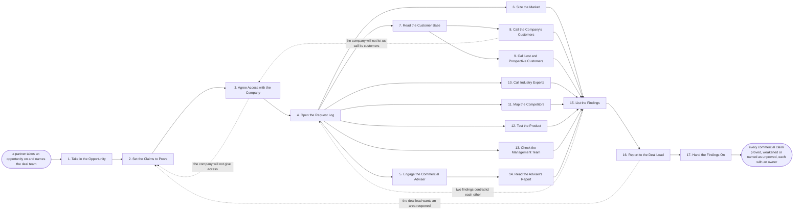

# Reference process: Run Commercial and Product Diligence

`ref/pc/run-commercial-and-product-diligence v1`

**value stream:** [Opportunity-to-Recommendation](../../streams/private-capital/opportunity-to-recommendation.md)
A partner has taken an opportunity on, and the deal team has a thesis
about why the company will win. This process tests the commercial half
of it: how large the market is and how fast it grows, who the customers
are and why they buy and stay, who the competitors are and what would
make a customer switch, and whether the product does what the company
says. The diligence-coordinator agent turns the thesis into claims to
prove and keeps one request log. The researcher agent sizes the market,
arranges and records the customer calls and the expert calls, maps the
competitors and takes the references on the management team. Every
finding is rated and given an owner, and the deal lead partner hears one
report that says which claims are proved, which are weakened and which
are still unproved.

## The goals

- Finish commercial diligence within [4 weeks]
- Rate [100%] of thesis claims proved or not
- Hold diligence costs under [1%] of the deal value

## The activities

| # | Activity | What happens | Agents |
|---|---|---|---|
| 1 | Take in the Opportunity | the thesis, the company and the deal team | [diligence-coordinator](../../agents/diligence-coordinator.md) |
| 2 | Set the Claims to Prove | the market, customer, competitor and product claims | diligence-coordinator · deal lead partner (person) |
| 3 | Agree Access with the Company | data, people, customers and the product, by when | diligence-coordinator · deal lead partner (person) |
| 4 | Open the Request Log | every request numbered, every answer dated | diligence-coordinator |
| 5 | Engage the Commercial Adviser | scope and fee agreed, and the engagement letter signed | deal lead partner (person) · diligence-coordinator |
| 6 | Size the Market | the market measured from the bottom up, with sources | [researcher](../../agents/researcher.md) |
| 7 | Read the Customer Base | who buys, how much, and how long they stay | researcher · diligence-coordinator |
| 8 | Call the Company's Customers | customers asked why they buy, stay and would leave | researcher |
| 9 | Call Lost and Prospective Customers | why some chose a competitor, or did not buy at all | researcher |
| 10 | Call Industry Experts | people who know the market, under the firm's call rules | researcher |
| 11 | Map the Competitors | who else wins these customers, and on what | researcher |
| 12 | Test the Product | the product used on real cases, and its roadmap read | technical reviewer (person) · diligence-coordinator |
| 13 | Check the Management Team | references, track record, and the roles still to fill | researcher · deal lead partner (person) |
| 14 | Read the Adviser's Report | the commercial report read against the claims | diligence-coordinator |
| 15 | List the Findings | every finding rated, with an owner and a date | diligence-coordinator |
| 16 | Report to the Deal Lead | each claim proved, weakened or unproved | deal lead partner (person) · diligence-coordinator |
| 17 | Hand the Findings On | to the model, the memo and the other diligence | diligence-coordinator |

**Venture and buyout.** For a venture deal there is little history to
test, so the product, the founders and the early customers carry most
of the weight. For a buyout, an outside adviser often writes a
commercial report that the lenders also read.

This is one of three diligence processes that run side by side once a
partner takes an opportunity on. `ref/pc/run-financial-diligence`
rebuilds the numbers and `ref/pc/run-legal-and-compliance-diligence`
checks the documents and the people. All three hand their rated findings
to `ref/pc/build-the-investment-model` and
`ref/pc/write-the-investment-memo`.

## The graph



## The document, with the blanks marked

```
PROCESS: commercial and product diligence  id: <team>/run-commercial-and-product-diligence   v1
from: ref/pc/run-commercial-and-product-diligence v1
owner: <who>                          effective: <date>
trigger: a partner takes an opportunity on and names the deal team, in
         <your deal pipeline>
         watch: record=<opportunity> system=<your deal pipeline>
                change=<the opportunity moves to diligence>
concurrency: runs may overlap - <how many> diligence runs live at once,
             and one company is in one commercial diligence run at a time
goal: every commercial claim the thesis rests on proved, weakened or
      written down as unproved within <weeks>, each finding rated and
      owned, and one report to the deal lead partner
phases:
  take-in-opportunity  - human: read the opportunity and its screen note,
                         and write down every commercial claim the thesis
                         rests on as a numbered list
                         owner: diligence-coordinator   after: trigger
                         automation: <level>
  set-claims           - convenes decide-and-announce: the claims about
                         the market, the customers, the competitors and
                         the product that must be proved, what is out of
                         scope, and how deep each area goes
                         owner: <your deal lead role>
                         after: take-in-opportunity     by: <days>
                         automation: <level>
  agree-access         - human: what the company will give, to whom and
                         by when, covering data, management time,
                         customer names and use of the product, under the
                         confidentiality agreement in force
                         owner: diligence-coordinator   after: set-claims
                         by: <days>                     automation: <level>
  open-log             - runs collect-and-report: one numbered request
                         list, every answer dated and attributed, nothing
                         held in anybody's memory or inbox
                         owner: diligence-coordinator   after: agree-access
                         automation: <level>
  engage-adviser       - convenes approval: where an outside commercial
                         adviser is used, the scope, the fee and the
                         timing agreed and the engagement letter signed
                         by <who>
                         owner: <your deal lead role>   after: open-log
                         by: <days>                     automation: never
  size-market          - runs assessment: the market measured from the
                         number of buyers and what each spends, set beside
                         the published figures, every source dated
                         owner: researcher              after: open-log
                         by: <days>                     automation: <level>
  read-customer-base   - runs collect-and-report: who buys, how much, how
                         long they stay, how concentrated the revenue is,
                         and which customers the calls should reach
                         owner: researcher              after: open-log
                         by: <days>                     automation: <level>
  call-customers       - runs collect-and-report: <n> of the company's
                         customers asked why they bought, what they would
                         miss and what would make them leave, recorded in
                         their own words
                         owner: researcher     after: read-customer-base
                         by: <weeks>                    automation: <level>
  call-lost-customers  - runs collect-and-report: <n> customers who left,
                         and <n> buyers who chose a competitor, asked why
                         owner: researcher     after: read-customer-base
                         by: <weeks>                    automation: <level>
  call-experts         - runs collect-and-report: <n> calls with people
                         who know the market, held under
                         <your expert call policy>, with each expert's
                         background and conflicts recorded
                         owner: researcher              after: open-log
                         by: <weeks>                    automation: <level>
  map-competitors      - runs assessment: who else wins these customers,
                         whether on price, product or reach, and what a
                         customer would need to switch
                         owner: researcher              after: open-log
                         by: <weeks>                    automation: <level>
  test-product         - runs assessment: the product used on <n> real
                         cases, its roadmap read against what customers
                         asked for, and the company's claims checked
                         against what actually ran
                         owner: <your technical reviewer role>
                         after: open-log                by: <weeks>
                         automation: <level>
  check-management     - runs collect-and-report: references on the
                         founders and leaders from people on and off the
                         list they gave, their record, and the roles still
                         to fill
                         owner: researcher              after: open-log
                         by: <weeks>                    automation: <level>
  read-adviser-report  - runs assessment: the adviser's report read claim
                         by claim against the calls and the sources, with
                         every disagreement recorded. Where no adviser is
                         engaged, this records that none was
                         owner: diligence-coordinator
                         after: engage-adviser          automation: <level>
  list-findings        - runs collect-and-report: every finding written
                         once, rated <your rating scale>, with the
                         evidence, the claim it settles, an owner and a
                         date
                         owner: diligence-coordinator
                         after: size-market + call-customers +
                         call-lost-customers + call-experts +
                         map-competitors + test-product +
                         check-management + read-adviser-report
                         by: <days>                     automation: <level>
  report-deal-lead     - convenes decide-and-announce: each claim reported
                         as proved, weakened or unproved, with the
                         evidence and every area that was cut from scope
                         owner: <your deal lead role>
                         after: list-findings           by: <days>
                         automation: <level>
  hand-on              - convenes briefing: the rated findings handed to
                         the investment model, the memo, and the financial
                         and legal diligence runs on the same company
                         owner: diligence-coordinator
                         after: report-deal-lead        automation: <level>
run-scoped:
  request-status - runs roll-call            owner: diligence-coordinator
                   every: <cadence>
                   from: open-log        until: list-findings
  cost-log       - runs allocate-and-reconcile
                   owner: <your finance role>
                   from: engage-adviser  until: run close
handoffs:
  take-in-opportunity -> set-claims [claims-to-prove]: the numbered
    commercial claims the thesis rests on, each marked as provable or as
    opinion
  set-claims -> agree-access [scope-and-evidence]: the claims in scope,
    how deep each goes, and what evidence would settle each one
  agree-access -> open-log [access-agreed]: what the company agreed to
    give, to whom, by when, and under which agreement
  open-log -> engage-adviser / size-market / read-customer-base /
    call-experts / map-competitors / test-product / check-management
    [request-list]: the request list, and the person on each side who
    owns every open request
  engage-adviser -> read-adviser-report [adviser-engagement]: the signed
    scope, the fee and the date the report is due
  size-market -> list-findings [market-size]: the market from the bottom
    up beside the published figures, with every source dated
  read-customer-base -> call-customers / call-lost-customers
    [customer-base]: the customer base, its concentration, and the names
    the calls should reach
  call-customers -> list-findings [customer-accounts]: what customers
    said in their own words, with the count that would not speak
  call-lost-customers -> list-findings [lost-customer-accounts]: why
    customers left or chose a competitor, in their own words
  call-experts -> list-findings [expert-accounts]: what each expert said,
    with their background and conflicts
  map-competitors -> list-findings [competitor-map]: the competitors, how
    each wins, and what a customer would need to switch
  test-product -> list-findings [product-results]: the product as it ran
    on real cases, with every failure recorded
  check-management -> list-findings [management-references]: what the
    references said, and who gave them
  read-adviser-report -> list-findings [adviser-reading]: the adviser's
    conclusions, and where the calls and sources disagree with them
  list-findings -> report-deal-lead [rated-findings]: every finding once,
    rated, with its evidence, its owner and the claim it settles or
    leaves open
  report-deal-lead -> hand-on [commercial-report]: each claim proved,
    weakened or unproved, and the areas cut from scope
deviations:
  agree-access -> set-claims [access-refused]: the company will not give
    access, so the claims that cannot be proved are cut from scope in
    writing and reported as cut
  call-customers -> agree-access [calls-refused]: the company will not let
    the firm call its customers, so access is worked again before any
    customer claim is called proved
  list-findings -> open-log [findings-contradict]: two findings contradict
    each other, so the request is reopened and both stay in the log with
    their dates
  report-deal-lead -> set-claims [area-reopened]: the deal lead sends an
    area back, so the scope reopens for that area only and the earlier
    report is kept as superseded
bindings:
  roster:  <who holds each role - agents claiming the abstract agents
           above, and named people for the deal lead partner, the
           technical reviewer, the commercial adviser and the person
           who signs engagements>
  systems: the deal pipeline (write), the data room (read), the request
           log (write), the research library (write), the calendar
           (write), <your expert network> (read),
           <your market data sources> (read)
  data:    the screen note and the thesis <version>, the confidentiality
           agreement, <your diligence checklist> <version>,
           <your rating scale>, <your expert call policy> <version>
policy:
  a claim with no evidence behind it is reported as unproved, and is
    never reported as proved because nobody objected
  every request and every answer lives in the request log, and an answer
    given only in a meeting is written into the log before it counts
  a customer of the company is called only as the access agreement
    allows, and is told who is calling and why
  no expert is asked for an employer's confidential information, and
    material non-public information about a listed company ends the call
    and goes to <your compliance role> the same day
  what a customer or an expert said is recorded in their own words, with
    the count of those who would not speak
  the adviser's report is evidence to test, and its conclusions are held
    to the calls and the sources like any other claim
  a demonstration the company gives is recorded as a demonstration, and
    only what the reviewer ran is recorded as a test
  the adviser's engagement letter is signed by a person, and the fee is
    approved before the work starts
  a finding nobody will own is escalated to <who>
measures:
  cycle time: <weeks> from the opportunity to the report to the deal lead
  evidence: <target> share of claims settled with evidence
  reach: <n> customer and expert calls per run, with the share that
         declined
  volume: <diligence runs per period>
  quality gate: every finding carries evidence, a rating and an owner,
                and no unproved claim is reported as proved
```

## The failure edges

- **The company will not give access.** The request stays open, the run
  goes back to the scope, and the claims that cannot be proved are cut
  in writing. They are then reported as cut, so the memo cannot present
  them as clean. A company that gives no access at all ends the run.
- **The company will not let the firm call its customers.** The
  researcher agent records the refusal and the run returns to the access
  agreement. Calls the company arranges and sits in on are recorded as
  such, and customers found through the firm's own network are called
  only as the agreement allows.
- **An expert call strays into confidential information.** The call
  stops, the researcher agent records where it stopped, and anything
  that sounds like material non-public information about a listed
  company goes to the chief compliance officer the same day.
- **Two findings contradict each other.** The diligence-coordinator agent
  reopens the request and keeps both answers in the log with their
  dates. The contradiction is a finding whether or not it is resolved.
- **The adviser's report and the calls disagree.** The disagreement goes
  into the findings with both sources, and the deal lead decides which
  to rely on, in writing. A conclusion from the adviser does not
  overwrite what customers said.
- **The product does not do what the pitch said.** The findings carry
  what actually ran, on which cases, and how it failed. The thesis is
  not rewritten to match, and the gap goes to the deal lead as a finding
  to price, condition or treat as a stop.
- **The timetable leaves no time.** In a sale process the bank's
  deadline can arrive before the calls are done. The areas still open
  are cut in writing and named as unproved in the report, so the memo
  carries them as open questions.
- **The deal lead sends an area back.** The scope reopens for that area
  only, the request log carries the new requests, and the earlier report
  is kept as superseded. Both versions stay.
- **The trigger fires while a run is in flight.** One company is in one
  commercial diligence run at a time. A second deal team asking about
  the same company joins the open run, and a follow-on round in a
  company the fund holds starts a new run that reads the last one.
- **A run is abandoned.** The company is told diligence has stopped and
  by whom. Material received under confidentiality is returned or
  destroyed as the agreement requires, and the destruction is recorded.
  The findings gathered so far are kept with the reason the run stopped,
  the request log is closed with its open items listed, and the cost
  line reconciles anyway.
