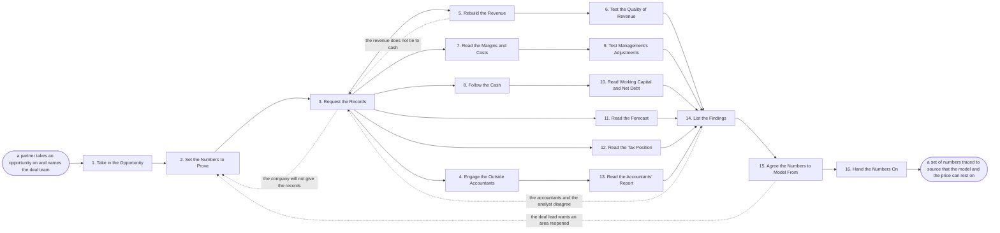

# Reference process: Run Financial Diligence

`ref/pc/run-financial-diligence v1`

**value stream:** [Due diligence](../../streams/private-capital/opportunity-to-recommendation.md)
The price the firm offers will rest on the company's numbers, and the
numbers in a pitch or an information memorandum are the seller's. This
process rebuilds them from the company's own records. The
financial-analyst agent ties the reported revenue to invoices, contracts
and cash received, splits recurring revenue from one-off revenue, reads
the margins and the costs line by line, follows the cash, and tests each
adjustment management proposes to its earnings. Where outside
accountants are engaged, their report is read against the analyst's own
figures and every difference is closed or left open on the record. The
deal lead partner agrees the numbers the model will use, each one traced
to its source, and the run closes when they are handed on.

**delivers:** report, a financial diligence report

## The goals

- Rebuild the numbers within [3 weeks]
- Trace [100%] of figures to company records
- Keep earnings surprises after closing under [5%]
- Hold accountants' fees within [the budget]

## The activities

| # | Activity | What happens | Agents |
|---|---|---|---|
| 1 | Take in the Opportunity | the thesis and the numbers the price will rest on | [diligence-coordinator](../../agents/diligence-coordinator.md) · [financial-analyst](../../agents/financial-analyst.md) |
| 2 | Set the Numbers to Prove | revenue, margins, cash and the proposed adjustments | diligence-coordinator · deal lead partner (person) |
| 3 | Request the Records | ledgers, invoices, contracts, bank and payroll records | diligence-coordinator |
| 4 | Engage the Outside Accountants | scope and fee agreed, and the engagement letter signed | deal lead partner (person) · diligence-coordinator |
| 5 | Rebuild the Revenue | revenue tied to invoices, contracts and cash received | financial-analyst |
| 6 | Test the Quality of Revenue | recurring or one-off, by customer, product and cohort | financial-analyst |
| 7 | Read the Margins and Costs | gross margin and each cost line, period by period | financial-analyst |
| 8 | Follow the Cash | cash flow, burn and runway, and earnings turned into cash | financial-analyst |
| 9 | Test Management's Adjustments | each proposed adjustment accepted, cut or left open | financial-analyst · outside accountant (person) |
| 10 | Read Working Capital and Net Debt | the normal level, and what counts as debt | financial-analyst · outside accountant (person) |
| 11 | Read the Forecast | management's plan against its own past accuracy | financial-analyst |
| 12 | Read the Tax Position | taxes owed, filed and exposed, with the adviser | tax adviser (person) · financial-analyst |
| 13 | Read the Accountants' Report | their findings read against the analyst's figures | diligence-coordinator · financial-analyst |
| 14 | List the Findings | every finding rated, with an owner and a date | diligence-coordinator |
| 15 | Agree the Numbers to Model From | the figures the model and the price will use | deal lead partner (person) · financial-analyst |
| 16 | Hand the Numbers On | to the model, the memo and the other diligence | financial-analyst · diligence-coordinator |

**Venture and buyout.** For a venture deal the work is lighter and
centers on cash burn, runway and unit economics. For a buyout, outside
accountants test the earnings that the price and the debt rest on, and
set the working capital and net debt that the price is adjusted by.

The agreed numbers go to `ref/pc/build-the-investment-model`, and the
rated findings go to `ref/pc/write-the-investment-memo`. A finding on
who owns the shares or what a contract permits belongs to
`ref/pc/run-legal-and-compliance-diligence`, and the two runs read each
other's findings.

## The graph



## The document, with the blanks marked

```
PROCESS: financial diligence          id: <team>/run-financial-diligence   v1
from: ref/pc/run-financial-diligence v1
owner: <who>                          effective: <date>
trigger: a partner takes an opportunity on and names the deal team, in
         <your deal pipeline>
         watch: record=<opportunity> system=<your deal pipeline>
                change=<the opportunity moves to diligence>
concurrency: runs may overlap - <how many> diligence runs live at once,
             and one company is in one financial diligence run at a time
goal: the numbers the price and the model will rest on rebuilt from the
      company's own records within <weeks>, every figure traced to its
      source and every adjustment accepted, cut or left open with its
      reason
phases:
  take-in-opportunity  - human: read the opportunity, the screen note and
                         the seller's numbers, and write down every figure
                         the thesis and the price would rest on
                         owner: diligence-coordinator   after: trigger
                         automation: <level>
  set-numbers          - convenes decide-and-announce: the figures that
                         must be proved, the periods they cover, how deep
                         each goes, and what is left to the outside
                         accountants
                         owner: <your deal lead role>
                         after: take-in-opportunity     by: <days>
                         automation: <level>
  request-records      - runs collect-and-report: the ledgers, invoices,
                         contracts, bank statements, payroll and tax
                         filings for <periods>, requested once in the
                         request log and tracked
                         owner: diligence-coordinator   after: set-numbers
                         by: <days>                     automation: <level>
  engage-accountants   - convenes approval: where outside accountants are
                         used, the scope, the fee and the timing agreed
                         and the engagement letter signed by <who>
                         owner: <your deal lead role>
                         after: request-records         by: <days>
                         automation: never
  rebuild-revenue      - runs assessment: reported revenue tied line by
                         line to invoices, contracts and cash received in
                         the bank, with every gap recorded
                         owner: financial-analyst  after: request-records
                         by: <days>                     automation: <level>
  test-revenue-quality - runs assessment: recurring and one-off revenue
                         split out by customer, product and cohort, with
                         concentration, retention and price changes
                         owner: financial-analyst  after: rebuild-revenue
                         automation: <level>
  read-margins         - runs assessment: gross margin and each cost line
                         period by period, with the costs that move with
                         revenue and the ones that do not
                         owner: financial-analyst  after: request-records
                         by: <days>                     automation: <level>
  follow-cash          - runs assessment: cash flow from the bank
                         statements, the burn and the runway, and how much
                         of the reported earnings turned into cash
                         owner: financial-analyst  after: request-records
                         by: <days>                     automation: <level>
  test-adjustments     - runs assessment: each adjustment management
                         proposes to its earnings accepted with evidence
                         that it will not recur, cut, or left open with
                         the reason
                         owner: financial-analyst  after: read-margins
                         automation: <level>
  read-working-capital - runs assessment: the normal level of working
                         capital over <months>, and every item that counts
                         as debt or as cash when the price is set
                         owner: financial-analyst  after: follow-cash
                         automation: <level>
  read-forecast        - runs assessment: management's forecast read
                         against how accurately it forecast the last
                         <periods>, with the assumptions that carry it
                         owner: financial-analyst  after: request-records
                         by: <days>                     automation: <level>
  read-tax             - runs assessment: taxes owed, filings made, open
                         audits, and exposures from past structuring, with
                         the tax adviser's view recorded as the adviser's
                         owner: <your tax role>    after: request-records
                         by: <weeks>                    automation: <level>
  read-accountants     - runs assessment: the outside accountants' report
                         read against the analyst's figures, with every
                         difference closed or left open on the record.
                         Where none are engaged, this records that none
                         were
                         owner: diligence-coordinator
                         after: engage-accountants      automation: <level>
  list-findings        - runs collect-and-report: every finding written
                         once, rated <your rating scale>, with the figure,
                         its source, an owner and a date
                         owner: diligence-coordinator
                         after: test-revenue-quality + test-adjustments +
                         read-working-capital + read-forecast + read-tax +
                         read-accountants
                         by: <days>                     automation: <level>
  agree-numbers        - convenes decide-and-announce: the revenue,
                         earnings, cash, working capital and net debt the
                         model will use, each with its source and its
                         adjustments
                         owner: <your deal lead role>
                         after: list-findings           by: <days>
                         automation: <level>
  hand-on              - convenes briefing: the agreed numbers and the
                         rated findings handed to the investment model,
                         the memo and the other diligence runs
                         owner: financial-analyst   after: agree-numbers
                         automation: <level>
run-scoped:
  request-status - runs roll-call            owner: diligence-coordinator
                   every: <cadence>
                   from: request-records     until: list-findings
  cost-log       - runs allocate-and-reconcile
                   owner: <your finance role>
                   from: engage-accountants  until: run close
handoffs:
  take-in-opportunity -> set-numbers [figures-to-prove]: every figure the
    thesis and the price would rest on, with where the seller stated it
  set-numbers -> request-records [numbers-in-scope]: the figures in
    scope, their periods, how deep each goes, and the accountants' part
  request-records -> engage-accountants / rebuild-revenue / read-margins /
    follow-cash / read-forecast / read-tax [records-received]: the
    records received, each logged with its period, and the ones still
    owed
  engage-accountants -> read-accountants [accountant-engagement]: the
    signed scope, the fee and the date the report is due
  rebuild-revenue -> test-revenue-quality [rebuilt-revenue]: revenue tied
    to invoices, contracts and cash, with every gap
  test-revenue-quality -> list-findings [revenue-quality]: recurring and
    one-off revenue, concentration and retention, by period
  read-margins -> test-adjustments [margins-and-costs]: the margins and
    each cost line, with the ones that do not move with revenue
  follow-cash -> read-working-capital [cash-reading]: the cash flow, the
    burn, the runway and the share of earnings that became cash
  test-adjustments -> list-findings [adjustment-results]: each adjustment
    accepted, cut or left open, with the evidence or the reason
  read-working-capital -> list-findings [working-capital-and-debt]: the
    normal working capital, and every item counted as debt or cash
  read-forecast -> list-findings [forecast-reading]: the forecast beside
    the company's past accuracy, and the assumptions that carry it
  read-tax -> list-findings [tax-position]: the taxes owed and filed, the
    exposures, and the adviser's view as the adviser's
  read-accountants -> list-findings [accountant-reading]: the accountants'
    findings, and each difference from the analyst's figures
  list-findings -> agree-numbers [rated-findings]: every finding once,
    rated, with its figure, its source and its owner
  agree-numbers -> hand-on [agreed-numbers]: the numbers the model will
    use, each with its source, its period and its adjustments
deviations:
  request-records -> set-numbers [records-refused]: the company will not
    give the records, so the figures that cannot be proved are cut from
    scope in writing and reported as management's figures
  rebuild-revenue -> request-records [revenue-does-not-tie]: the revenue
    does not tie to cash received, so the records behind the gap are
    requested before any revenue figure is called verified
  list-findings -> request-records [figures-disagree]: the accountants'
    figures and the analyst's disagree, so the records behind the
    difference are requested again and both figures stay on the record
  agree-numbers -> set-numbers [area-reopened]: the deal lead sends an
    area back, so the scope reopens for that area only
bindings:
  roster:  <who holds each role - agents claiming the abstract agents
           above, and named people for the deal lead partner, the outside
           accountants, the tax adviser and the person who signs
           engagements>
  systems: the deal pipeline (write), the data room (read), the request
           log (write), the notification channel (write),
           <your financial model> (write)
  data:    the seller's numbers or management accounts <version>, the
           confidentiality agreement, <your diligence checklist>
           <version>, <your rating scale>, <your adjustment policy>
           <version>
policy:
  every figure carries the source document and the period it was read
    from
  a figure management gives without a record behind it is reported as
    management's figure, and never as verified
  revenue counts as verified only when it ties to cash received
  an adjustment to earnings is accepted only with evidence that the cost
    or the income will not recur
  every difference between the accountants' figures and the analyst's is
    closed or left open on the record, and neither figure is dropped
  the accountants' engagement letter is signed by a person, and the fee
    is approved before the work starts
  the tax adviser's view is recorded as the adviser's
  the company's records are read only by the people the access agreement
    names
  a finding nobody will own is escalated to <who>
measures:
  cycle time: <weeks> from the opportunity to the agreed numbers
  traced: <target> share of the agreed figures traced to a source
          document
  adjustments: <target> share of proposed adjustments settled with
               evidence, whether accepted or cut
  volume: <diligence runs per period>
  quality gate: every agreed figure names its source and its period, and
                every adjustment names its evidence or why it was cut
```

## The failure edges

- **The company will not give the records.** The run goes back to the
  scope, and the figures that cannot be rebuilt are cut in writing and
  reported as management's figures. A seller who will give only a
  summary has told the firm something, and the memo says so.
- **The revenue does not tie to cash.** The financial-analyst agent
  records the gap, period by period, and the records behind it are
  requested. Revenue that cannot be tied is reported as unverified,
  whatever the audited accounts show.
- **An adjustment has no evidence.** A cost management calls one-off
  that appears every year is cut, with the years it appeared. An
  adjustment the evidence neither supports nor refutes stays open and
  goes to the deal lead, so the model cannot quietly assume it.
- **The accountants and the analyst disagree.** Both figures stay on the
  record, the records behind the difference are requested again, and
  the deal lead decides which figure the model uses, in writing.
- **The forecast is far from the company's past accuracy.** The
  forecast is carried beside the record of how close the last ones came,
  and the model is given both. A forecast is never recorded as a
  finding about the past.
- **A tax exposure turns up.** The tax adviser's view is recorded as the
  adviser's, the exposure is rated like any other finding, and it goes
  to the deal lead as something to price, cover with a promise from the
  seller, or treat as a stop.
- **The cash is shorter than the company said.** A runway shorter than
  the pitch claimed is raised to the deal lead the day it is found,
  because it changes the timetable of the deal as well as its price.
- **The deal lead sends an area back.** The scope reopens for that area
  only, the request log carries the new requests, and the agreed numbers
  are issued again at a new version with what changed.
- **The trigger fires while a run is in flight.** One company is in one
  financial diligence run at a time. A second request about the same
  company joins the open run, and a follow-on round in a company the
  fund holds starts a new run that reads the last one.
- **A run is abandoned.** The company is told diligence has stopped and
  by whom. Records received under confidentiality are returned or
  destroyed as the agreement requires and the destruction is recorded,
  the accountants are stopped in writing, the findings so far are kept
  with the reason the run stopped, and the cost line reconciles anyway.
