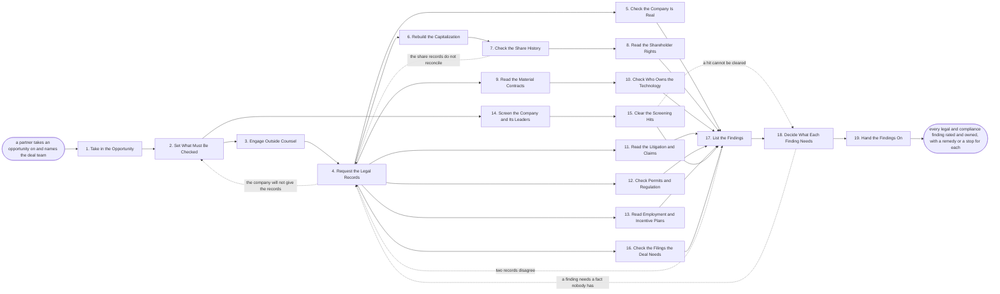

# Reference process: Run Legal and Compliance Diligence

`ref/pc/run-legal-and-compliance-diligence v1`

**value stream:** [Opportunity-to-Recommendation](../../streams/private-capital/opportunity-to-recommendation.md)
This process checks that the company the firm would invest in is what
its documents say it is, and that the firm may lawfully invest in it.
The cap-table-keeper agent rebuilds the capitalization table (cap table)
from the company's own records and reads the rights attached to every
share. Outside counsel reads the material contracts, the ownership of
the technology, the litigation, the permits and the employment
arrangements, and names the filings the deal would need. The
supplier-check agent screens the company, its owners and its leaders
against registries, sanctions lists and adverse records, and the chief
compliance officer decides every hit before the run goes on. Every
finding is rated with an owner, and the deal lead partner decides which
problems are fixed in the documents, which are priced or covered by a
promise from the seller, and which stop the deal.

**delivers:** verdict

## The goals

- Finish legal diligence within [4 weeks]
- Have a person decide [100%] of screening hits
- Keep legal claims after closing at [zero]
- Hold counsel fees within [the budget]

## The activities

| # | Activity | What happens | Agents |
|---|---|---|---|
| 1 | Take in the Opportunity | the company, the structure proposed, and the deal team | [diligence-coordinator](../../agents/diligence-coordinator.md) |
| 2 | Set What Must Be Checked | the areas, how deep each goes, and who reads each | diligence-coordinator · deal lead partner (person) |
| 3 | Engage Outside Counsel | scope and fee agreed, and the engagement letter signed | deal lead partner (person) · diligence-coordinator |
| 4 | Request the Legal Records | charter, share records, contracts, filings and claims | diligence-coordinator |
| 5 | Check the Company Is Real | registration, good standing, and who owns it | [supplier-check](../../agents/supplier-check.md) |
| 6 | Rebuild the Capitalization | every share, option, warrant and convertible, from records | [cap-table-keeper](../../agents/cap-table-keeper.md) |
| 7 | Check the Share History | each issue authorized, paid for and recorded | cap-table-keeper |
| 8 | Read the Shareholder Rights | preferences, vetoes, transfer limits and drag rights | cap-table-keeper · outside counsel (person) |
| 9 | Read the Material Contracts | change of control, exclusivity, and terms that bind | outside counsel (person) · diligence-coordinator |
| 10 | Check Who Owns the Technology | assignments from founders, staff and contractors | outside counsel (person) · diligence-coordinator |
| 11 | Read the Litigation and Claims | suits, threats, regulator letters and settlements | outside counsel (person) · supplier-check |
| 12 | Check Permits and Regulation | licenses, data protection and the sector's rules | outside counsel (person) · diligence-coordinator |
| 13 | Read Employment and Incentive Plans | key contracts, the option plan, and staff claims | outside counsel (person) · cap-table-keeper |
| 14 | Screen the Company and Its Leaders | sanctions, bribery exposure, adverse records, backgrounds | supplier-check |
| 15 | Clear the Screening Hits | each hit read and decided by the compliance officer | chief compliance officer (person) · supplier-check |
| 16 | Check the Filings the Deal Needs | competition, foreign investment and other approvals | outside counsel (person) · diligence-coordinator |
| 17 | List the Findings | every finding rated, with an owner and a date | diligence-coordinator |
| 18 | Decide What Each Finding Needs | fixed in the documents, priced, insured, or a stop | deal lead partner (person) · diligence-coordinator |
| 19 | Hand the Findings On | to the model, the memo and the deal documents | diligence-coordinator · cap-table-keeper |

**Venture and buyout.** For a venture deal, the founders' assignment of
the technology to the company and the cap table get the closest look.
For a buyout, the work adds the competition filings the change of
control needs, and often insurance against breaches of the seller's
promises.

The rebuilt capitalization goes to `ref/pc/build-the-investment-model`,
where the fund's ownership and preferences are modeled from it, and the
remedies go to `ref/pc/write-the-investment-memo` and on to
`ref/pc/issue-a-term-sheet`. A filing the deal needs is carried to the
closing checklist in `ref/pc/run-the-closing`.

## The graph



## The document, with the blanks marked

```
PROCESS: legal and compliance diligence  id: <team>/run-legal-and-compliance-diligence   v1
from: ref/pc/run-legal-and-compliance-diligence v1
owner: <who>                          effective: <date>
trigger: a partner takes an opportunity on and names the deal team, in
         <your deal pipeline>
         watch: record=<opportunity> system=<your deal pipeline>
                change=<the opportunity moves to diligence>
concurrency: runs may overlap - <how many> diligence runs live at once,
             and one company is in one legal diligence run at a time
goal: every legal and compliance finding rated and owned within
      <weeks>, every screening hit decided by a person, and each finding
      given a remedy or called a stop before the memo is written
phases:
  take-in-opportunity  - human: read the opportunity and the structure
                         proposed, and write down what the firm would be
                         buying, from whom, and what the documents must
                         show
                         owner: diligence-coordinator   after: trigger
                         automation: <level>
  set-scope            - convenes decide-and-announce: the areas to
                         check, how deep each goes, which are for counsel,
                         and the date each is due
                         owner: <your deal lead role>
                         after: take-in-opportunity     by: <days>
                         automation: <level>
  engage-counsel       - convenes approval: outside counsel's scope, fee
                         and timing agreed and the engagement letter
                         signed by <who>
                         owner: <your deal lead role>   after: set-scope
                         by: <days>                     automation: never
  request-records      - runs collect-and-report: the charter documents,
                         the share register and every issue, the material
                         contracts, filings, permits, employment records
                         and claims, requested once in the request log
                         owner: diligence-coordinator
                         after: engage-counsel          automation: <level>
  check-company        - runs assessment: registration, good standing,
                         the ownership chain up to the people who control
                         it, and whether the entity the fund would invest
                         in holds the business
                         owner: supplier-check     after: request-records
                         by: <days>                     automation: <level>
  rebuild-cap-table    - runs assessment: every share, option, warrant,
                         convertible note and promise of equity rebuilt
                         from the company's records, set beside the cap
                         table the company supplies
                         owner: cap-table-keeper   after: request-records
                         by: <days>                     automation: <level>
  check-share-history  - runs assessment: each issue and transfer checked
                         for board and shareholder approval, payment and
                         filing, with every gap recorded
                         owner: cap-table-keeper
                         after: rebuild-cap-table       automation: <level>
  read-share-rights    - runs assessment: liquidation preferences,
                         vetoes, pre-emption, transfer limits, drag and
                         tag rights, and anything the new money would
                         need waived
                         owner: cap-table-keeper
                         after: check-share-history     automation: <level>
  read-contracts       - runs assessment: the material contracts read for
                         change of control, exclusivity, most favoured
                         terms, assignment and termination, with the
                         clauses quoted
                         owner: <your legal role>  after: request-records
                         by: <weeks>                    automation: <level>
  check-tech-ownership - runs assessment: signed assignments from
                         founders, staff and contractors, the licenses the
                         product uses, and any claim a former employer
                         could make
                         owner: <your legal role>   after: read-contracts
                         by: <days>                     automation: <level>
  read-litigation      - runs assessment: suits filed and threatened,
                         letters from regulators, and settlements and
                         their terms, from the company and from public
                         records
                         owner: <your legal role>  after: request-records
                         by: <weeks>                    automation: <level>
  check-permits        - runs assessment: the licenses the business needs
                         and the ones it holds, its data protection
                         practice, and the rules of its sector
                         owner: <your legal role>  after: request-records
                         by: <weeks>                    automation: <level>
  read-employment      - runs assessment: the contracts of key people,
                         the option plan and its grants, payments due on a
                         change of control, and claims by staff
                         owner: <your legal role>  after: request-records
                         by: <weeks>                    automation: <level>
  screen-leaders       - runs assessment: the company, its owners, its
                         directors and its senior leaders screened against
                         sanctions lists, registries and adverse records,
                         background checks run under
                         <your screening policy>, and bribery exposure
                         read from where it sells, through whom, and to
                         which governments
                         owner: supplier-check          after: set-scope
                         by: <days>                     automation: <level>
  clear-hits           - convenes decide-and-announce: each screening hit
                         read by the chief compliance officer and cleared,
                         cleared with a condition, or called a stop, on
                         the record
                         owner: <your compliance role>
                         after: screen-leaders          by: <days>
                         automation: <level>
  check-deal-filings   - runs assessment: the competition, foreign
                         investment and sector approvals the deal would
                         need, how long each takes, and whether closing
                         must wait for them
                         owner: <your legal role>  after: request-records
                         by: <weeks>                    automation: <level>
  list-findings        - runs collect-and-report: every finding written
                         once, rated <your rating scale>, with the
                         evidence behind it, an owner and a date
                         owner: diligence-coordinator
                         after: check-company + read-share-rights +
                         check-tech-ownership + read-litigation +
                         check-permits + read-employment + clear-hits +
                         check-deal-filings
                         by: <days>                     automation: <level>
  decide-remedies      - convenes decide-and-announce: each finding fixed
                         in the deal documents, priced, covered by a
                         promise from the seller, insured, accepted in
                         writing, or called a stop
                         owner: <your deal lead role>
                         after: list-findings or clear-hits
                         by: <days>                     automation: <level>
  hand-on              - convenes briefing: the rated findings and their
                         remedies handed to the model, the memo and the
                         term sheet, and the rebuilt capitalization to
                         the cap table record
                         owner: diligence-coordinator
                         after: decide-remedies         automation: <level>
run-scoped:
  request-status - runs roll-call            owner: diligence-coordinator
                   every: <cadence>
                   from: request-records  until: list-findings
  cost-log       - runs allocate-and-reconcile
                   owner: <your finance role>
                   from: engage-counsel   until: run close
handoffs:
  take-in-opportunity -> set-scope [what-is-bought]: what the firm would
    buy, from whom, and what the documents must show
  set-scope -> engage-counsel / screen-leaders [legal-scope]: the areas in
    scope, how deep each goes, who reads each, and the dates
  engage-counsel -> request-records [counsel-engagement]: counsel's signed
    scope, fee and timetable
  request-records -> check-company / rebuild-cap-table / read-contracts /
    read-litigation / check-permits / read-employment /
    check-deal-filings [request-list]: the request list, the records
    received, and the person on each side who owns every open request
  check-company -> list-findings [company-record]: the entity, its owners
    and its standing, each with the source and the date read
  rebuild-cap-table -> check-share-history [rebuilt-capitalization]: the
    capitalization as the records show it, beside the company's own table
  check-share-history -> read-share-rights [share-history]: each issue
    and transfer with its approval, its payment and its filing, and the
    gaps
  read-share-rights -> list-findings [share-rights]: the rights on every
    class, and what the new money would need waived
  read-contracts -> check-tech-ownership [binding-clauses]: the clauses
    that bind the company or the deal, quoted
  check-tech-ownership -> list-findings [technology-ownership]: who owns
    each part of the technology, and where an assignment is missing
  read-litigation -> list-findings [claims-record]: every claim, threat
    and regulator letter, with its status
  check-permits -> list-findings [regulatory-position]: the licenses
    needed and held, and the rules the business does not yet meet
  read-employment -> list-findings [employment-position]: the key
    contracts, the option grants, the change of control payments and the
    claims
  screen-leaders -> clear-hits [screening-results]: the screens run, the
    sources, the date, and every hit
  clear-hits -> list-findings [cleared-hits]: each hit with the compliance
    officer's decision and any condition
  check-deal-filings -> list-findings [deal-filings]: the approvals the
    deal needs and how long each takes
  list-findings -> decide-remedies [rated-findings]: every finding once,
    rated, with its evidence and its owner
  decide-remedies -> hand-on [finding-remedies]: each finding with its
    remedy or its stop, and the person who decided
deviations:
  request-records -> set-scope [records-refused]: the company will not
    give the records, so the areas that cannot be checked are cut from
    scope in writing and reported as cut
  check-share-history -> request-records [shares-do-not-reconcile]: the
    share records do not reconcile with the company's table, so the
    records behind the gap are requested before any ownership figure is
    used
  clear-hits -> decide-remedies [hit-not-cleared]: the compliance officer
    cannot clear a hit, so it goes straight to the decision as a
    possible stop
  list-findings -> request-records [records-disagree]: two records
    disagree, so the request is reopened and both stay in the log with
    their dates
  decide-remedies -> request-records [fact-nobody-has]: deciding a
    remedy needs a fact nobody has, so it goes back to the log as a new
    request
bindings:
  roster:  <who holds each role - agents claiming the abstract agents
           above, and named people for the deal lead partner, outside
           counsel, the chief compliance officer and the person who signs
           engagements>
  systems: the deal pipeline (write), the data room (read), the request
           log (write), the cap table record (write),
           <your screening service> (read),
           <your company registry sources> (read),
           <your court and regulator records> (read)
  data:    the structure proposed <version>, the confidentiality
           agreement, <your diligence checklist> <version>,
           <your rating scale>, <your screening policy> <version>,
           <your sanctions lists>
policy:
  a screening hit stops the run on that company until the chief
    compliance officer has read it and written down what happens next
  the capitalization is rebuilt from the company's own records, and the
    table the company supplies is read as its claim
  a share issue with no approving record behind it is a finding,
    whatever the company says
  technology with no signed assignment behind it is reported as not owned
    by the company until counsel says otherwise in writing
  background checks on individuals follow <your screening policy> and the
    law where each person lives
  counsel's engagement letter is signed by a person, and counsel's view
    is recorded as counsel's
  a filing the deal needs is handed to the closing checklist with the
    time it takes
  material received under confidentiality is read only by the people the
    access agreement names
  a finding nobody will own is escalated to <who>
measures:
  cycle time: <weeks> from the opportunity to the remedies decided
  screening: <target> share of hits decided within <days>
  capitalization: <target> share of shares and rights traced to an
                  approving record
  volume: <diligence runs per period>
  quality gate: every finding carries evidence, a rating, an owner and a
                remedy, and every screening hit carries the compliance
                officer's decision
```

## The failure edges

- **The company will not give the records.** The run goes back to the
  scope, and the areas that cannot be checked are cut in writing and
  reported as cut. A company that will not show its share register ends
  the run, because the fund cannot know what it would own.
- **The share records do not reconcile.** The cap-table-keeper agent
  records each gap between the records and the company's table, and the
  records behind it are requested. No ownership figure goes to the model
  until the gap is closed or named as a finding.
- **The technology was never assigned.** A founder, an early employee
  or a contractor who never signed an assignment is a finding that goes
  to the deal lead as something to fix before closing. Counsel's view
  is recorded as counsel's, and the company's assurance is recorded as
  an assurance.
- **A screening hit comes back.** The run stops on that company until
  the chief compliance officer has read the hit and written down what
  happens next. A false positive is cleared on the record. A hit that
  cannot be cleared goes straight to the decision as a possible stop.
- **A contract forbids the deal.** A change of control clause or an
  exclusivity that the deal would breach is quoted, and the finding goes
  to the deal lead as a structural problem. The structure changes, the
  counterparty's consent becomes a condition of closing, or the deal
  stops.
- **A filing would take longer than the timetable.** Counsel names the
  approval and how long it takes, and the deal lead decides whether the
  timetable moves or closing waits. The filing goes to the closing
  checklist either way.
- **Two records disagree, or a remedy needs a fact nobody has.** The
  request is reopened with both records kept and dated. The
  disagreement is a finding whether or not it is resolved.
- **The trigger fires while a run is in flight.** One company is in one
  legal diligence run at a time. A second request about the same company
  joins the open run, and a follow-on round in a company the fund holds
  starts a new run that reads the cap table the firm already keeps.
- **A run is abandoned.** The company is told diligence has stopped and
  by whom. Counsel is stopped in writing, material received under
  confidentiality is returned or destroyed as the agreement requires and
  the destruction is recorded, open screening hits stay with the
  compliance officer until each one is decided, and the cost line
  reconciles anyway.
