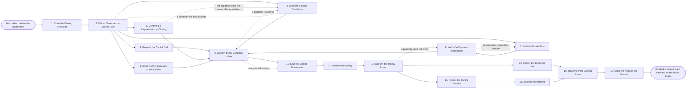

# Reference process: Run the Closing

`ref/pc/run-the-closing v1`

**value stream:** [Recommendation-to-Close](../../streams/private-capital/recommendation-to-close.md)
Both sides have confirmed the agreed text, and the deal now has to close.
The close-plan-keeper agent lists every condition to closing once, puts
one owner and one date on each, and chases each one until it is done with
its evidence. The cap-table-keeper agent confirms the company's
capitalization as it will stand at closing, the signature-manager agent
confirms who signs each document and in what order, and the wire-check
agent verifies every payment instruction through a channel independent of
the one it arrived on. People sign, and a named person releases the money
once every condition is met. The run closes when every payee has
confirmed receipt, the executed set is filed, the fund's position is in
the cap table record and on the fund's books, and what the agreements
still owe after closing has an owner and a date.

**delivers:** deal

## The goals

- Close on [the target closing date]
- Pay [100%] of money to verified accounts
- Waive no more than [1] closing condition
- Clear post-closing items within [60 days]

## The activities

| # | Activity | What happens | Agents |
|---|---|---|---|
| 1 | Open the Closing Checklist | every condition from the agreed text, listed once | [close-plan-keeper](../../agents/close-plan-keeper.md) |
| 2 | Put an Owner and a Date on Each | one owner and one date on every condition | close-plan-keeper |
| 3 | Request the Capital Call | the amount and the date the fund must hold cash | close-plan-keeper · chief financial officer (person) |
| 4 | Work the Closing Conditions | consents, filings and approvals chased to done | close-plan-keeper |
| 5 | Confirm the Capitalization at Closing | the cap table as it will stand once the deal closes | [cap-table-keeper](../../agents/cap-table-keeper.md) |
| 6 | Confirm Who Signs and in What Order | each signer, the authority and the documents | [signature-manager](../../agents/signature-manager.md) |
| 7 | Build the Funds Flow | every payment, payee, amount and account in one sheet | close-plan-keeper · cap-table-keeper |
| 8 | Verify the Payment Instructions | each account confirmed on an independent call | [wire-check](../../agents/wire-check.md) |
| 9 | Confirm Every Condition Is Met | each condition done with evidence, or waived | close-plan-keeper · outside counsel (person) |
| 10 | Sign the Closing Documents | each signer signs in the agreed order | fund signatory (person) · signature-manager |
| 11 | Release the Money | the funds flow wired on the closing date | chief financial officer (person) · second signer (person) |
| 12 | Confirm the Money Arrived | each payee's receipt matched to the funds flow | wire-check |
| 13 | Collect the Executed Set | every signed document and exhibit, filed | signature-manager |
| 14 | Record the Fund's Position | shares, class, price and rights on the record | cap-table-keeper |
| 15 | Book the Investment | the cost and the holding in the fund's accounts | controller (person) · cap-table-keeper |
| 16 | Track the Post-Closing Items | what the agreements owe after closing, with dates | close-plan-keeper |
| 17 | Close the Plan on the Record | what slipped and why, for the next closing | close-plan-keeper |

**Venture and buyout.** In venture, several investors often close
together, and a round is sometimes paid in tranches tied to milestones.
In a buyout, the lenders fund at the same closing, the company's old debt
is paid off, and every payment follows one funds flow.

## The graph



## The document, with the blanks marked

```
PROCESS: run the closing              id: <team>/run-the-closing   v1
from: ref/pc/run-the-closing v1
owner: <who>                          effective: <date>
trigger: both sides confirm the agreed text and it is handed to the
         closing, in <your deal pipeline>
         watch: record=<agreed text> system=<your deal pipeline>
                change=<the agreed text is handed to the closing>
concurrency: runs may overlap - <how many> closings may be open at once,
             one deal has one closing run at a time, and a later tranche
             of the same round is its own run
goal: the deal closed on <the target closing date> or within <days> of
      the agreed text, with every condition met or waived in writing,
      every payment made to a verified account, and the fund's position
      recorded on the closing date
phases:
  open-checklist          - runs collect-and-report: every condition to
                            closing in the agreed text, listed once,
                            with the side that owes it and the clause
                            it comes from
                            owner: close-plan-keeper  after: trigger
                            automation: <level>
  assign-owners           - human: one named owner and one date on each
                            condition, counted back from the closing date
                            owner: close-plan-keeper
                            after: open-checklist
                            automation: <level>
  request-capital-call    - human: the amount the fund must pay and the
                            date it must hold the cash, sent to
                            ref/pc/issue-a-capital-call or drawn on
                            <your fund's credit line>
                            owner: <your finance role>
                            after: assign-owners      by: <days>
                            automation: <level>
  work-conditions         - runs roll-call: each consent, filing, lender
                            condition and approval chased with its owner
                            until it is done with evidence
                            owner: close-plan-keeper
                            after: assign-owners
                            every: <cadence>          automation: <level>
  confirm-capitalization  - runs assessment: the company's cap table as
                            it will stand at closing, read against the
                            agreed text, share class by share class
                            owner: cap-table-keeper
                            after: assign-owners      automation: <level>
  confirm-signers         - runs collect-and-report: each signer on each
                            side, the authority each signs under, the
                            documents each signs and the order
                            owner: signature-manager
                            after: assign-owners      automation: <level>
  build-funds-flow        - human: every payment the closing makes, with
                            its payee, amount, account and the clause
                            that requires it, in one sheet at a version
                            owner: close-plan-keeper
                            after: assign-owners      automation: <level>
  verify-instructions     - runs assessment: each payee's account
                            confirmed by a call to a contact the firm
                            already held, independent of the message the
                            instruction came in
                            owner: wire-check
                            after: build-funds-flow   automation: <level>
  confirm-conditions-met  - convenes approval: each condition marked done
                            with its evidence, or waived in writing by
                            <who>, and the fund's cash confirmed in place
                            owner: close-plan-keeper
                            after: request-capital-call +
                            work-conditions + confirm-capitalization +
                            confirm-signers + verify-instructions
                            by: <days>                automation: <level>
  sign-documents          - convenes approval: each signer signs in the
                            agreed order, <your fund signatory role>
                            signing for the fund under <your delegation
                            of authority>
                            owner: <your fund signatory role>
                            after: confirm-conditions-met
                            automation: never
  release-money           - convenes approval: <your finance role>
                            releases the funds flow in <your bank portal>
                            under <your dual control rule>, payment by
                            payment against the verified sheet
                            owner: <your finance role>
                            after: sign-documents     automation: never
  confirm-receipts        - runs collect-and-report: each payee's receipt
                            confirmed and matched to the funds flow line
                            it pays
                            owner: wire-check         after: release-money
                            by: <hours>               automation: <level>
  collect-executed-set    - runs assessment: every signed document and
                            each exhibit it names, filed complete at its
                            executed version
                            owner: signature-manager
                            after: confirm-receipts   automation: <level>
  record-position         - system: the fund's shares, their class, the
                            price paid, the preferences and the rights,
                            written to the cap table record on the
                            closing date
                            owner: cap-table-keeper
                            after: confirm-receipts   automation: <level>
  book-investment         - human: the cost and the holding entered in
                            the fund accounting system, matched to the
                            cash that left the fund
                            owner: <your controller role>
                            after: record-position    automation: <level>
  track-post-closing      - runs roll-call: every item the agreements owe
                            after closing, such as filings, price
                            adjustments and deferred payments, with an
                            owner and a date
                            owner: close-plan-keeper
                            after: collect-executed-set + book-investment
                            every: <cadence>          automation: <level>
  close-plan              - convenes debrief: what slipped, why, and what
                            the next closing should plan differently
                            owner: close-plan-keeper
                            after: track-post-closing automation: <level>
run-scoped:
  status - runs roll-call                     owner: close-plan-keeper
           every: <cadence>
           from: assign-owners      until: sign-documents
  funds  - runs allocate-and-reconcile        owner: wire-check
           from: build-funds-flow   until: confirm-receipts
handoffs:
  open-checklist -> assign-owners [condition-list]: every condition to
    closing, the side that owes it and the clause it comes from
  assign-owners -> request-capital-call / work-conditions /
    confirm-capitalization / confirm-signers / build-funds-flow
    [closing-plan]: each condition with one owner and one date, and the
    closing date they count back from
  request-capital-call -> confirm-conditions-met [cash-request]: the
    amount, the date the cash is due and the capital call run or draw
    that provides it
  work-conditions -> confirm-conditions-met [condition-evidence]: each
    condition done with its evidence, or still open with its owner
  confirm-capitalization -> confirm-conditions-met [closing-cap-table]:
    the cap table at closing, matched to the agreed text
  confirm-signers -> confirm-conditions-met [signature-path]: the
    signers, their authority, the documents and the order
  build-funds-flow -> verify-instructions [funds-flow]: every payment
    with its payee, amount, account and clause, at a version
  verify-instructions -> confirm-conditions-met [verified-accounts]: each
    account verified, with who was called, on what number, and when
  confirm-conditions-met -> sign-documents [closing-cleared]: every
    condition done or waived in writing, with the evidence filed
  sign-documents -> release-money [executed-documents]: the signed
    documents and the time the last signature landed
  release-money -> confirm-receipts [payments-released]: each payment
    released, with its reference and the person who released it
  confirm-receipts -> collect-executed-set / record-position
    [receipts-matched]: each payee's receipt matched to its line
  collect-executed-set -> track-post-closing [executed-set]: the filed
    set, with every exhibit marked present
  record-position -> book-investment [fund-position]: the fund's shares,
    class, price, preferences and rights at closing
  book-investment -> track-post-closing [booked-investment]: the entry in
    the fund's accounts, matched to the cash that left
  track-post-closing -> close-plan [post-closing-items]: each item owed
    after closing, with its owner and its date
deviations:
  work-conditions -> assign-owners [condition-will-miss]: a condition
    will miss its date, so the plan is dated again and every condition
    behind it moves with it
  confirm-capitalization -> work-conditions [cap-table-mismatch]: the cap
    table does not match the agreed text, so the correction becomes a
    condition to closing with an owner and a date
  verify-instructions -> build-funds-flow [instruction-unverified]: an
    instruction cannot be verified, so that payment is held and the line
    is rebuilt once a verified account is in hand
  confirm-conditions-met -> work-conditions [condition-not-met]: a
    condition is not met and nobody with authority waives it, so it goes
    back to be worked
  sign-documents -> confirm-conditions-met [signer-refuses]: a signer
    will not sign, so the reason is recorded and treated as an open
    condition
  confirm-receipts -> verify-instructions [payment-missing]: a payment
    does not arrive, so it is traced with the bank and the account
    verified again before anything is sent a second time
bindings:
  roster:  <who holds each role - agents claiming the abstract agents
           above, and named people for the chief financial officer, the
           controller, the outside counsel and the fund signatory>
  systems: the close plan record (write), the deal pipeline (write),
           the data room (read), the signature system (trigger),
           the bank portal (read), the cap table record (write),
           the fund accounting system (write), the notification channel
           (write)
  data:    the agreed text <version>, the funds flow <version>, <your
           wire verification procedure> <version>, <your delegation of
           authority> <version>, the capital call notice
policy:
  no money moves to an account that has not been confirmed through a
    channel independent of the one the instruction came in, using a
    contact the firm already held
  a change to payment instructions inside <days> of closing is treated
    as suspect until it is verified again, and that payment waits
  money is released by a named person in <your bank portal> under <your
    dual control rule>, and the release is never delegated to an agent
  every signature is a human gate and is never delegated to an agent
  nothing is signed while a condition is open, unless <who> waives it in
    writing and the waiver is filed
  every payment follows the funds flow, and a payment the sheet does not
    carry is not made
  the fund's position is recorded on the closing date
  the executed set is filed complete, with every exhibit it names
measures:
  cycle time: <days> from the agreed text to the closing
  on time: <target> share of closings on the date first planned
  volume: <closings per period>
  quality gate: every payment went to a verified account, and every
                condition is done with evidence or waived in writing
```

## The failure edges

- **A condition will miss its date.** The close-plan-keeper agent dates
  the plan again with the condition's owner, and every condition behind
  it moves too. When the closing date itself moves, the other side,
  the lenders and the fund's finance team hear the new date on the same
  day.
- **The cap table does not match the agreed text.** The cap-table-keeper
  agent names each line that differs, and the correction becomes a
  condition to closing. The fund does not pay for shares that the
  company's own record does not show it will hold.
- **A payment instruction cannot be verified.** That payment is held and
  its line rebuilt once a verified account is in hand. An instruction
  that changes late, arrives by email alone, or comes from an address
  the firm has never used is treated as an attempt at fraud until a
  call to a known contact confirms it.
- **A condition is not met.** It goes back to be worked, or a person with
  authority waives it in writing. The run never treats a condition as
  met because the closing date has arrived.
- **A signer will not sign.** The reason is recorded and treated as an
  open condition. The documents are not released to the other side with
  a signature missing, and nobody signs in the place of the refusing
  signer.
- **A payment does not arrive.** The wire-check agent traces it with the
  bank and verifies the account again before anything is sent a second
  time. Money is never sent twice on the hope that the first payment was
  lost.
- **The fund's cash is not in place.** When the capital call or the
  credit line will not land before the closing date, the chief financial
  officer and the deal lead partner decide with the other side whether
  the date moves. The run does not release money the fund does not hold.
- **The trigger fires while a run is in flight.** One deal has one
  closing run at a time. A tranche tied to a milestone is its own run,
  started when the milestone is confirmed, and it reads this run's
  executed set.
- **A run is abandoned.** The deal fails to close. No money is released,
  any money already received from co-investors or from the fund's
  investors is returned as the documents require, documents out to sign
  are withdrawn, the other side is told in writing, and the reason goes
  onto the deal's record and back to the committee.
