# Reference process: Run the Portfolio Review

`ref/pc/run-the-portfolio-review v1`

**value stream:** [Quarter-to-Mark](../../streams/private-capital/quarter-to-mark.md)
The marks are approved, and the partners now go through every company in
the fund together. This process puts each company's condition in one
place: its results against plan, its cash, its covenants, its mark and
what its board has asked for. The companies are ranked by risk, the deal
leads give their account, and the partners decide the watch list, what
each company on it needs, and the reserve the fund holds back for each
company's later rounds or add-on acquisitions. The fund model shows what
those reserves leave for new investments and whether the fund can carry
them, and the chief financial officer (CFO) checks them against the
capital the fund can still call. The run closes when the watch list is
current, every reserve is set with its reason, and every action has one
owner and one date.

**delivers:** report, a portfolio review

## The goals

- Review every company within [15 days] of the marks
- Hold reserves under [15%] of the fund
- Flag [90%] of later write-downs a quarter ahead

## The activities

| # | Activity | What happens | Agents |
|---|---|---|---|
| 1 | Open the Review | the fund, the date, the companies and the partners | [decision-coordinator](../../agents/decision-coordinator.md) |
| 2 | Gather Each Company's Condition | results, cash, covenants, mark and board requests | [portfolio-monitor](../../agents/portfolio-monitor.md) |
| 3 | Rank the Companies by Risk | each company placed on the watch list scale | portfolio-monitor |
| 4 | Read Each Company against Its Plan | value creation plan progress, change by change | portfolio-monitor · operating partner (person) |
| 5 | Propose Each Company's Reserve | the money its next rounds or add-ons may need | [fund-modeler](../../agents/fund-modeler.md) · deal lead partner (person) |
| 6 | Model the Fund with the Reserves | what the reserves leave for new investments | fund-modeler |
| 7 | Check the Fund Can Carry the Reserves | reserves against uncalled capital and the fund's terms | fund-modeler · CFO (person) |
| 8 | Send the Pack Ahead | one pack, with the questions the partners must settle | decision-coordinator |
| 9 | Hear the Deal Leads | each deal lead's account of the company and the ask | deal lead partner (person) · decision-coordinator |
| 10 | Decide the Watch List | who goes on, who comes off, and at what level | partners (person) · decision-coordinator |
| 11 | Set the Reserves | each company's reserve agreed, with its reason | partners (person) · fund-modeler |
| 12 | Decide What Each Watched Company Needs | help, a change of course, or a restructuring | partners (person) · decision-coordinator |
| 13 | Name an Owner and a Date for Each Action | every action with one owner and one date | decision-coordinator |
| 14 | Start the Work a Company Needs | a company in trouble goes to its own process | portfolio-monitor · deal lead partner (person) |
| 15 | Record the Decisions | watch list, reserves and actions, with any dissent | decision-coordinator |
| 16 | Update the Fund Model | the agreed reserves set into the fund's plan | fund-modeler |
| 17 | Hand On the Watch List and Reserves | to the next marks, the report and the board work | decision-coordinator · portfolio-monitor |

**Venture and buyout.** In a venture fund the main decision is each
company's reserve, and whether the fund takes its full pro rata share of
the next round, a smaller share or none. In a buyout fund the closest
look goes to each company's headroom under its loan covenants and to
the add-on acquisitions it is pursuing, and most of the reserve is
money for those add-ons.

A reserve sets money aside in the fund's plan, and spending it still
takes a decision. A follow-on round or an add-on acquisition runs
through diligence and `ref/pc/decide-at-investment-committee` like a new
deal. A company the review sends for help starts
`ref/pc/work-a-company-in-trouble`, or goes to its board through
`ref/pc/prepare-and-hold-a-board-meeting`.

## The graph

```mermaid
flowchart LR
  T([the quarter's marks are approved]) --> A1[1. Open the Review]
  A1 --> A2[2. Gather Each Company's Condition]
  A2 --> A3[3. Rank the Companies by Risk]
  A2 --> A4[4. Read Each Company against Its Plan]
  A3 -. a company is in breach or out of cash .-> A14[14. Start the Work a Company Needs]
  A3 --> A5[5. Propose Each Company's Reserve]
  A4 --> A5
  A5 --> A6[6. Model the Fund with the Reserves]
  A6 --> A7[7. Check the Fund Can Carry the Reserves]
  A7 -. the fund cannot carry the reserves .-> A5
  A7 --> A8[8. Send the Pack Ahead]
  A8 --> A9[9. Hear the Deal Leads]
  A9 --> A10[10. Decide the Watch List]
  A9 --> A11[11. Set the Reserves]
  A11 -. the agreed reserves exceed what the fund can carry .-> A6
  A10 --> A12[12. Decide What Each Watched Company Needs]
  A11 --> A13[13. Name an Owner and a Date for Each Action]
  A12 --> A13
  A13 --> A14
  A13 --> A15[15. Record the Decisions]
  A14 --> A15
  A15 --> A16[16. Update the Fund Model]
  A16 --> A17[17. Hand On the Watch List and Reserves]
  A17 --> DONE([the watch list current, every reserve set, and every action owned and dated])
```



## The document, with the blanks marked

```
PROCESS: run the portfolio review     id: <team>/run-the-portfolio-review   v1
from: ref/pc/run-the-portfolio-review v1
owner: <who>                          effective: <date>
trigger: the quarter's marks are approved, and the review is held
         within <days> of the approval
         watch: record=<quarterly marks>
                system=<your fund accounting system>
                change=<the valuation committee approves the marks>
concurrency: one fund and one quarter is one run. An out-of-cycle
             review, called by <who> after a market shock, runs as its
             own run, and its decisions replace the quarter's for the
             companies it covers
goal: every company in the fund reviewed within <days> of the approved
      marks, with a watch list level, a reserve and a reason for each,
      reserves inside what the fund can carry, and every action owned
      and dated
phases:
  open-review         - system: the fund, the review date, every
                        company it holds, the partners who sit, and the
                        approved marks the review reads from
                        owner: decision-coordinator after: trigger
                        automation: <level>
  gather-condition    - runs collect-and-report: each company's results
                        against plan, cash runway, covenant headroom,
                        approved mark, open board requests and the
                        actions left open by the last review
                        owner: portfolio-monitor    after: open-review
                        automation: <level>
  rank-risk           - runs assessment: each company placed on <your
                        watch list scale> against <your watch list
                        criteria>, with the reason for any change of
                        level since last quarter
                        owner: portfolio-monitor
                        after: gather-condition     automation: <level>
  read-against-plan   - runs assessment: each change in the value
                        creation plan read for progress, with its
                        owner, its measure and the date it is due
                        owner: portfolio-monitor
                        after: gather-condition     automation: <level>
  propose-reserves    - runs assessment: the money each company's next
                        rounds, add-on acquisitions or rescue may need,
                        with the deal lead's ask and the case for it
                        owner: fund-modeler
                        after: rank-risk + read-against-plan
                        automation: <level>
  model-fund          - runs assessment: the fund modeled with the
                        proposed reserves, showing what is left for new
                        investments, the pace of investing, and the
                        fund's expected return at each reserve level
                        owner: fund-modeler     after: propose-reserves
                        automation: <level>
  check-capacity      - runs assessment: the reserves against uncalled
                        capital, the recycling the partnership agreement
                        allows, the limit per company, and whether the
                        investment period has ended
                        owner: fund-modeler         after: model-fund
                        automation: <level>
  send-pack           - runs collect-and-report: one pack with every
                        company's condition, the ranking, the proposed
                        reserves and the questions the review must
                        settle, sent <days> ahead
                        owner: decision-coordinator
                        after: check-capacity       automation: <level>
  hear-deal-leads     - convenes briefing: each deal lead's account of
                        the company, what its board is facing, and what
                        the deal lead asks the partners for
                        owner: <your deal lead role>
                        after: send-pack            automation: <level>
  decide-watch-list   - convenes decide-and-announce: which companies
                        go on the watch list, which come off, and at
                        what level, with the reason for each
                        owner: <your partners>
                        after: hear-deal-leads      automation: <level>
  set-reserves        - convenes decide-and-announce: each company's
                        reserve agreed with its reason, and whether the
                        fund means to take its full share of the next
                        round
                        owner: <your partners>
                        after: hear-deal-leads      automation: <level>
  decide-actions      - convenes decide-and-announce: for each watched
                        company, help from the firm, a change of course
                        through the board, a restructuring, or no
                        further money
                        owner: <your partners>
                        after: decide-watch-list    automation: <level>
  assign-actions      - human: every action written once with one owner
                        and one date, and each action left open by the
                        last review closed, carried or dropped on the
                        record
                        owner: decision-coordinator
                        after: set-reserves + decide-actions
                        by: <days>                  automation: <level>
  start-work          - convenes briefing: a company that needs it
                        handed to the process that does the work, with
                        its condition and the partners' decision
                        attached
                        owner: portfolio-monitor
                        after: assign-actions or rank-risk, whichever
                        comes first for that company
                        by: <days>                  automation: <level>
  record-decisions    - runs collect-and-report: the watch list, the
                        reserves and the actions, with who decided, any
                        dissent and its reason
                        owner: decision-coordinator
                        after: assign-actions + start-work
                        automation: <level>
  update-fund-model   - system: the agreed reserves written into the
                        fund model at a version, replacing last
                        quarter's
                        owner: fund-modeler
                        after: record-decisions     automation: <level>
  hand-on             - convenes briefing: the watch list and the
                        reserves handed to the next quarter's
                        valuation, the quarterly report and each
                        company's board work
                        owner: decision-coordinator
                        after: update-fund-model    automation: <level>
run-scoped:
  clock   - runs roll-call                   owner: decision-coordinator
            every: <cadence>
            from: open-review     until: record-decisions
  actions - runs roll-call                   owner: decision-coordinator
            every: <cadence>
            from: assign-actions  until: run close
handoffs:
  open-review -> gather-condition [review-roster]: the fund, the date,
    the companies, the partners, and the approved marks at their version
  gather-condition -> rank-risk / read-against-plan [company-condition]:
    each company's results, cash, covenants, mark, board requests and
    open actions, each with its source
  rank-risk -> propose-reserves [risk-ranking]: each company's level on
    the watch list scale and the reason for any change
  read-against-plan -> propose-reserves [plan-progress]: each change in
    the value creation plan, on track, late or dropped, with its owner
  propose-reserves -> model-fund [proposed-reserves]: the reserve asked
    for each company, and the case for it
  model-fund -> check-capacity [fund-model-run]: the fund with the
    proposed reserves, what is left for new investments, and the
    expected return
  check-capacity -> send-pack [capacity-check]: whether the fund can
    carry the reserves, and the limit or term each one was tested
    against
  send-pack -> hear-deal-leads [review-pack]: the pack the partners
    read, at a version, and the questions it asks them to settle
  hear-deal-leads -> decide-watch-list / set-reserves [deal-lead-accounts]:
    each deal lead's account and ask, recorded as the deal lead gave it
  decide-watch-list -> decide-actions [watch-list]: the watch list, each
    level and its reason
  set-reserves -> assign-actions [agreed-reserves]: each reserve agreed,
    its reason, and the share of the next round it allows for
  decide-actions -> assign-actions [company-actions]: what each watched
    company needs, decided, with who decided it
  assign-actions -> start-work / record-decisions [owned-actions]: every
    action with one owner and one date, and the fate of each action
    left open last quarter
  start-work -> record-decisions [work-started]: the process each
    company was handed to, and its run
  record-decisions -> update-fund-model [review-record]: the decisions,
    who made them, and any dissent with its reason
  update-fund-model -> hand-on [fund-model-version]: the fund model at
    its new version, with the reserves it now carries
deviations:
  rank-risk -> start-work [urgent-trouble]: a company is in breach of a
    covenant or short of cash, so it goes to the work it needs the day
    the ranking finds it and the review hears it afterwards
  check-capacity -> propose-reserves [fund-cannot-carry]: the proposed
    reserves exceed what the fund can call or the terms allow, so the
    reserves are proposed again before the partners see them
  set-reserves -> model-fund [agreed-reserves-exceed-capacity]: the
    reserves the partners agree exceed what the fund can carry, so the
    fund is modeled again and the partners decide on the result
bindings:
  roster:  <who holds each role - agents claiming the abstract agents
           above, and named people for the partners, each deal lead,
           the operating partner and the CFO>
  systems: the portfolio reporting system (read),
           the fund accounting system (read),
           <your fund model> (write),
           the value creation plan (read),
           the notification channel (write)
  data:    <your watch list scale> <version>, <your watch list
           criteria> <version>, <your reserve policy> <version>, the
           partnership agreement's investment and recycling terms, the
           quarter's approved marks
policy:
  every company in the fund is reviewed every quarter, including the
    ones going well
  a company in breach of a covenant or short of cash goes to the work it
    needs the day the ranking finds it, without waiting for the meeting
  reserves never exceed what the fund can call plus the recycling the
    partnership agreement allows, and the check runs before the partners
    decide
  a reserve sets money aside in the fund's plan, and spending it still
    goes through diligence and the investment committee
  after the investment period ends, reserves are set only for the
    investments the partnership agreement still allows
  a partner who is a director of a company gives an account of it and
    does not set its reserve alone
  every action has one owner and one date, and an action left open last
    quarter is closed, carried or dropped on the record
  dissent is recorded with its reason
measures:
  cycle time: <days> from approved marks to recorded decisions
  coverage: every company in the fund reviewed every quarter
  reserve accuracy: <target> gap between the reserve set and the
                    follow-on money later invested, by company
  follow-through: <target> share of actions done by their date
  volume: <companies per review>
  quality gate: every company has a watch list level, a reserve and a
                reason for each, and every action has one owner and one
                date
```

## The failure edges

- **The ranking finds a company in breach or out of cash.** The
  portfolio-monitor agent hands it to `ref/pc/work-a-company-in-trouble`
  the same day, and the review hears it as a company already being
  worked. Waiting for the meeting is not one of the choices when the
  cash runs out before it.
- **The fund cannot carry the reserves.** The fund-modeler agent shows
  which reserves push the fund past what it can call or past the terms,
  and the reserves are proposed again. The partners see a set of
  reserves the fund can carry, with the cuts and their reasons beside
  them.
- **The partners agree more than the fund can carry.** The fund is
  modeled again on the agreed reserves, and the partners decide on what
  the model shows: smaller reserves, a smaller share of later rounds, or
  money for new investments given up, written down as a choice.
- **The partners disagree about a company.** The decision is made by the
  person the firm's rules name, and the dissent is recorded with its
  reason. A dissent that turns out right is the most useful thing in
  next year's debrief, so it is never smoothed away.
- **A deal lead cannot attend.** The deal lead's account is taken in
  writing before the meeting, and the company is reviewed anyway. A
  company is never left out because its deal lead was away.
- **A mark looks wrong in the review.** The review does not reopen an
  approved mark. A new fact goes to the valuation as an event after the
  period, or into next quarter's mark, and the review decides on the
  mark as approved.
- **An action from the last review is still open.** It is closed,
  carried with a new date, or dropped with a reason, on the record. An
  action carried twice without progress goes to the managing partner.
- **The trigger fires while a run is in flight.** One fund and one
  quarter is one run. An out-of-cycle review runs as its own run, its
  decisions replace the quarter's for the companies it covers, and both
  records are kept.
- **A run is abandoned.** Last quarter's watch list and reserves stay
  in force and are marked as not reviewed this quarter. Any company
  already handed to the work it needs stays there, the partners are told
  when the review will be held, and the pack already sent is kept for
  that meeting.
