# Reference process: Screen an Inbound Pitch

`ref/pc/screen-an-inbound-pitch v1`

**value stream:** [Finding deals](../../streams/private-capital/lead-to-opportunity.md)
A founder sends a deck, a contact forwards a company, or a pitch arrives
through the firm's website. This process answers every one of them. The
inbound-responder agent starts the clock the firm promised and tells the
sender when to expect an answer. The deal-screener agent matches the
company to what the firm already holds, tests it against the fund's
mandate and the firm's written theses, weighs who referred it, and
writes a screen note a partner can decide from quickly. A partner
decides whether to meet, ask for more, or pass, and the founder hears
the answer inside the promised time, with a reason when it is a pass.
The run closes when the pitch has a recorded decision and a pitch worth
pursuing has become an opportunity with a named owner.

**delivers:** verdict, a pitch screening decision

**starts:** on an event, a pitch arrives from a founder, a referrer or the firm's website

## The goals

- Answer every founder within [5 days]
- Move [10%] of pitches to a first meeting
- Keep partner screening under [3 hours] a week

## The activities

| # | Activity | What happens | Agents |
|---|---|---|---|
| 1 | Take in the Pitch | the deck, the sender, the channel and the ask | [inbound-responder](../../agents/inbound-responder.md) |
| 2 | Start the Response Clock | the promised answer date, set from the arrival | inbound-responder |
| 3 | Acknowledge the Pitch | the sender told it arrived and when to expect an answer | inbound-responder |
| 4 | Check the Pitch May Be Read | terms attached to the material, and competing holdings | [deal-screener](../../agents/deal-screener.md) |
| 5 | Match It to What the Firm Holds | seen before, met before, passed on, or owned already | deal-screener |
| 6 | Read the Pitch | what the company does, its stage, its numbers, its raise | deal-screener |
| 7 | Test It Against the Mandate | stage, size, sector, region and the fund's exclusions | deal-screener |
| 8 | Test It Against the Theses | which written thesis it fits, if any, and how well | deal-screener |
| 9 | Weigh the Referral | who sent it, what they know, and what ties them to it | deal-screener |
| 10 | Write the Screen Note | the case, the fit, the gaps and a proposed answer | deal-screener |
| 11 | Route the Note to a Partner | the partner who owns the sector or the referral | inbound-responder · deal-screener |
| 12 | Decide the Pitch | meet, ask for more, or pass, with the reason | screening partner (person) · deal-screener |
| 13 | Ask for What Is Missing | one list of questions, sent once, with a date | inbound-responder · deal-screener |
| 14 | Answer the Founder | the decision in writing, inside the promised time | inbound-responder · screening partner (person) |
| 15 | Tell the Referrer the Outcome | the outcome, as far as the founder allows | inbound-responder |
| 16 | Offer a Time to Talk | a first meeting offered with the deciding partner | inbound-responder |
| 17 | Open the Opportunity | an entry in the deal pipeline with a named owner | deal-screener · screening partner (person) |
| 18 | Record the Decision and the Time | the decision, the reason and how long the answer took | inbound-responder · deal-screener |

The decision here is whether to meet. Testing whether the company is
what the pitch says it is starts in the Due diligence stream, with
`ref/pc/run-commercial-and-product-diligence`. A company a banker offers
in a sale is answered in `ref/pc/respond-to-a-sale-process`, because the
bank's timetable and its confidentiality agreement change the work.

## The graph

```mermaid
flowchart LR
  T([a pitch arrives from a founder, a referrer or the firm's website]) --> A1[1. Take in the Pitch]
  A1 --> A2[2. Start the Response Clock]
  A2 --> A3[3. Acknowledge the Pitch]
  A3 --> A4[4. Check the Pitch May Be Read]
  A4 -. the material comes with terms the firm will not accept .-> A14[14. Answer the Founder]
  A4 --> A5[5. Match It to What the Firm Holds]
  A5 -. the company already has an owner at the firm .-> A11[11. Route the Note to a Partner]
  A5 --> A6[6. Read the Pitch]
  A6 --> A7[7. Test It Against the Mandate]
  A7 -. plainly outside the mandate .-> A10[10. Write the Screen Note]
  A7 --> A8[8. Test It Against the Theses]
  A8 --> A9[9. Weigh the Referral]
  A9 --> A10
  A10 --> A11
  A11 --> A12[12. Decide the Pitch]
  A12 -. the partner needs more to decide .-> A13[13. Ask for What Is Missing]
  A13 -. the founder has answered .-> A6
  A13 -. no answer by the date .-> A12
  A12 --> A14
  A14 --> A15[15. Tell the Referrer the Outcome]
  A14 --> A16[16. Offer a Time to Talk]
  A16 --> A17[17. Open the Opportunity]
  A15 --> A18[18. Record the Decision and the Time]
  A17 --> A18
  A18 --> DONE([the pitch has a recorded decision, and a pitch worth pursuing has an owner])
```



## The document, with the blanks marked

```
PROCESS: screen an inbound pitch      id: <team>/screen-an-inbound-pitch   v1
from: ref/pc/screen-an-inbound-pitch v1
owner: <who>                          effective: <date>
trigger: a pitch arrives through <your pitch inbox> or
         <your website form>, or a referral is recorded in the CRM
         watch: record=<pitch> system=<your pitch inbox>
                change=<a pitch arrives>
         and watch: record=<referral> system=<your CRM>
                change=<a referral of a company is recorded>
concurrency: runs may overlap freely - one pitch is one run. A second
             pitch for the same company joins the open run, and the
             sender is told it has
goal: every pitch answered within <days> of arriving, decided by a
      partner, with every pass carrying its reason in the terms of the
      mandate or a thesis
phases:
  take-in-pitch      - system: the pitch lands with the deck, the
                       sender, the channel it came through, the referrer
                       if there is one, and what is being asked for
                       owner: inbound-responder   after: trigger
                       automation: <level>
  start-clock        - system: the answer date set at <days> from the
                       arrival, as the firm promises on
                       <your pitch page>
                       owner: inbound-responder   after: take-in-pitch
                       automation: <level>
  acknowledge        - human: the sender told the pitch arrived, who
                       will read it, and the date they will hear by
                       owner: inbound-responder   after: start-clock
                       by: <hours>                automation: <level>
  check-may-read     - runs assessment: any confidentiality terms
                       attached to the material, and whether the company
                       competes with a portfolio company whose board
                       member should not read it
                       owner: deal-screener       after: acknowledge
                       automation: <level>
  match-records      - runs assessment: the company read against the
                       CRM, the deal pipeline and every sector map for a
                       past pitch, a meeting, a pass or an owner
                       owner: deal-screener       after: check-may-read
                       automation: <level>
  read-pitch         - runs collect-and-report: what the company does,
                       its stage, its customers, its numbers, and how
                       much it is raising on what terms, with what the
                       deck claims marked as claims
                       owner: deal-screener
                       after: match-records or ask-missing
                       automation: <level>
  test-mandate       - runs assessment: stage, size, sector, region and
                       security against the fund's limits and exclusions
                       at their version, with the clause behind each
                       result
                       owner: deal-screener       after: read-pitch
                       automation: <level>
  test-theses        - runs assessment: which of the firm's written
                       theses the company fits, how well, and what would
                       have to be true for it to be a deal
                       owner: deal-screener       after: test-mandate
                       automation: <level>
  weigh-referral     - runs assessment: who referred it, what they know
                       of the company, and what ties them to it, such as
                       an investment, a fee or a family tie
                       owner: deal-screener       after: test-theses
                       automation: <level>
  write-screen-note  - human: one page with the case, the fit to the
                       mandate and the theses, the gaps, and a proposed
                       answer with its reason
                       owner: deal-screener
                       after: weigh-referral or test-mandate
                       by: <days>                 automation: <level>
  route-note         - convenes decide-and-announce: the partner who
                       decides, whether the owner of the company, the
                       owner of the matching sector map, the partner the
                       referral came to, or <the partner on duty>
                       owner: inbound-responder
                       after: write-screen-note or match-records
                       automation: <level>
  decide-pitch       - convenes decide-and-announce: meet, ask for more,
                       or pass, with the reason written in the terms of
                       the mandate or the thesis
                       owner: <your screening partner role>
                       after: route-note or ask-missing
                       by: <days>                 automation: <level>
  ask-missing        - human: one list of questions to the founder, sent
                       once, with the date an answer is needed by
                       owner: inbound-responder   after: decide-pitch
                       by: <days>                 automation: <level>
  answer-founder     - human: the decision in writing, before the
                       promised date, with the reason for a pass and
                       what would bring the firm back
                       owner: inbound-responder
                       after: decide-pitch or check-may-read
                       automation: <level>
  tell-referrer      - human: the referrer thanked and told the outcome,
                       as far as the founder has agreed. Skipped when
                       there is no referrer
                       owner: inbound-responder   after: answer-founder
                       automation: <level>
  offer-meeting      - human: a first meeting with the deciding partner
                       offered in the founder's time zone and held on
                       the calendar
                       owner: inbound-responder   after: answer-founder
                       by: <days>                 automation: <level>
  open-opportunity   - system: an entry in the deal pipeline with the
                       named owner, the screen note and the answer
                       attached
                       owner: deal-screener       after: offer-meeting
                       automation: <level>
  record-decision    - convenes debrief: the decision, the reason, the
                       partner who made it, and the time the answer took
                       against the promise
                       owner: inbound-responder
                       after: tell-referrer + open-opportunity
                       automation: <level>
run-scoped:
  clock - runs roll-call                        owner: inbound-responder
          every: <cadence>
          from: start-clock      until: answer-founder
handoffs:
  take-in-pitch -> start-clock [pitch]: the pitch as it arrived, with
    the sender, the channel, the referrer and the time it landed
  start-clock -> acknowledge [response-clock]: the answer date and the
    promise it was set from
  acknowledge -> check-may-read [acknowledgement]: what the sender was
    told, and when
  check-may-read -> match-records [read-clearance]: the terms attached to
    the material and the people who should not read it
  match-records -> read-pitch [matched-records]: every past pitch,
    meeting, pass and owner the firm holds on the company
  read-pitch -> test-mandate [pitch-reading]: the company as the pitch
    describes it, with each claim marked as a claim
  test-mandate -> test-theses [mandate-result]: each limit met or failed,
    with the clause behind it
  test-theses -> weigh-referral [thesis-fit]: the thesis it fits, how
    well, and what would have to be true
  weigh-referral -> write-screen-note [referral-reading]: who referred it
    and every tie between them and the company
  write-screen-note -> route-note [screen-note]: the one-page note with
    the proposed answer and its reason
  route-note -> decide-pitch [routed-note]: the note, and the partner it
    went to with the reason they were chosen
  decide-pitch -> answer-founder [pitch-decision]: meet, ask for more or
    pass, the reason, and the partner who decided
  ask-missing -> read-pitch [founder-answer]: the founder's answers, and
    the date they arrived
  answer-founder -> tell-referrer / offer-meeting [answer-sent]: the
    answer as sent, and the date it went
  tell-referrer -> record-decision [referrer-told]: what the referrer was
    told, and what the founder agreed they could hear
  offer-meeting -> open-opportunity [meeting-offered]: the times offered
    and the time accepted
  open-opportunity -> record-decision [opportunity]: the deal pipeline
    entry and its owner
deviations:
  check-may-read -> answer-founder [terms-refused]: the material comes
    with confidentiality terms the firm will not accept, so the founder
    is told the firm cannot read it on those terms and nothing is opened
  match-records -> route-note [already-owned]: the company already has
    an owner at the firm, so the pitch goes to that owner to decide
  test-mandate -> write-screen-note [outside-mandate]: the company is
    plainly outside the mandate, so a short note proposes a pass and the
    thesis and referral readings are not run
  decide-pitch -> ask-missing [more-needed]: the partner needs more to
    decide, so the founder is asked once, in one list
  ask-missing -> decide-pitch [no-answer]: the founder has not answered
    by the date, so the partner decides on what the firm has
bindings:
  roster:  <who holds each role - agents claiming the abstract agents
           above, and named people for the screening partners and the
           partner on duty>
  systems: the pitch inbox and the website form (read), the CRM (write),
           the deal pipeline (write), the email system (write), the
           calendar (write), the notification channel (write)
  data:    the fund's limits and exclusions <version>, the firm's sector
           theses at their versions, <your response time promise>,
           <your information barrier policy> <version>,
           <your retention policy for pitch material>
policy:
  every pitch gets an answer, and silence is never the answer
  a pass gives the founder a reason in the terms of the mandate or the
    thesis
  an agent proposes the answer, and a partner makes the decision
  the firm does not sign a confidentiality agreement to read an
    unsolicited pitch unless <who> agrees
  a pitch from a company that competes with a portfolio company is
    screened by people who do not sit on that company's board
  the founder is asked for missing information once, in one list
  a referrer is told only what the founder has agreed may be shared
  the deck and the founder's personal details are kept only as long as
    <your retention policy> allows
measures:
  response time: <days> from a pitch arriving to the founder answered
  on time: <target> share of pitches answered inside the promised time
  conversion: <target> share of pitches that reach a first meeting
  volume: <pitches per period>
  quality gate: every decision names the partner who made it, and every
                pass names its reason
```

## The failure edges

- **The material comes with terms the firm will not accept.** A founder
  asks the firm to sign a confidentiality agreement before reading the
  deck. The founder is told the firm cannot read it on those terms and
  is invited to send what can be shared openly. Nothing is opened while
  the question is open.
- **The company already has an owner at the firm.** The pitch goes to
  the partner who owns the company, with the screen work so far, and
  that partner decides and answers. The founder hears from one person.
- **The pitch is plainly outside the mandate.** The deal-screener agent
  writes a short note proposing a pass and names the limit it fails.
  A partner still decides, at the automation level the firm has set for
  plain passes, and the founder still gets the reason.
- **The partner needs more, and the founder goes quiet.** The founder is
  asked once, in one list, with a date. When the date passes, the
  partner decides on what the firm has, and the clock on the promised
  answer keeps running throughout.
- **The clock is about to run out.** The roll-call raises the pitch to
  the routed partner and then to the partner on duty before the date.
  A pitch the firm cannot decide in time gets an honest holding answer
  with one new date, given once.
- **The company competes with a portfolio company.** The pitch is
  screened by people who do not sit on that company's board, and the
  screen note records who read it. A founder's material never reaches
  a competitor's director through the firm.
- **The referrer has a stake in the company.** The tie is written into
  the screen note, and a referral from someone who would earn from the
  deal is weighed as an interested view.
- **The trigger fires while a run is in flight.** One pitch is one run.
  A second pitch for the same company, from the founder or a referrer,
  joins the open run, and the second sender is told the firm is already
  reading it.
- **A run is abandoned.** No founder is left without an answer: the
  founder is told the firm will not take the pitch forward and why, the
  referrer is told the same as far as the founder allows, and the
  material is kept or deleted as the retention policy says.
