# Reference process: Seek an Advisory Committee Consent

`ref/pc/seek-an-advisory-committee-consent v1`

**value stream:** [Commitment-to-Statement](../../streams/private-capital/commitment-to-statement.md)
The firm wants to do something its partnership agreement allows only
with the consent of the advisory committee of its limited partners (LPs):
buy from or sell to another fund it manages, invest past a concentration
limit, extend the investment period or the fund's term, charge an
expense the agreement does not name, or act where the firm's interest and
the investors' interest pull apart. This process finds the clause that
sends the matter to the LP advisory committee, sets out the conflict in
plain words, and lets the partners decide whether to ask at all. The
facts and any independent opinion the matter needs are gathered, and the
request is read by compliance and fund counsel for completeness and
fairness before it goes. Every member receives the same facts at the same
time, every question is answered to all of them, and the members talk and
vote with the firm out of the room. The run closes when the decision is
recorded with its conditions and its votes, the investors who must be
told have been told, and every condition has been met.

## The goals

- Decide every consent within [30 days]
- Give members the facts [10 days] before the vote
- Win consent on [90%] of requests
- Keep consents later challenged at [zero]

## The activities

| # | Activity | What happens | Agents |
|---|---|---|---|
| 1 | Take in the Matter | what the firm wants to do, and why it may need consent | [decision-coordinator](../../agents/decision-coordinator.md) |
| 2 | Find the Clause That Requires Consent | the clause, the vote it needs, and the time it allows | [mandate-check](../../agents/mandate-check.md) |
| 3 | Set Out the Conflict | who gains, who could lose, and by how much | mandate-check · chief compliance officer (person) |
| 4 | Decide Whether to Ask | the partners ask, change the plan, or drop it | managing partner (person) · decision-coordinator |
| 5 | Gather the Facts | the numbers, the terms and the other options weighed | decision-coordinator |
| 6 | Commission an Independent Opinion | an outside valuation or fairness opinion, where needed | decision-coordinator · chief compliance officer (person) |
| 7 | Write the Consent Request | the facts, the conflict, the options and the ask | decision-coordinator |
| 8 | Check the Request Is Complete and Fair | compliance and counsel read it before it goes | chief compliance officer (person) · fund counsel (person) |
| 9 | Send the Request to the Committee | the same pack to every member, with the vote date | [investor-relations-manager](../../agents/investor-relations-manager.md) |
| 10 | Answer the Members' Questions | every answer given to every member alike | investor-relations-manager · managing partner (person) |
| 11 | Hold the Committee Meeting | the firm presents, then leaves the members to talk | decision-coordinator · LP advisory committee (person) |
| 12 | Take the Committee's Vote | each member votes, or abstains and names its conflict | LP advisory committee (person) |
| 13 | Record the Decision | the answer, the conditions, the votes and any dissent | decision-coordinator |
| 14 | Tell Those Who Must Know | the deal team, the investors, and anyone the clause names | investor-relations-manager |
| 15 | Track the Conditions to Closed | each condition the committee set, met and evidenced | mandate-check |
| 16 | Record What the Request Taught | what the members asked, and what the next request carries | decision-coordinator |

The committee's consent stays with its members. The agents put the
clause, the conflict and the facts in front of them and record what they
decided, and nothing in this process lets an agent or the firm stand in
for a member's vote. The matter itself runs in the process it came from,
such as `ref/pc/decide-at-investment-committee` for a cross-fund
investment or `ref/pc/allocate-fees-and-expenses` for an expense the
agreement does not name, and it waits there until the consent is
recorded.

## The graph

```mermaid
flowchart LR
  T([a matter arises that the partnership agreement sends to the LP advisory committee]) --> A1[1. Take in the Matter]
  A1 --> A2[2. Find the Clause That Requires Consent]
  A2 -. the agreement does not require consent .-> A13[13. Record the Decision]
  A2 --> A3[3. Set Out the Conflict]
  A3 --> A4[4. Decide Whether to Ask]
  A4 -. the partners change the plan .-> A1
  A4 -. the partners drop the plan .-> A13
  A4 --> A5[5. Gather the Facts]
  A5 --> A6[6. Commission an Independent Opinion]
  A5 --> A7[7. Write the Consent Request]
  A6 --> A7
  A7 --> A8[8. Check the Request Is Complete and Fair]
  A8 -. the request is incomplete or one-sided .-> A7
  A8 --> A9[9. Send the Request to the Committee]
  A9 --> A10[10. Answer the Members' Questions]
  A10 -. a question changes the facts .-> A5
  A10 --> A11[11. Hold the Committee Meeting]
  A11 -. the members ask for more facts .-> A5
  A11 --> A12[12. Take the Committee's Vote]
  A12 -. too few members vote .-> A11
  A12 --> A13
  A13 --> A14[14. Tell Those Who Must Know]
  A14 --> A15[15. Track the Conditions to Closed]
  A15 -. a condition cannot be met .-> A1
  A15 --> A16[16. Record What the Request Taught]
  A16 --> DONE([the committee's answer is recorded, the investors are told, and its conditions are met])
```



## The document, with the blanks marked

```
PROCESS: advisory committee consent   id: <team>/seek-an-advisory-committee-consent   v1
from: ref/pc/seek-an-advisory-committee-consent v1
owner: <who>                          effective: <date>
trigger: <who> raises a matter that the partnership agreement or a side
         letter sends to the LP advisory committee, in <your decision
         record>
         watch: record=<consent matter> system=<your decision record>
                change=<a matter is raised for the advisory committee>
concurrency: runs may overlap - one matter is one run, several matters
             may go to the committee in one pack, and each is voted on
             its own
goal: every matter that needs consent decided by the committee before
      the firm acts on it, within <days> of being raised, with the
      members given the same facts at least <days> before they vote
phases:
  take-in-matter       - human: the matter written as one question: what
                         the firm wants to do, when it must be done by,
                         and why it may need consent
                         owner: decision-coordinator   after: trigger
                         automation: <level>
  find-clause          - runs assessment: the clause of the partnership
                         agreement or a side letter that sends the matter
                         to the committee, the vote it needs, the notice
                         it requires, and whether the matter also needs
                         the investors' own consent
                         owner: mandate-check
                         after: take-in-matter      automation: <level>
  set-out-conflict     - runs assessment: who at the firm or in its other
                         funds gains, which investors could lose and by
                         how much, tested against the fund's limits, the
                         restricted list and <your conflicts policy>
                         owner: mandate-check       after: find-clause
                         automation: <level>
  decide-to-ask        - convenes decide-and-announce: <your managing
                         partner role> decides to seek consent, change
                         the plan, or drop it, with the reason written
                         down
                         owner: <your managing partner role>
                         after: set-out-conflict    by: <days>
                         automation: never
  gather-facts         - runs collect-and-report: the numbers, the terms,
                         the price and how it was set, the other options
                         the firm weighed, and the effect on each fund
                         the matter touches
                         owner: decision-coordinator
                         after: decide-to-ask       automation: <level>
  commission-opinion   - human: an outside valuation, fairness opinion or
                         other independent view where <your conflicts
                         policy> or the committee requires one, with the
                         adviser's own conflicts declared
                         owner: decision-coordinator
                         after: gather-facts        by: <weeks>
                         automation: <level>
  write-request        - convenes draft-review-merge: the request written
                         from the clause, the conflict, the facts and any
                         opinion, stating the firm's own interest and the
                         exact consent asked for
                         owner: decision-coordinator
                         after: gather-facts, and commission-opinion when
                         one ran                    automation: <level>
  check-request        - runs assessment: the request read for whether
                         it is complete, whether it states the firm's
                         interest plainly, and whether a member could
                         decide from it alone
                         owner: <your chief compliance officer role>
                         after: write-request       by: <days>
                         automation: never
  send-request         - system: the same pack to every member of the
                         committee at the same time, with the date the
                         vote is due and how to ask questions
                         owner: investor-relations-manager
                         after: check-request
                         by: <days before the vote> automation: <level>
  answer-questions     - human: every question from a member answered in
                         writing, and every answer sent to all members
                         alike
                         owner: investor-relations-manager
                         after: send-request        by: <days>
                         automation: <level>
  hold-meeting         - convenes briefing: the firm presents the request
                         and answers questions, then leaves the members
                         to discuss on their own, or the members act by
                         written consent where the agreement allows
                         owner: decision-coordinator
                         after: answer-questions    automation: <level>
  take-vote            - convenes approval: each member votes in writing
                         or at the meeting, and a member with its own
                         conflict in the matter says so and abstains,
                         under the quorum of <quorum>
                         owner: <your LP advisory committee role>
                         after: hold-meeting        by: <days>
                         automation: never
  record-decision      - human: the answer, its conditions, each member's
                         vote and any dissent recorded at a version, or
                         the clause showing no consent was needed, or the
                         reason the partners dropped the plan
                         owner: decision-coordinator
                         after: take-vote, or find-clause or decide-to-ask
                         when the run ended there   automation: <level>
  tell-investors       - system: the decision sent to the deal team and
                         the process that waits on it, and to the
                         investors as the agreement and <your investor
                         notice policy> require
                         owner: investor-relations-manager
                         after: record-decision     by: <days>
                         automation: <level>
  track-conditions     - runs assessment: each condition the committee
                         set tracked to closed with its evidence, and the
                         firm's act checked against the consent as it
                         was given
                         owner: mandate-check
                         after: tell-investors      automation: <level>
  record-learning      - convenes debrief: what the members asked, what
                         the request left out, and what the next request
                         carries from the start
                         owner: decision-coordinator
                         after: track-conditions    automation: <level>
run-scoped:
  vote-clock   - runs roll-call                 owner: decision-coordinator
                 every: <cadence>
                 from: send-request   until: take-vote
  question-log - runs collect-and-report        owner: investor-relations-manager
                 from: send-request   until: take-vote
handoffs:
  take-in-matter -> find-clause [consent-question]: the matter as one
    question, the date it must be done by, and who raised it
  find-clause -> set-out-conflict [consent-clause]: the clause, the vote
    it needs, the notice it requires, and whether the investors must
    also consent
  set-out-conflict -> decide-to-ask [conflict-statement]: who gains, who
    could lose, by how much, and which limits or policies the matter
    touches
  decide-to-ask -> gather-facts [decision-to-ask]: the partners'
    decision to seek consent, with the reason
  gather-facts -> commission-opinion / write-request [matter-facts]: the
    numbers, the terms, the options weighed and the effect on each fund
  commission-opinion -> write-request [independent-opinion]: the
    opinion, the adviser, and the conflicts the adviser declared
  write-request -> check-request [request-draft]: the request at a
    version, with each fact tied to its source
  check-request -> send-request [cleared-request]: the request as
    compliance and counsel cleared it
  send-request -> answer-questions [sent-pack]: the pack, its version,
    the members it went to, and the date each received it
  answer-questions -> hold-meeting [answered-questions]: every question
    and its answer, as sent to all members
  hold-meeting -> take-vote [meeting-record]: what was presented, the
    questions asked, and the members present
  take-vote -> record-decision [committee-vote]: each member's vote or
    abstention, with any conflict named
  record-decision -> tell-investors [recorded-decision]: the answer, its
    conditions and the votes, at a version
  tell-investors -> track-conditions [decision-notices]: who was told,
    on what date, and the process now free to act
  track-conditions -> record-learning [conditions-closed]: each
    condition with the evidence that it was met
deviations:
  find-clause -> record-decision [no-consent-needed]: the agreement does
    not require consent, so the clause showing why is recorded and the
    chief compliance officer confirms it before the firm acts
  decide-to-ask -> take-in-matter [plan-changed]: the partners change
    the plan, so the changed matter is taken in as a new question
  decide-to-ask -> record-decision [plan-dropped]: the partners drop the
    plan, so the reason is recorded and nothing goes to the committee
  check-request -> write-request [request-incomplete]: the request is
    incomplete or one-sided, so it is written again on the lines
    compliance or counsel named
  answer-questions -> gather-facts [facts-changed]: a question changes
    the facts, so they are gathered again and every member receives the
    revised request
  hold-meeting -> gather-facts [more-facts-asked]: the members ask for
    more facts, so they are gathered and the vote waits for them
  take-vote -> hold-meeting [no-quorum]: too few members vote, so the
    committee meets again or acts by written consent
  track-conditions -> take-in-matter [condition-cannot-be-met]: a
    condition cannot be met, so the firm stops and the matter comes back
    as a new question
bindings:
  roster:  <who holds each role - agents claiming the abstract agents
           above, and named people for the managing partner, the chief
           compliance officer, fund counsel and each member of the LP
           advisory committee>
  systems: <your decision record> (write), the investor portal (write),
           the data room (write), the side letter register (read), the
           CRM (write), the deal pipeline (read), the notification
           channel (write)
  data:    the partnership agreement <version>, every side letter at
           its current version, <your conflicts policy> <version>, the
           committee's membership and its rules of procedure, the fund's
           restricted list
policy:
  the firm does not act on the matter before the committee's consent is
    recorded, and an act taken first is reported to the committee as a
    breach
  every member receives the same facts at the same time, and an answer
    given to one member is sent to all
  the request states the firm's own interest in the matter in plain
    words
  the firm leaves the meeting before the members discuss and vote,
    unless the members ask it to stay
  a member with its own conflict in the matter says so and abstains
  a consent covers only the matter as it was put, and a change to the
    matter after the vote is a new request
  the decision, its conditions and every vote are recorded at a version,
    and a change is a new version beside the old one
  silence is never taken as consent, unless the agreement says a member
    who does not answer within <days> consents
measures:
  cycle time: <days> from the matter raised to the decision recorded
  notice: <target> share of requests sent at least <days> before the
          vote
  volume: <matters per fund per year>
  quality gate: every decision names its clause, every member received
                the same pack, and every condition closes with evidence
```

## The failure edges

- **The agreement does not require consent.** The mandate-check agent
  records the clause that shows why, and the chief compliance officer
  confirms it before the firm acts. A matter that falls near the line
  goes to the committee anyway, because asking costs a few weeks and
  acting without consent is a breach.
- **The partners change or drop the plan.** A changed plan comes back
  in as a new question, because the clause and the conflict may both be
  different. A dropped plan is recorded with the reason, so the same
  matter raised later starts from what was decided.
- **The request is incomplete or one-sided.** Compliance or counsel
  names the lines, and the request is written again. A request that
  leaves out the firm's own interest, or an option the firm weighed and
  refused, does not go to the committee.
- **A question changes the facts.** The facts are gathered again and
  every member receives the revised request, with the date of the vote
  moved if the notice period requires it.
- **The members ask for more facts.** The vote waits for them. The
  decision-coordinator agent records what was asked and by whom, and the
  answer goes to every member.
- **Too few members vote.** The committee meets again, or acts by
  written consent where the agreement allows. The firm does not act on a
  vote that missed its quorum.
- **The committee withholds consent.** The firm does not act. The
  refusal is recorded with any reasons the members gave, and a plan
  changed to meet their concerns is a new request with a new run.
- **The firm acted before consent.** The act is reported to the
  committee as a breach, with what was done and when, and the committee
  decides what the firm must do to put it right.
- **A condition cannot be met.** The firm stops, and the matter comes
  back as a new question. A condition is never treated as met because
  the deal moved on.
- **The trigger fires while a run is in flight.** Each matter is its own
  run. Several matters may go in one pack to save the members' time, and
  each is voted on and recorded on its own.
- **A run is abandoned.** The members are told the request is withdrawn
  and why, the process waiting on the consent is told it will not come,
  and the firm does not act on the matter. The facts and the request are
  kept at their last version with the reason the run stopped.
