# Reference process: Sell Down a Public Position

`ref/pc/sell-down-a-public-position v1`

**value stream:** [Hold-to-Exit](../../streams/private-capital/hold-to-exit.md)
A portfolio company has listed its shares, and the fund still holds
them. This process plans how the fund leaves the position: shares sold
in the market over time, sold in one block to a bank, or distributed to
the fund's investors in kind. It reads the lock-up the fund signed at
the listing, the company's trading windows and the securities rules
that bind a large holder or a director, and it clears every sale
against the firm's restricted list and against anything the firm knows
about the company that the market does not. The investment committee
approves the plan and its floor price, a named person signs each
instruction, and every sale or transfer is settled and reconciled to
the cap table record. The run closes when the fund holds only the
shares it chose to keep, and the proceeds or the shares have gone to
the fund's distribution.

## The goals

- Exit the position within [6 months] of the lock-up
- Sell at or above [the floor price]
- Keep the price drop from selling under [3%]
- Make [100%] of filings by the deadline

## The activities

| # | Activity | What happens | Agents |
|---|---|---|---|
| 1 | Take in the Listed Position | shares held, by class, after the listing converted them | [cap-table-keeper](../../agents/cap-table-keeper.md) |
| 2 | Read the Lock-Up and the Holder Rules | the lock-up's end, trading windows and holder limits | [exit-planner](../../agents/exit-planner.md) · counsel (person) |
| 3 | Set the Sell-Down Plan | how much, how fast, by which route, at what floor | exit-planner · deal lead partner (person) |
| 4 | Choose Between a Sale and a Distribution | cash for the investors, or the shares sent in kind | exit-planner · managing partner (person) |
| 5 | Check the Plan against the Fund's Terms | in-kind rules, holding limits and the fund's term | [mandate-check](../../agents/mandate-check.md) |
| 6 | Approve the Plan | the committee approves the route, the size and the floor | investment committee (person) |
| 7 | Make the Shares Ready to Trade | restrictions lifted, shares moved to the fund's broker | cap-table-keeper · counsel (person) |
| 8 | Choose the Broker or the Block Bank | the bank chosen on price, reach and fee | exit-planner · deal lead partner (person) |
| 9 | Clear Each Sale with Compliance | restricted list, inside information and the window | mandate-check · chief compliance officer (person) |
| 10 | Sign Each Sale or Transfer Instruction | a named signer authorizes each order or transfer | authorized signer (person) |
| 11 | Execute the Sale or the Transfer | the order worked, the block placed or the shares moved | exit-planner · broker (person) |
| 12 | File What the Rules Require | the holder's filings after each sale, on time | exit-planner · counsel (person) |
| 13 | Settle and Reconcile Each Sale | shares and cash settled and matched to the record | cap-table-keeper |
| 14 | Hand Over the Proceeds or the Shares | cash or shares, with value and date, to distribution | cap-table-keeper |
| 15 | Track What Is Left to Sell | the shares left, the next window and the next tranche | exit-planner |
| 16 | Record the Result | the price achieved against the plan, sale by sale | exit-planner · cap-table-keeper |

The money and the shares do not reach investors here. Each investor's
share of a cash sale or of a distribution in kind is worked out and
paid in `ref/pc/make-a-distribution`, which this process hands the
proceeds or the shares to, with their value at the date of
distribution. An investor that cannot hold the shares, under its own
rules or its side letter, is dealt with there.

## The graph

```mermaid
flowchart LR
  T([a portfolio company lists and the fund holds its shares]) --> A1[1. Take in the Listed Position]
  A1 --> A2[2. Read the Lock-Up and the Holder Rules]
  A2 --> A3[3. Set the Sell-Down Plan]
  A3 --> A4[4. Choose Between a Sale and a Distribution]
  A4 --> A5[5. Check the Plan against the Fund's Terms]
  A5 -. the plan breaks the fund's terms .-> A3
  A5 --> A6[6. Approve the Plan]
  A6 -. the committee changes the pace or the floor .-> A3
  A6 --> A7[7. Make the Shares Ready to Trade]
  A6 --> A8[8. Choose the Broker or the Block Bank]
  A7 --> A9[9. Clear Each Sale with Compliance]
  A8 --> A9
  A9 -. the window is shut or the firm knows too much .-> A15[15. Track What Is Left to Sell]
  A9 --> A10[10. Sign Each Sale or Transfer Instruction]
  A10 --> A11[11. Execute the Sale or the Transfer]
  A11 -. the price falls below the floor .-> A15
  A11 --> A12[12. File What the Rules Require]
  A11 --> A13[13. Settle and Reconcile Each Sale]
  A13 -. the settlement does not match the trade .-> A11
  A13 --> A14[14. Hand Over the Proceeds or the Shares]
  A12 --> A15
  A14 --> A15
  A15 -. shares remain for the next window .-> A9
  A15 --> A16[16. Record the Result]
  A16 --> DONE([the fund holds only what it chose to keep, and every sale is reconciled])
```



## The document, with the blanks marked

```
PROCESS: sell down a public position
                       id: <team>/sell-down-a-public-position   v1
from: ref/pc/sell-down-a-public-position v1
owner: <who>                          effective: <date>
trigger: a portfolio company's shares begin trading on <an exchange>,
         and the fund still holds them
         watch: record=<portfolio company>
                system=<your cap table record>
                change=<the company's shares begin trading on an
                exchange>
concurrency: one listed holding is one run, open from the listing until
             the fund has sold or distributed what it chose to. A
             follow-on offering the fund sells into joins the open run
goal: the position sold or distributed within <months> of the lock-up
      ending, at or above the floor, with every sale cleared, signed,
      settled and reconciled, and every filing made by <the deadline>
phases:
  take-in-position    - runs assessment: the fund's shares after the
                        listing converted them, by class and by the
                        fund entity that holds them, with any
                        restriction on each, reconciled to the company's
                        register
                        owner: cap-table-keeper     after: trigger
                        automation: <level>
  read-rules          - runs assessment: the lock-up's end date and any
                        early release, the company's trading windows,
                        the limits on selling as a large holder or as a
                        director's firm, and the filings each sale
                        triggers
                        owner: exit-planner
                        after: take-in-position     automation: <level>
  set-plan            - convenes decide-and-announce: how many shares to
                        sell, how fast, by which route and at what
                        floor, and how much of the position the fund
                        means to keep, with the reason
                        owner: <your deal lead role>
                        after: read-rules           automation: <level>
  choose-route        - convenes decide-and-announce: shares sold for
                        cash, or distributed to the investors in kind,
                        with what each route does for the investors and
                        to the share price
                        owner: <your managing partner role>
                        after: set-plan             automation: <level>
  check-terms         - runs assessment: the plan against the
                        partnership agreement's rules on distributions
                        in kind and how they are valued, any limit on
                        holding listed shares, and the fund's term
                        owner: mandate-check        after: choose-route
                        automation: <level>
  approve-plan        - convenes approval: the investment committee
                        approves the route, the size, the pace and the
                        floor
                        owner: <your investment committee>
                        after: check-terms          by: <days>
                        automation: never
  ready-shares        - human: the restriction on the share certificates
                        lifted with the company's counsel, and the
                        shares moved into the fund's account at the
                        broker or the transfer agent
                        owner: cap-table-keeper     after: approve-plan
                        by: <days>                  automation: <level>
  choose-broker       - runs assessment: the broker for sales in the
                        market, or the bank for a block, chosen on
                        price, reach and fee, with the terms of any
                        block agreement
                        owner: exit-planner         after: approve-plan
                        automation: <level>
  clear-with-compliance - runs assessment: each sale or transfer checked
                        against the restricted list, the company's
                        window and whether anyone at the firm holds
                        information the market does not, and cleared by
                        the chief compliance officer for <days>
                        owner: mandate-check
                        after: ready-shares + choose-broker
                        automation: <level>
  sign-instruction    - convenes approval: a named signer authorizes
                        each order, block or transfer, with its size,
                        its limit price and the clearance it rests on
                        owner: <your authorized signer role>
                        after: clear-with-compliance
                        automation: never
  execute             - human: the order worked in the market inside its
                        limits, the block placed with the bank, or the
                        shares moved to the investors' accounts
                        owner: <your broker>
                        after: sign-instruction     automation: <level>
  file-required       - runs collect-and-report: every filing the sale
                        triggers for the fund as a holder, made by its
                        deadline and kept on the record
                        owner: exit-planner         after: execute
                        by: <days>                  automation: <level>
  settle-reconcile    - runs allocate-and-reconcile: each trade's shares
                        and cash settled and matched to the instruction,
                        the broker's confirmation and the cap table
                        record
                        owner: cap-table-keeper     after: execute
                        automation: <level>
  hand-over           - convenes briefing: the cash net of costs, or the
                        shares with their value at the distribution
                        date, handed to the fund's distribution
                        owner: cap-table-keeper
                        after: settle-reconcile     automation: <level>
  track-remaining     - runs collect-and-report: the shares left, the
                        next open window, the next tranche in the plan,
                        and anything in the rules or the market that has
                        changed since the last sale
                        owner: exit-planner
                        after: file-required + hand-over
                        automation: <level>
  record-result       - convenes debrief: the price achieved against the
                        plan and against <your benchmark price>, sale by
                        sale, and what the sell-down taught
                        owner: exit-planner     after: track-remaining
                        automation: <level>
run-scoped:
  window-watch - runs roll-call                 owner: exit-planner
                 every: <cadence>
                 from: approve-plan           until: run close
  clearance    - runs assessment                owner: mandate-check
                 from: clear-with-compliance  until: run close
handoffs:
  take-in-position -> read-rules [listed-position]: the fund's shares by
    class and by entity, each restriction, and the match to the register
  read-rules -> set-plan [holder-rules]: the lock-up's end, the windows,
    the limits on selling and the filings each sale triggers
  set-plan -> choose-route [sell-down-plan]: the size, the pace, the
    route, the floor and the shares the fund means to keep
  choose-route -> check-terms [chosen-route]: sale for cash or
    distribution in kind, and the reason for the choice
  check-terms -> approve-plan [terms-check]: the plan against the
    partnership agreement, with each rule it was tested against
  approve-plan -> ready-shares / choose-broker [approved-plan]: the
    approved route, size, pace and floor, with any condition the
    committee set
  ready-shares -> clear-with-compliance [tradeable-shares]: the shares
    free of restriction and in the fund's account, with the date they
    arrived
  choose-broker -> clear-with-compliance [broker-terms]: the broker or
    the bank, its fee and the terms of any block agreement
  clear-with-compliance -> sign-instruction [trade-clearance]: the
    clearance, its period, and the checks it rests on
  sign-instruction -> execute [signed-instruction]: the signed
    instruction with its size, its limit and its clearance. A change to
    any of them voids the signature
  execute -> file-required / settle-reconcile [executed-trade]: the
    shares sold or moved, the price, the date and the broker's
    confirmation
  file-required -> track-remaining [holder-filings]: each filing made,
    its date and its reference
  settle-reconcile -> hand-over [settled-trade]: shares and cash
    settled and matched to the instruction and the record
  hand-over -> track-remaining [distribution-handover]: the cash or the
    shares handed to the distribution, with their value and the date
  track-remaining -> record-result [remaining-position]: the shares
    left, if any, and why the fund keeps them
deviations:
  check-terms -> set-plan [plan-breaks-fund-terms]: the plan breaks the
    partnership agreement's rules, so it is set again inside them
  approve-plan -> set-plan [committee-changes-plan]: the committee
    changes the pace, the size or the floor, so the plan is set again
    and comes back for approval
  clear-with-compliance -> track-remaining [window-shut-or-inside-information]:
    the window is shut, or someone at the firm holds information the
    market does not, so nothing is sold and the run waits for the next
    window
  execute -> track-remaining [price-below-floor]: the price falls below
    the floor, so the order stops and the shares wait for the next
    window or a new floor from the committee
  settle-reconcile -> execute [settlement-mismatch]: the settlement
    does not match the trade, so the difference is traced with the
    broker before anything is handed over
  track-remaining -> clear-with-compliance [shares-remain]: shares
    remain for the next window, so the next sale is cleared afresh
bindings:
  roster:  <who holds each role - agents claiming the abstract agents
           above, and named people for the deal lead, the managing
           partner, the members of the investment committee, the chief
           compliance officer, counsel, the authorized signers and the
           broker>
  systems: the cap table record (write),
           the fund accounting system (write),
           <your restricted list> (read),
           <your brokerage account> (write),
           <your market data sources> (read),
           the notification channel (write)
  data:    the lock-up agreement, the company's trading window policy,
           the partnership agreement's terms on distributions in kind,
           <your securities trading policy> <version>, the approved
           sell-down plan <version>
policy:
  no share is sold or transferred while anyone at the firm holds
    information about the company that the market does not have,
    whatever the price
  every sale and every transfer is cleared by the chief compliance
    officer before it is placed, and a clearance lapses after <days>
  the fund sells at or above the floor the committee set, and only the
    committee moves it
  each instruction is signed by a named person, and the signature is
    never delegated to an agent
  a distribution in kind is valued as the partnership agreement
    requires, at <the price rule> on the date of distribution
  a partner who sits on the company's board makes the firm an insider,
    and the firm trades only in the company's windows while that partner
    stays on the board
  every filing the fund owes as a holder is made by <the deadline>
  the lock-up is kept to its terms, and an early release is used only
    when the underwriting banks have granted it in writing
measures:
  cycle time: <months> from the lock-up's end to the plan complete
  price: <target> for the price achieved against <your benchmark price>
  volume: <sales per period>
  quality gate: every sale has a clearance, a signed instruction, a
                settlement matched to the record and every filing it
                triggered
```

## The failure edges

- **The plan breaks the fund's terms.** The mandate-check agent names
  the rule, for example a limit on distributing shares in kind or on
  holding listed shares past a date, and the plan is set again inside
  it. The committee sees the plan that fits, with the rule it was
  tested against.
- **The committee changes the pace or the floor.** The plan is set
  again on the committee's terms and comes back for approval. Shares are
  never sold on a plan the committee has not approved in its current
  form.
- **The window is shut, or the firm knows too much.** Nothing is sold,
  whatever the price. The run waits for the next window, and the next
  sale is cleared afresh, because a clearance given last month says
  nothing about what the firm knows today.
- **The firm learns something in the middle of a sale.** A partner on
  the company's board hears of a deal, or the company shares its
  numbers early. Open orders are cancelled at once, the chief
  compliance officer is told, the restricted list is updated, and the
  sell-down resumes only after a new clearance.
- **The price falls below the floor.** The order stops and the shares
  wait for the next window. A lower floor is a new decision by the
  committee, recorded with its date, and is never set at the broker's
  desk.
- **The settlement does not match the trade.** The cap-table-keeper
  agent traces the difference with the broker before anything is handed
  to the distribution, and the record shows the trade as it settled.
- **An investor cannot hold the shares in kind.** That is handled in
  `ref/pc/make-a-distribution` under the investor's side letter, often
  by selling its share for cash. This process sells those shares only
  when the plan says so, under the same clearance as every other sale.
- **The trigger fires while a run is in flight.** One listed holding is
  one run. When the company asks the fund to sell in a follow-on
  offering, the offering joins the open run as a route, and it is
  cleared, approved and signed like any other sale.
- **A run is abandoned.** Open orders are cancelled and the broker is
  told. The shares the fund still holds stay on the cap table record
  and are valued each quarter at their market price, the restricted
  list entries stay as the chief compliance officer set them, and the
  reason the sell-down stopped goes to the committee.
