# Reference process: Set the Fund Strategy

`ref/pc/set-the-fund-strategy v1`

**value stream:** [Raising a fund](../../streams/private-capital/strategy-to-fund.md)
The partners have decided to raise a new fund, and before anyone outside
the firm hears about it they have to agree what the fund is. This process
first checks that the last fund's agreement allows a new fund to be
raised. It then reads what the last fund planned against what it did, and
gathers the outside picture: the market, the deals the firm can expect to
see, the funds it will compete with, and what limited partners (LPs) say
they will back. The fund modeler turns the thesis into numbers: how many
deals of what size, how much is held back for later rounds, how large the
fund is, the fees and carried interest it charges, and the net return in
each case. The chief financial officer (CFO) checks the economics, and the
partners choose between two or three written options in a recorded
decision. The run closes when one strategy and one fund model, at the
same version, are handed to the lawyers who form the fund and to the team
that raises it.

**delivers:** document, a fund strategy

**starts:** by hand, the partners decide to raise a new fund

## The goals

- Decide the strategy by [the launch date]
- Target a net return of [20%] in the base case
- Size the fund to [the amount investors back]
- Hold the management fee at [2%] or less

## The activities

| # | Activity | What happens | Agents |
|---|---|---|---|
| 1 | Take in the Decision to Raise | the partners' call to raise, and the target date | [decision-coordinator](../../agents/decision-coordinator.md) · managing partner (person) |
| 2 | Check the Last Fund Allows a New One | the last fund's limit on raising a successor | chief compliance officer (person) · [fund-modeler](../../agents/fund-modeler.md) |
| 3 | Read the Last Fund's Results | what the last fund planned against what it did | fund-modeler · CFO (person) |
| 4 | Research the Market | the sector, the deal flow and the competing funds | [researcher](../../agents/researcher.md) |
| 5 | Read What Investors Will Back | what LPs want now, at what size and on what terms | researcher · investor relations lead (person) |
| 6 | Write the Investment Thesis | what the fund buys, and why the firm wins those deals | partners (person) · researcher |
| 7 | Set the Mandate and Limits | stage, sector, region, deal size and exclusions | partners (person) · fund-modeler |
| 8 | Model the Portfolio Construction | how many deals, of what size, at what ownership | fund-modeler |
| 9 | Set the Reserve for Later Rounds | what is held back for follow-ons and add-ons | fund-modeler |
| 10 | Set the Fund Size | the target size and the hard cap | fund-modeler · managing partner (person) |
| 11 | Set the Fees and Carried Interest | fee, carry, hurdle, catch-up and fee offsets | fund-modeler · CFO (person) |
| 12 | Test the Returns the Strategy Needs | net returns in the base, low and high cases | fund-modeler |
| 13 | Set the Team and the Firm's Commitment | who works the fund, and what the partners put in | managing partner (person) · fund-modeler |
| 14 | Put the Options to the Partners | two or three strategies, each with its numbers | decision-coordinator · fund-modeler |
| 15 | Decide the Strategy | the partners settle it, with any dissent recorded | partners (person) · decision-coordinator |
| 16 | Write the Strategy Down | the strategy and the model at one version | decision-coordinator · fund-modeler |
| 17 | Hand On to Formation and Fundraising | the strategy to counsel and to investor relations | decision-coordinator · investor relations lead (person) |

**Venture and buyout.** A venture fund holds a large share of its
commitments back for each company's later rounds, so Set the Reserve for
Later Rounds carries much of the model. A buyout fund plans fewer and
larger deals, each paid for partly with borrowed money, and keeps a
smaller reserve for add-on acquisitions.

## The graph

```mermaid
flowchart LR
  T([the partners decide to raise a new fund]) --> A1[1. Take in the Decision to Raise]
  A1 --> A2[2. Check the Last Fund Allows a New One]
  A2 -. the last fund does not allow it yet .-> A1
  A2 --> A3[3. Read the Last Fund's Results]
  A2 --> A4[4. Research the Market]
  A2 --> A5[5. Read What Investors Will Back]
  A3 --> A6[6. Write the Investment Thesis]
  A4 --> A6
  A5 --> A6
  A6 --> A7[7. Set the Mandate and Limits]
  A7 --> A8[8. Model the Portfolio Construction]
  A8 --> A9[9. Set the Reserve for Later Rounds]
  A9 --> A10[10. Set the Fund Size]
  A10 -. the size is more than investors will back .-> A8
  A10 --> A11[11. Set the Fees and Carried Interest]
  A11 --> A12[12. Test the Returns the Strategy Needs]
  A12 -. the net return misses the target .-> A8
  A12 --> A13[13. Set the Team and the Firm's Commitment]
  A13 --> A14[14. Put the Options to the Partners]
  A14 --> A15[15. Decide the Strategy]
  A15 -. the partners reject every option .-> A6
  A15 --> A16[16. Write the Strategy Down]
  A16 --> A17[17. Hand On to Formation and Fundraising]
  A17 --> DONE([one decided strategy and one fund model, at one version, with counsel and investor relations])
```



## The document, with the blanks marked

```
PROCESS: set the fund strategy        id: <team>/set-the-fund-strategy   v1
from: ref/pc/set-the-fund-strategy v1
owner: <who>                          effective: <date>
trigger: the partners decide to raise a new fund, recorded by <who> in
         <your partnership decision record>
         watch: record=<partnership decision>
                system=<your partnership decision record>
                change=<a decision to raise a new fund is recorded>
concurrency: one run per fund being raised - a second fund with a
             different strategy runs as its own run, and each run reads
             the other's mandate for overlap
goal: one written strategy and one fund model, at the same version,
      decided by the partners by <date>, that reach <the target net
      return> in the base case at a size investors said they will back
phases:
  take-in-decision   - human: the partners' decision to raise, the fund
                       it follows, the target first close date and the
                       partner who leads the work
                       owner: decision-coordinator   after: trigger
                       automation: <level>
  check-successor    - runs assessment: the last fund's partnership
                       agreement read for when a new fund may be raised,
                       against the share of that fund invested or
                       reserved today and <the threshold it sets>
                       owner: <your compliance role>
                       after: take-in-decision   automation: <level>
  read-last-fund     - runs collect-and-report: what the last fund's
                       model planned for deal count, deal size, reserve
                       and return, set beside what the fund actually did
                       and the reason for each gap
                       owner: fund-modeler      after: check-successor
                       automation: <level>
  research-market    - runs collect-and-report: the sector's size and
                       direction, the deals the firm can expect to see,
                       and the funds raising for the same strategy
                       owner: researcher        after: check-successor
                       by: <weeks>              automation: <level>
  read-investors     - runs collect-and-report: what the firm's existing
                       LPs and its target investors say they will back,
                       at what commitment size and on what terms
                       owner: researcher        after: check-successor
                       by: <weeks>              automation: <level>
  write-thesis       - human: what the fund invests in, why the firm
                       wins those deals, and what it will not do, with
                       the evidence under each claim
                       owner: <your partner role>
                       after: read-last-fund + research-market +
                       read-investors
                       by: <weeks>              automation: <level>
  set-mandate        - convenes decide-and-announce: stage, sector,
                       region, the smallest and largest deal, the most
                       in any one company, and the exclusions
                       owner: <your partner role>   after: write-thesis
                       automation: <level>
  model-construction - runs assessment: how many deals, of what size, at
                       what ownership or control, paced over <the
                       investment period>
                       owner: fund-modeler      after: set-mandate
                       automation: <level>
  set-reserve        - runs assessment: the share of the fund held back
                       for later rounds or add-on acquisitions, set from
                       how the last fund actually used its reserve
                       owner: fund-modeler   after: model-construction
                       automation: <level>
  set-size           - convenes decide-and-announce: the target size and
                       the hard cap the construction needs, read against
                       what investors said they will back
                       owner: <your managing partner role>
                       after: set-reserve       automation: <level>
  set-economics      - runs assessment: the management fee and its
                       step-down, the carried interest, the hurdle, the
                       catch-up and the fee offsets, each priced in the
                       model and read against <your market terms source>
                       owner: fund-modeler      after: set-size
                       automation: <level>
  test-returns       - runs assessment: the net return to investors in
                       the base, low and high cases, and the deal
                       outcomes each case assumes
                       owner: fund-modeler      after: set-economics
                       automation: <level>
  set-team           - human: who works the fund and for how much of
                       their time, and what the partners commit of their
                       own money, at no less than <the share of
                       commitments>
                       owner: <your managing partner role>
                       after: test-returns      automation: <level>
  put-options        - convenes briefing: two or three strategies, each
                       with its size, construction, economics and net
                       return, and what each one gives up
                       owner: decision-coordinator   after: set-team
                       automation: <level>
  decide-strategy    - convenes decide-and-announce: the partners choose
                       one strategy, and the decision is recorded with
                       who disagreed and why
                       owner: <your managing partner role>
                       after: put-options       by: <date>
                       automation: never
  write-strategy     - human: the strategy written as one document and
                       the fund model frozen beside it, at the same
                       version
                       owner: decision-coordinator
                       after: decide-strategy   automation: <level>
  hand-on            - convenes briefing: the strategy and the model
                       handed to fund counsel to form the fund and to
                       investor relations to build the materials
                       owner: decision-coordinator
                       after: write-strategy    automation: <level>
run-scoped:
  timeline  - runs roll-call                  owner: decision-coordinator
              every: <cadence>
              from: take-in-decision    until: hand-on
  model-log - runs collect-and-report         owner: fund-modeler
              from: model-construction  until: run close
handoffs:
  take-in-decision -> check-successor [raise-decision]: the decision to
    raise, the fund it follows, the target first close and the partner
    who leads
  check-successor -> read-last-fund / research-market / read-investors
    [successor-clearance]: the clause that governs a new fund, the share
    of the last fund invested or reserved, and the date a raise may start
  read-last-fund -> write-thesis [last-fund-reading]: the last fund's
    plan beside its results, deal by deal, with each gap explained
  research-market -> write-thesis [market-picture]: the market, the
    expected deal flow and the competing funds, each with its source
  read-investors -> write-thesis [investor-appetite]: what each investor
    said it will back, at what size and terms, and the date it said so
  write-thesis -> set-mandate [investment-thesis]: the thesis, each
    claim with its evidence, and what the fund will not do
  set-mandate -> model-construction [fund-mandate]: the stage, sector,
    region, deal size limits, concentration limit and exclusions
  model-construction -> set-reserve [portfolio-construction]: the deal
    count, the size of each, the ownership sought and the pacing
  set-reserve -> set-size [reserve-plan]: the reserve as a share of the
    fund, and the last fund's actual use that it rests on
  set-size -> set-economics [fund-size]: the target size, the hard cap,
    and the investor appetite each was read against
  set-economics -> test-returns [fund-economics]: the fee, the carried
    interest, the hurdle, the catch-up and the offsets, as modeled
  test-returns -> set-team [return-cases]: the net return in each case
    and the outcomes it assumes
  set-team -> put-options [team-and-commitment]: who works the fund, the
    time each gives it, and the partners' own commitment
  put-options -> decide-strategy [strategy-options]: two or three
    options, each with its numbers and what it gives up
  decide-strategy -> write-strategy [strategy-decision]: the option
    chosen, the conditions on it, and who disagreed and why
  write-strategy -> hand-on [fund-strategy]: the strategy and the fund
    model, at one version, with the date they were frozen
deviations:
  check-successor -> take-in-decision [successor-barred]: the last
    fund's agreement does not allow a new fund yet, so the raise is
    re-dated to when it can start, or the advisory committee's consent
    is sought under ref/pc/seek-an-advisory-committee-consent
  set-size -> model-construction [size-will-not-raise]: the size the
    construction needs is more than investors will back, so the
    construction is redrawn for a size that can be raised
  test-returns -> model-construction [return-misses-target]: the net
    return misses the target in the base case, so the construction
    changes before the economics are touched
  decide-strategy -> write-thesis [every-option-rejected]: the partners
    reject every option, so the thesis is written again and the options
    already modeled are kept with the reason they were rejected
bindings:
  roster:  <who holds each role - agents claiming the abstract agents
           above, and named people for the managing partner, the
           partners, the CFO, the chief compliance officer and the
           investor relations lead>
  systems: the fund model (write), the fund accounting system (read),
           the portfolio reporting system (read), the CRM (read),
           <your research sources> (read), <your partnership decision
           record> (write), the document store (write)
  data:    the last fund's partnership agreement and side letters, the
           last fund's model <version>, the last fund's audited
           statements, <your investor feedback notes>, the strategy and
           the fund model at their version
policy:
  no investor hears about the new fund before the last fund's agreement
    allows it to be raised
  every claim in the thesis carries its evidence, and a claim with none
    is marked as the partners' view
  the fund size follows from the construction and the investor appetite,
    and it is never set first and filled in afterwards
  the economics are tested in the model before any investor is offered
    them
  the strategy is decided by the partners in a recorded decision, and an
    agent never decides it
  the strategy and the model carry the same version, and a change to
    either makes a new version of both
  the partners' own commitment is no less than <the share of
    commitments>
measures:
  cycle time: <weeks> from the decision to raise to the strategy handed
              on
  appetite: the size investors said they will back, against the target
            size
  volume: <strategies decided per period>
  quality gate: the strategy names its size, construction, reserve,
                economics and net return in each case, and every number
                traces to the model at the same version
```

## The failure edges

- **The last fund does not allow a new one yet.** Most partnership
  agreements bar a successor fund until a set share of the last fund is
  invested or reserved. The run goes back to the decision with the date a
  raise can start. The partners either wait, or ask the advisory
  committee for consent under `ref/pc/seek-an-advisory-committee-consent`.
  No investor is approached while the bar is in force.
- **The size is more than investors will back.** The construction is
  redrawn for a size that can be raised, with fewer or smaller deals. The
  size is not kept and the gap left for the fundraising to close, because
  a fund that closes short of its construction cannot buy what its
  strategy promised.
- **The net return misses the target.** The run goes back to the
  construction before the economics, because cutting the fee to rescue
  the return hides a strategy that does not work. The fund-modeler agent
  records each version of the model so the partners can see what was
  tried.
- **The partners reject every option.** The thesis is written again. The
  options already modeled are kept with the reason each one was
  rejected, so the next round does not offer them again unchanged.
- **The last fund did worse than its model said.** The reading of the last
  fund carries the gap and its reason, and the new strategy says what it
  does differently. A strategy that repeats the last fund's plan without
  saying why it will work this time is sent back at the decision.
- **The new fund overlaps a fund the firm already runs.** The mandate
  check finds two funds that could buy the same deal. The overlap is
  settled in the strategy with an allocation rule, because investors in
  both funds will ask and the partnership agreements will have to say.
- **The trigger fires while a run is in flight.** A second decision to
  raise a fund of the same strategy joins the run already open. A fund of
  a different strategy is its own run, and the two runs read each other's
  mandate before either is decided.
- **A run is abandoned.** The partners record that the fund will not be
  raised and why. Investors who were asked what they would back are told
  by the investor relations lead, the model and the research are kept
  with the reason the run stopped, and nothing reaches counsel or the
  fundraising team.
