# Reference process: Value the Portfolio

`ref/pc/value-the-portfolio v1`

**value stream:** [Quarterly valuations](../../streams/private-capital/quarter-to-mark.md)
Every quarter, each holding needs a fair value that the fund can report
to its investors and the auditor can test. This process takes the
company reports from the quarter's collection, the fund's position in
each company from the cap table record, and the evidence from recent
rounds, sales and comparable listed companies, and proposes a value for
each holding under the firm's written valuation policy. Every mark
carries its method, its inputs and the judgments behind it, and the
change from last quarter is explained. The deal teams give their view,
an outside adviser tests the holdings the policy names, the chief
financial officer (CFO) reviews the work, and the valuation committee
questions the marks and approves them. The run closes when every
holding carries an approved mark on the fund's books, with its file
ready for the auditor and the quarterly report.

**delivers:** sheet, portfolio valuations

## The goals

- Approve every mark within [30 days] of quarter end
- Keep audit changes to marks at [zero]
- Land exits within [15%] of the last mark

## The activities

| # | Activity | What happens | Agents |
|---|---|---|---|
| 1 | Open the Valuation Period | the measurement date, the holdings, the policy version | [valuation-analyst](../../agents/valuation-analyst.md) |
| 2 | Take in the Company Reports | the confirmed reports from the quarter's collection | valuation-analyst · [portfolio-monitor](../../agents/portfolio-monitor.md) |
| 3 | Read the Fund's Position in Each Company | share classes, preferences and fully diluted ownership | [cap-table-keeper](../../agents/cap-table-keeper.md) |
| 4 | Gather the Market Evidence | rounds, sales, listed peers and their multiples | valuation-analyst |
| 5 | Choose the Method for Each Holding | the policy's method, or the reason this one differs | valuation-analyst |
| 6 | Calibrate to the Last Price | the entry or latest round price reproduced by the method | valuation-analyst |
| 7 | Propose the Company's Value | the company's value, with every input written down | valuation-analyst |
| 8 | Allocate Value across the Share Classes | the value run through the preferences to the fund | cap-table-keeper · valuation-analyst |
| 9 | Write Up Each Mark | method, inputs, judgments and the change from last quarter | valuation-analyst |
| 10 | Get an Outside View of Named Holdings | an independent adviser tests the marks the policy names | independent valuation adviser (person) · valuation-analyst |
| 11 | Hear the Deal Teams | each deal lead's view of the company beside the mark | deal lead partner (person) · portfolio-monitor |
| 12 | Review the Marks as CFO | method, inputs and consistency across the portfolio | CFO (person) · valuation-analyst |
| 13 | Present the Marks to the Committee | the marks, the movements and the judgments explained | valuation-analyst · CFO (person) |
| 14 | Approve the Marks | the valuation committee approves, changes or sends back | valuation committee (person) |
| 15 | Post the Marks to the Fund's Books | the approved values entered in the fund accounting system | controller (person) · valuation-analyst |
| 16 | File the Work for the Auditor | each mark's file, at the version the committee approved | valuation-analyst |
| 17 | Hand the Marks to the Quarterly Report | the approved marks and their movements, for investors | valuation-analyst |
| 18 | Record What the Quarter Taught | where marks moved most, and which judgments were argued | valuation-analyst · portfolio-monitor |

**Venture and buyout.** A venture holding usually starts from the price
of the company's latest round, adjusted for what has changed since: its
progress against plan, the market for comparable companies, and the
rights each share class carries. A buyout holding starts from the
company's earnings times the multiples of comparable listed companies
and recent sales, less the company's debt, and a discounted cash flow
is often run beside it as a check.

The marks approved here are the ones the investors see in
`ref/pc/issue-the-quarterly-report-and-statements` and the auditor
tests in `ref/pc/close-the-year-end-audit-and-tax-documents`. A holding
written off between quarters in `ref/pc/write-off-a-failed-investment`
comes into this run already at zero, with its approval on the record.

## The graph

```mermaid
flowchart LR
  T([the quarter's company reports are confirmed]) --> A1[1. Open the Valuation Period]
  A1 --> A2[2. Take in the Company Reports]
  A1 --> A3[3. Read the Fund's Position in Each Company]
  A1 --> A4[4. Gather the Market Evidence]
  A2 --> A5[5. Choose the Method for Each Holding]
  A4 --> A5
  A5 --> A6[6. Calibrate to the Last Price]
  A6 --> A7[7. Propose the Company's Value]
  A3 --> A8[8. Allocate Value across the Share Classes]
  A7 --> A8
  A8 --> A9[9. Write Up Each Mark]
  A9 --> A10[10. Get an Outside View of Named Holdings]
  A9 --> A11[11. Hear the Deal Teams]
  A10 -. the adviser's range excludes the mark .-> A7
  A11 -. the deal lead knows of a new price .-> A4
  A10 --> A12[12. Review the Marks as CFO]
  A11 --> A12
  A12 -. an input is not supported .-> A7
  A12 --> A13[13. Present the Marks to the Committee]
  A13 --> A14[14. Approve the Marks]
  A14 -. the committee sends a mark back .-> A7
  A14 --> A15[15. Post the Marks to the Fund's Books]
  A14 --> A16[16. File the Work for the Auditor]
  A15 --> A17[17. Hand the Marks to the Quarterly Report]
  A16 --> A17
  A17 --> A18[18. Record What the Quarter Taught]
  A18 --> DONE([every holding carries an approved mark, with its file ready for the auditor])
```



## The document, with the blanks marked

```
PROCESS: value the portfolio          id: <team>/value-the-portfolio   v1
from: ref/pc/value-the-portfolio v1
owner: <who>                          effective: <date>
trigger: the quarter's company reports are confirmed and handed to the
         valuation, for the measurement date <quarter end>
         watch: record=<reporting period>
                system=<your portfolio reporting system>
                change=<the quarter's reports are handed to the
                valuation>
concurrency: one measurement date is one run, and one fund's marks are
             approved once for each date. Funds that hold the same
             company are valued in the same run, on the same evidence
goal: every holding marked at fair value under the valuation policy
      <version>, approved by the valuation committee within <days> of
      the measurement date, with every mark's method, inputs and
      judgments on file for the auditor
phases:
  open-period         - system: the measurement date, every holding
                        the fund carries on it, and the valuation policy
                        at the version in force
                        owner: valuation-analyst    after: trigger
                        automation: <level>
  take-in-reports     - runs collect-and-report: the confirmed reports
                        and summaries from the quarter's collection,
                        with every company that did not report named
                        owner: valuation-analyst    after: open-period
                        automation: <level>
  read-position       - runs assessment: the fund's shares in each
                        company by class, the preferences, conversion
                        terms, options and warrants, and the fully
                        diluted ownership at the measurement date
                        owner: cap-table-keeper     after: open-period
                        automation: <level>
  gather-evidence     - runs collect-and-report: rounds, offers and
                        sales in each company and its peers, the
                        multiples of comparable listed companies, and
                        market moves since last quarter, each with its
                        source and its date
                        owner: valuation-analyst    after: open-period
                        automation: <level>
  choose-method       - runs assessment: the method the policy sets for
                        each holding, or the written reason a different
                        one fits better this quarter
                        owner: valuation-analyst
                        after: take-in-reports + gather-evidence
                        automation: <level>
  calibrate           - runs assessment: the entry price or the latest
                        round price reproduced by the chosen method at
                        its own date, so the same judgments carry
                        forward to this quarter
                        owner: valuation-analyst    after: choose-method
                        automation: <level>
  propose-value       - runs assessment: the company's value at the
                        measurement date, with every input, its source
                        and every judgment written down
                        owner: valuation-analyst    after: calibrate
                        automation: <level>
  allocate-value      - runs assessment: the company's value run
                        through the debt, the preferences and the
                        conversion rights to each share class, and so
                        to the fund's shares
                        owner: cap-table-keeper
                        after: propose-value + read-position
                        automation: <level>
  write-up            - runs collect-and-report: one file per holding
                        with the method, the inputs, the judgments, the
                        mark, and the change from last quarter explained
                        owner: valuation-analyst    after: allocate-value
                        automation: <level>
  outside-view        - runs assessment: <your independent valuation
                        adviser> tests the marks for the holdings <your
                        policy names>, and returns a range or a view for
                        each one
                        owner: <your independent valuation adviser>
                        after: write-up             by: <days>
                        automation: <level>
  hear-deal-teams     - convenes briefing: each deal lead's view of the
                        company, and anything known that the reports do
                        not show, set beside the mark with its evidence
                        owner: <your deal lead role>
                        after: write-up             automation: <level>
  cfo-review          - runs assessment: the CFO tests each method, the
                        inputs and their sources, and whether like
                        holdings are valued alike across the portfolio
                        owner: <your CFO role>
                        after: outside-view + hear-deal-teams
                        by: <days>                  automation: <level>
  present-marks       - convenes briefing: the marks, the largest
                        movements, every changed method and every
                        judgment the committee should test, sent <days>
                        ahead
                        owner: valuation-analyst    after: cfo-review
                        automation: <level>
  approve-marks       - convenes approval: the valuation committee
                        approves each mark, changes it with a written
                        reason, or sends it back
                        owner: <your valuation committee>
                        after: present-marks        by: <days>
                        automation: never
  post-marks          - system: the approved marks entered in the fund
                        accounting system at the measurement date, each
                        tied to its approval
                        owner: <your controller role>
                        after: approve-marks        automation: <level>
  file-for-auditor    - runs collect-and-report: each holding's file at
                        the version the committee approved, with the
                        committee's record and the adviser's view
                        owner: valuation-analyst    after: approve-marks
                        automation: <level>
  hand-to-report      - convenes briefing: the approved marks, their
                        movements and the plain reasons for them, handed
                        to the quarterly report
                        owner: valuation-analyst
                        after: post-marks + file-for-auditor
                        automation: <level>
  record-lessons      - convenes debrief: where marks moved most, which
                        judgments were argued, and how earlier marks
                        compared with the prices later realized
                        owner: valuation-analyst    after: hand-to-report
                        automation: <level>
run-scoped:
  clock  - runs roll-call                       owner: valuation-analyst
           every: <cadence>
           from: open-period      until: approve-marks
  events - runs collect-and-report              owner: valuation-analyst
           from: gather-evidence  until: approve-marks
handoffs:
  open-period -> take-in-reports / read-position / gather-evidence
    [valuation-roster]: the measurement date, the holdings, and the
    policy at its version
  take-in-reports -> choose-method [company-figures]: each company's
    confirmed figures, with anything untied or stale marked as such
  read-position -> allocate-value [fund-position]: the fund's shares by
    class, their preferences and conversion terms, and the fully
    diluted ownership, read at the measurement date
  gather-evidence -> choose-method [market-evidence]: each round, offer,
    sale and comparable company, with its source and its date
  choose-method -> calibrate [chosen-method]: the method for each
    holding, and the reason for any change from last quarter
  calibrate -> propose-value [calibrated-inputs]: the judgments that
    reproduce the last price, carried forward to this quarter
  propose-value -> allocate-value [company-value]: the company's value,
    each input and source, and each judgment
  allocate-value -> write-up [share-class-values]: the value reaching
    each share class, and so the fund's shares
  write-up -> outside-view / hear-deal-teams [mark-file]: one file per
    holding, at a version, with the change from last quarter explained
  outside-view -> cfo-review [adviser-view]: the adviser's range or view
    for each named holding, and its reasoning
  hear-deal-teams -> cfo-review [deal-team-view]: each deal lead's view
    and the evidence behind it, recorded beside the mark
  cfo-review -> present-marks [reviewed-marks]: the marks as the CFO
    left them, with every question the CFO raised and its answer
  present-marks -> approve-marks [committee-pack]: the pack the
    committee read, at a version, and the date it was sent
  approve-marks -> post-marks / file-for-auditor [approved-marks]: each
    approved mark, any change the committee made and its reason
  post-marks -> hand-to-report [posted-marks]: the marks as entered in
    the fund accounting system, tied to the approval
  file-for-auditor -> hand-to-report [audit-file]: the complete file
    for each holding, at the approved version
  hand-to-report -> record-lessons [report-marks]: what went to the
    quarterly report, and the reasons it gives for each movement
deviations:
  outside-view -> propose-value [adviser-range-excludes-mark]: the
    adviser's range does not include the mark, so the value is worked
    again and both views go to the committee
  hear-deal-teams -> gather-evidence [new-price-known]: the deal lead
    knows of an offer, a term sheet or a round that the evidence does
    not hold, so it is gathered and weighed for how firm it is
  cfo-review -> propose-value [input-unsupported]: an input has no
    source the CFO accepts, so the value is worked again without it or
    with a source that holds
  approve-marks -> propose-value [mark-sent-back]: the committee sends
    a mark back with its question, and only that holding is worked
    again
bindings:
  roster:  <who holds each role - agents claiming the abstract agents
           above, and named people for the CFO, the controller, each
           deal lead, the members of the valuation committee and the
           independent valuation adviser>
  systems: the portfolio reporting system (read),
           the cap table record (read),
           the fund accounting system (write),
           <your market data sources> (read),
           <your valuation files> (write),
           the notification channel (write)
  data:    the valuation policy <version>, <the fair value standard the
           fund reports under>, the partnership agreement's valuation
           terms, <your comparable company sets> <version>, last
           quarter's approved marks
policy:
  every holding is valued at every measurement date under the policy at
    its version, including a holding whose mark does not move
  the valuation policy changes only by <who>, in writing, and never
    inside a run
  a mark is set from the evidence at the measurement date, and a fund
    return, a fundraising target or a carried interest threshold is
    never an input
  the deal team gives its view and its evidence, and does not approve
    its own company's mark
  a change of method from last quarter is disclosed with its reason,
    and like holdings are valued alike
  a figure the company has not tied is not an input until it has
  the valuation committee's approval is a human gate and is never
    delegated to an agent
  the marks are approved within <days> of the measurement date
measures:
  cycle time: <days> from the measurement date to approved marks
  calibration: <target> gap between the last mark and the price
               realized at exit, by holding
  volume: <holdings per quarter>
  quality gate: every approved mark has its method, inputs, sources,
                judgments and the change from last quarter on file
```

## The failure edges

- **A company has not reported.** The mark is built from the last tied
  figures and everything known since, and the file says so in its first
  line. The committee sees the holding named as stale, and the deal
  lead's account of the company is recorded as the deal lead's, dated.
- **The adviser's range excludes the mark.** The valuation-analyst
  agent works the value again with the adviser's reasoning beside it.
  If the firm keeps a mark outside the range, both views go to the
  committee and both are filed, because the auditor will read both.
- **The deal lead knows of a new price.** An offer, a signed term sheet
  or a round led by someone else is gathered as evidence and weighed for
  how firm it is. A price heard in conversation is recorded as a
  conversation, and it moves a mark only once there is a document
  behind it.
- **A deal lead argues for a different mark.** The argument and its
  evidence go into the file. The committee decides on the evidence, and
  a mark moved without evidence is a failure of the review, recorded as
  one.
- **The CFO finds an input unsupported.** The value is worked again
  without the input, or with a source that holds. An input the firm
  cannot source is named in the committee pack.
- **The committee sends a mark back.** Only that holding is worked
  again, against the committee's written question, and it comes back
  to the committee before the marks are posted.
- **Something happens after the measurement date.** What was known or
  knowable at the measurement date belongs in the mark. What happened
  afterwards is recorded as an event after the period, and goes to the
  quarterly report rather than into this quarter's mark.
- **The trigger fires while a run is in flight.** One measurement date
  is one run. A late report for one company reopens that holding only,
  inside the same run, while the marks are still unapproved. After
  approval it goes to the next quarter, or to a restatement the
  committee approves.
- **A run is abandoned.** The marks stay at their last approved values,
  and nothing unapproved reaches the fund's books or the investors. The
  CFO tells the investor relations lead and the auditor that the
  quarter's marks are late and when they will be approved, and the files
  already written are kept for the run that finishes the work.
