# Reference process: Work a Company in Trouble

`ref/pc/work-a-company-in-trouble v1`

**value stream:** [Close-to-Value](../../streams/private-capital/close-to-value.md)
A portfolio company is missing its plan, running short of cash or close to
breaching a covenant with its lenders. The portfolio-monitor agent raises
the warning, checks the facts with the company's finance lead and works
out how many weeks of cash are left. The decision-coordinator agent names
the decision and the date the cash forces it, hears what the other
investors and the lenders will and will not do, and lays out the options.
The returns-modeler agent models what each option returns the fund and
what it risks. The investment committee decides whether the fund puts in
a bridge, restructures, sells or puts in no more money, and the firm's
director votes on the company's board. The run closes when the course has
been handed to the process that carries it out and the company is off the
watch list, sold or written off.

**delivers:** document

## The goals

- Decide with at least [8 weeks] of cash left
- Recover [50%] of cost on troubled companies
- Keep rescue money within [the reserve]

## The activities

| # | Activity | What happens | Agents |
|---|---|---|---|
| 1 | Raise the Warning | the miss, the cash gap or the covenant at risk | [portfolio-monitor](../../agents/portfolio-monitor.md) |
| 2 | Confirm the Facts with Management | the numbers checked with the company's finance lead | portfolio-monitor · portfolio company finance lead (person) |
| 3 | Work Out the Cash Runway | the weeks of cash left, forecast week by week | portfolio-monitor · portfolio company finance lead (person) |
| 4 | Name the Decision and the Deadline | what must be decided, and the date cash forces it | [decision-coordinator](../../agents/decision-coordinator.md) · deal lead partner (person) |
| 5 | Read the Fund's Rights and Limits | preferences, consent rights and the reserve left | portfolio-monitor · fund counsel (person) |
| 6 | Hear the Other Investors and Lenders | what each will and will not do | deal lead partner (person) · decision-coordinator |
| 7 | Lay Out the Options | bridge, restructuring, sale or no further money | decision-coordinator · [returns-modeler](../../agents/returns-modeler.md) |
| 8 | Model Each Option | what each option returns the fund, and its risk | returns-modeler |
| 9 | Check Conflicts and Fund Limits | other funds' holdings, the reserve and the limits | chief compliance officer (person) · decision-coordinator |
| 10 | Put the Options to the Partners | two or three options, each with its evidence | decision-coordinator |
| 11 | Decide the Fund's Course | bridge, restructure, sell or stop funding | investment committee (person) |
| 12 | Record the Decision and the Dissent | the course, its conditions and who disagreed | decision-coordinator |
| 13 | Agree Terms with the Other Parties | the bridge, the new terms or the route to a sale | deal lead partner (person) · returns-modeler |
| 14 | Vote at the Company's Board | the director's vote on the company's course | board director (person) |
| 15 | Hand the Course to the Process That Runs It | the closing, the sale or the write-off | decision-coordinator |
| 16 | Watch the Company Every Week | cash and the plan read weekly until clear | portfolio-monitor |
| 17 | Take the Company off the Watch List | cleared, sold or written off, with the date | portfolio-monitor · deal lead partner (person) |
| 18 | Record What Was Learned | what warned first, and how early | decision-coordinator · portfolio-monitor |

**Venture and buyout.** In venture, the choice is usually a bridge or an
inside round among the existing investors. In a buyout, the lenders are
at the table, and the options include new equity to cure a covenant
breach, new loan terms, or handing the company to the lenders.

## The graph

```mermaid
flowchart LR
  T([a portfolio company misses its plan, runs short of cash or nears a covenant breach]) --> A1[1. Raise the Warning]
  A1 --> A2[2. Confirm the Facts with Management]
  A2 -. the warning was a reporting error .-> A17[17. Take the Company off the Watch List]
  A2 --> A3[3. Work Out the Cash Runway]
  A3 --> A4[4. Name the Decision and the Deadline]
  A4 --> A5[5. Read the Fund's Rights and Limits]
  A4 --> A6[6. Hear the Other Investors and Lenders]
  A5 --> A7[7. Lay Out the Options]
  A6 --> A7
  A7 --> A8[8. Model Each Option]
  A8 --> A9[9. Check Conflicts and Fund Limits]
  A9 -. an option breaks a fund limit .-> A7
  A9 --> A10[10. Put the Options to the Partners]
  A10 --> A11[11. Decide the Fund's Course]
  A11 -. the partners want another option .-> A7
  A11 --> A12[12. Record the Decision and the Dissent]
  A12 --> A13[13. Agree Terms with the Other Parties]
  A13 -. the other parties will not agree .-> A7
  A13 --> A14[14. Vote at the Company's Board]
  A14 -. the board takes another course .-> A7
  A14 --> A15[15. Hand the Course to the Process That Runs It]
  A15 --> A16[16. Watch the Company Every Week]
  A16 -. the company misses again .-> A4
  A16 --> A17
  A17 --> A18[18. Record What Was Learned]
  A18 --> DONE([the course is carried out, and the company is cleared, sold or written off])
```



## The document, with the blanks marked

```
PROCESS: company in trouble          id: <team>/work-a-company-in-trouble   v1
from: ref/pc/work-a-company-in-trouble v1
owner: <who>                          effective: <date>
trigger: a company's report shows a miss of <threshold> against plan,
         cash for less than <weeks>, or a covenant within <headroom> of
         breach, or <who> puts the company on the watch list
         watch: record=<watch list entry>
                system=<your portfolio reporting system>
                change=<a company is put on the watch list as in trouble>
concurrency: one company is in one run at a time, and <how many>
             companies may be worked at once
goal: a decided course for the fund within <days> of the warning and
      always before the date the cash forces it, with every option
      modeled and the decision recorded, and the company cleared, sold
      or written off by <date rule>
phases:
  raise-warning       - system: the miss, the cash gap or the covenant at
                        risk raised to the deal lead partner and the
                        board director, with the report it came from
                        owner: portfolio-monitor     after: trigger
                        automation: <level>
  confirm-facts       - runs assessment: the numbers behind the warning
                        checked with the company's finance lead, and any
                        reporting error named
                        owner: portfolio-monitor     after: raise-warning
                        by: <days>                   automation: <level>
  work-out-runway     - runs assessment: the weeks of cash left on a
                        forecast built week by week, with the covenant
                        headroom at each test date
                        owner: portfolio-monitor     after: confirm-facts
                        by: <days>                   automation: <level>
  name-decision       - convenes decide-and-announce: what the fund has to
                        decide, the date the cash or the covenant forces
                        it, and who decides
                        owner: decision-coordinator
                        after: work-out-runway       automation: <level>
  read-rights         - runs assessment: the fund's preferences, consent
                        rights, lender agreements and the reserve left for
                        the company
                        owner: portfolio-monitor     after: name-decision
                        automation: <level>
  hear-parties        - convenes briefing: the other investors, the
                        co-investors and the lenders each say in writing
                        what they will and will not do
                        owner: <your deal lead role> after: name-decision
                        by: <days>                   automation: <level>
  lay-out-options     - runs collect-and-report: a bridge, a
                        restructuring, a sale, or no further money, each
                        written out with what it would need from whom
                        owner: decision-coordinator
                        after: read-rights + hear-parties
                        automation: <level>
  model-options       - runs assessment: what each option returns the
                        fund in its base and downside cases, and what it
                        costs in ownership and in money
                        owner: returns-modeler       after: lay-out-options
                        automation: <level>
  check-conflicts     - runs assessment: each option against the reserve,
                        the fund's limits, and holdings of the same
                        company in the firm's other funds
                        owner: <your compliance role>
                        after: model-options         automation: <level>
  put-options         - convenes briefing: two or three options put to the
                        partners with their models and the parties'
                        positions
                        owner: decision-coordinator
                        after: check-conflicts       automation: <level>
  decide-course       - convenes decide-and-announce: <your investment
                        committee> decides the fund's course, and any new
                        money is voted on as an investment
                        owner: <your committee chair role>
                        after: put-options           automation: never
  record-decision     - runs collect-and-report: the course, its
                        conditions, each vote and each dissent with its
                        reason
                        owner: decision-coordinator  after: decide-course
                        automation: <level>
  agree-terms         - human: the bridge, the new loan terms or the route
                        to a sale agreed with the other parties, inside
                        what the committee decided
                        owner: <your deal lead role>
                        after: record-decision       by: <days>
                        automation: <level>
  vote-at-board       - convenes decide-and-announce: the director votes
                        on the company's course as a director of the
                        company, owing its duties to the company
                        owner: <your board director role>
                        after: agree-terms           automation: never
  hand-on-course      - human: a bridge sent to
                        ref/pc/negotiate-the-definitive-agreements and
                        ref/pc/run-the-closing, a sale to
                        ref/pc/run-a-sale-process, a write-off to
                        ref/pc/write-off-a-failed-investment
                        owner: decision-coordinator  after: vote-at-board
                        automation: <level>
  watch-weekly        - runs roll-call: cash, the covenant headroom and
                        the plan read every week, and the valuation team
                        told for ref/pc/value-the-portfolio
                        owner: portfolio-monitor     after: hand-on-course
                        every: <cadence>             automation: <level>
  clear-watch-list    - convenes decide-and-announce: the company taken
                        off the watch list as cleared, sold or written
                        off, with the date and the reason
                        owner: <your deal lead role>
                        after: watch-weekly or confirm-facts
                        automation: <level>
  record-lessons      - convenes debrief: what warned first, how early,
                        what the fund could have done sooner, and what
                        the next warning should trigger
                        owner: decision-coordinator
                        after: clear-watch-list      automation: <level>
run-scoped:
  clock  - runs roll-call                     owner: decision-coordinator
           every: <cadence>
           from: name-decision     until: decide-course
  cash   - runs collect-and-report            owner: portfolio-monitor
           from: work-out-runway   until: clear-watch-list
handoffs:
  raise-warning -> confirm-facts [warning]: the warning, the report it
    came from and the threshold it crossed
  confirm-facts -> work-out-runway [confirmed-facts]: the numbers as
    confirmed with the company, and any correction
  work-out-runway -> name-decision [cash-runway]: the weeks of cash left
    and the covenant headroom at each test date
  name-decision -> read-rights / hear-parties [decision-frame]: what must
    be decided, by when, and who decides
  read-rights -> lay-out-options [fund-rights]: the fund's preferences,
    consent rights and reserve, each with its source
  hear-parties -> lay-out-options [party-positions]: what each investor
    and lender will and will not do, in writing
  lay-out-options -> model-options [option-list]: each option with what it
    would need from whom
  model-options -> check-conflicts [modeled-options]: each option's return
    in its base and downside cases
  check-conflicts -> put-options [cleared-options]: each option read
    against the reserve, the limits and the firm's other funds
  put-options -> decide-course [options-paper]: two or three options with
    their models and the parties' positions
  decide-course -> record-decision [course-decided]: the course and each
    vote
  record-decision -> agree-terms [decision-record]: the course, its
    conditions and its dissent, at a version
  agree-terms -> vote-at-board [agreed-terms]: the terms agreed with the
    other parties
  vote-at-board -> hand-on-course [board-outcome]: how the director voted
    and what the board resolved
  hand-on-course -> watch-weekly [course-run]: the run that now carries
    the course, and its identifier
  watch-weekly -> clear-watch-list [weekly-reads]: each week's cash,
    headroom and plan read
  clear-watch-list -> record-lessons [watch-list-outcome]: how the
    company left the watch list, and the date
deviations:
  confirm-facts -> clear-watch-list [reporting-error]: the warning came
    from a reporting error, so the company is taken off the watch list
    with the correction recorded
  check-conflicts -> lay-out-options [option-breaks-limit]: an option
    breaks a fund limit or needs a consent the fund does not hold, so the
    options are laid out again
  decide-course -> lay-out-options [another-option]: the partners want
    another option, so it is laid out and modeled before they decide
  agree-terms -> lay-out-options [parties-refuse]: the other parties will
    not agree, so the options are laid out again without their part
  vote-at-board -> lay-out-options [board-differs]: the board takes
    another course, so the fund's options are laid out again around it
  watch-weekly -> name-decision [company-misses-again]: the company misses
    again, so a new decision and a new deadline are named
bindings:
  roster:  <who holds each role - agents claiming the abstract agents
           above, and named people for the deal lead partner, the board
           director, the investment committee, the chief compliance
           officer, the fund counsel and the company's finance lead>
  systems: the portfolio reporting system (read), the watch list (write),
           the decision record (write), the investment model (write),
           the cap table record (read), the deal pipeline (write)
  data:    the company's latest reports <version>, the lender agreements
           <version>, the company's governing documents <version>, the
           fund's partnership agreement at its current version, <your
           reserve policy> <version>
policy:
  the date the cash forces the decision is written down at the start,
    and the run is paced to beat it
  new money into the company is decided by <your investment committee>
    and is never delegated to an agent
  the director's vote is a human gate, and the director votes on the
    company's interest, declaring any conflict with the fund's under
    <your conflicts policy>
  an option that puts one of the firm's funds into a company another of
    its funds holds goes to the advisory committee under
    ref/pc/seek-an-advisory-committee-consent before it is carried out
  a bridge beyond the reserve set for the company needs <who>
  every option is modeled with its downside before it goes to the
    partners
  what the other investors and the lenders say is kept in writing
  what the fund tells the company, the other investors and the lenders
    goes through <your deal lead role>
measures:
  decision time: <days> from the warning to a decided course
  early warning: <target> share of companies raised with at least <weeks>
                 of cash left
  volume: <companies worked per period>
  quality gate: every decision names its options, its models and its
                dissent, and every course is handed to the process that
                runs it
```

## The failure edges

- **The warning was a reporting error.** The facts checked with the
  company show the numbers were wrong, and the company comes off the
  watch list with the correction recorded. The portfolio-monitor agent
  notes the error so the template or the company's reporting is fixed.
- **An option breaks a fund limit.** The options are laid out again
  without it, or with the consent it needs named as a condition. A
  bridge from a fund whose reserve for the company is spent is a new
  investment decision, and it is put to the committee as one.
- **The partners want another option.** It is laid out and modeled
  before they decide, with its downside, so the committee never chooses
  between a modeled option and an unmodeled one.
- **The other parties will not agree.** The co-investors or the lenders
  refuse their part, and the options are laid out again without it. A
  bridge the fund would put in alone is a different option from one
  shared with other investors, and it is modeled as such.
- **The board takes another course.** The director votes on the
  company's interest, and the board may decide differently from what the
  fund preferred. The fund's options are laid out again around what the
  board resolved.
- **The company misses again.** A new decision and a new deadline are
  named, and the run goes round again. Each round's decision stays on
  the record, so a fund that has bridged a company twice can see that it
  has.
- **Cash runs out before the decision can be made.** The deal lead
  partner raises it the day the forecast shows it, and the committee
  meets at short notice under its charter. The run never lets the date
  pass in silence, because a company that runs out of cash decides the
  fund's course for it.
- **The trigger fires while a run is in flight.** One company is in one
  run at a time. A second warning for the same company joins the open
  run as new evidence, and the decision-coordinator agent checks whether
  it moves the deadline.
- **A run is abandoned.** The company is sold, recovers on its own or is
  handed to its lenders before the course is decided. The decision is
  recorded as overtaken with the reason, the parties are told the fund's
  position in writing, the watch list entry is closed with its date, and
  the valuation team is told.
