# Reference process: Work an Investor Prospect

`ref/pc/work-an-investor-prospect v1`

**value stream:** [Strategy-to-Fund](../../streams/private-capital/strategy-to-fund.md)
The fund has its materials, and each prospective limited partner (LP)
now has to be found and worked until it says what it will commit or
declines. This process builds the target list from the strategy and
checks that every name may be approached under the offering rules, the
rules on political contributions that apply to public pension plans, and
the firm's own conflicts, before a person signs the list. For each
investor it finds the warmest path in and maps who decides, who advises,
and when the investor's own committee meets. The first approach goes
through that path, every meeting is booked and written up, the data room
opens under a signed confidentiality agreement, and the questions, the
follow-up meetings and the reference calls are worked in order. Every
contact lands in the CRM, the firm's record of each relationship. The run
closes when the investor has stated a commitment amount and the close it
will join, or has declined, and the answer is recorded with the date to
ask again.

## The activities

| # | Activity | What happens | Agents |
|---|---|---|---|
| 1 | Take in the Fund and the Target | the fund, the amount sought and the investor types | [investor-relations-manager](../../agents/investor-relations-manager.md) |
| 2 | Build the Target List | investors who fit, each with the reason it fits | [prospect-researcher](../../agents/prospect-researcher.md) |
| 3 | Check Each Name May Be Approached | offering rules, contribution rules and conflicts | prospect-researcher · chief compliance officer (person) |
| 4 | Sign Off the List | a person signs the list before any name is worked | investor relations lead (person) |
| 5 | Find the Warmest Path In | who at the firm knows whom, and how well | [relationship-mapper](../../agents/relationship-mapper.md) |
| 6 | Map the Investor's Decision | who decides, who advises, and when they meet | relationship-mapper |
| 7 | Make the First Approach | the introduction, through the path named | investor-relations-manager · partners (person) |
| 8 | Book the First Meeting | a time, the attendees and the brief | [meeting-scheduler](../../agents/meeting-scheduler.md) |
| 9 | Hold the First Meeting | the partners present, and the notes are written | partners (person) · meeting-scheduler |
| 10 | Record What the Investor Said | interest, questions, size and timing | investor-relations-manager |
| 11 | Open the Data Room to the Investor | access under a signed confidentiality agreement | investor-relations-manager · investor relations lead (person) |
| 12 | Answer the Follow-Up Questions | each question answered, or sent to a questionnaire run | investor-relations-manager · partners (person) |
| 13 | Hold the Follow-Up Meetings | partner meetings, office visits and on-site reviews | meeting-scheduler · partners (person) |
| 14 | Arrange the Reference Calls | earlier investors and founders who will speak | relationship-mapper · meeting-scheduler |
| 15 | Ask for the Commitment | the amount, the close it joins, and its conditions | partners (person) · investor-relations-manager |
| 16 | Record the Answer | a commitment, a decline, or a date to ask again | investor-relations-manager |
| 17 | Hand On the Commitment | the investor passed to the terms and the close | investor-relations-manager · investor relations lead (person) |

When the firm uses a placement agent, the agent works the investors
assigned to it through this same process. The target list records which
investors are the placement agent's, so a fee is never owed twice for one
investor or argued about at the close.

## The graph

```mermaid
flowchart LR
  T([a fund opens for fundraising, or a new investor is added to the target]) --> A1[1. Take in the Fund and the Target]
  A1 --> A2[2. Build the Target List]
  A2 --> A3[3. Check Each Name May Be Approached]
  A3 -. a name may not be approached .-> A2
  A3 --> A4[4. Sign Off the List]
  A4 --> A5[5. Find the Warmest Path In]
  A5 --> A6[6. Map the Investor's Decision]
  A6 --> A7[7. Make the First Approach]
  A7 -. the approach gets no answer .-> A5
  A7 --> A8[8. Book the First Meeting]
  A8 --> A9[9. Hold the First Meeting]
  A9 --> A10[10. Record What the Investor Said]
  A10 -. the investor is not interested .-> A16
  A10 --> A11[11. Open the Data Room to the Investor]
  A11 --> A12[12. Answer the Follow-Up Questions]
  A11 --> A13[13. Hold the Follow-Up Meetings]
  A12 --> A14[14. Arrange the Reference Calls]
  A13 --> A14
  A14 --> A15[15. Ask for the Commitment]
  A15 -. the investor wants more before it decides .-> A13
  A15 --> A16[16. Record the Answer]
  A16 --> A17[17. Hand On the Commitment]
  A16 --> DONE([the investor has stated its commitment or declined, and the answer is recorded])
  A17 --> DONE
```



## The document, with the blanks marked

```
PROCESS: work an investor prospect    id: <team>/work-an-investor-prospect   v1
from: ref/pc/work-an-investor-prospect v1
owner: <who>                          effective: <date>
trigger: a fund opens for fundraising once
         ref/pc/prepare-the-fundraising-materials releases, or <who>
         adds an investor to the target list in <your CRM>
         watch: record=<fund raise> system=<your CRM>
                change=<a fund opens for fundraising>
         and watch: record=<investor prospect> system=<your CRM>
                change=<an investor is added to the target list>
concurrency: one run per investor per fund - <how many> investors are
             worked at once, and an investor already in a run is never
             approached by a second one
goal: every investor on the signed list approached through its warmest
      path within <weeks>, and answered to a stated commitment or a
      decline before <the final close date>, with <the target amount>
      committed across the list
phases:
  take-in-fund      - human: the fund, its target and hard cap, the
                      amount sought at each close, and the kinds of
                      investor the strategy suits
                      owner: investor-relations-manager  after: trigger
                      automation: <level>
  build-list        - runs collect-and-report: investors that fit the
                      fund, from the firm's existing LPs and <your
                      investor sources>, each with the reason it fits and
                      the size it usually commits
                      owner: prospect-researcher  after: take-in-fund
                      by: <days>                  automation: <level>
  check-approach    - runs assessment: each name read against <your
                      offering rules>, the political contribution rules
                      for public plans, and the firm's conflicts
                      owner: prospect-researcher  after: build-list
                      automation: <level>
  sign-list         - convenes approval: the investor relations lead
                      signs the list, and names struck are recorded with
                      the reason
                      owner: <your investor relations role>
                      after: check-approach       by: <days>
                      automation: <level>
  find-path         - runs assessment: who at the firm, in the portfolio
                      or among the firm's investors knows someone at the
                      investor, and how well, from recorded contact
                      owner: relationship-mapper  after: sign-list
                      automation: <level>
  map-decision      - runs assessment: who decides, who advises, the
                      consultant if there is one, and the dates the
                      investor's committee meets
                      owner: relationship-mapper  after: find-path
                      automation: <level>
  first-approach    - human: the introduction made through the path
                      named, by the person who holds it, with the
                      approved summary of the fund
                      owner: investor-relations-manager
                      after: map-decision        by: <days>
                      automation: <level>
  book-meeting      - system: a time offered in the investor's own time
                      zone, the invitation accepted, and the attendees
                      briefed with the decision map
                      owner: meeting-scheduler   after: first-approach
                      automation: <level>
  hold-meeting      - human: the partners present the fund, and the
                      notes, the questions asked and the next step are
                      written up the same day
                      owner: <your partner role>  after: book-meeting
                      automation: <level>
  record-interest   - runs collect-and-report: the investor's interest,
                      its questions, the size it mentioned and its
                      timing, written into the CRM
                      owner: investor-relations-manager
                      after: hold-meeting        automation: <level>
  open-room         - human: the confidentiality agreement signed, and
                      the data room opened to the people the investor
                      named, at the access the agreement allows
                      owner: investor-relations-manager
                      after: record-interest     by: <days>
                      automation: <level>
  answer-questions  - human: each follow-up question answered from the
                      approved materials, and a full questionnaire sent
                      to ref/pc/answer-a-due-diligence-questionnaire
                      owner: investor-relations-manager
                      after: open-room           by: <days>
                      automation: <level>
  follow-up-meetings - human: the partner meetings, office visits and
                      on-site reviews the investor asks for, each
                      booked, held and written up
                      owner: meeting-scheduler   after: open-room
                      automation: <level>
  arrange-references - system: <n> earlier investors and founders who
                      have agreed to speak, each call booked and its
                      date recorded
                      owner: relationship-mapper
                      after: answer-questions + follow-up-meetings
                      automation: <level>
  ask-commitment    - human: the partners ask for the amount, the close
                      it joins, and any condition the investor puts on it
                      owner: <your partner role>
                      after: arrange-references  automation: <level>
  record-answer     - runs collect-and-report: a stated commitment with
                      its amount and close, a decline with its reason, or
                      a date to ask again
                      owner: investor-relations-manager
                      after: ask-commitment or record-interest
                      automation: <level>
  hand-on           - convenes briefing: the committed investor handed to
                      ref/pc/negotiate-the-fund-terms-and-side-letters
                      and ref/pc/hold-a-fund-close, with every promise
                      made in the meetings written down
                      owner: investor-relations-manager
                      after: record-answer       automation: <level>
run-scoped:
  contact-log - runs collect-and-report owner: investor-relations-manager
                from: first-approach  until: run close
  pipeline    - runs roll-call
                owner: <your investor relations role>
                every: <cadence>
                from: sign-list       until: record-answer
handoffs:
  take-in-fund -> build-list [fund-target]: the fund, its target and
    hard cap, the amount sought per close, and the investor types sought
  build-list -> check-approach [target-list]: each investor, the reason
    it fits, its usual commitment size and the source of each fact
  check-approach -> sign-list [approach-check]: each name cleared or
    struck, with the rule that struck it
  sign-list -> find-path [signed-list]: the signed list, and the
    placement agent's names marked as the agent's
  find-path -> map-decision [warm-path]: the path in, the person who
    holds it, and how well that person knows the investor
  map-decision -> first-approach [decision-map]: who decides, who
    advises, and the investor's committee dates
  first-approach -> book-meeting [introduction]: the introduction, who
    made it, and what the investor replied
  book-meeting -> hold-meeting [meeting-brief]: the time, the attendees,
    the decision map and the approved materials to use
  hold-meeting -> record-interest [meeting-notes]: what was said, the
    questions asked and the next step agreed
  record-interest -> open-room [investor-interest]: the interest, the
    size mentioned, the timing and the open questions
  open-room -> answer-questions / follow-up-meetings [room-access]: the
    signed agreement and the people who now have access
  answer-questions -> arrange-references [answers-given]: each question
    and its answer, or the questionnaire run it was sent to
  follow-up-meetings -> arrange-references [meetings-held]: each meeting
    held, who attended, and what it left open
  arrange-references -> ask-commitment [references-done]: the calls
    held, with whom, and what the investor heard
  ask-commitment -> record-answer [investor-answer]: the amount, the
    close it joins and any condition, in the investor's own words
  record-answer -> hand-on [stated-commitment]: the commitment, its
    close and its conditions, ready for the terms and the close
deviations:
  check-approach -> build-list [name-barred]: a name may not be
    approached, so it is struck with the rule and the list is filled
    from the next investors that fit
  first-approach -> find-path [no-answer]: the approach gets no answer
    after <n> tries, so the next path is tried before the investor is
    set aside
  record-interest -> record-answer [not-interested]: the investor says
    it is not interested, so the decline is recorded with its reason and
    the date to ask again
  ask-commitment -> follow-up-meetings [wants-more]: the investor wants
    more before it decides, so the meetings it asks for are booked and
    the ask is made again afterwards
bindings:
  roster:  <who holds each role - agents claiming the abstract agents
           above, and named people for the partners, the investor
           relations lead, the chief compliance officer and any
           placement agent>
  systems: the CRM (write), the data room (write), <your calendar>
           (write), <your investor sources> (read), the document store
           (read), <your political contribution records> (read)
  data:    the fund strategy <version>, the approved fundraising
           materials <version>, <your offering rules>, the signed
           target list, <your confidentiality agreement template>
           <version>
policy:
  no investor is approached before the list it is on has been signed
  every approach uses only the materials compliance approved, at their
    current version
  the data room opens to an investor only under a signed confidentiality
    agreement
  every contact with an investor is written into the CRM the same day
  an investor that declines is not approached again before <the date
    the firm sets>, unless it asks
  a promise made to an investor in a meeting is written down and handed
    to the terms negotiation
  the placement agent's investors are recorded as the agent's before
    any of them is approached
measures:
  cycle time: <weeks> from the first approach to a stated commitment or
              a decline
  conversion: <target> share of investors met who commit
  volume: <investors worked per fund>
  quality gate: every investor approached was on the signed list, and
                every meeting has a written note in the CRM
```

## The failure edges

- **A name may not be approached.** The prospect-researcher agent strikes
  it with the rule that applies, whether that is the offering rules, a
  contribution by someone at the firm to an official who oversees a
  public plan, or a conflict. The list is filled from the next investors
  that fit, and the struck name is kept with its reason.
- **The approach gets no answer.** After the set number of tries the next
  path in is used. When every path has been tried, the investor is set
  aside with the date to try again, and it is not chased past that.
- **The investor is not interested.** The decline goes into the CRM with
  its reason in the investor's own words. A reason that recurs across
  investors goes to the partners, because the cause may lie in the
  strategy itself.
- **The investor wants more before it decides.** The meetings it asks for
  are booked and the commitment is asked for again afterwards. When the
  investor's committee date passes the final close, the investor relations
  lead records that this fund is out of reach and sets the date for the
  next one.
- **A partner says something the materials do not.** A figure or a claim
  in a meeting that is not in the approved materials is written into the
  note, and the chief compliance officer decides whether a correction
  must go to the investor in writing.
- **The investor asks for terms of its own.** Asks about the partnership
  agreement or a side letter are written down in the investor's words and
  handed to `ref/pc/negotiate-the-fund-terms-and-side-letters`. No term is
  agreed in a meeting.
- **The trigger fires while a run is in flight.** An investor already in
  a run stays in it. A second team member who wants to approach the same
  investor works through the run's owner, so the investor hears from the
  firm with one voice.
- **A run is abandoned.** The investor is told the firm will not pursue
  the commitment now, and by whom. Its data room access is closed, the
  CRM records why the run stopped, and any meeting already booked is
  cancelled with an apology.
