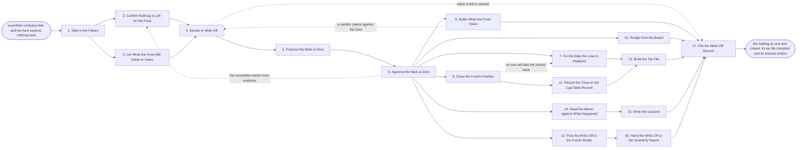

# Reference process: Write Off a Failed Investment

`ref/pc/write-off-a-failed-investment v1`

**value stream:** [Exits](../../streams/private-capital/hold-to-exit.md)
A portfolio company has failed. It has wound down, been sold for less
than its debts and the preferences ahead of the fund, or has nothing
left that the fund's shares can reach. This process confirms that
nothing is left for the fund, lists what the fund still holds or owes in
the company, and marks the holding at zero with the valuation
committee's approval. The date the loss is realized is fixed on an
event the tax adviser accepts, the fund's shares are surrendered or
cancelled, any directorship the firm held is resigned, and anything the
fund guaranteed is released or settled by the chief financial officer
(CFO). The original investment memo is then read against what happened,
and its lessons are written where the next memo can find them. The run
closes when the holding is at zero on the fund's books and closed in the
cap table record, with its tax file complete and its lessons recorded.

**delivers:** statement, a write-off

## The goals

- Approve the zero mark within [30 days]
- Recover [100%] of what the fund can still reach
- Realize the loss in [the planned tax year]

## The activities

| # | Activity | What happens | Agents |
|---|---|---|---|
| 1 | Take in the Failure | a wind-down, a sale below the preferences, or nothing left | [valuation-analyst](../../agents/valuation-analyst.md) · deal lead partner (person) |
| 2 | Confirm Nothing Is Left for the Fund | what each class receives, and that the fund's gets none | [cap-table-keeper](../../agents/cap-table-keeper.md) |
| 3 | List What the Fund Still Holds or Owes | notes, warrants, guarantees and claims in the company | cap-table-keeper · counsel (person) |
| 4 | Decide to Write Off | the partners decide the holding is worth nothing | managing partner (person) · deal lead partner (person) |
| 5 | Propose the Mark at Zero | the zero mark, with the evidence that supports it | valuation-analyst |
| 6 | Approve the Mark at Zero | the valuation committee approves the write-off | valuation committee (person) |
| 7 | Fix the Date the Loss Is Realized | the event that fixes the loss, with its evidence | valuation-analyst · tax adviser (person) |
| 8 | Close the Fund's Position | shares surrendered, cancelled or abandoned, and signed | counsel (person) · cap-table-keeper |
| 9 | Settle What the Fund Owes | guarantees released, claims filed, payments signed | CFO (person) · counsel (person) |
| 10 | Resign from the Board | the firm's director resigns on the date counsel advises | deal lead partner (person) |
| 11 | Record the Close in the Cap Table Record | the position closed at zero, with the documents | cap-table-keeper |
| 12 | Post the Write-Off to the Fund's Books | the loss realized in the fund accounting system | controller (person) · valuation-analyst |
| 13 | Build the Tax File | the event, the date and the fund's cost in the company | valuation-analyst · tax adviser (person) |
| 14 | Read the Memo against What Happened | each claim in the memo set beside what happened | [memo-writer](../../agents/memo-writer.md) · deal lead partner (person) |
| 15 | Write the Lessons | what the firm would test differently next time | memo-writer |
| 16 | Hand the Write-Off to the Quarterly Report | the loss, its date and the plain reason, for investors | valuation-analyst |
| 17 | File the Write-Off Record | the decision, the mark, the tax file and the lessons | valuation-analyst · memo-writer |

A company usually reaches this process from
`ref/pc/work-a-company-in-trouble`, when the partners decide on no
further money and nothing can be recovered, or straight from a
wind-down the fund did not control. A holding written off here comes
into the next `ref/pc/value-the-portfolio` already at zero, with its
approval on the record, and the investors hear of it in
`ref/pc/issue-the-quarterly-report-and-statements`.

## The graph



## The document, with the blanks marked

```
PROCESS: write off a failed investment
                       id: <team>/write-off-a-failed-investment   v1
from: ref/pc/write-off-a-failed-investment v1
owner: <who>                          effective: <date>
trigger: a portfolio company is wound down, sold for less than the
         debts and preferences ahead of the fund, or found by <who> to
         have nothing left for the fund's shares
         watch: record=<portfolio company>
                system=<your portfolio reporting system>
                change=<the company is marked as failed>
concurrency: one company is one run, and every fund or vehicle the firm
             manages that holds the company is closed out in that run,
             with one record for each
goal: the holding approved at zero within <days> of the failure, the
      position closed and every obligation released or settled within
      <days>, the tax file accepted by the tax adviser before <the
      fund's tax filing date>, and the lessons written against the memo
phases:
  take-in-failure     - human: what happened written down: the
                        wind-down, the sale and its price, or the event
                        that left nothing, with its date and its source
                        owner: valuation-analyst    after: trigger
                        automation: <level>
  confirm-nothing-left - runs assessment: the proceeds or the remaining
                        assets run through the debt and the preferences,
                        class by class, to show what the fund's shares
                        receive
                        owner: cap-table-keeper
                        after: take-in-failure      automation: <level>
  list-obligations    - runs collect-and-report: everything the fund
                        still holds or owes in the company, such as
                        notes, warrants, guarantees, indemnities,
                        unpaid commitments and any claim it could make
                        owner: cap-table-keeper
                        after: take-in-failure      automation: <level>
  decide-write-off    - convenes decide-and-announce: the partners
                        decide the holding is worth nothing, or that
                        something is left to recover and how
                        owner: <your managing partner role>
                        after: confirm-nothing-left + list-obligations
                        automation: <level>
  propose-zero        - runs assessment: the mark at zero under the
                        valuation policy, with the evidence that nothing
                        is left and the last mark it replaces
                        owner: valuation-analyst
                        after: decide-write-off     automation: <level>
  approve-zero        - convenes approval: the valuation committee
                        approves the write-off, or asks for more
                        evidence
                        owner: <your valuation committee>
                        after: propose-zero         by: <days>
                        automation: never
  fix-loss-date       - runs assessment: the event that makes the loss
                        realized for tax, such as the company's
                        dissolution, the surrender of the shares or a
                        sale for nothing, agreed with the tax adviser
                        owner: valuation-analyst
                        after: approve-zero or close-position, whichever
                        fixes the event
                        automation: <level>
  close-position      - convenes approval: the shares surrendered,
                        cancelled or abandoned on documents signed by
                        <who>, and the company's register updated
                        owner: <your authorized signer role>
                        after: approve-zero         by: <days>
                        automation: never
  settle-obligations  - convenes approval: each guarantee released or
                        paid, each claim filed in the wind-down, and
                        every payment signed by <who>
                        owner: <your CFO role>      after: approve-zero
                        by: <days>                  automation: never
  resign-board        - human: the firm's director resigns from the
                        company's board on the date counsel advises,
                        with the insurance cover for former directors
                        confirmed
                        owner: <your deal lead role>
                        after: approve-zero         automation: never
  record-close        - system: the position closed at zero in the cap
                        table record, with the signed documents attached
                        owner: cap-table-keeper     after: close-position
                        automation: <level>
  post-write-off      - system: the write-off entered in the fund
                        accounting system, tied to the committee's
                        approval
                        owner: <your controller role>
                        after: approve-zero         automation: <level>
  build-tax-file      - runs collect-and-report: the event, its date,
                        the evidence for it and the fund's cost in the
                        company, filed for the tax adviser and the
                        investors' tax documents
                        owner: valuation-analyst
                        after: fix-loss-date + record-close
                        automation: <level>
  read-memo           - runs assessment: each claim in the investment
                        memo as the committee approved it, set beside
                        what happened and marked held, failed or never
                        tested
                        owner: memo-writer          after: approve-zero
                        automation: <level>
  write-lessons       - convenes debrief: what the firm would test
                        differently in diligence, in the model and in
                        the help it gave, written about the work
                        owner: memo-writer          after: read-memo
                        automation: <level>
  hand-to-report      - convenes briefing: the write-off, its date, the
                        amount lost and the plain reason, handed to the
                        next quarterly report
                        owner: valuation-analyst
                        after: post-write-off       automation: <level>
  file-record         - runs collect-and-report: the decision, the
                        approved mark, the closing documents, the tax
                        file and the lessons, kept together on the
                        holding's record
                        owner: valuation-analyst
                        after: build-tax-file + settle-obligations +
                        resign-board + write-lessons + hand-to-report,
                        or decide-write-off when value is left
                        automation: <level>
run-scoped:
  clock - runs roll-call                        owner: valuation-analyst
          every: <cadence>
          from: approve-zero    until: file-record
handoffs:
  take-in-failure -> confirm-nothing-left / list-obligations
    [failure-record]: what happened, when, and the source it is read
    from
  confirm-nothing-left -> decide-write-off [recovery-analysis]: what
    each class receives, and what the fund's shares receive
  list-obligations -> decide-write-off [fund-obligations]: everything
    the fund still holds or owes in the company, each with its document
  decide-write-off -> propose-zero [write-off-decision]: the partners'
    decision, who made it, and the reason
  propose-zero -> approve-zero [zero-mark]: the mark at zero, the
    evidence for it, and the mark it replaces
  approve-zero -> fix-loss-date / close-position / settle-obligations /
    resign-board / post-write-off / read-memo [approved-write-off]: the
    committee's approval, its date and any condition it set
  fix-loss-date -> build-tax-file [loss-event]: the event that fixes
    the loss, its date and the evidence the tax adviser accepted
  close-position -> record-close [closing-documents]: the signed
    documents that surrender, cancel or abandon the shares
  record-close -> build-tax-file [closed-position]: the position as
    closed in the cap table record, with its documents
  post-write-off -> hand-to-report [posted-write-off]: the write-off as
    entered in the fund accounting system
  build-tax-file -> file-record [tax-file]: the tax file as the adviser
    accepted it
  read-memo -> write-lessons [memo-reading]: each claim in the memo
    marked held, failed or never tested, with what happened
  write-lessons -> file-record [lessons]: the lessons, written where
    the next memo's author will read them
  hand-to-report -> file-record [report-entry]: what the quarterly
    report will say about the write-off
  settle-obligations / resign-board -> file-record [obligations-closed]:
    each obligation released or settled, and the director's
    resignation, with dates
deviations:
  decide-write-off -> file-record [value-left-to-recover]: the partners
    find value left to recover, so the run files what it found and
    closes, and the holding goes back to the quarterly valuation
  approve-zero -> confirm-nothing-left [committee-wants-evidence]: the
    committee wants more evidence that nothing is left, so the recovery
    is worked again against its question
  close-position -> fix-loss-date [shares-cannot-be-surrendered]: no
    one will take the shares back, so the loss date rests on the
    evidence that the shares are worthless
  settle-obligations -> decide-write-off [creditor-claims-against-fund]:
    a creditor claims against the fund, so the partners decide on the
    claim before anything is paid
bindings:
  roster:  <who holds each role - agents claiming the abstract agents
           above, and named people for the managing partner, the deal
           lead, the members of the valuation committee, the CFO, the
           controller, counsel, the tax adviser and the authorized
           signers>
  systems: the cap table record (write),
           the fund accounting system (write),
           the portfolio reporting system (write),
           the deal pipeline (read),
           <your lessons library> (write),
           the notification channel (write)
  data:    the valuation policy <version>, the investment memo at the
           version the committee approved, the company's charter and
           the shareholders' agreement, the fund's guarantees and side
           agreements with the company, <your tax evidence standard>
policy:
  a holding is written off only on evidence that nothing is left for
    the fund's shares, and the evidence is filed with the mark
  the zero mark is approved by the valuation committee, and the
    approval is never delegated to an agent
  the loss date rests on an event the tax adviser accepts, and is never
    moved to suit a tax year
  every document that closes the position, every payment and the
    director's resignation are signed by a person
  the memo is read as the committee approved it, and is never edited
    after the write-off
  the lessons are written about the work and the evidence, and are
    filed where the next memo's author will read them
  the investors are told in the next quarterly report, in plain words
  money that reaches the fund after a write-off is recorded as a
    recovery and goes to the distribution
measures:
  cycle time: <days> from the failure to the record filed
  tax: <target> share of write-offs with a tax file the adviser accepts
       before <the fund's tax filing date>
  learning: <target> share of write-offs whose lessons are cited in a
            later memo
  volume: <write-offs per year>
  quality gate: every write-off has the committee's approval, the
                evidence, the loss date, the closing documents and the
                lessons on one record
```

## The failure edges

- **Value is left to recover.** A buyer for the technology, a claim the
  fund can make, or money left after the debts means the holding is not
  worth nothing. The run files what it found and closes, the holding
  goes back to the quarterly valuation at a value the evidence supports,
  and a buyer is pursued through `ref/pc/run-a-sale-process`.
- **The committee wants more evidence.** The cap-table-keeper agent
  works the recovery again against the committee's question, and the
  mark stays at its last approved value until the committee approves
  the zero.
- **No one will take the shares back.** The company has dissolved with
  no process to accept a surrender. The loss date then rests on the
  evidence that the shares are worthless, agreed with the tax adviser,
  and the file says which event it rests on and why.
- **A creditor claims against the fund.** A guarantee is called or a
  claim is made under something the fund signed. Nothing is paid until
  the partners have decided on the claim, and the payment, when there
  is one, is signed by a person.
- **The firm's director is named in a claim.** Counsel advises on when
  to resign, the insurance cover for former directors is confirmed
  before the resignation, and the claim is recorded on the holding's
  file and with the firm.
- **Money arrives after the write-off.** A late payment from the
  wind-down or a sale of what was left is recorded as a recovery
  against the closed holding and goes to `ref/pc/make-a-distribution`.
  The write-off itself is not reopened.
- **The trigger fires while a run is in flight.** One company is one
  run. Every fund or vehicle the firm manages that holds the company is
  closed out in that run, with one record for each, so the funds are
  never told different stories about the same failure.
- **A run is abandoned.** The holding stays at its last approved mark
  and is valued again next quarter, with the abandoned run named in its
  file. No document closing the position is left half signed, every
  claim against the fund stays with the CFO, and the reason the run
  stopped goes to the managing partner.
