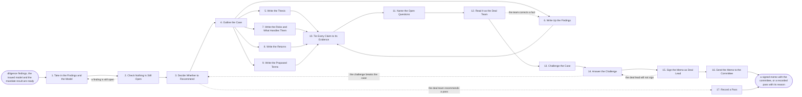

# Reference process: Write the Investment Memo

`ref/pc/write-the-investment-memo v1`

**value stream:** [Opportunity-to-Recommendation](../../streams/private-capital/opportunity-to-recommendation.md)
The memo is the case the investment committee votes on, and it is only
as good as the evidence under each sentence. This process writes it from
what the deal team found. The memo-writer agent sets out the thesis, the
findings from each strand of diligence, the risks and what handles each
one, and the proposed terms. The returns-modeler agent writes the
returns from the issued model at its version, and the
diligence-coordinator agent checks that nothing is still open and that
every claim links to the finding under it. A claim with nothing under it
is cut or marked as the deal team's view. The deal team reads the draft,
a partner with no part in the deal argues against it, and the deal lead
partner signs it. The run closes when the signed memo is with the
committee, or when the deal team records a pass with its reason.

## The goals

- Send the memo [5 days] before the committee
- Tie [100%] of claims to evidence
- Win committee approval on [80%] of memos

## The activities

| # | Activity | What happens | Agents |
|---|---|---|---|
| 1 | Take in the Findings and the Model | diligence findings, the model and the mandate result | [memo-writer](../../agents/memo-writer.md) · [diligence-coordinator](../../agents/diligence-coordinator.md) |
| 2 | Check Nothing Is Still Open | open requests and unrated findings, listed | diligence-coordinator |
| 3 | Decide Whether to Recommend | invest on terms, or pass, with the reason | deal lead partner (person) · memo-writer |
| 4 | Outline the Case | thesis, findings, risks, returns, terms and asks | memo-writer |
| 5 | Write the Thesis | why this company, why now, and why this firm | memo-writer |
| 6 | Write Up the Findings | each strand of diligence, with its rating | memo-writer · diligence-coordinator |
| 7 | Write the Risks and What Handles Them | each risk, how likely it is, and what handles it | memo-writer · diligence-coordinator |
| 8 | Write the Returns | the cases, the return at each, and the breakeven | [returns-modeler](../../agents/returns-modeler.md) · memo-writer |
| 9 | Write the Proposed Terms | price, amount, security, rights and conditions | memo-writer · returns-modeler |
| 10 | Tie Every Claim to Its Evidence | each claim linked to a finding or a model case | memo-writer · diligence-coordinator |
| 11 | Name the Open Questions | what is unproved, and what would settle it | memo-writer |
| 12 | Read It as the Deal Team | the team corrects facts and agrees the wording | deal lead partner (person) · memo-writer |
| 13 | Challenge the Case | a partner outside the deal argues against it | challenge partner (person) · memo-writer |
| 14 | Answer the Challenge | each challenge answered in the memo or left open | memo-writer · deal lead partner (person) |
| 15 | Sign the Memo as Deal Lead | the deal lead puts their name to the case | deal lead partner (person) |
| 16 | Send the Memo to the Committee | the memo at a version, before the reading deadline | memo-writer |
| 17 | Record a Pass | the reason, the findings, and when to look again | memo-writer · deal lead partner (person) |

The vote is not taken here. The signed memo goes to
`ref/pc/decide-at-investment-committee`, where the memo-writer agent
writes any later version the committee asks for. A pass recorded here is
told to the company by the partner who owns it, and the record stays in
the deal pipeline for the next deal team that meets the company.

## The graph



## The document, with the blanks marked

```
PROCESS: investment memo              id: <team>/write-the-investment-memo   v1
from: ref/pc/write-the-investment-memo v1
owner: <who>                          effective: <date>
trigger: the diligence findings, the issued model and the mandate result
         for a deal are all recorded in <your deal pipeline>, or the deal
         lead asks for the memo ahead of <the committee date>
         watch: record=<opportunity> system=<your deal pipeline>
                change=<the findings, the model and the mandate result
                are all recorded>
concurrency: one deal has one memo run open at a time, and a later
             version of the memo is a new run that supersedes it
goal: a signed memo with the committee <days> before it meets, with
      every claim tied to its evidence and every open question named, or
      a pass recorded with its reason within <days> of diligence closing
phases:
  take-in-findings     - human: the rated findings from commercial,
                         financial and legal diligence, the issued model
                         at its version and the mandate result, read in
                         with their dates
                         owner: memo-writer             after: trigger
                         automation: <level>
  check-open-items     - runs assessment: open requests, unrated
                         findings, findings with no owner, and a model or
                         mandate result older than the latest change to
                         the deal
                         owner: diligence-coordinator
                         after: take-in-findings        automation: <level>
  decide-direction     - convenes decide-and-announce: invest on stated
                         terms or pass, with the reason, decided by the
                         deal lead partner with the deal team
                         owner: <your deal lead role>
                         after: check-open-items or answer-challenge
                         by: <days>                     automation: <level>
  outline-case         - human: the memo laid out in <your memo template>
                         with the thesis, the findings, the risks, the
                         returns, the terms and the decisions asked of the
                         committee
                         owner: memo-writer      after: decide-direction
                         automation: <level>
  write-thesis         - human: why this company, why now and why this
                         firm, stated as the claims diligence tested
                         owner: memo-writer         after: outline-case
                         automation: <level>
  write-findings       - human: each strand of diligence written up with
                         its rating, its evidence and every area that was
                         cut from scope
                         owner: memo-writer         after: outline-case
                         automation: <level>
  write-risks          - human: each risk with how likely it is, what it
                         would cost and what handles it, and each risk
                         nothing handles written as accepted with the name
                         of who accepts it
                         owner: memo-writer         after: outline-case
                         automation: <level>
  write-returns        - human: the cases from the issued model, the
                         return at each, the breakeven, the reserve and
                         the sensitivities, at the model's version
                         owner: returns-modeler     after: outline-case
                         automation: <level>
  write-terms          - human: the price, the amount, the security, the
                         rights, the director rights and the conditions,
                         inside the mandate result
                         owner: memo-writer         after: outline-case
                         automation: <level>
  tie-evidence         - runs assessment: each claim in the memo linked to
                         the finding, model case or source under it, and
                         each claim with nothing under it cut or marked as
                         the deal team's view
                         owner: memo-writer
                         after: write-thesis + write-findings +
                         write-risks + write-returns + write-terms
                         automation: <level>
  name-open-questions  - human: what is still unproved, why, what would
                         settle it, and whether settling it is a
                         condition of the investment
                         owner: memo-writer         after: tie-evidence
                         automation: <level>
  team-read            - convenes draft-review-merge: the deal team reads
                         the draft, corrects facts against the findings
                         and agrees the wording, with every change tracked
                         owner: <your deal lead role>
                         after: name-open-questions     by: <days>
                         automation: <level>
  challenge-case       - runs assessment: a partner with no part in the
                         deal argues in writing against investing, claim by
                         claim
                         owner: <your challenge partner role>
                         after: team-read               by: <days>
                         automation: <level>
  answer-challenge     - human: each challenge answered in the memo with
                         its evidence, or left open and named as open
                         owner: memo-writer       after: challenge-case
                         automation: <level>
  sign-memo            - convenes approval: the deal lead partner signs
                         the memo as its sponsor, at a version
                         owner: <your deal lead role>
                         after: answer-challenge        by: <days>
                         automation: never
  send-to-committee    - system: the signed memo at its version, with the
                         model and the mandate result, sent to the
                         committee before <the reading deadline>
                         owner: memo-writer         after: sign-memo
                         automation: <level>
  record-pass          - convenes debrief: the pass recorded in the deal
                         pipeline with the reason, the findings behind it,
                         what the company is told, and when the firm might
                         look again
                         owner: memo-writer     after: decide-direction
                         automation: <level>
run-scoped:
  clock       - runs roll-call                  owner: memo-writer
                every: <cadence>
                from: take-in-findings  until: send-to-committee
  version-log - runs collect-and-report         owner: memo-writer
                from: outline-case      until: run close
handoffs:
  take-in-findings -> check-open-items [deal-record]: the rated findings,
    the model version and the mandate result, each with its date
  check-open-items -> decide-direction [open-items]: everything still
    open, unrated or out of date, or a statement that nothing is
  decide-direction -> outline-case / record-pass [direction]: invest on
    stated terms or pass, the reason, and who decided
  outline-case -> write-thesis / write-findings / write-risks /
    write-returns / write-terms [memo-outline]: the outline, and the
    decisions the memo will ask of the committee
  write-thesis -> tie-evidence [thesis-section]: the thesis as claims
  write-findings -> tie-evidence [findings-section]: each strand's
    findings, ratings and cut areas
  write-risks -> tie-evidence [risks-section]: each risk, its likelihood,
    its cost and what handles it, and the risks accepted
  write-returns -> tie-evidence [returns-section]: the cases and returns
    at the model's version
  write-terms -> tie-evidence [terms-section]: the proposed terms and
    their conditions
  tie-evidence -> name-open-questions [linked-draft]: the draft with
    every claim linked, and the claims cut or marked as the team's view
  name-open-questions -> team-read [open-questions]: the open questions,
    what would settle each, and which are conditions
  team-read -> challenge-case [team-draft]: the draft the deal team
    agreed, with its changes tracked
  challenge-case -> answer-challenge [challenges]: the challenges, claim
    by claim, in the challenger's words
  answer-challenge -> sign-memo [answered-draft]: each challenge with its
    answer or marked open
  sign-memo -> send-to-committee [signed-memo]: the signed memo, its
    version, its signer and its date
deviations:
  check-open-items -> take-in-findings [finding-open]: a finding is still
    open or a result is out of date, so the memo waits for diligence to
    close it and the findings are read in again
  decide-direction -> record-pass [pass-recommended]: the deal team
    recommends a pass, so no memo is written and the pass is recorded
    with its reason
  team-read -> write-findings [fact-corrected]: the team corrects a fact,
    so the section is written again from the finding and every claim
    that rested on the fact is checked again
  answer-challenge -> decide-direction [case-broken]: the challenge breaks
    the case, so the recommendation is decided again before anything is
    signed
  sign-memo -> answer-challenge [lead-will-not-sign]: the deal lead will
    not sign, so the points behind the refusal are answered or the memo
    goes back to the decision
bindings:
  roster:  <who holds each role - agents claiming the abstract agents
           above, and named people for the deal lead partner, the deal
           team and the challenge partner>
  systems: the deal pipeline (write), the request log (read), the data
           room (read), the committee portal (write), the signature
           system (write), <your financial model> (read)
  data:    <your memo template> <version>, the rated findings at their
           versions, the issued model <version>, the mandate result
           <version>, <your rating scale>
policy:
  every claim in the memo links to a finding, a model case or a source,
    and a claim with nothing under it is cut or marked as the deal
    team's view
  the returns are the issued model's at its version, and the memo
    carries no number the model does not
  the proposed terms sit inside the mandate result, and every consent
    the result names is a condition of the recommendation
  the memo names every open question and every area cut from diligence
  a risk nothing handles is written as accepted, with the name of the
    person who accepts it
  the challenge partner has no part in the deal
  the deal lead's signature is a human gate and is never given by an
    agent
  a version sent to the committee is never edited: a change is a new
    version, sent with a note of what changed
  a pass is recorded in the deal pipeline with its reason, where the
    next deal team can read it
measures:
  cycle time: <days> from diligence closing to the memo with the
              committee
  evidence: <target> share of claims linked to a finding or a model case
  on time: <target> share of memos with the committee by the reading
           deadline
  volume: <memos and recorded passes per period>
  quality gate: every memo names its open questions, its accepted risks
                and its model version, and every pass names its reason
```

## The failure edges

- **A finding is still open.** The diligence-coordinator agent lists it,
  and the memo waits for diligence to close it. When the committee date
  will not move, the deal lead may send the memo with the finding named
  as open and its settlement made a condition of the investment, and the
  memo says so on its first page.
- **The deal team recommends a pass.** No memo is written. The pass is
  recorded with its reason and the findings behind it, the company is
  told by the partner who owns it, and the costs of diligence are closed
  against the deal.
- **The mandate result is blocked or carries conditions.** A blocked
  result means the deal cannot be recommended as it stands, and the run
  goes to the decision. A condition, such as a consent from the advisory
  committee of the fund's limited partners (LPs), is written into the
  recommendation as a condition of approval.
- **A claim has nothing under it.** The memo-writer agent cuts it or
  marks it as the deal team's view. A sentence the evidence does not
  carry is the one the committee would otherwise rely on, and the run
  does not let it through unmarked.
- **The team corrects a fact.** The section is written again from the
  finding, and every claim that rested on the fact is checked again.
  When the finding itself is wrong, it goes back to the diligence run
  that made it, and the memo waits.
- **The challenge breaks the case.** The recommendation is decided again
  before anything is signed. A challenge the team cannot answer stays in
  the memo as an open question, written in the challenger's words.
- **The deal lead will not sign.** The points behind the refusal are
  answered or the memo goes back to the decision. A memo is never sent
  to the committee without the deal lead's signature.
- **The model or the terms change after the memo is sent.** A new
  version of the memo goes to the committee with a note of what changed
  and why, and the earlier version stays in the version log.
- **The reading deadline will be missed.** The roll-call raises it to
  the deal lead before the deadline. The deal lead asks the committee
  for a later date or sends the memo with its gaps named, and the
  committee decides whether to read it.
- **The trigger fires while a run is in flight.** One deal has one memo
  run open at a time. Findings that arrive during the run join it, and
  a change after the memo is sent starts a new run for the next version.
- **A run is abandoned.** The deal pipeline shows no memo is coming, the
  committee is told the deal is off its agenda, the drafts are kept at
  their last version with the reason the run stopped, and the company
  is told by the partner who owns it.
