# Reference process: Write the Value Creation Plan

`ref/pc/write-the-value-creation-plan v1`

**value stream:** [Close-to-Value](../../streams/private-capital/close-to-value.md)
The deal has closed and the handover has passed on the changes the
investment thesis rests on. The value-creation-planner agent works with
management to turn them into a short plan, and the financial-analyst agent
rebuilds today's numbers from the company's own records, so that every
change is sized against a baseline both sides accept. Management and the
firm choose the few changes the plan will carry, and each one gets one
owner, one measure and one date, with the help the firm will give written
beside it. The chief executive and the deal lead partner agree the plan,
and the company's board adopts it. The commitment-keeper agent then holds
every change as an item with a state and reads progress on the cadence
the plan sets. The run closes when the plan is agreed, loaded in the
tracker, and its first progress review has been held.

## The goals

- Agree the plan within [100 days] of closing
- Carry no more than [5] changes
- Grow earnings [50%] by the planned exit
- Keep plan work under [10%] of management's time

## The activities

| # | Activity | What happens | Agents |
|---|---|---|---|
| 1 | Take in the Starting Points | the thesis, the findings and the handover notes | [value-creation-planner](../../agents/value-creation-planner.md) |
| 2 | Build the Baseline | today's numbers, rebuilt and traced to source | [financial-analyst](../../agents/financial-analyst.md) |
| 3 | Hear Management's View | what management thinks will move the value | value-creation-planner · portfolio company chief executive (person) |
| 4 | List the Candidate Changes | every change proposed, from either side | value-creation-planner |
| 5 | Size Each Change | what each change is worth and what it costs | financial-analyst |
| 6 | Check What the Company Can Carry | the people, cash and attention each one needs | value-creation-planner · operating partner (person) |
| 7 | Choose the Few Changes | the changes the plan carries, and why the rest wait | portfolio company chief executive (person) · deal lead partner (person) |
| 8 | Give Each Change an Owner and a Measure | one owner, one measure and one date per change | value-creation-planner |
| 9 | Plan the First Months | what happens first, week by week | value-creation-planner · operating partner (person) |
| 10 | Set the Firm's Help | the people, introductions and money the firm puts in | operating partner (person) · value-creation-planner |
| 11 | Agree the Plan with Management | the chief executive and the firm agree one plan | portfolio company chief executive (person) · deal lead partner (person) |
| 12 | Put the Plan to the Board | the board adopts the plan as the company's own | portfolio company board (person) |
| 13 | Load the Plan into the Tracker | each change as an item with owner, date and state | [commitment-keeper](../../agents/commitment-keeper.md) |
| 14 | Set the Review Cadence | when progress is read, by whom, on which calendars | commitment-keeper · operating partner (person) |
| 15 | Read Progress Against the Plan | each change met, running, late or untouched | commitment-keeper · financial-analyst |
| 16 | Close or Replace a Dead Change | the change given up on, its reason and its date | value-creation-planner · deal lead partner (person) |
| 17 | Issue the Plan at a Version | the plan as it now stands, with what changed | value-creation-planner |

**Venture and buyout.** In venture, the founders own the plan, and the
firm offers help without control. In a buyout, the firm has control, the
plan opens with the first hundred days, and add-on acquisitions are often
part of it.

A follow-on round the company needs, or an add-on acquisition the plan
calls for, starts from this plan and then runs like a new deal through the
diligence processes and `ref/pc/decide-at-investment-committee`. Later
progress reviews are read at each board meeting under
`ref/pc/prepare-and-hold-a-board-meeting`, and a plan that needs
rewriting starts a new run here.

## The graph

```mermaid
flowchart LR
  T([a closed deal's starting points arrive, or the plan is reopened]) --> A1[1. Take in the Starting Points]
  A1 --> A2[2. Build the Baseline]
  A1 --> A3[3. Hear Management's View]
  A2 --> A4[4. List the Candidate Changes]
  A3 --> A4
  A4 --> A5[5. Size Each Change]
  A5 -. a change cannot be sized from the records .-> A2
  A5 --> A6[6. Check What the Company Can Carry]
  A6 --> A7[7. Choose the Few Changes]
  A7 --> A8[8. Give Each Change an Owner and a Measure]
  A8 --> A9[9. Plan the First Months]
  A9 --> A10[10. Set the Firm's Help]
  A10 --> A11[11. Agree the Plan with Management]
  A11 -. management will not agree a change .-> A7
  A11 --> A12[12. Put the Plan to the Board]
  A12 -. the board sends the plan back .-> A7
  A12 --> A13[13. Load the Plan into the Tracker]
  A13 --> A14[14. Set the Review Cadence]
  A14 --> A15[15. Read Progress Against the Plan]
  A15 --> A16[16. Close or Replace a Dead Change]
  A15 --> A17[17. Issue the Plan at a Version]
  A16 --> A17
  A17 --> DONE([an agreed plan in the tracker, with its first review held])
```



## The document, with the blanks marked

```
PROCESS: value creation plan    id: <team>/write-the-value-creation-plan   v1
from: ref/pc/write-the-value-creation-plan v1
owner: <who>                          effective: <date>
trigger: the handover sends the starting points for a new holding, or
         <who> reopens the plan after a new chief executive, an add-on
         acquisition or a sustained miss
         watch: record=<plan starting points>
                system=<your portfolio reporting system>
                change=<a handover sends starting points for a holding>
         and watch: record=<value creation plan>
                system=<your portfolio reporting system>
                change=<the plan is reopened for rewriting>
concurrency: one plan per holding is live at a time, and a reopened plan
             replaces the old one at a new version
goal: a plan agreed with management within <days> of closing, carrying
      no more than <how many> changes, each with one owner, one measure
      and one date, adding up to <the value the thesis needs> by <the
      planned exit date>
phases:
  take-in-starting-points - human: the starting points, the findings
                            under them, the committee's conditions and
                            the handover notes
                            owner: value-creation-planner
                            after: trigger           automation: <level>
  build-baseline          - runs assessment: today's revenue, margins,
                            cash and the measures the plan will use,
                            rebuilt from the company's records and each
                            traced to its source
                            owner: financial-analyst
                            after: take-in-starting-points
                            by: <days>               automation: <level>
  hear-management         - convenes briefing: what the chief executive
                            and the team think will move the value, and
                            what they think will not
                            owner: value-creation-planner
                            after: take-in-starting-points
                            automation: <level>
  list-changes            - runs collect-and-report: every change either
                            side proposes, written once, with who proposed
                            it and the thesis line it serves
                            owner: value-creation-planner
                            after: build-baseline + hear-management
                            automation: <level>
  size-changes            - runs assessment: what each change is worth to
                            earnings or growth, what it costs, how long it
                            takes, and the assumptions behind each number
                            owner: financial-analyst  after: list-changes
                            automation: <level>
  check-capacity          - runs assessment: the people, cash and
                            management attention each change needs, set
                            beside what the company has
                            owner: value-creation-planner
                            after: size-changes      automation: <level>
  choose-changes          - convenes decide-and-announce: the few changes
                            the plan carries, and why each of the others
                            waits or is dropped
                            owner: <your deal lead role>
                            after: check-capacity    by: <days>
                            automation: <level>
  assign-owners           - human: one owner, one measure and one date on
                            each change, and a change that cannot carry
                            all three is struck
                            owner: value-creation-planner
                            after: choose-changes    automation: <level>
  plan-first-months       - runs build-by-talent: what happens in the
                            first <weeks>, week by week, with the owner of
                            each step
                            owner: value-creation-planner
                            after: assign-owners     automation: <level>
  set-firm-help           - human: the people, introductions and money the
                            firm commits, each written as a commitment
                            with an owner at the firm and a date
                            owner: <your operating partner role>
                            after: plan-first-months automation: <level>
  agree-with-management   - convenes approval: the chief executive and
                            the deal lead partner agree one plan at one
                            version
                            owner: <your deal lead role>
                            after: set-firm-help     by: <days>
                            automation: never
  put-to-board            - convenes decide-and-announce: the company's
                            board adopts the plan as its own, under <your
                            board's rules>
                            owner: <your board director role>
                            after: agree-with-management
                            automation: never
  load-tracker            - system: every change and every commitment of
                            the firm loaded into the commitment tracker
                            with its owner, its date and its state
                            owner: commitment-keeper after: put-to-board
                            automation: <level>
  set-cadence             - human: when progress is read, who reads it,
                            and the review dates placed on every owner's
                            calendar
                            owner: commitment-keeper after: load-tracker
                            automation: <level>
  read-progress           - runs roll-call: each change read out as met,
                            running, late or untouched, with the measure
                            set beside the baseline
                            owner: commitment-keeper after: set-cadence
                            every: <cadence>         automation: <level>
  close-dead-change       - convenes decide-and-announce: a change given
                            up on is closed with its reason and its date,
                            or replaced by one with its own owner
                            owner: <your deal lead role>
                            after: read-progress     automation: <level>
  issue-plan              - system: the plan issued at a version, with
                            what changed since the last one and why
                            owner: value-creation-planner
                            after: read-progress, and close-dead-change
                            when a change was closed
                            automation: <level>
run-scoped:
  status - runs roll-call                     owner: value-creation-planner
           every: <cadence>
           from: take-in-starting-points   until: put-to-board
  help   - runs allocate-and-reconcile
           owner: <your operating partner role>
           from: set-firm-help             until: run close
handoffs:
  take-in-starting-points -> build-baseline / hear-management
    [starting-points]: the starting points, their findings and the
    committee's conditions
  build-baseline -> list-changes [baseline]: today's numbers, each traced
    to its source, at a version
  hear-management -> list-changes [management-view]: what management
    proposed and what it doubted, in its own words
  list-changes -> size-changes [candidate-changes]: every change, who
    proposed it and the thesis line it serves
  size-changes -> check-capacity [sized-changes]: each change with its
    value, cost, time and assumptions
  check-capacity -> choose-changes [capacity-read]: what each change needs
    beside what the company has
  choose-changes -> assign-owners [chosen-changes]: the changes the plan
    carries, and the reasons the others wait
  assign-owners -> plan-first-months [owned-changes]: each change with one
    owner, one measure and one date
  plan-first-months -> set-firm-help [first-months-plan]: the first weeks,
    step by step, with owners
  set-firm-help -> agree-with-management [firm-commitments]: what the firm
    commits, each with an owner at the firm and a date
  agree-with-management -> put-to-board [agreed-plan]: the plan both sides
    agreed, at its version
  put-to-board -> load-tracker [adopted-plan]: the plan as the board
    adopted it, with the date
  load-tracker -> set-cadence [tracked-plan]: every change and commitment
    as an item in the tracker
  set-cadence -> read-progress [review-dates]: the review dates and the
    calendars they landed on
  read-progress -> close-dead-change / issue-plan [progress-read]: each
    change's state, and the measures against the baseline
  close-dead-change -> issue-plan [closed-changes]: the changes closed or
    replaced, with the reasons and dates
deviations:
  size-changes -> build-baseline [baseline-short]: a change cannot be
    sized from the records, so the baseline is extended to cover it before
    the change is sized
  agree-with-management -> choose-changes [management-disagrees]:
    management will not agree a change, so the choice is made again with
    management's reasons on the record
  put-to-board -> choose-changes [board-sends-back]: the board sends the
    plan back, so the changes are chosen again against what the board said
bindings:
  roster:  <who holds each role - agents claiming the abstract agents
           above, and named people for the deal lead partner, the
           operating partner, the portfolio company's chief executive and
           its board>
  systems: the portfolio reporting system (read), the commitment tracker
           (write), the company's financial records (read), the calendar
           (write), the data room (read)
  data:    the investment memo <version>, the handover package <version>,
           the committee decision <version>, <your plan template>
           <version>, the company's budget <version>
policy:
  the plan carries no more than <how many> changes, and a change with no
    owner, no measure or no date is struck from it
  every number in the plan traces to the baseline or to a sizing with its
    assumptions written down
  management's agreement and the board's adoption are human gates and are
    never delegated to an agent
  the firm's help is written as commitments with owners at the firm, and
    tracked the same way as management's
  a change moved twice goes to <who> to be funded, reassigned or closed
  a dead change is closed with its reason and its date, and is never left
    open by silence
  the plan is issued at a version, and every earlier version stays on file
measures:
  cycle time: <days> from closing to a plan adopted by the board
  delivery: <target> share of changes met by their date
  volume: <plans per period>
  quality gate: every change has one owner, one measure and one date, and
                every number traces to the baseline
```

## The failure edges

- **A change cannot be sized from the records.** The financial-analyst
  agent says which numbers are missing, and the baseline is extended
  before the change is sized. A change sized on a guess is marked as a
  guess, so the plan never rests on a number nobody can trace.
- **Management will not agree a change.** The choice is made again with
  management's reasons on the record. In venture the founders' view
  usually carries, and in a buyout the firm may keep the change, but in
  both cases the disagreement is written down where the next review can
  read it.
- **The board sends the plan back.** The changes are chosen again
  against what the board said, and the plan comes back at a new version.
  The firm's director does not treat the board's adoption as a formality
  to be voted through.
- **A change has no owner.** It is struck from the plan. A sentence with
  no owner, measure or date is an intention, and the tracker holds only
  commitments.
- **A change is moved twice.** The commitment-keeper agent raises it to
  the person the plan names above the owner, and it ends funded,
  reassigned or closed as dead. It is not moved a third time.
- **The firm's help does not arrive.** The firm's commitments are read
  out at every review alongside management's, so an introduction the
  firm promised and never made is as visible as a target management
  missed.
- **The trigger fires while a run is in flight.** One plan per holding is
  live at a time. A reopened plan replaces the old one at a new version,
  and the old plan's open changes are carried across or closed with
  their reasons.
- **A run is abandoned.** The company is sold, written off or handed to
  its lenders before the plan is adopted. The tracker items are closed
  with the reason, the firm's commitments are released by name, and the
  work done so far is kept with the deal's record for the exit or the
  write-off.
