# Reference process: Administer a Tool

`ref/rev/administer-a-tool v1`

**value stream:** [Signal-to-System](../../streams/revenue-operations/signal-to-system.md)
A tool is live and somebody has to hold it: who may get in, what the
configuration says, how many licences are paid for against how many are
used, and whether the links either side of it still carry. This process
is the standing work of keeping one tool fit to run the process it was
bought for, and it ends each cycle at a review that asks whether the
tool still earns its place. The review has three answers, and one of
them is retirement. A tool nobody reviews is a tool nobody can defend
at renewal.

## The activities

| # | Activity | What happens | Agents |
|---|---|---|---|
| 1 | Take On the Tool | the owner, the licence, and what it is for | [tool-administrator](../../agents/tool-administrator.md) |
| 2 | Set the Roles and the Permissions | who may see and who may change what | tool-administrator · security reviewer (person) |
| 3 | Open and Close Accounts | joiners get in, leavers are taken out | tool-administrator |
| 4 | Hold the Configuration at a Version | changes are recorded, not just made | tool-administrator · [standards-keeper](../../agents/standards-keeper.md) |
| 5 | Take in Change Requests | each request read against what the tool is for | tool-administrator · requester (person) |
| 6 | Try the Change away from Live | the change made where nothing real breaks | tool-administrator · [integration-keeper](../../agents/integration-keeper.md) |
| 7 | Apply the Change | applied, dated, and the version moved on | tool-administrator |
| 8 | Keep the Licence Count Right | licences paid for set against licences used | tool-administrator · [analytics](../../agents/analytics.md) |
| 9 | Watch Who Uses It and for What | usage read against the process it serves | analytics |
| 10 | Check the Links Still Carry | the counts either side still agree | integration-keeper · analytics |
| 11 | Take in Supplier Changes | new versions, changed terms, and notices | [supplier-check](../../agents/supplier-check.md) · tool-administrator |
| 12 | Read Every Account Again | every account named, with who approved it | tool-administrator · security reviewer (person) |
| 13 | Run the Standing Review | whether the tool still earns its place | [stack-planner](../../agents/stack-planner.md) · tool-administrator |
| 14 | Decide Keep, Change or Retire | the named decider says which, and why | stack-planner · revenue operations lead (person) · procurement lead (person) |
| 15 | Record the Review | what was decided, and the evidence behind it | tool-administrator · stack-planner |

## The graph

```mermaid
flowchart LR
  T([a tool goes live under an owner]) --> A1[1. Take On the Tool]
  A1 --> A2[2. Set the Roles and the Permissions]
  A2 --> A3[3. Open and Close Accounts]
  A3 --> A4[4. Hold the Configuration at a Version]
  A4 --> A5[5. Take in Change Requests]
  A5 -. the request is not what the tool is for .-> A4
  A5 --> A6[6. Try the Change away from Live]
  A6 -. the change breaks something .-> A5
  A6 --> A7[7. Apply the Change]
  A7 -. the change has to be taken back .-> A6
  A7 --> A8[8. Keep the Licence Count Right]
  A8 -. more sellers are used than are held .-> A3
  A8 --> A9[9. Watch Who Uses It and for What]
  A9 --> A10[10. Check the Links Still Carry]
  A10 -. a link has stopped carrying .-> A7
  A9 --> A11[11. Take in Supplier Changes]
  A11 -. a supplier change forces a change here .-> A5
  A11 --> A12[12. Read Every Account Again]
  A12 -. an account nobody can account for .-> A3
  A10 --> A13[13. Run the Standing Review]
  A12 --> A13
  A13 --> A14[14. Decide Keep, Change or Retire]
  A14 -. keep it, with changes to make first .-> A5
  A14 --> A15[15. Record the Review]
  A15 --> DONE([the tool is held, and its place is decided again])
```



## The document, with the blanks marked

```
PROCESS: administer a tool            id: <team>/administer-a-tool   v1
from: ref/rev/administer-a-tool v1
owner: <who>                          effective: <date>
trigger: a tool goes live under an owner, and again every <cadence>
         while it is still in the stack
concurrency: one run per tool - runs for different tools overlap freely
             and never touch each other
goal: the right people in, the wrong people out, the configuration at a
      known version, the licences matched to use, and a dated answer to
      whether the tool still earns its place
phases:
  take-on-tool     - human: read the entry as the stack record holds it:
                     the owner, the licence, the term, and the process
                     the tool runs
                     owner: tool-administrator   after: trigger
                     automation: <level>
  set-permissions  - human: the roles the tool offers, what each one may
                     see and change, and which role each kind of user
                     gets by default
                     owner: <your security role> after: take-on-tool
                     by: <days>                  automation: never
  manage-accounts  - system: joiners get the role their job calls for,
                     and a leaver's account is closed within <hours> of
                     the leaving record
                     owner: tool-administrator   after: set-permissions
                     automation: <level>
  hold-config      - human: the settings that matter held at a version,
                     so a change can be seen, dated and taken back
                     owner: tool-administrator   after: manage-accounts
                     by: <days>                  automation: <level>
  take-requests    - human: each request read against the process the
                     tool runs, and refused in writing when it is not
                     what the tool is for
                     owner: tool-administrator   after: hold-config
                     automation: <level>
  try-change       - human: the change made where no live record is
                     touched, and what it affects written down
                     owner: tool-administrator   after: take-requests
                     by: <days>                  automation: <level>
  apply-change     - human: the change applied on a stated date, the
                     version moved on, and the way back kept
                     owner: tool-administrator   after: try-change
                     automation: <level>
  licence-count    - runs allocate-and-reconcile: licences paid for set
                     against licences used, with every seller that has not
                     been used in <days> named
                     owner: tool-administrator   after: apply-change
                     every: <cadence>            automation: <level>
  watch-usage      - runs collect-and-report: who uses the tool, for
                     what, and how often, read against the process it
                     was bought to run
                     owner: analytics            after: licence-count
                     every: <cadence>            automation: <level>
  check-links      - runs assessment: the links either side checked
                     against the record of what flows where, and the
                     counts compared
                     owner: integration-keeper   after: watch-usage
                     every: <cadence>            automation: <level>
  supplier-changes - runs collect-and-report: new versions, changed
                     terms, price notices and end-of-life notices, each
                     with what it would force here
                     owner: supplier-check       after: watch-usage
                     every: <cadence>            automation: <level>
  access-review    - runs roll-call: every account read again, with the
                     role it holds and the person who approved it
                     owner: <your security role>
                     after: supplier-changes
                     every: <cadence>            automation: never
  standing-review  - runs assessment: use, cost, links, findings and
                     supplier changes set against the process the tool
                     runs and what it was bought to do
                     owner: stack-planner
                     after: check-links + access-review
                     by: <days>                  automation: <level>
  decide-future    - convenes decide-and-announce: <who> says keep,
                     change or retire, gives the reason, and everyone
                     who works in the tool hears at the same time
                     owner: stack-planner        after: standing-review
                     by: <days>                  automation: never
  record-review    - human: the decision, the date, the evidence it was
                     made on, and the date the next review falls
                     owner: tool-administrator   after: decide-future
                     automation: <level>
run-scoped:
  access - runs roll-call                     owner: tool-administrator
           every: <cadence>
           from: manage-accounts   until: run close
  spend  - runs allocate-and-reconcile        owner: <your finance role>
           every: <cadence>
           from: licence-count   until: run close
handoffs:
  take-on-tool -> set-permissions: the entry as the stack record holds
    it, and the process the tool runs
  set-permissions -> manage-accounts: the roles, what each one reaches,
    and the role each kind of user gets by default
  manage-accounts -> hold-config: every account open today, with its
    role and the person who approved it
  hold-config -> take-requests: the settings that matter at their
    current version, and the date of the last change to each
  take-requests -> try-change: the request, what it would change, and
    the reason it is what the tool is for
  try-change -> apply-change: what the change did away from live, and
    everything it touched that nobody expected
  apply-change -> licence-count: the change as applied, its date, its
    version, and the way back
  licence-count -> watch-usage: licences paid for, licences used, and every
    licence unused for <days>
  watch-usage -> check-links: who used the tool, for what, and how
    often, against the process it runs
  watch-usage -> supplier-changes: the same usage, so a supplier change
    can be read against who it would actually affect
  check-links -> standing-review: whether the links still carry, with
    every difference in the counts and how long it has been there
  supplier-changes -> access-review: what the supplier has changed, and
    what each change would force here
  access-review -> standing-review: every account, its role, who
    approved it, and every one nobody can account for
  standing-review -> decide-future: use, cost, findings and supplier
    changes set against what the tool was bought to do
  decide-future -> record-review: the decision, who made it, on what
    date, and anyone who disagreed
bindings:
  roster:  <who holds each role - agents claiming the abstract agents
           above, and named people for the requester, the security
           reviewer, procurement and the revenue operations lead>
  systems: the tool (write), the stack record (write),
           the configuration record (write), the account record (write),
           <your identity system> (read), the flow record (read),
           the budget record (read), a non-live environment (write)
  data:    the entry in the stack record, the record of what flows
           where, <your security and privacy standards> <version>,
           <your access rules>, the licence agreement and its renewal
           date
policy:
  a leaver's account is closed within <hours> of the leaving record,
    and the closure is recorded against the person
  no account is opened without a named approver, and no account carries
    a role wider than the job it was opened for
  every configuration change is recorded with its date, its version and
    the request behind it. A change nobody can find a request for is
    taken back
  no change is made straight to live where a non-live copy exists
  the access review is a human gate and is never delegated to an agent
  a licence unused for <days> is taken back at the next renewal unless its
    owner says in writing why it is held
  the standing review runs on its cadence whether or not anybody has
    complained about the tool
measures:
  cycle time: <hours> from the leaving record to the account being
              closed
  coverage: <share> of accounts carrying a named approver and a role
  volume: <changes per period>
  quality gate: no review closes without a decision, a date and the
                evidence it was made on
```

## The failure edges

- **A leaver keeps an account.** The account review is the backstop, not
  the plan. When one turns up, the tool-administrator agent closes it,
  records how long it was open after the leaving date, and the gap goes
  to the security reviewer as a finding against the joiner and leaver
  path rather than against the person who found it.
- **More sellers are used than are held.** The run goes back to accounts.
  Either licences are bought or accounts are closed, and which one happens
  is decided by the person who owns the budget, in writing, before the
  next renewal.
- **A change breaks something in live.** The change is taken back using
  the way that was kept, the version returns to what it was, and the run
  goes back to the trial. A change that cannot be taken back is not
  applied outside a stated window with the tool's owner watching.
- **A request arrives that is not what the tool is for.** The
  tool-administrator agent refuses it in writing and says which process
  the request belongs to. Bending a tool to do work it was not chosen
  for is how a stack ends up with two tools that half-do one job.
- **A link stops carrying and nobody notices.** The link check is what
  makes it visible, and its finding goes back to the change activity so
  the fix is applied the same way any other change is. A link left
  broken for a whole review cycle is a finding against the cadence.
- **The supplier changes the terms or ends the version in use.** The
  supplier-check agent records what changed and what it forces here. If
  it forces work, the work enters as a change request. If it changes the
  price or the term, it goes straight into the standing review.
- **The review has nothing to review.** Nobody has used the tool, or
  nobody can say which process it serves. That is a finding, not an
  empty report, and it goes to the decision with retirement as the
  reasonable answer.
- **The review is skipped.** The tool keeps running and the entry in the
  stack record goes stale, so the next renewal is signed on nothing. The
  missed review is recorded against the tool and the next one is
  brought forward rather than left at its usual cadence.
- **A run is abandoned.** Accounts and permissions stay as they are,
  because a half-administered tool with open accounts is worse than an
  unreviewed one. The configuration stays at its last recorded version,
  the outstanding change requests go back to the people who raised them,
  and the review is recorded as not held so the tool cannot be renewed
  on the strength of a review that never happened.
