# Reference process: Answer a Data Question

`ref/rev/answer-a-data-question v1`

**value stream:** [Activity-to-Insight](../../streams/revenue-operations/activity-to-insight.md)
A question arrives that no dashboard answers. Somebody wants to know how
many deals slipped out of the quarter, or what the win rate looks like
for one segment, and they want it before Thursday. This process answers
it once, properly: the question is restated in countable words, the
measures are cited at the versions in force, the query and the date it
was pulled travel with the number, and what the data leaves out is said
rather than hidden. Then the ask is judged. A question asked once is
filed. A question asked every week becomes a report.

## The activities

| # | Activity | What happens | Agents |
|---|---|---|---|
| 1 | Take in the Question | the ask, the asker, and the date it is needed | [reporting-manager](../../agents/reporting-manager.md) · the person who asked (person) |
| 2 | Say What Changes on the Answer | the decision waiting on the number | reporting-manager · the person who asked (person) |
| 3 | Check What Is Already Published | whether a standing report answers it | [analytics](../../agents/analytics.md) |
| 4 | Put It in Countable Words | the ask restated as measures and filters | reporting-manager |
| 5 | Name the Measures and Versions | the definitions in force, cited by number | [standards-keeper](../../agents/standards-keeper.md) |
| 6 | Size It and Agree the Date | what it costs, and what it pushes back | reporting-manager · revenue operations lead (person) |
| 7 | Pull the Record | the query, the filters, and the date pulled | analytics |
| 8 | Say What Was Left Out | the rows excluded, and the rule that removed them | [data-steward](../../agents/data-steward.md) |
| 9 | Say What the Numbers Support | the range around the figure, and the noise | [statistician](../../agents/statistician.md) |
| 10 | Write the Answer | the number, and the sentence that reads it | reporting-manager |
| 11 | Check It Against the Definitions | the answer scored against the measures cited | standards-keeper |
| 12 | Deliver the Answer | the answer goes back with its query attached | reporting-manager |
| 13 | Judge Whether It Should Stand | how often this is asked, and by how many | reporting-manager · revenue operations lead (person) |
| 14 | File the Question and the Answer | both searchable the next time it is asked | analytics |

## The graph

```mermaid
flowchart LR
  T([a question arrives that no dashboard answers]) --> A1[1. Take in the Question]
  A1 --> A2[2. Say What Changes on the Answer]
  A2 -. nothing changes on the answer .-> A1
  A2 --> A3[3. Check What Is Already Published]
  A3 -. a published report already answers it .-> A12[12. Deliver the Answer]
  A3 --> A4[4. Put It in Countable Words]
  A4 --> A5[5. Name the Measures and Versions]
  A5 -. the question needs a word nobody has defined .-> A4
  A5 --> A6[6. Size It and Agree the Date]
  A6 --> A7[7. Pull the Record]
  A7 --> A8[8. Say What Was Left Out]
  A8 -. too much of the record is missing .-> A4
  A8 --> A9[9. Say What the Numbers Support]
  A9 --> A10[10. Write the Answer]
  A10 --> A11[11. Check It Against the Definitions]
  A11 -. the answer does not match the definition .-> A10
  A11 --> A12
  A12 --> A13[13. Judge Whether It Should Stand]
  A13 --> A14[14. File the Question and the Answer]
  A14 --> DONE([the question is answered, and judged for whether it recurs])
```



## The document, with the blanks marked

```
PROCESS: answer a data question        id: <team>/answer-a-data-question   v1
from: ref/rev/answer-a-data-question v1
owner: <who>                          effective: <date>
trigger: somebody asks the revenue organization a question about the
         numbers that no published report answers
         watch: record=<question> system=<where questions arrive>
                change=<a question about the numbers is asked and no
                published report answers it>
concurrency: runs may overlap freely - <how many> questions are open at
             once, and a question that needs more than <days> of work
             stops being a question and goes to <your report building
             process>
goal: one answer, computed from measures at their versions, carrying the
      query and the date it was pulled, delivered by the date agreed,
      and a decision about whether the question should become a report
phases:
  take-in-question    - human: the ask in the asker's own words, who is
                        asking, and the date they need it by
                        owner: reporting-manager   after: trigger
                        automation: <level>
  name-the-decision   - human: what the asker will do differently once
                        they have the number, said before any work
                        starts
                        owner: reporting-manager
                        after: take-in-question
                        automation: <level>
  check-published     - system: every published report that touches the
                        question, searched before anything is computed
                        owner: analytics           after: name-the-decision
                        automation: <level>
  restate-countable   - human: the ask rewritten as measures, filters,
                        a period and a grain, in words the asker
                        confirms
                        owner: reporting-manager   after: check-published
                        automation: <level>
  name-measures       - human: every measure the answer will use, cited
                        at the version in force, and any word in the
                        question that has no definition
                        owner: standards-keeper    after: restate-countable
                        automation: <level>
  size-and-agree      - human: what the answer costs to produce, what it
                        pushes back, and the date <who> agrees to
                        owner: <your revenue operations role>
                        after: name-measures
                        by: <days>                 automation: <level>
  pull-record         - human: the query written down, run once, with
                        the filters and the date and time it was pulled
                        recorded beside the result
                        owner: analytics           after: size-and-agree
                        by: <days>                 automation: <level>
  name-exclusions     - runs assessment: which rows the query left out,
                        under which rule, how many there were, and what
                        the figure looks like with them left in
                        owner: data-steward        after: pull-record
                        automation: <level>
  say-what-it-holds   - human: the range around each figure, whether a
                        difference is bigger than the noise, and every
                        figure that could not be computed at all
                        owner: statistician        after: name-exclusions
                        by: <days>                 automation: <level>
  write-answer        - human: the number, and the sentence that reads
                        it, in words the asker can repeat without
                        changing what it means
                        owner: reporting-manager
                        after: say-what-it-holds
                        automation: <level>
  check-definitions   - runs assessment: the answer scored against the
                        measures it cites, at the versions it cites
                        owner: standards-keeper    after: write-answer
                        automation: <level>
  deliver-answer      - human: the answer goes to the asker with the
                        query, the pull date, the exclusions and the
                        measure versions attached
                        owner: reporting-manager
                        after: check-definitions
                        by: <days>                 automation: <level>
  judge-standing      - human: how often this question has been asked,
                        by how many people, and whether it should
                        become a standing report
                        owner: reporting-manager   after: deliver-answer
                        automation: <level>
  file-the-answer     - system: the question, the query and the answer
                        filed where the next asker will find them
                        owner: analytics           after: judge-standing
                        automation: <level>
run-scoped:
  queue - runs roll-call                       owner: reporting-manager
          every: <cadence>
          from: take-in-question   until: deliver-answer
handoffs:
  take-in-question -> name-the-decision [the-ask]: the ask as it was
    written, and the date the asker gave
  name-the-decision -> check-published [decision-waiting]: what the
    asker will do with the number, which is what makes the question
    worth the work
  check-published -> restate-countable [published-near-misses]: the
    reports that already touch the question, and how far short of it
    each one falls
  restate-countable -> name-measures [countable-question]: the question
    as measures, filters, a period and a grain, confirmed by the asker
    in writing
  name-measures -> size-and-agree [measures-and-versions]: the measures
    at their versions, and every word the question needs that nobody
    has defined
  size-and-agree -> pull-record [agreed-date]: the agreed date, and
    what was pushed back to make room for it
  pull-record -> name-exclusions [query-and-result]: the query as run,
    the result, and the date and time the record was pulled
  name-exclusions -> say-what-it-holds [exclusions]: the rows removed,
    the rule that removed them, and the figure with them left in
  say-what-it-holds -> write-answer [figures-with-ranges]: each figure
    with its range, and a list of the figures that could not be
    computed
  write-answer -> check-definitions [drafted-answer]: the answer at a
    version, citing the measures it used
  check-definitions -> deliver-answer [scored-answer]: the scored
    answer, with any place the wording drifts from the definition it
    cites
  deliver-answer -> judge-standing [delivered-answer]: the answer as
    delivered, and the date it went
  judge-standing -> file-the-answer [standing-verdict]: whether this
    becomes a report, and if so the request that opens that run
deviations:
  name-the-decision -> take-in-question [no-decision-behind-it]: the
    asker cannot say what they will do differently, so the question is
    taken again or it goes in the queue behind the ones that feed
    decisions
  check-published -> deliver-answer [already-published]: a published
    report already answers the question, so nothing is restated, sized,
    pulled or written, and the asker gets the report and the access
    they were missing
  name-measures -> restate-countable [undefined-word]: the question
    needs a word nobody has defined, so it is asked again in words that
    are already defined
  name-exclusions -> restate-countable [too-much-missing]: so much of
    the record is left out that the answer would be about the gaps, so
    the question is restated rather than answered with a footnote
  check-definitions -> write-answer [answer-drifts]: the answer does
    not match the definition it cites, so it is written again against
    the definition
bindings:
  roster:  <who holds each role - agents claiming the abstract agents
           above, and named people for the asker and the revenue
           operations lead who agrees the date>
  systems: the data warehouse (read), the CRM (read),
           the billing system (read), the report store (read),
           the answer log (write)
  data:    the measure definitions at their versions, <your access
           policy>, the reporting calendar
policy:
  every answer names the measures it used and the versions it used them
    at
  every answer carries the query it came from and the date and time the
    record was pulled
  a row left out of an answer is reported with the rule that removed it
  a figure that cannot be computed from the data on hand is reported as
    uncomputed, and no estimate is put in its place
  a question that has been asked <how many> times in <period> goes to
    <your report building process> rather than being answered by hand
    again
  an answer is never delivered without the range around it when the
    asker is comparing two numbers
measures:
  cycle time: <days> from the ask to the delivered answer
  volume: <questions per period>
  coverage: <share> of answers filed where the next asker can find them
  quality gate: <share> of delivered answers carrying their query, their
                pull date and their measure versions
```

## The failure edges

- **Nothing changes on the answer.** The asker cannot say what they will
  do differently, and the run goes back to the question. Sometimes a
  better question comes out of that conversation. Sometimes the honest
  outcome is that the ask is curiosity, and it goes in the queue behind
  the questions that feed decisions.
- **A published report already answers it.** The run jumps straight to
  delivery: the asker gets the report, the address, and the access they
  were missing. Recomputing an answer that already exists is the waste
  this check is for, and the filing step records that the report was the
  answer so the next asker is pointed at it too.
- **The question needs a word nobody has defined.** The
  standards-keeper agent says so, and the run goes back to restating the
  question. Either the question is asked in words that are already
  defined, or the answer waits on <your measure definition process> and
  the asker is told which it is.
- **Too much of the record is missing.** The data-steward agent reports
  how many rows were removed and what the figure looks like with them
  left in. When the exclusions are large enough that the answer would be
  about the gaps, the run goes back to the question rather than shipping
  a number with a footnote nobody reads.
- **The difference is inside the noise.** The statistician agent says so
  before the answer is written, and the answer says so too. A difference
  smaller than the measurement noise is reported as no difference found,
  never as a small difference.
- **The answer arrives after the decision.** The date was agreed at
  sizing, so a slip is raised before it happens and not explained after.
  If the decision has already been made, the answer is still delivered
  and still filed, and the debrief records that the sizing was wrong.
- **The same question keeps coming back.** The judging step counts it.
  Once it crosses the threshold the policy names, it stops being a
  question and becomes a request to build a report, and the answers
  already given become the hand count that report is checked against.
- **The asker restates the question after the pull.** That is a new
  question. The first answer is delivered and filed as it stands, and
  the new one enters at the top with its own date, because a query
  changed after the record was pulled leaves nobody able to say which
  number came from which question.
- **A run is abandoned.** The asker is told the question was not
  answered and why, and the question is filed unanswered with whatever
  was pulled. An abandoned question that keeps being asked shows up in
  the next review as an unmet need rather than disappearing.
