# Reference process: Approve a Discount

`ref/rev/approve-a-discount v1`

**value stream:** [Deal-to-Approval](../../streams/revenue-operations/deal-to-approval.md)
A discount past the threshold cannot be given by the seller who asked
for it. This process takes the ask, checks it carries its lines and its
evidence, and starts a clock the seller can see. The published table
says who may sign at that size. The price is checked against the rate
card in force, the margin against the floor, and the ask against what
this customer and this segment already got. A named signer approves,
cuts it back, or refuses, and the reason is recorded against the deal.
An ask that passes its promised time escalates rather than waiting.

## The activities

| # | Activity | What happens | Agents |
|---|---|---|---|
| 1 | Take in the Discount Ask | the ask, the deal, the evidence and the date wanted | [discount-approver](../../agents/discount-approver.md) · seller (person) |
| 2 | Check the Ask Is Complete | no ask moves without its lines, its reason and a date | discount-approver |
| 3 | Start the Clock | the response time promised, in writing, to the seller | discount-approver |
| 4 | Find the Level That Applies | the published table read against the size of the ask | discount-approver · [standards-keeper](../../agents/standards-keeper.md) |
| 5 | Check the Price as Asked | every line re-priced at the card version in force | discount-approver |
| 6 | Check the Margin Against the Floor | the discounted deal set against the floor | discount-approver · [analytics](../../agents/analytics.md) |
| 7 | Read the Evidence | the competitor, the volume, the term, the reason | discount-approver |
| 8 | Test the Ask Against the Precedent | what this customer and this segment already got | analytics · discount-approver |
| 9 | Say What the Discount Costs Later | the renewal price, the expansion, the precedent set | analytics · discount-approver |
| 10 | Route to the Signer | the ask goes to whoever the table says may sign it | discount-approver |
| 11 | Decide, and Say Why | approved, cut back or refused, with the reason | finance approver (person) · sales leader (person) · discount-approver |
| 12 | Escalate a Clock That Ran Out | an ask past its promised time goes up the line | discount-approver · sales leader (person) |
| 13 | Record the Decision | the decision, the reason and the signer, at a version | discount-approver |
| 14 | Tell the Seller and the Quote | the answer goes back, and the quote is built on it | discount-approver · seller (person) |
| 15 | Report What the Discounts Did | approvals and refusals set against what deals did | [reporting-manager](../../agents/reporting-manager.md) · analytics |

## The graph

```mermaid
flowchart LR
  T([a discount past the threshold is asked for]) --> A1[1. Take in the Discount Ask]
  A1 --> A2[2. Check the Ask Is Complete]
  A2 -. the ask carries no evidence .-> A1
  A2 --> A3[3. Start the Clock]
  A3 --> A4[4. Find the Level That Applies]
  A4 --> A5[5. Check the Price as Asked]
  A5 -. the quote was priced at an old card .-> A1
  A5 --> A6[6. Check the Margin Against the Floor]
  A6 --> A7[7. Read the Evidence]
  A7 --> A8[8. Test the Ask Against the Precedent]
  A8 --> A9[9. Say What the Discount Costs Later]
  A9 --> A10[10. Route to the Signer]
  A10 -. the signer is away and has no delegate .-> A4
  A10 -. the promised time has run out .-> A12[12. Escalate a Clock That Ran Out]
  A10 --> A11[11. Decide, and Say Why]
  A11 -. the promised time has run out .-> A12
  A11 -. a smaller ask is worth testing .-> A7
  A12 -. signed above the level .-> A11
  A11 --> A13[13. Record the Decision]
  A13 --> A14[14. Tell the Seller and the Quote]
  A14 -. the seller comes back with a new ask .-> A1
  A14 --> A15[15. Report What the Discounts Did]
  A15 --> DONE([the discount is approved or refused, with the reason recorded])
```



## The document, with the blanks marked

```
PROCESS: approve a discount            id: <team>/approve-a-discount   v1
from: ref/rev/approve-a-discount v1
owner: <who>                           effective: <date>
trigger: a quote in <your quoting process> asks for a discount past
         <threshold>, or past the level the seller may give
concurrency: runs may overlap freely - <how many> asks are live at the
             desk at once, and one quote has one open ask at a time
goal: every discount past the threshold approved, cut back or refused
      by somebody the table says may sign it, with the reason recorded
      against the deal, inside the time that level promised
phases:
  take-in-ask      - human: read the ask. Which lines, how much off
                     each one, on which deal, and the date the seller
                     needs an answer
                     owner: discount-approver    after: trigger
                     automation: assisted
  check-complete   - runs assessment: the ask tested for the lines it
                     covers, the reason behind it, the evidence, and
                     the date it is needed
                     owner: discount-approver    after: take-in-ask
                     by: <hours>                 automation: <level>
  start-clock      - system: the band is read off the published table,
                     the time that band promises is stamped on the ask,
                     and the seller is told both
                     owner: discount-approver    after: check-complete
                     automation: autonomous
  find-level       - system: the size of the ask matched to a band on
                     the approval table at the version in force, and to
                     the signer and the delegate that band names
                     owner: standards-keeper     after: start-clock
                     automation: autonomous
  check-price      - runs assessment: every discounted line re-priced
                     against the rate card at the version in force, so
                     the discount is measured off a real list price
                     owner: discount-approver    after: find-level
                     by: <hours>                 automation: <level>
  check-margin     - runs assessment: the deal at the asked price set
                     against the cost floor and the margin threshold
                     <threshold>
                     owner: discount-approver    after: check-price
                     automation: <level>
  read-evidence    - human: what is behind the ask. A competing bid, a
                     volume, a longer term, a payment change, or a
                     reason that is none of those
                     owner: discount-approver    after: check-margin
                     automation: assisted
  test-precedent   - runs collect-and-report: what this customer, this
                     segment and this product already got, and what
                     the last <n> asks of this size were given
                     owner: analytics            after: read-evidence
                     automation: <level>
  cost-it-later    - runs assessment: what the discount does to the
                     renewal price, to the next expansion, and to the
                     next deal that cites it
                     owner: analytics            after: test-precedent
                     automation: <level>
  route-to-signer  - system: the ask goes to the signer the band names,
                     or to their delegate, with everything above it
                     attached
                     owner: discount-approver    after: cost-it-later
                     automation: autonomous
  decide           - convenes approval: a named signer approves, cuts
                     the ask back, or refuses. The reason is written by
                     the signer, not by the desk
                     owner: <your approver role>
                     after: route-to-signer
                     by: <hours>                 automation: never
  escalate-clock   - human: an ask that has passed the time its band
                     promised goes to <who> with the ask, what it is
                     waiting on, and what the desk recommends
                     owner: <your deal desk role>
                     after: route-to-signer or decide, whichever ran out
                     by: <hours>                 automation: never
  record-decision  - system: the decision, the reason, the signer, the
                     band, and the version of the quote it was decided
                     against
                     owner: discount-approver    after: decide
                     automation: autonomous
  tell-the-seller  - human: the seller is told what was decided and
                     why, and the quote is rebuilt on the approved
                     number rather than on the asked one
                     owner: discount-approver    after: record-decision
                     automation: assisted
  report-discounts - runs collect-and-report: what was approved, what
                     was refused, what it cost, and what the deals went
                     on to do
                     owner: reporting-manager    after: tell-the-seller
                     by: <days>                  automation: <level>
run-scoped:
  clock     - runs roll-call                     owner: discount-approver
              every: <cadence>
              from: start-clock   until: tell-the-seller
  giveaway  - runs allocate-and-reconcile        owner: analytics
              from: record-decision   until: run close
handoffs:
  take-in-ask -> check-complete: the ask as the seller wrote it, with
    the quote version it is asked against
  check-complete -> start-clock: the complete ask, with anything that
    was missing and has since arrived
  start-clock -> find-level: the ask, its size on each line and in
    total, and the hour the clock started
  find-level -> check-price: the band, the signer it names, the
    delegate, and the time that band promises
  check-price -> check-margin: every line at its list price, the card
    version it was read from, and the discount as a number
  check-margin -> read-evidence: the margin at the asked price, and
    every line that sits below the floor
  read-evidence -> test-precedent: the reason behind the ask, and the
    evidence the seller supplied for it
  test-precedent -> cost-it-later: what was already given to this
    customer and this segment, dated, with the deals it was given on
  cost-it-later -> route-to-signer: what the discount costs at renewal
    and on the next deal, as a number where there is one
  route-to-signer -> decide: the ask, the price, the margin, the
    evidence, the precedent and the later cost, in one packet
  decide -> record-decision: the decision, the number approved, the
    reason in the signer's words, and the signer
  escalate-clock -> decide: the ask as it stood when the clock ran out,
    and what was decided above the band
  record-decision -> tell-the-seller: the approved number at a version,
    with the approval attached to the quote
  tell-the-seller -> report-discounts: what was asked, what was given,
    and how long the answer took
bindings:
  roster:  <who holds each role - agents claiming the abstract agents
           above, and named people for the seller, the finance
           approver, and the sales leader who hears an escalation>
  systems: the quoting system (read), the CRM (read),
           the approval record (write), the rate card store (read),
           the cost model (read), the discount log (write),
           the notification channel (write)
  data:    the approval table <version>, the rate card <version>,
           the discount schedule <version>, the cost floor <version>,
           the delegation of authority <version>
policy:
  a seller never approves their own ask, and no ask is signed by
    somebody the table does not name for that band
  every ask is answered inside the time its band promises, and an ask
    that passes <hours> escalates to <who> without the seller having to
    chase it
  a refusal names the number the signer would approve, or what would
    have to change for the asked number to be given
  approval is a human gate and is never delegated to an agent
  the discount is measured against the rate card at a named version,
    never against a previous quote
  a quote changed after approval goes back through approval, and the
    old approval is voided rather than carried across
  a deal below the cost floor is not approved unless <who> accepts it
    in writing and the acceptance is recorded against the deal
  an ask with no evidence behind it is sent back inside <hours> rather
    than being decided on the size of the number alone
measures:
  response time: <target> from a complete ask to a decision, reported
                 every <cadence> and broken out by band
  first answer: <hours> from the ask landing to the seller being told
                the clock or told what is missing
  breach rate: <target> share of asks that pass their promised time,
               with the band and the signer named for each breach
  discount given: <target> average discount, and the share of deals
                  that needed an approval at all
  volume: <asks per period>
  quality gate: no discount reaches a customer without a signer, a
                reason and a band recorded against it
```

## The failure edges

- **The ask arrives with a number and nothing else.** No lines, no
  reason, no evidence. It goes back to the seller inside the time the
  policy names, with what is missing listed. Deciding on the size of
  the number alone is how a desk starts approving whatever is asked
  loudest, so the ask waits rather than being guessed at.
- **The quote was priced against an old rate card.** The price check
  finds it, and the run goes back to the ask rather than approving a
  discount measured off a number that is no longer the list price. The
  seller gets the current list price and says whether the ask still
  stands.
- **The named signer is away.** The table names a delegate for every
  band, and the ask goes to the delegate. If no delegate is named, that
  is a hole in the table rather than a reason to wait, and the run goes
  back to the level so the table can be read again at the version in
  force.
- **The clock is missed.** The ask goes to the named leader with what
  it is waiting on and what the desk recommends, and the seller is told
  it went up. Sellers who cannot predict the desk stop using it, and
  the discounts that never reach the desk are the expensive ones.
- **The signer approves a smaller number.** The seller gets the number
  the signer would approve and the reason, and the run returns to the
  evidence if a different shape would carry the ask. The quote is
  rebuilt on the approved number, never on the asked one.
- **A discount is given before it is approved.** The approval record
  shows no signature against the version that went to the customer.
  The quote is withdrawn in writing, the customer gets the approved
  version, and the exception taken without approval is recorded against
  the deal and the seller.
- **The precedent is the argument.** The ask cites a discount another
  deal was given. The analytics agent reports what that deal was, what
  it was given, and what it did afterwards, and the signer decides
  against that record rather than against the seller's account of it.
- **The approved discounts stop predicting anything.** The report shows
  approvals clustered at the band edges, or refusals that closed anyway
  at full price. That is a signal about the table rather than about any
  one deal, and it goes into the threshold review.
- **A run is abandoned.** The deal is lost, paused, or the seller
  withdraws the ask. The ask is closed as withdrawn with the reason,
  any approval already given is voided so no later quote inherits it,
  the quote is left at its unapproved version, and the signer who was
  waiting is told they no longer need to decide.
