# Reference process: Build a Report

`ref/rev/build-a-report v1`

**value stream:** [Activity-to-Insight](../../streams/revenue-operations/activity-to-insight.md)
Somebody asks the same question every week, and the answer is assembled
by hand every week. This process turns that question into something that
answers itself on a cadence. It names the reader and the decision the
report feeds, cites every measure at the version already agreed, checks
the data is really there, and counts one period by hand before anyone
trusts the automatic version. The report publishes at an address with a
version, and it is born with the condition that would switch it off
already written down.

## The activities

| # | Activity | What happens | Agents |
|---|---|---|---|
| 1 | Take in the Question | what somebody wants to know, and how often | [reporting-manager](../../agents/reporting-manager.md) · the person who asked (person) |
| 2 | Look in the Report Store First | whether something already answers this | reporting-manager · [analytics](../../agents/analytics.md) |
| 3 | Name the Reader and the Decision | who opens it, and what they do differently | reporting-manager · the person who asked (person) |
| 4 | Settle the Measures It Uses | every measure cited at the version in force | [standards-keeper](../../agents/standards-keeper.md) |
| 5 | Check the Data Is There | the fields, the coverage, and the known gaps | [data-steward](../../agents/data-steward.md) |
| 6 | Choose the Cut and the Cadence | grain, filters, timezone, and how often it runs | analytics · data-steward |
| 7 | Draft the Report | the numbers, the comparison, and the layout | analytics |
| 8 | Count One Period by Hand | the same period computed twice, separately | [statistician](../../agents/statistician.md) |
| 9 | Read It as the Reader Would | can the reader answer the question from it | reporting-manager · the person who asked (person) |
| 10 | Set Who May See It | access by role, and the grain each role gets | data-steward |
| 11 | Publish the Report at a Version | it goes live at an address, dated, at a version | reporting-manager |
| 12 | Watch the First Cycles | does it refresh on time, and does anyone open it | analytics |
| 13 | Set the Retirement Condition | what would switch this report off | reporting-manager |
| 14 | Record What Was Learned | what to reuse, and what not to build again | reporting-manager |

## The graph

```mermaid
flowchart LR
  T([a question is asked often enough to be worth automating]) --> A1[1. Take in the Question]
  A1 --> A2[2. Look in the Report Store First]
  A2 -. an existing report answers it .-> A1
  A2 --> A3[3. Name the Reader and the Decision]
  A3 --> A4[4. Settle the Measures It Uses]
  A4 --> A5[5. Check the Data Is There]
  A5 -. the data does not support the question .-> A3
  A5 --> A6[6. Choose the Cut and the Cadence]
  A6 --> A7[7. Draft the Report]
  A7 --> A8[8. Count One Period by Hand]
  A8 -. the two counts disagree .-> A7
  A8 --> A9[9. Read It as the Reader Would]
  A9 -. the reader cannot decide from it .-> A6
  A9 --> A10[10. Set Who May See It]
  A10 --> A11[11. Publish the Report at a Version]
  A11 --> A12[12. Watch the First Cycles]
  A12 -. it breaks or nobody opens it .-> A7
  A12 --> A13[13. Set the Retirement Condition]
  A13 --> A14[14. Record What Was Learned]
  A14 --> DONE([the question answers itself on its cadence])
```



## The document, with the blanks marked

```
PROCESS: build a report               id: <team>/build-a-report   v1
from: ref/rev/build-a-report v1
owner: <who>                          effective: <date>
trigger: the same question is asked <how many> times in <period>, or
         <who> asks for a standing report
         watch: record=<question> system=<where answered questions are
                filed>
                change=<one question passes the number of askings the
                policy names>
         or watch: record=<report request> system=<where requests
                arrive>
                change=<a standing report is asked for>
concurrency: runs may overlap - <how many> reports are under
             construction at once, and two runs never build the same
             report
goal: one report that answers a named reader's question on its cadence,
      computing measures at the versions in force, checked against a
      hand count before anyone acts on it
phases:
  take-in-question - human: what the reader wants to know, how often
                     they need it, and what they do with the answer
                     owner: reporting-manager   after: trigger
                     automation: <level>
  search-store     - runs collect-and-report: every published report
                     that touches this question, with who reads it and
                     how recently it was opened
                     owner: reporting-manager   after: take-in-question
                     by: <days>                 automation: <level>
  name-the-reader  - convenes briefing: the named reader, the decision
                     the report feeds, and what would make the reader
                     act differently
                     owner: reporting-manager   after: search-store
                     automation: <level>
  settle-measures  - human: every measure the report uses, cited at the
                     version in force, and any word the report needs
                     that has no definition yet
                     owner: standards-keeper    after: name-the-reader
                     automation: <level>
  check-data       - runs assessment: the fields the report needs, how
                     completely they are filled, how far back they go,
                     and where the record is known to be thin
                     owner: data-steward        after: settle-measures
                     by: <days>                 automation: <level>
  choose-cut       - human: the grain, the filters, the timezone, the
                     comparison period, and how often it refreshes
                     owner: analytics           after: check-data
                     automation: <level>
  draft-report     - human: the numbers, the comparison and the layout,
                     built against the measures at their versions
                     owner: analytics           after: choose-cut
                     by: <days>                 automation: <level>
  hand-count       - runs assessment: <how many periods> computed
                     independently of the report and set beside it,
                     with every difference explained
                     owner: statistician        after: draft-report
                     by: <days>                 automation: <level>
  read-as-reader   - convenes approval: the named reader says whether
                     they can make their decision from this and nothing
                     else
                     owner: <your revenue operations role>
                     after: hand-count
                     by: <days>                 automation: never
  set-access       - human: who may open it, at what grain, and which
                     rows each role may not see
                     owner: data-steward        after: read-as-reader
                     automation: <level>
  publish-report   - human: the report goes live at an address, at a
                     version, with the measures and their versions
                     printed on it
                     owner: reporting-manager   after: set-access
                     automation: <level>
  watch-cycles     - system: <how many cycles> watched for refreshes
                     that failed, numbers that moved without a reason,
                     and readers who never opened it
                     owner: analytics           after: publish-report
                     by: <weeks>                automation: <level>
  set-retirement   - human: what would switch this report off - <how
                     many> cycles unopened, the decision going away, or
                     a replacement covering it
                     owner: reporting-manager   after: watch-cycles
                     automation: <level>
  record-learnings - convenes debrief: what to reuse next time, and
                     what should not have been built at all
                     owner: reporting-manager   after: set-retirement
                     automation: <level>
run-scoped:
  freshness - runs collect-and-report          owner: analytics
              every: <cadence>
              from: publish-report   until: run close
handoffs:
  take-in-question -> search-store [the-question]: the question in the
    asker's own words, and how often they need it answered
  search-store -> name-the-reader [existing-reports]: every report that
    already touches the question, with its readers and its last opening
  name-the-reader -> settle-measures [reader-and-decision]: the named
    reader, the decision, and every word the question rests on
  settle-measures -> check-data [measures-at-versions]: the measures at
    their versions, and any word that has to be defined before this
    report can compute
  check-data -> choose-cut [data-coverage]: what the record holds, how
    far back, and the gaps the report will have to show as gaps
  choose-cut -> draft-report [cut-and-cadence]: the grain, the filters,
    the timezone, the comparison and the refresh cadence, written down
    before building
  draft-report -> hand-count [report-draft]: the report at a draft
    version, with the query behind every number
  hand-count -> read-as-reader [two-counts]: the two counts side by
    side, with every difference explained rather than averaged
  read-as-reader -> set-access [reader-acceptance]: the report as the
    reader accepted it, and anything they said they still cannot see
  set-access -> publish-report [access-rules]: who may open it, at what
    grain, and the rows each role is kept out of
  publish-report -> watch-cycles [published-report]: the address, the
    version, the cadence and the date of the first scheduled run
  watch-cycles -> set-retirement [first-cycles]: failed refreshes,
    unexplained moves, and how many people opened it in the first
    cycles
  set-retirement -> record-learnings [retirement-condition]: the
    condition that would switch this report off, and the date it is
    next reviewed against it
deviations:
  search-store -> take-in-question [already-answered]: a report already
    answers the question, so the run returns to the request and the
    usual outcome is that the existing report is changed, moved or
    opened up
  check-data -> name-the-reader [data-will-not-support]: the record
    cannot carry the question, so the reader either accepts a narrower
    question or takes the gap away as work to fix the record
  hand-count -> draft-report [counts-disagree]: the hand count and the
    report disagree, so the draft is corrected before anything
    publishes
  read-as-reader -> choose-cut [reader-cannot-decide]: the reader
    cannot make the decision from it, so the grain, the comparison and
    the cadence are chosen again
  watch-cycles -> draft-report [breaks-or-unopened]: it fails to
    refresh or nobody opens it, so the report is drafted again rather
    than left running
bindings:
  roster:  <who holds each role - agents claiming the abstract agents
           above, and named people for the reader, the revenue
           operations lead and whoever approves access>
  systems: the data warehouse (read), the CRM (read),
           the billing system (read), the reporting tool (write),
           the report store (write), the access record (write)
  data:    the measure definitions at their versions, the reporting
           calendar, <your access policy>, <your territory map> at a
           version
policy:
  every report cites the measures it computes, at their versions, on
    the report itself
  no report publishes before one period has been counted independently
    and the differences explained
  a report has one named reader and one decision, and a report nobody
    can name a reader for is not built
  a report shows a gap as a gap and never fills it with an estimate
  access is set before publication, never after
  a report is published with the condition that would retire it already
    written down
measures:
  cycle time: <days> from the question to the published report
  coverage: <share> of published reports carrying a named reader and a
            retirement condition
  volume: <reports per period>
  quality gate: <share> of published reports whose first period was
                counted by hand and matched
```

## The failure edges

- **A report already answers the question.** The search finds it and the
  run goes back to the request. The usual outcome is that the existing
  report is changed, moved somewhere the asker looks, or given access
  the asker did not have. Building a second report that answers the same
  question is the failure this activity exists to prevent.
- **The data does not support the question.** The data-steward agent
  says which field is missing, thin or filled only since a certain date.
  The run goes back to the reader, who either accepts a narrower
  question or takes the gap away as work to fix the record. The report
  is not built on a field that is half empty.
- **The hand count and the report disagree.** The run goes back to the
  draft with the difference attached. Nothing publishes while the two
  counts differ, and a difference explained by a timezone or a period
  cut is fixed in the report rather than noted as a quirk.
- **The reader cannot decide from it.** The run goes back to the cut and
  the cadence, because the usual cause is the wrong grain or a missing
  comparison rather than a missing number. If the reader still cannot
  decide from it after a second pass, the question was not the question,
  and the run returns to naming the decision.
- **A measure it cites changes version.** The report is named in the
  announcement from the definition change, and it either recomputes
  under the new version or is marked as computing a retired definition.
  It never carries a number under a name that no longer means that.
- **The refresh fails and nobody notices.** The freshness check names
  the report and the date it last ran, and a report that has not
  refreshed for <how many> cycles is shown as stale to every reader who
  opens it rather than showing an old number as a current one.
- **Nobody opens it.** The first cycles say so plainly. A report with no
  readers goes to the retirement condition immediately rather than
  waiting for the review, and the debrief records what was wrong with
  the question rather than with the build.
- **The trigger fires while a run is in flight.** Reports are built in
  parallel, and the concurrency line says how many. Two runs never build
  the same report, so a second request for the same question joins the
  open run.
- **A run is abandoned.** The draft is left unpublished and the report
  store records that the question was not answered, with the reason.
  Nothing half built is left refreshing on a schedule, and the person
  who asked is told they are still answering it by hand.
