# Reference process: Build the Roll-Up

`ref/rev/build-the-roll-up v1`

**value stream:** [Pipeline-to-Forecast](../../streams/revenue-operations/pipeline-to-forecast.md)
Open deals become a set of totals leadership can argue over. The run
fixes a cut-off, takes one extract at that moment, converts it to one
currency, applies the category definitions as written, and sums the same
deals along every dimension leadership asked for. Each cut is reconciled
back to the extract, set against the last cycle on the same rules, and
tested for coverage against the target. Cuts too thin to carry a number
are said to be thin. The result is frozen at a version with its gaps
named. It is arithmetic, and it decides nothing.

## The activities

| # | Activity | What happens | Agents |
|---|---|---|---|
| 1 | Take in What the Roll-Up Must Answer | the questions leadership will ask of it this cycle | [reporting-manager](../../agents/reporting-manager.md) · revenue operations lead (person) |
| 2 | Fix the Cut-Off | the moment the pipeline is read, named in advance | [roll-up-builder](../../agents/roll-up-builder.md) · [data-steward](../../agents/data-steward.md) |
| 3 | Name the Dimensions | segment, region, product, stage, owner and source | reporting-manager · sales leader (person) |
| 4 | Pull the Open Deals at the Cut-Off | one extract, at one moment, kept so it can be replayed | data-steward · roll-up-builder |
| 5 | Take in the Hygiene Marks | which deals the record could not support | [pipeline-check](../../agents/pipeline-check.md) · roll-up-builder |
| 6 | Convert to One Currency | one rate table, named and dated, applied once | roll-up-builder · data-steward |
| 7 | Apply the Category Definitions | commit, best case and the rest, exactly as defined | roll-up-builder · [forecaster](../../agents/forecaster.md) |
| 8 | Roll the Deals Up by Each Dimension | the same deals summed along each cut leadership asked | roll-up-builder |
| 9 | Reconcile the Cuts Against the Extract | every cut sums back to the same total | roll-up-builder · data-steward |
| 10 | Set It Against the Last Cycle | same cut-off rule, same definitions, same cuts | [analytics](../../agents/analytics.md) · roll-up-builder |
| 11 | Compute Coverage Against the Target | open pipeline set against what still has to be found | forecaster · analytics |
| 12 | Compute What Moved | in, out, up, down, and the dates that slipped | analytics · roll-up-builder |
| 13 | Test Whether the Thin Cuts Say Anything | cells with too few deals to carry a number | [statistician](../../agents/statistician.md) · analytics |
| 14 | Mark What the Roll-Up Cannot Answer | the questions the data does not reach | roll-up-builder · statistician |
| 15 | Have a Second Pair of Eyes Check It | the arithmetic rerun by somebody who did not build it | data-steward · reporting-manager |
| 16 | Freeze the Roll-Up at a Version | the numbers stop moving and the version gets a name | reporting-manager · roll-up-builder |
| 17 | Hand It On for Publishing | the frozen roll-up, with everything it could not answer | reporting-manager · forecaster |

The roll-up applies the category definitions; it does not decide what
sits in a category. A deal is commit because the definition says so and
because a person put it there, and the argument about whether that
person was right happens in the sales leadership stream, not here.

## The graph

```mermaid
flowchart LR
  T([the reporting cadence comes round]) --> A1[1. Take in What the Roll-Up Must Answer]
  A1 --> A2[2. Fix the Cut-Off]
  A2 --> A3[3. Name the Dimensions]
  A3 -. a dimension the CRM does not carry .-> A1
  A3 --> A4[4. Pull the Open Deals at the Cut-Off]
  A4 --> A5[5. Take in the Hygiene Marks]
  A5 -. the hygiene run has not finished .-> A4
  A5 --> A6[6. Convert to One Currency]
  A6 --> A7[7. Apply the Category Definitions]
  A7 --> A8[8. Roll the Deals Up by Each Dimension]
  A8 --> A9[9. Reconcile the Cuts Against the Extract]
  A9 -. a cut does not sum back to the extract .-> A8
  A9 --> A10[10. Set It Against the Last Cycle]
  A10 -. the definitions changed since last cycle .-> A7
  A10 --> A11[11. Compute Coverage Against the Target]
  A11 --> A12[12. Compute What Moved]
  A12 --> A13[13. Test Whether the Thin Cuts Say Anything]
  A13 -. the cut is too thin to report at all .-> A3
  A13 --> A14[14. Mark What the Roll-Up Cannot Answer]
  A14 --> A15[15. Have a Second Pair of Eyes Check It]
  A15 -. the second run does not reproduce a number .-> A8
  A15 --> A16[16. Freeze the Roll-Up at a Version]
  A16 --> A17[17. Hand It On for Publishing]
  A17 --> DONE([one frozen roll-up, reproducible, with its gaps named])
```



## The document, with the blanks marked

```
PROCESS: pipeline roll-up             id: <team>/build-the-roll-up   v1
from: ref/rev/build-the-roll-up v1
owner: <who>                          effective: <date>
trigger: <your reporting cadence> reaches its cut-off for <period>
         watch: every=<your reporting cadence>
concurrency: runs may overlap - one roll-up per pipeline per cycle, and
             a cycle has exactly one frozen version
goal: every open deal in scope counted once, summed along every
      dimension asked for, reconciled to the extract it came from,
      comparable with the last cycle, and frozen at a named version
      with everything it could not answer written beside it
phases:
  take-in-questions - human: the questions leadership will put to this
                      roll-up, written down before any number is built
                      owner: reporting-manager   after: trigger
                      automation: <level>
  fix-cut-off       - human: the moment the pipeline is read, named in
                      advance and the same for every cut, with the
                      time zone it is stated in
                      owner: roll-up-builder     after: take-in-questions
                      automation: <level>
  name-dimensions   - convenes decide-and-announce: the cuts this cycle
                      carries - segment, region, product, stage, owner,
                      source, and <your dimensions>
                      owner: <your sales leadership role>
                      after: fix-cut-off         automation: <level>
  pull-extract      - system: one extract of every open deal in scope
                      at the cut-off, stored so any number built from
                      it can be replayed line by line
                      owner: data-steward        after: name-dimensions
                      by: <hours>                automation: <level>
  take-in-marks     - system: the hygiene marks as they stood at the
                      cut-off, so a deal the record could not support
                      is counted and flagged rather than dropped
                      owner: pipeline-check      after: pull-extract
                      automation: <level>
  convert-currency  - system: one rate table, named and dated, applied
                      once to every deal, with the original amount and
                      currency kept beside the converted one
                      owner: roll-up-builder     after: take-in-marks
                      automation: <level>
  apply-categories  - system: <your category definitions> applied as
                      written, with the deal's own category recorded
                      next to the one the definition produces
                      owner: roll-up-builder     after: convert-currency
                      automation: <level>
  build-cuts        - runs collect-and-report: the same deals summed
                      along every named dimension, each total carrying
                      the count of deals behind it
                      owner: roll-up-builder     after: apply-categories
                      by: <hours>                automation: <level>
  reconcile-cuts    - runs assessment: every cut summed back to the
                      extract, with any difference shown deal by deal
                      rather than as a rounding line
                      owner: data-steward        after: build-cuts
                      automation: <level>
  compare-history   - runs collect-and-report: this cycle set against
                      the last <n>, on the same cut-off rule and the
                      same definitions, with any change of rule named
                      owner: analytics           after: reconcile-cuts
                      automation: <level>
  compute-coverage  - runs assessment: open pipeline against the target
                      at <your coverage ratio>, by segment, with what
                      is still to find stated as an amount
                      owner: forecaster          after: compare-history
                      automation: <level>
  compute-movement  - runs collect-and-report: what entered, what left,
                      what changed amount, and every close date that
                      moved since the last cut-off, with who moved it
                      owner: analytics           after: compute-coverage
                      automation: <level>
  test-thin-cuts    - runs assessment: cuts holding fewer than <n>
                      deals, or one deal worth more than <share> of the
                      cut, marked as unable to carry a number
                      owner: statistician        after: compute-movement
                      automation: <level>
  mark-gaps         - human: the questions from the first phase this
                      roll-up cannot answer, each with the reason it
                      cannot, written into the roll-up itself
                      owner: roll-up-builder     after: test-thin-cuts
                      automation: <level>
  second-check      - human: <how many> headline figures rebuilt from
                      the extract by somebody who did not build them,
                      and any difference resolved before the freeze
                      owner: <your revenue operations role>
                      after: mark-gaps
                      by: <hours>                automation: never
  freeze-version    - human: the numbers stop moving, the version takes
                      a name and a timestamp, and the extract, the rate
                      table and the definitions are pinned to it
                      owner: reporting-manager   after: second-check
                      automation: <level>
  hand-over         - human: the frozen roll-up goes to <your forecast
                      view process>, with its gaps, its marks and its
                      thin cuts travelling with it
                      owner: reporting-manager   after: freeze-version
                      by: <hours>                automation: <level>
run-scoped:
  extract-health - runs collect-and-report       owner: data-steward
                   every: <cadence>
                   from: pull-extract   until: freeze-version
handoffs:
  take-in-questions -> fix-cut-off [leadership-questions]: the
    questions this roll-up has to answer, and who will ask each one
  fix-cut-off -> name-dimensions [cut-off-moment]: the cut-off moment,
    its time zone, and the cut-off the last cycle used
  name-dimensions -> pull-extract [dimensions]: the dimensions to sum
    along, and the field in the CRM each one reads from
  pull-extract -> take-in-marks [deal-extract]: one extract at one
    moment, stored, with the row count and the total it carries
  take-in-marks -> convert-currency [hygiene-marks]: the hygiene mark
    on every deal that has one, and the rule it failed
  convert-currency -> apply-categories [converted-amounts]: every deal
    in one currency, with its original amount, its currency and the
    rate beside it
  apply-categories -> build-cuts [deal-categories]: each deal's
    category as the definition produces it, and the category the record
    claimed
  build-cuts -> reconcile-cuts [summed-cuts]: every cut, each total
    carrying the count of deals behind it
  reconcile-cuts -> compare-history [reconciled-cuts]: the cuts that
    tie to the extract, and every difference named deal by deal
  compare-history -> compute-coverage [cycle-comparison]: this cycle
    beside the last ones, with every definition or rule change marked
    where it happened
  compute-coverage -> compute-movement [coverage-position]: coverage by
    segment, and the amount still to find at the ratio in use
  compute-movement -> test-thin-cuts [movement]: what entered, left,
    grew, shrank or slipped, each change carrying who made it and when
  test-thin-cuts -> mark-gaps [thin-cuts]: the cuts that cannot carry a
    number, and why each one cannot
  mark-gaps -> second-check [roll-up-with-gaps]: the roll-up with its
    gaps written into it, ready to be rebuilt from the extract
  second-check -> freeze-version [rebuilt-figures]: the rebuilt
    figures, and any difference from the first build with its cause
  freeze-version -> hand-over [frozen-roll-up]: the roll-up at a named
    version, pinned to its extract, its rate table and its definitions
deviations:
  name-dimensions -> take-in-questions [dimension-not-carried]: a
    dimension leadership asked for is not in the record, so the
    question is answered another way or written down as unanswerable
  take-in-marks -> pull-extract [hygiene-unfinished]: the hygiene run
    has not finished at the cut-off, so the extract is read again for
    the marks that existed at the cut-off
  reconcile-cuts -> build-cuts [cut-will-not-tie]: a cut does not sum
    back to the extract, so the cuts are built again and the difference
    is chased deal by deal
  compare-history -> apply-categories [definitions-changed]: the
    definitions changed since the last cycle, so the categories are
    applied again on one set of definitions for both cycles
  test-thin-cuts -> name-dimensions [cut-too-thin]: a cut is too thin
    to report at all, so the dimensions are named again without it
  second-check -> build-cuts [figure-not-reproduced]: the second check
    cannot reproduce a headline figure, so the cuts are built again
    until both runs produce the same number
bindings:
  roster:  <who holds each role - agents claiming the abstract agents
           above, and named people for the leader who names the
           dimensions and whoever runs the second check>
  systems: the CRM (read), the pipeline extract store (write),
           the report store (write), the forecast record (write),
           analytics platforms (read), the rate source (read),
           the notification channel (write)
  data:    <your category definitions> at a version, <your dimensions>,
           <your coverage ratio>, the rate table at a date, the target
           for <period>, the hygiene marks at the cut-off
policy:
  one cut-off per cycle. Every cut in the roll-up reads the same
    extract, and a number built from a later pull is not in this
    roll-up
  every published total names the count of deals behind it
  a deal carrying a hygiene mark is counted and flagged. Deals are
    never removed from the roll-up to make a total look supported
  the roll-up applies the category definitions as written. It does not
    move a deal between categories, and it does not decide what is
    committed. That call belongs to <your sales leadership's forecast
    and commitment processes>
  a cut holding fewer than <n> deals is reported as thin, or not
    reported, and is never reported as if it were solid
  a definition, a rate table or a cut-off that changes is named where
    it changed, so a comparison across cycles says what moved and what
    was only redefined
  once frozen, a version does not change. A correction is a new version
    with the reason it exists
measures:
  cycle time: <hours> from the cut-off to the frozen version
  reproducibility: <share> of headline figures rebuilt from the extract
                   to the same number by the second check
  coverage: <share> of open deals counted exactly once
  quality gate: every cut ties back to its extract, and every figure
                can name the extract, the rate table and the definition
                version it was computed from
```

## The failure edges

- **The hygiene run has not finished at the cut-off.** The roll-up runs
  anyway on the pipeline as it stands, and takes in the marks that
  existed at the cut-off. The roll-up says which segments were untested,
  and nobody waits for a clean pipeline that will not arrive.
- **A cut does not sum back to the extract.** The run returns to
  activity 8 and the difference is chased deal by deal. A difference
  posted as a rounding line, a plug or an "other" row is the failure
  this edge exists to prevent, because it is where deals go missing
  quietly and forever.
- **A dimension leadership asked for does not exist in the record.** The
  question goes back to activity 1 and is answered another way or
  written down as unanswerable. The roll-up does not guess a segment
  from an account name, and it does not report a cut it built from a
  guess.
- **The definitions changed since the last cycle.** The comparison to
  history is either restated on the new definitions for both cycles, or
  published with the change marked at the cycle it happened. A trend
  line across a definition change, drawn as if nothing happened, is a
  lie the arithmetic told on its own.
- **A single deal carries a cut.** The statistician agent marks the cut
  as resting on one deal, with that deal's share of the total. The cut
  is still published, and the reader is told not to read a trend into
  it.
- **The second check cannot reproduce a headline figure.** The freeze
  waits. Either the first build or the second is wrong, and the run
  returns to activity 8 until both produce the same number. Freezing a
  figure two people computed differently is not an option.
- **Somebody asks for the number to be built a different way.** A late
  request to change a definition, a rate or a cut-off after the numbers
  are seen is refused for this cycle and recorded, with who asked. It
  goes into the next cycle's definitions, at a version, where everybody
  can see it.
- **The frozen roll-up is later found to be wrong.** It is not edited. A
  new version is built, the difference from the old one is stated line
  by line, and everybody who read the old version is told which figures
  moved.
- **A run is abandoned.** No roll-up is frozen for the cycle. The last
  frozen version stands and is marked stale with its date and its
  cut-off, the extract that was pulled is kept so the cycle can be
  rebuilt later, and the people who have to commit a number are told
  which cycle has no arithmetic behind it.
