# Reference process: Calculate Commission

`ref/rev/calculate-commission v1`

**value stream:** [Result-to-Payout](../../streams/revenue-operations/result-to-payout.md)
A commission period closes, and the run works out what each closed deal
earns. Every booking is matched to a seller and to the plan version that
seller sits on, the credit is split the way the plan says, attainment is
measured, and each component is computed from the booking record rather
than from a spreadsheet somebody keeps. Draws, clawbacks and amounts
not yet payable are netted before anybody sees a number. The run closes
when the statements are published with every line traceable to the
record it came from, and payroll holds a file a person has signed for.

## The activities

| # | Activity | What happens | Agents |
|---|---|---|---|
| 1 | Open the Period | the period, and the plan version each seller is on | [commission-calculator](../../agents/commission-calculator.md) |
| 2 | Pull the Bookings | every booking the period covers, pulled once | commission-calculator |
| 3 | Match Each Booking to a Seller | each booking matched to a seller and a plan | commission-calculator · sales operations (person) |
| 4 | Check the Booking Record Is Complete | the fields a payment depends on, checked present | commission-calculator |
| 5 | Apply the Credit Rules | who gets credit for the booking, and how much | commission-calculator · sales manager (person) |
| 6 | Measure Attainment | attainment measured against the seller's quota | commission-calculator |
| 7 | Compute Each Component | each component computed from the matched record | commission-calculator |
| 8 | Apply Gates, Accelerators and Caps | gates, accelerators and caps applied in order | commission-calculator |
| 9 | Net Draws and Clawbacks | draws, recoverables and clawbacks netted off | commission-calculator · finance partner (person) |
| 10 | Hold Back What Is Not Yet Payable | amounts not yet payable held, each with a reason | commission-calculator · finance partner (person) |
| 11 | Score the Run Against Last Period | the run compared with last period, outliers named | [statistician](../../agents/statistician.md) · [analytics](../../agents/analytics.md) |
| 12 | Show the Working, Line by Line | every line shown with the record behind it | commission-calculator · [reporting-manager](../../agents/reporting-manager.md) |
| 13 | Have the Manager Read the Statements | the manager reads their own team's statements | sales manager (person) · commission-calculator |
| 14 | Approve the Run | a person signs the run before finance sees it | sales leader (person) · finance partner (person) |
| 15 | Publish and Pass the File to Payroll | statements published, the file passed to payroll | reporting-manager · payroll operations (person) |
| 16 | Record the Corrections | corrections and exceptions written down | commission-calculator · [plan-designer](../../agents/plan-designer.md) |

Activity 14 is the gate. A statement may be corrected freely before it;
after it, a change is a correction with its own record and it lands in
the next run rather than in this one. Activity 12 is what makes the
process defensible: a line nobody can trace back to a booking record is
a line the run holds back instead of paying.

## The graph

```mermaid
flowchart LR
  T([a commission period closes]) --> A1[1. Open the Period]
  A1 --> A2[2. Pull the Bookings]
  A2 --> A3[3. Match Each Booking to a Seller]
  A3 -. a booking matches no seller .-> A2
  A3 --> A4[4. Check the Booking Record Is Complete]
  A4 -. a field a payment depends on is missing .-> A3
  A4 --> A5[5. Apply the Credit Rules]
  A5 -. two sellers claim the same booking .-> A3
  A5 --> A6[6. Measure Attainment]
  A6 --> A7[7. Compute Each Component]
  A7 --> A8[8. Apply Gates, Accelerators and Caps]
  A8 --> A9[9. Net Draws and Clawbacks]
  A9 --> A10[10. Hold Back What Is Not Yet Payable]
  A10 --> A11[11. Score the Run Against Last Period]
  A11 -. an outlier the plan does not explain .-> A5
  A11 --> A12[12. Show the Working, Line by Line]
  A12 -. a line nothing in the record supports .-> A7
  A12 --> A13[13. Have the Manager Read the Statements]
  A13 -. the manager names a wrong credit split .-> A5
  A13 --> A14[14. Approve the Run]
  A14 -. the run is not signed .-> A12
  A14 --> A15[15. Publish and Pass the File to Payroll]
  A15 --> A16[16. Record the Corrections]
  A16 --> DONE([every seller holds a traceable statement and payroll holds the file])
```



## The document, with the blanks marked

```
PROCESS: commission calculation        id: <team>/calculate-commission  v1
from: ref/rev/calculate-commission v1
owner: <who>                           effective: <date>
trigger: a commission period closes on <date>, or a corrected booking
         reopens a period already paid
concurrency: one run per population per period - a period is calculated
             once, and a correction to a closed period lands in the
             next run rather than reopening this one
goal: every seller holds a statement in which each line names the booking
      record it was computed from, published within <days> of the
      period closing, and a payroll file signed by a person
phases:
  open-period         - system: the period boundaries, the sellers in
                        scope, and the plan version each seller sits on
                        owner: commission-calculator  after: trigger
                        automation: autonomous
  pull-bookings       - system: every booking the period covers, pulled
                        once from <your system of record> and frozen at
                        a snapshot with a timestamp
                        owner: commission-calculator
                        after: open-period        automation: autonomous
  match-bookings      - system: each booking matched to a seller, a
                        territory and a plan version. What matches
                        nothing goes to the exception queue
                        owner: commission-calculator
                        after: pull-bookings      automation: supervised
  check-completeness  - runs assessment: the fields a payment depends
                        on, checked present and internally consistent
                        owner: commission-calculator
                        after: match-bookings     automation: autonomous
  apply-credit        - system: the credit rules applied - splits,
                        overlays and team credit, per the plan
                        owner: commission-calculator
                        after: check-completeness
                        automation: supervised
  measure-attainment  - system: attainment measured against the seller's
                        quota for the period, at the plan's own
                        definition of what counts
                        owner: commission-calculator
                        after: apply-credit       automation: autonomous
  compute-components  - system: each component computed from the
                        matched record, with the rate and the input
                        stored next to the result
                        owner: commission-calculator
                        after: measure-attainment
                        automation: autonomous
  apply-modifiers     - system: gates, accelerators and caps applied in
                        the order the plan sets, each one recorded as
                        applied or not applied
                        owner: commission-calculator
                        after: compute-components
                        automation: autonomous
  net-draws           - system: draws, recoverables and clawbacks
                        netted off, each carrying the period it came
                        from
                        owner: commission-calculator
                        after: apply-modifiers    automation: supervised
  hold-unpayable      - human: amounts the plan does not yet make
                        payable are held, each with the condition it is
                        waiting on and the period it is expected in
                        owner: <your finance role>
                        after: net-draws          automation: <level>
  score-run           - runs assessment: the run set against last
                        period and against the cost model, with every
                        seller more than <threshold> out named
                        owner: statistician       after: hold-unpayable
                        by: <days>                automation: supervised
  show-working        - runs collect-and-report: each statement built
                        so that every line names the booking, the rate,
                        the plan sentence and the date behind it
                        owner: commission-calculator
                        after: score-run          automation: supervised
  manager-review      - human: each manager reads their own team's
                        statements before the people on them do, and
                        says what looks wrong
                        owner: <your sales management role>
                        after: show-working
                        by: <days>                automation: never
  approve-run         - convenes approval: <who> and <who> sign the run
                        at a total, as named signers, before finance
                        sees it
                        owner: <your finance role>
                        after: manager-review
                        by: <days>                automation: never
  publish-and-pay     - human: the statements go to each person, and
                        the payroll file goes to payroll with the run
                        version and the signatures attached
                        owner: reporting-manager  after: approve-run
                        by: <days>                automation: <level>
  record-corrections  - convenes debrief: every correction, exception
                        and held amount written down, with the plan
                        sentence or the record that caused it
                        owner: commission-calculator
                        after: publish-and-pay    automation: <level>
run-scoped:
  exceptions - runs collect-and-report      owner: commission-calculator
               every: <cadence>
               from: match-bookings   until: approve-run
  holdbacks  - runs allocate-and-reconcile  owner: <your finance role>
               from: hold-unpayable   until: run close
handoffs:
  open-period -> pull-bookings: the period boundaries, the sellers in
    scope, and the plan version each seller sits on
  pull-bookings -> match-bookings: the booking snapshot, timestamped,
    with the system and the query it was taken from
  match-bookings -> check-completeness: each booking against a seller, a
    territory and a plan version, and every unmatched booking listed
    rather than dropped
  check-completeness -> apply-credit: the bookings a payment can be
    computed from, and the ones missing a field, each naming the field
  apply-credit -> measure-attainment: the credited amount per seller per
    booking, with the split rule that produced it
  measure-attainment -> compute-components: attainment per seller, and
    the quota it was measured against
  compute-components -> apply-modifiers: each component with its rate,
    its input and its result
  apply-modifiers -> net-draws: the gross earning per seller, with every
    gate, accelerator and cap recorded as applied or not applied
  net-draws -> hold-unpayable: the net earning per seller, and every draw
    or clawback with the period it came from
  hold-unpayable -> score-run: what is payable now and what is held,
    each held amount naming the condition it waits on
  score-run -> show-working: the run against last period and against
    the cost model, with every seller outside <threshold> named
  show-working -> manager-review: the statements, each line naming its
    booking, its rate and the plan sentence behind it
  manager-review -> approve-run: what each manager accepted, and what
    they said was wrong, unresolved items listed by name
  approve-run -> publish-and-pay: the run at a version, its total, and
    the signatures. A change after this makes a new run
  publish-and-pay -> record-corrections: what was published, to whom,
    on what date, and what payroll received
bindings:
  roster:  <who holds each role - agents claiming the abstract agents
           above, and named people for the sales managers, the finance
           partner, the sales leader and payroll operations>
  systems: <your system of record> (read), the plan record (read),
           the quota record (read), the commission ledger (write),
           the statement store (write), the payroll system (write),
           the notification channel (write)
  data:    the plan at a version per seller, the quota record at a
           version, the credit rules, the booking snapshot, the draw
           and clawback balances
policy:
  every line on a statement names the booking record, the rate and the
    plan sentence it was computed from
  a booking that matches no seller is paid to nobody until a person
    places it, and it never defaults to <who>
  a number that cannot be traced to a record is held back rather than
    paid, and the person is told it is held and why
  the run is signed by a person before finance sees it, and the
    signature is never delegated to an agent
  a correction to a period already paid lands in the next run, with the
    period it belongs to named on the line
  a clawback is applied only where the plan says it is, and never
    beyond <how many> periods back
  a person sees their own statement and their manager sees their own
    team's, and nobody sees anybody else's
measures:
  cycle time: <days> from the period closing to statements published
  accuracy: <target> share of lines unchanged after the dispute window
            closes
  volume: <statements per period>
  quality gate: no line pays without a traceable record, and no run
                publishes without the manager read and the signatures
```

## The failure edges

- **A booking matches no seller.** It goes to the exception queue rather
  than to the nearest plausible seller. A person places it, what they
  decided is recorded against the booking, and the run picks it up from
  the credit rules. A booking still unplaced at the approval gate is
  paid to nobody this period and named in the record.
- **Two sellers claim the same booking.** The commission-calculator agent
  does not choose. It shows both claims with the credit rule each one
  relies on, the managers settle it by name before the run is approved,
  and what they settled becomes the credit record for that booking.
- **The booking record is missing a field a payment depends on.** The
  line is held, not guessed. The seller is told which field is missing
  and who owns fixing it, and the amount lands in the next run once the
  record is complete.
- **An outlier the plan does not explain.** The statistician agent names
  the seller and the size of the gap, and the run stops at that seller
  until the number is either explained by a plan sentence or corrected.
  Paying it and sorting it out afterwards is not one of the choices.
- **The manager finds a wrong credit split.** The run returns to the
  credit rules and only the bookings the manager named are recomputed.
  Everything downstream of those bookings runs again, because a split
  changes attainment and attainment changes the accelerators.
- **The run is not signed.** Nothing publishes and nothing goes to
  payroll. The sellers are told the date has moved and why, and the run
  waits at activity 12 rather than being partly paid.
- **A period already paid turns out to be wrong.** The correction lands
  in the next run as its own line, naming the period it belongs to. The
  closed run is never rewritten, because a statement people have
  already read is evidence.
- **Payroll cannot use the file.** The reporting-manager agent keeps
  the run open until payroll confirms receipt in a form payroll can
  process. The statements stay published, and everybody affected is
  told the payment date has moved before the date passes.
- **The trigger fires while a run is in flight.** The next period does
  not start calculating until the open run is signed. Bookings that
  arrive in the meantime are held in the snapshot for the period they
  belong to, not the one being calculated.
- **A run is abandoned.** No statement is published, no file goes to
  payroll, and every seller is told in writing that the period is not
  being paid on the promised date and when it will be. The snapshot,
  the exceptions and the working are kept, because the run that
  replaces this one starts from them.
