# Reference process: Certify a Seller

`ref/rev/certify-a-seller v1`

**value stream:** [Hire-to-Productive](../../streams/revenue-operations/hire-to-productive.md)
A seller is put forward and the run proves they can do the parts of the
job a customer would notice, before a customer is the one finding out.
What must be proved is named first, the standard for a pass is written
down, and the assessment is checked against that standard before anybody
sits it. The seller answers questions cold, runs a discovery
conversation, takes the hard objections live, and builds a record and a
quote unaided. Each part is scored against the written standard and a
person signs the pass or the retake. The run closes when the result is
recorded with the standard version it was scored against and the date it
lapses.

## The activities

| # | Activity | What happens | Agents |
|---|---|---|---|
| 1 | Take in the Request to Certify | who is put forward, for which job, and by when | [certification-check](../../agents/certification-check.md) · sales manager (person) |
| 2 | Name What Must Be Proved | the parts of the job a customer would notice | certification-check · [standards-keeper](../../agents/standards-keeper.md) |
| 3 | Set the Standard for a Pass | what a pass looks like, written down before use | standards-keeper · sales manager (person) |
| 4 | Build the Assessment | the questions, the exercises and the scenarios | [curriculum-manager](../../agents/curriculum-manager.md) · [sales-enablement-manager](../../agents/sales-enablement-manager.md) |
| 5 | Check the Assessment Is Fair | the assessment set against the standard it claims | certification-check · standards-keeper |
| 6 | Name the Assessors | who scores, and who may not score their own seller | certification-check · sales manager (person) |
| 7 | Brief the Assessors | every assessor scores the same way, from one sheet | certification-check · assessor (person) |
| 8 | Schedule the Sitting | the date, the order, and what the seller may bring | [onboarding-manager](../../agents/onboarding-manager.md) · certification-check |
| 9 | Run the Knowledge Check | product, pricing and market questions, answered cold | certification-check · assessor (person) |
| 10 | Run the Discovery Exercise | a discovery conversation played out end to end | assessor (person) · curriculum-manager |
| 11 | Run the Objection Exercise | the hard questions asked live, without warning | assessor (person) · sales manager (person) |
| 12 | Run the Systems Check | the seller builds a record and a quote unaided | sales-enablement-manager · assessor (person) |
| 13 | Score Against the Standard | each part scored, with the evidence behind it | certification-check · assessor (person) |
| 14 | Decide Pass or Retake | a person signs the result and what it covers | sales manager (person) · certification-check |
| 15 | Give the Feedback | what passed, what did not, and what to do next | sales manager (person) · curriculum-manager |
| 16 | Record the Certification | the result, the standard version, and the expiry | certification-check · standards-keeper |
| 17 | Report What Certification Predicted | scores set against what those sellers went on to do | [analytics](../../agents/analytics.md) · certification-check |

Activity 14 is the only place a certification is granted, and it is
signed by a person. Activity 17 is what keeps the standard honest: a
standard that passes people who then cannot sell is a standard, not a
gate.

## The graph

```mermaid
flowchart LR
  T([a seller is put forward for certification]) --> A1[1. Take in the Request to Certify]
  A1 --> A2[2. Name What Must Be Proved]
  A2 --> A3[3. Set the Standard for a Pass]
  A3 --> A4[4. Build the Assessment]
  A3 --> A6[6. Name the Assessors]
  A4 --> A5[5. Check the Assessment Is Fair]
  A5 -. the assessment does not test the standard .-> A4
  A5 -. the standard cannot be scored .-> A3
  A5 --> A7[7. Brief the Assessors]
  A6 --> A7
  A7 --> A8[8. Schedule the Sitting]
  A8 --> A9[9. Run the Knowledge Check]
  A9 --> A10[10. Run the Discovery Exercise]
  A10 --> A11[11. Run the Objection Exercise]
  A11 --> A12[12. Run the Systems Check]
  A9 --> A13[13. Score Against the Standard]
  A10 --> A13
  A11 --> A13
  A12 --> A13
  A13 --> A14[14. Decide Pass or Retake]
  A14 -. the assessors do not agree .-> A13
  A14 -. retake the parts that failed .-> A8
  A14 --> A15[15. Give the Feedback]
  A15 -. the seller disputes a score .-> A13
  A15 --> A16[16. Record the Certification]
  A16 --> A17[17. Report What Certification Predicted]
  A17 -. the standard did not predict results .-> A3
  A17 --> DONE([the seller is certified against a version of the standard, or booked to retake])
```



## The document, with the blanks marked

```
PROCESS: certify a seller             id: <team>/certify-a-seller   v1
from: ref/rev/certify-a-seller v1
owner: <who>                          effective: <date>
trigger: a seller is put forward for certification by <your onboarding
         process>, by a manager, or by a standard that has moved
concurrency: runs may overlap - <how many> sittings in a period, and one
             seller is certified for one job by one run at a time
goal: a signed pass or retake for every seller put forward, scored
      against a written standard at a version, with the evidence kept
      and the expiry date recorded
phases:
  take-in-request  - human: read who is put forward, for which job, at
                     what level, and the date they are needed by
                     owner: certification-check  after: trigger
                     automation: assisted
  name-matters     - human: the parts of the job a customer would
                     notice, listed and agreed with <who>
                     owner: certification-check  after: take-in-request
                     automation: <level>
  set-standard     - convenes decide-and-announce: what a pass looks
                     like for each part, written down before use
                     owner: standards-keeper
                     after: name-matters    by: <days>
                     automation: <level>
  build-assessment - runs build-by-talent: the questions, the exercises
                     and the scenarios that test the standard
                     owner: curriculum-manager   after: set-standard
                     by: <days>                  automation: <level>
  check-assessment - runs assessment: every item traced to the part of
                     the standard it claims to test
                     owner: certification-check  after: build-assessment
                     automation: supervised
  name-assessors   - human: who scores, with <who> confirming that no
                     assessor scores a seller they manage
                     owner: certification-check  after: set-standard
                     automation: <level>
  brief-assessors  - convenes briefing: the standard, the scoring sheet
                     and the worked examples, heard by all at once
                     owner: certification-check
                     after: check-assessment + name-assessors
                     automation: <level>
  schedule-sitting - human: the date, the order of the parts, and what
                     the seller may bring into the room
                     owner: onboarding-manager   after: brief-assessors
                     by: <days>                  automation: <level>
  knowledge-check  - runs assessment: product, pricing and market
                     questions, answered without notes
                     owner: certification-check  after: schedule-sitting
                     automation: <level>
  run-discovery    - runs assessment: a discovery conversation played
                     end to end against <your discovery standard>
                     owner: <your assessor role>
                     after: knowledge-check      automation: never
  run-objections   - runs assessment: the hard questions asked live,
                     drawn from <your objection set>, without warning
                     owner: <your assessor role>
                     after: run-discovery       automation: never
  systems-check    - runs assessment: the seller opens a record, works
                     it to <stage>, and builds a quote unaided
                     owner: sales-enablement-manager
                     after: run-objections       automation: <level>
  score-result     - human: each part scored against the standard, with
                     the evidence written next to the score
                     owner: certification-check
                     after: knowledge-check + run-discovery +
                     run-objections + systems-check
                     by: <days>                  automation: <level>
  decide-result    - convenes approval: <who> signs a pass, a
                     conditional pass or a retake, and says what it
                     covers
                     owner: <your sales manager role>
                     after: score-result         by: <days>
                     automation: never
  give-feedback    - convenes debrief: what passed, what did not, and
                     what the seller does before the retake
                     owner: <your sales manager role>
                     after: decide-result        by: <days>
                     automation: <level>
  record-result    - system: the result, the standard version, the
                     assessors, the evidence and the expiry date
                     owner: certification-check  after: give-feedback
                     automation: <level>
  report-predicted - runs collect-and-report: the scores set against
                     what those sellers went on to do, after <months>
                     owner: analytics            after: record-result
                     automation: assisted
run-scoped:
  sitting-log - runs collect-and-report     owner: certification-check
                every: <cadence>
                from: knowledge-check   until: score-result
  standard    - runs assessment             owner: standards-keeper
                every: <cadence>
                from: set-standard      until: run close
handoffs:
  take-in-request -> name-matters: who is being certified, for
    which job, and the date the certification is needed by
  name-matters -> set-standard: the parts of the job that matter,
    each with the reason a customer would notice it
  set-standard -> build-assessment: the standard at a version, with a
    pass line for every part
  set-standard -> name-assessors: the standard, so the assessors are
    chosen for what they can actually judge
  build-assessment -> check-assessment: every question and exercise,
    each one naming the part of the standard it tests
  check-assessment -> brief-assessors: the assessment as approved, and
    any item removed with the reason it was removed
  name-assessors -> brief-assessors: who scores which part, and the
    conflicts that were ruled out
  brief-assessors -> schedule-sitting: the scoring sheet at a version,
    and the worked examples every assessor saw
  schedule-sitting -> knowledge-check: the date, the order, and what the
    seller was told they may bring
  knowledge-check -> run-discovery: the answers as given, marked, so
    the exercise can probe what was shaky
  run-discovery -> run-objections: the conversation as it ran, with
    what the seller did not ask
  run-objections -> systems-check: the objections as answered, with the
    words the seller used
  systems-check -> score-result: the record and the quote as built, and
    every step the seller needed help with
  score-result -> decide-result: a score per part, the evidence behind
    each score, and the assessor who gave it
  decide-result -> give-feedback: the signed result, what it covers, and
    any condition attached to a conditional pass
  give-feedback -> record-result: what the seller was told, on what
    date, and what they said back
  record-result -> report-predicted: the result, the standard version
    and the expiry, at the record every system reads
bindings:
  roster:  <who holds each role - agents claiming the abstract agents
           above, and named people for the sales manager, the assessors
           and the signer>
  systems: the learning system (write), the enablement library (read),
           the CRM (write, on a practice record),
           the quoting system (write, on a practice record),
           the certification record (write), analytics (read)
  data:    <your certification standard> <version>, <your discovery
           standard>, <your objection set>, <your price book> <version>,
           the assessment at a version, the scoring sheet
policy:
  the standard is written down before the assessment is built, and an
    assessment that tests something the standard does not name is
    changed rather than scored
  no assessor scores a seller they manage or hired
  a pass is signed by a person and is never granted by an agent
  a conditional pass names the condition and the date it expires. An
    expired condition is a retake, not a pass
  every score keeps the evidence it was given on, so a disputed score
    can be reread rather than re-argued
  a certification names the standard version it was scored against. When
    the standard changes, <who> decides which certifications reopen
  a seller who fails retakes only the parts that failed, after <days>
measures:
  cycle time: <days> from the seller being put forward to a signed
             result
  coverage: <target> share of sellers certified before their first
            customer conversation
  volume: <sittings per period>
  quality gate: no customer conversation without a signed pass, and
                <sample size> of scores reread each period against the
                standard
```

## The failure edges

- **The standard cannot be scored.** The assessment check finds a part
  of the standard that two assessors would mark differently. The run
  goes back to the standard rather than forward with a pass line nobody
  can apply, and the assessors are briefed on the rewritten version.
- **The assessment does not test the standard.** The
  certification-check agent names the items with no part of the standard
  behind them, and the run returns to the build. Items are removed or
  rewritten, and the removal is recorded so the next version does not
  quietly bring them back.
- **An assessor scores their own seller.** The run stops at the scoring
  and that part is scored again by somebody else. The first score is
  kept in the record marked as set aside, because deleting it hides the
  conflict rather than resolving it.
- **The assessors do not agree.** The scores go back with the evidence
  attached and the assessors settle it against the written standard. If
  they still disagree, the named decider settles it, and the
  disagreement goes to the standards-keeper agent as a case the
  standard did not cover.
- **The seller fails.** This is an ordinary outcome, not an exception.
  The feedback names the parts that failed, the seller retakes only
  those parts after the waiting period, and the run stays open until the
  retake is scheduled or the manager withdraws the seller.
- **The seller disputes a score.** The dispute goes back to the scoring
  with the evidence, not to the decision. What the seller said is kept
  in the record whether or not the score changes.
- **The standard did not predict results.** The report shows certified
  sellers doing no better than uncertified ones. That sends the standard
  back to be set again, and it is an amendment with a version, the same
  way the standard was written in the first place.
- **The trigger fires while a run is in flight.** One seller is
  certified for one job by one run at a time. A second request for the
  same seller and the same job joins the open run. A request for a
  different job opens its own run with its own standard.
- **A run is abandoned.** The sitting is cancelled, the assessors are
  released, and the seller is told plainly that they are not certified
  and may not take a customer conversation. Any part already scored is
  kept with the date, so a later run starts from evidence rather than
  from nothing.
