# Reference process: Choose a Tool

`ref/rev/choose-a-tool v1`

**value stream:** [Signal-to-System](../../streams/revenue-operations/signal-to-system.md)
Somebody in the revenue organization reports work the current tools
cannot carry, and this process ends with one tool chosen and written
into the stack record. Every run names the process that would run
inside the tool before any candidate is looked at, because a tool
bought without a process to run in it is what this stream exists to
prevent. The requirements and the criteria are fixed and dated first,
the market is searched with one set of questions, and the security and
procurement reviews run alongside the scoring rather than after it.

## The activities

| # | Activity | What happens | Agents |
|---|---|---|---|
| 1 | Take in the Need | say what the revenue organization cannot do today | [stack-planner](../../agents/stack-planner.md) · requester (person) |
| 2 | Name the Process It Serves | the process that would run inside the tool | stack-planner · revenue operations lead (person) |
| 3 | Check the Stack for It | read the stack record for something that does it | stack-planner |
| 4 | Write down the Requirements | what the tool has to do, ranked and testable | stack-planner · requester (person) |
| 5 | Set the Scoring Criteria | how a candidate is judged, fixed beforehand | [supplier-check](../../agents/supplier-check.md) · stack-planner |
| 6 | Brief the Evaluation | every agent hears the same requirements at once | stack-planner · supplier-check · [researcher](../../agents/researcher.md) · [standards-keeper](../../agents/standards-keeper.md) · [integration-keeper](../../agents/integration-keeper.md) |
| 7 | Map What It Must Connect To | the systems either side of it, and what flows | integration-keeper · systems owner (person) |
| 8 | Search the Market | find every candidate worth looking at | researcher · stack-planner |
| 9 | Cut to a Shortlist | drop the candidates that miss a requirement | stack-planner · supplier-check |
| 10 | Score the Shortlist | a verdict on every requirement, per candidate | supplier-check |
| 11 | Review the Security | how it holds data and what it would be given | security reviewer (person) · data owner (person) |
| 12 | Check It against the Standards | whether it can hold the definitions in force | standards-keeper |
| 13 | Trial the Finalists on Real Work | the same work, the same period, measured once | stack-planner · requester (person) · [analytics](../../agents/analytics.md) |
| 14 | Work out the Whole Cost | licence, setup, the people, and the cost to leave | stack-planner · finance (person) |
| 15 | Run the Procurement Review | price, term, exit, and what the supplier must meet | procurement lead (person) · legal reviewer (person) |
| 16 | Compare the Finalists | scores, trial, security and cost side by side | stack-planner · supplier-check |
| 17 | Choose the Tool | the named decider picks one and says why | stack-planner · revenue operations lead (person) |
| 18 | Write It into the Stack Record | the process served, the owner, the cost, the date | stack-planner |

## The graph

```mermaid
flowchart LR
  T([a need the current tools cannot meet is raised]) --> A1[1. Take in the Need]
  A1 --> A2[2. Name the Process It Serves]
  A2 -. no process would run inside it .-> A1
  A2 --> A3[3. Check the Stack for It]
  A3 --> A4[4. Write down the Requirements]
  A4 --> A5[5. Set the Scoring Criteria]
  A5 --> A6[6. Brief the Evaluation]
  A6 --> A7[7. Map What It Must Connect To]
  A6 --> A8[8. Search the Market]
  A7 --> A9[9. Cut to a Shortlist]
  A8 --> A9
  A9 --> A10[10. Score the Shortlist]
  A10 -. every candidate fails a requirement .-> A4
  A10 --> A11[11. Review the Security]
  A10 --> A12[12. Check It against the Standards]
  A10 --> A13[13. Trial the Finalists on Real Work]
  A11 -. findings the candidate has to answer .-> A10
  A12 -. it cannot hold the definitions in force .-> A9
  A13 -. the trial shows it cannot do the work .-> A9
  A13 --> A14[14. Work out the Whole Cost]
  A14 -. the cost rules every finalist out .-> A8
  A14 --> A15[15. Run the Procurement Review]
  A15 -. terms the organization cannot accept .-> A9
  A11 --> A16[16. Compare the Finalists]
  A12 --> A16
  A15 --> A16
  A16 -. no finalist is worth taking .-> A8
  A16 --> A17[17. Choose the Tool]
  A17 -. the choice needs more evidence .-> A13
  A17 --> A18[18. Write It into the Stack Record]
  A18 --> DONE([the tool is chosen, reviewed and recorded against a process])
```



## The document, with the blanks marked

```
PROCESS: choose a tool                id: <team>/choose-a-tool   v1
from: ref/rev/choose-a-tool v1
owner: <who>                          effective: <date>
trigger: a need the current tools cannot meet is raised in <your
         planning process>
         watch: record=<need> system=<your planning process>
                change=<a need the current tools cannot meet is
                raised>
concurrency: runs may overlap - <how many> searches open at once, and
             two searches for the same need are merged into one
goal: one tool chosen against requirements fixed before any candidate
      was seen, cleared by the security and the procurement reviews,
      and recorded against the process it will run
phases:
  take-in-need     - human: read the need as the requester states it and
                     write down what the revenue organization cannot do
                     today
                     owner: stack-planner        after: trigger
                     automation: <level>
  name-process     - human: the process that would run inside the tool,
                     named and pointed at. A need with no process behind
                     it goes back to the requester
                     owner: stack-planner        after: take-in-need
                     by: <days>                  automation: <level>
  check-stack      - system: read the stack record for something already
                     licensed that does the job or comes near it
                     owner: stack-planner        after: name-process
                     by: <days>                  automation: <level>
  requirements     - human: what the tool has to do, ranked, each one
                     written so a candidate can be tested against it
                     owner: stack-planner        after: check-stack
                     by: <days>                  automation: <level>
  set-criteria     - human: how a candidate is judged and what a pass
                     takes, fixed at a version and dated
                     owner: supplier-check       after: requirements
                     by: <days>                  automation: <level>
  brief-evaluation - convenes briefing: every agent hears the same
                     requirements, the criteria and the due date at once
                     owner: stack-planner        after: set-criteria
                     automation: <level>
  map-connections  - human: the systems that would feed the tool, the
                     systems that would read it, and what would flow
                     owner: integration-keeper   after: brief-evaluation
                     by: <days>                  automation: <level>
  search-market    - runs collect-and-report: one set of questions in one
                     format to every candidate, every answer kept against
                     the candidate that gave it
                     owner: researcher           after: brief-evaluation
                     by: <weeks>                 automation: <level>
  shortlist        - human: the candidates that miss a requirement are
                     dropped, each with the requirement it failed
                     owner: stack-planner
                     after: map-connections + search-market
                     by: <days>                  automation: <level>
  score-shortlist  - runs assessment: every requirement gets a verdict
                     for every candidate, against the list at the version
                     it was fixed at
                     owner: supplier-check       after: shortlist
                     by: <days>                  automation: <level>
  review-security  - human: how the candidate holds the data, what it
                     would be given, and who at the supplier can read it
                     owner: <your security role> after: score-shortlist
                     by: <days>                  automation: never
  check-standards  - runs assessment: whether the tool can hold the
                     definitions, the records and the retention rules in
                     force
                     owner: standards-keeper     after: score-shortlist
                     by: <days>                  automation: <level>
  trial-finalists  - runs assessment: each finalist takes the same work
                     the team actually has, over the same period,
                     measured the same way
                     owner: stack-planner        after: score-shortlist
                     by: <weeks>                 automation: <level>
  whole-cost       - human: the licence, the setup, the people it takes
                     to run, and what leaving would cost
                     owner: <your finance role>  after: trial-finalists
                     by: <days>                  automation: <level>
  procurement-review - convenes approval: the price, the term, the notice
                     a cancellation needs, and what the supplier has to
                     meet. Procurement and legal sign as named signers
                     owner: <your procurement role>
                     after: whole-cost
                     by: <weeks>                 automation: never
  compare          - human: the finalists side by side against one list,
                     with what taking each one would rule out
                     owner: stack-planner
                     after: review-security + check-standards +
                            procurement-review
                     by: <days>                  automation: <level>
  choose-tool      - convenes decide-and-announce: <who> picks one, says
                     why, and every agent waiting on it hears at the same
                     time
                     owner: stack-planner        after: compare
                     by: <days>                  automation: never
  record-entry     - human: the entry lands with the process it serves,
                     its owner, its cost, its term and its renewal date
                     owner: stack-planner        after: choose-tool
                     automation: <level>
run-scoped:
  status - runs roll-call                     owner: stack-planner
           every: <cadence>
           from: brief-evaluation   until: choose-tool
  money  - runs allocate-and-reconcile        owner: <your finance role>
           from: whole-cost   until: run close
handoffs:
  take-in-need -> name-process [the-need]: what the revenue
    organization cannot do today, in one line the requirements are
    written from
  name-process -> check-stack [process-served]: the process that would
    run inside the tool, and the activities in it the tool would carry
  check-stack -> requirements [near-misses-in-stack]: what the stack
    already holds that comes near, and what each of those falls short
    on
  requirements -> set-criteria [ranked-requirements]: the requirements
    ranked, each written so a candidate can be tested against it
  set-criteria -> brief-evaluation [fixed-criteria]: the requirements
    and the criteria at a version, dated before any candidate was
    looked at
  brief-evaluation -> map-connections [process-systems]: the process
    the tool serves and the systems that process already reads and
    writes
  brief-evaluation -> search-market [evaluation-brief]: the
    requirements as every agent heard them, and the date the choice is
    due
  map-connections -> shortlist [required-connections]: what would have
    to flow in and out, and the connections a candidate would have to
    support
  search-market -> shortlist [candidates-found]: every candidate found,
    with where it came from and what it answered, and a candidate that
    did not answer recorded as missing
  shortlist -> score-shortlist [shortlisted-candidates]: the candidates
    left, and the requirement each dropped candidate failed
  score-shortlist -> trial-finalists [requirement-verdicts]: a verdict
    per requirement per candidate with the evidence behind it, and
    every requirement that could not be tested marked as not tested
  review-security -> compare [security-findings]: how the candidate
    holds the data, what it would be given, and every finding it has to
    answer
  check-standards -> compare [standards-verdict]: whether the tool can
    hold the definitions and the retention rules, with the rule behind
    every failure
  trial-finalists -> whole-cost [trial-results]: what each finalist did
    on the same work, with the figures and the range around each one
  whole-cost -> procurement-review [cost-of-ownership]: the licence,
    the setup, the people it takes to run, and what leaving would cost
  procurement-review -> compare [granted-terms]: the terms as the
    supplier will grant them, and every term the organization will not
    accept
  compare -> choose-tool [side-by-side]: the finalists set side by side
    against one list, and what taking each one would rule out
  choose-tool -> record-entry [the-choice]: the chosen tool, who
    decided, on what date, for what reasons, and anyone who disagreed
deviations:
  name-process -> take-in-need [no-process-behind-it]: no process would
    run inside the tool, so the need goes back to the requester as a
    way of working rather than as a thing to buy
  score-shortlist -> requirements [all-candidates-fail]: every
    candidate fails a requirement, so the requirements are written
    again with the decision and the scores behind it recorded
  review-security -> score-shortlist [findings-to-answer]: the security
    review raises findings the candidate has to answer, so the scoring
    is worked again while the evaluation is still open
  check-standards -> shortlist [cannot-hold-definitions]: the tool
    cannot hold the definitions in force, so the candidate drops off
    and the shortlist is cut again
  trial-finalists -> shortlist [trial-fails]: the trial shows a
    finalist cannot do the work, so the shortlist is cut again
  whole-cost -> search-market [cost-rules-all-out]: the whole cost
    rules every finalist out, so the market is searched again
  procurement-review -> shortlist [terms-refused]: the organization
    cannot accept the terms, so the shortlist is cut again and the next
    candidate is taken
  compare -> search-market [no-finalist-worth-taking]: no finalist is
    worth taking, so the search reopens rather than the least bad one
    being chosen
  choose-tool -> trial-finalists [more-evidence-needed]: the choice
    needs more evidence, so the finalists are trialled again on the
    same work
bindings:
  roster:  <who holds each role - agents claiming the abstract agents
           above, and named people for the requester, the systems owner,
           the data owner, the security reviewer, procurement, legal,
           finance and the revenue operations lead>
  systems: the stack record (write), the requirements record (write),
           the scoring record (write), the decision record (write),
           the budget record (write), a trial environment (read),
           the process register (read)
  data:    the requirements and the criteria at the version they were
           fixed at, <your security and privacy standards> <version>,
           <your data retention rules>, the definitions in force,
           the stack record as it stands
policy:
  no run goes past name-process without a process named that the tool
    would run inside
  the requirements and the criteria are written down and dated before
    any candidate is looked at
  every candidate is scored against the same list, and a requirement
    that could not be tested is recorded as not tested
  a change to the requirements after candidates have been seen goes in
    as a new version, and every score made against the earlier version
    is marked
  a candidate with a relationship to the organization or to anyone
    deciding is declared before scoring starts
  no agreement is entered into by an agent. Named people sign it and
    <your finance role> commits the money
  the security review and the procurement review are human gates and
    are never delegated to an agent
  no entry goes into the stack record without a named owner, a renewal
    date and the process it serves
measures:
  cycle time: <target> from the need to the recorded entry
  coverage: <share> of the requirements carrying a tested verdict on the
            tool that was chosen
  quality gate: nothing is chosen without a scored comparison behind it,
                a cleared security review and a named person who decided
```

## The failure edges

- **No process would run inside the tool.** The run stops at
  name-process. The stack-planner agent records the need as raised and
  sends it back to the requester, because the thing being asked for is a
  way of working rather than a tool, and buying one will not produce the
  other.
- **The stack already holds something that does the job.** The run
  closes at check-stack. The stack-planner agent names the entry it
  found and who owns it, and the requester is pointed at that owner. No
  search opens and no agreement is entered into.
- **Every candidate fails a requirement.** The run goes back to the
  requirements. <who> decides whether the requirement comes down,
  whether the team builds what it cannot buy, or whether it does
  without, and the decision is recorded with the scores behind it.
- **The security review finds something the candidate has to answer.**
  The findings go back to the scoring with what each one puts at risk,
  and the candidate answers while the evaluation is still open. A
  finding nobody answered is not cleared, and a candidate carrying an
  open finding does not reach the comparison.
- **A requirement cannot be tested with what a candidate supplied.** The
  supplier-check agent records it as not tested with the reason, and the
  stack-planner agent puts the question back to the candidate. A
  requirement nobody tested has not passed.
- **The tool cannot hold the definitions in force.** The
  standards-keeper agent names the definition and the rule behind the
  failure, and the candidate drops off the shortlist. A tool that would
  make the same field mean two things is not chosen to save a licence
  fee.
- **The procurement review will not clear the terms.** The run returns
  to the shortlist and the next candidate is taken, or the search
  reopens. Nobody signs terms the legal reviewer has objected to, and no
  trial account quietly becomes a live account instead.
- **The trigger fires while runs are in flight.** Searches overlap
  normally, and the concurrency line says how many. Two searches for the
  same need are merged into one so the organization does not buy the
  same thing twice, and the merged runs share their requirements
  read-only.
- **A run is abandoned.** The requirements, the criteria and the scores
  stay where they are at their versions, so a later run can pick them
  up. Every trial account is closed, the data the team put into it is
  retrieved or destroyed, the candidates that answered are told the
  search has stopped, and the requester is told the need is still open.
