# Reference process: Dedupe and Merge

`ref/rev/dedupe-and-merge v1`

**value stream:** [Record-to-Truth](../../streams/revenue-operations/record-to-truth.md)
Two records turn out to be one company, one person or one deal. A rule
matched them, a person reported them, or a new record collided with an
old one at the moment it was created. The run reads what each record
holds, scores how sure the match is, and sends the unsure ones to a
person. Once somebody confirms they are one thing, one record is chosen
to survive, every field is settled value by value, and everything the
losing record held is kept rather than dropped. The activities, deals
and files move, the owners are told, and a merge that turns out to be
wrong can be reversed from what was kept.

## The activities

| # | Activity | What happens | Agents |
|---|---|---|---|
| 1 | Take in the Duplicate Set | the records proposed as one thing, and why | [deduper](../../agents/deduper.md) |
| 2 | Read the Match Rule That Fired | which rule matched, and on which fields | deduper |
| 3 | Pull What Each Record Holds | the fields, the owners, and everything attached | deduper · [data-steward](../../agents/data-steward.md) |
| 4 | Score the Match | how confident the match is, with the inputs kept | deduper · [statistician](../../agents/statistician.md) |
| 5 | Route the Unsure Ones to a Person | a match under the bar waits for a person | deduper |
| 6 | Confirm They Are One Thing | a person says merge them or leave them apart | record owner (person) · deduper |
| 7 | Choose the Surviving Record | which id everything else will point at | deduper · data-steward |
| 8 | Settle Every Field | the winning value per field, and where it came from | data-steward |
| 9 | Keep What the Loser Held | the values not carried forward are stored | data-steward |
| 10 | Move the Related Records | activities, deals, contacts and files repoint | deduper |
| 11 | Check Consent Before Merging | the stricter of the two consent records wins | [consent-manager](../../agents/consent-manager.md) |
| 12 | Tell the Owners | both owners hear what is merging, and when | deduper · record owner (person) |
| 13 | Merge the Records | the merge runs, and the loser closes as merged | deduper |
| 14 | Check the Merge Landed | counts, links and reports read after the merge | [data-quality-check](../../agents/data-quality-check.md) |
| 15 | Report What the Merge Changed | how many records merged, and what moved | [analytics](../../agents/analytics.md) · deduper |
| 16 | Undo the Merge | a wrong merge reversed from what was kept | deduper · data-steward |
| 17 | Record What Was Learned | which rules matched things that were not one | deduper · statistician |

Activity 9 is what separates a merge from a deletion. The values that
lose are stored against the surviving record, dated, with the record
they came from, which is the only reason activity 16 can exist at all. A
merge that keeps nothing is not reversible, and a merge nobody can
reverse is one people stop authorizing.

## The graph

```mermaid
flowchart LR
  T([records are proposed as one thing]) --> A1[1. Take in the Duplicate Set]
  A1 --> A2[2. Read the Match Rule That Fired]
  A2 --> A3[3. Pull What Each Record Holds]
  A3 --> A4[4. Score the Match]
  A4 --> A5[5. Route the Unsure Ones to a Person]
  A5 --> A6[6. Confirm They Are One Thing]
  A6 -. they are two real things .-> A17[17. Record What Was Learned]
  A6 --> A7[7. Choose the Surviving Record]
  A7 --> A8[8. Settle Every Field]
  A8 --> A9[9. Keep What the Loser Held]
  A9 --> A10[10. Move the Related Records]
  A10 --> A11[11. Check Consent Before Merging]
  A11 -. the two consent records disagree .-> A8
  A11 --> A12[12. Tell the Owners]
  A12 -. an owner objects .-> A6
  A12 --> A13[13. Merge the Records]
  A13 --> A14[14. Check the Merge Landed]
  A14 -. something did not move .-> A10
  A14 -. the merge lost a value .-> A16[16. Undo the Merge]
  A14 --> A15[15. Report What the Merge Changed]
  A16 -. the records stand apart again .-> A17
  A15 --> A17
  A17 --> DONE([one record stands, or the two are marked as different])
```



## The document, with the blanks marked

```
PROCESS: dedupe and merge             id: <team>/dedupe-and-merge   v1
from: ref/rev/dedupe-and-merge v1
owner: <who>                          effective: <date>
trigger: a match rule fires, a person reports a duplicate, or a new
         record collides with an existing one at create time in <your
         CRM>
concurrency: runs may overlap - one record belongs to one merge at a
             time, and a record already inside an open run is held out
             of any new set until that run closes
goal: every set of records that names one real thing ends as one
      record, with nothing either record held lost, and every merge
      reversible for <how long>
phases:
  take-in-set     - system: the records proposed as one thing, what
                    proposed them, and when
                    owner: deduper            after: trigger
                    automation: <level>
  read-rule       - system: which rule matched, on which fields, and
                    at what strength
                    owner: deduper            after: take-in-set
                    automation: <level>
  pull-records    - runs collect-and-report: every field on each
                    record, the owner, the activity, and every related
                    record hanging off it
                    owner: deduper            after: read-rule
                    automation: <level>
  score-match     - system: scored against the matching model at its
                    current version, with the inputs recorded beside
                    the score
                    owner: deduper            after: pull-records
                    automation: <level>
  route-unsure    - system: a match at or above <threshold> may merge
                    on the rules below; anything under it waits in the
                    review queue
                    owner: deduper            after: score-match
                    automation: <level>
  confirm-one     - human: a person reads both records and says merge
                    them or leave them apart, and says which one is
                    the real one
                    owner: <your record owner role>
                    after: route-unsure
                    by: <hours>               automation: never
  choose-survivor - human: which record id survives, following <your
                    survivor rule> when the two records disagree
                    owner: data-steward       after: confirm-one
                    automation: <level>
  settle-fields   - human: field by field, the value that survives and
                    the record it came from, following <your field
                    precedence>
                    owner: data-steward       after: choose-survivor
                    automation: <level>
  keep-loser      - system: every value not carried forward written
                    against the survivor, dated, naming the record it
                    came from
                    owner: data-steward       after: settle-fields
                    automation: <level>
  move-related    - system: activities, deals, contacts, files, list
                    memberships and open tasks repointed at the
                    surviving id
                    owner: deduper            after: keep-loser
                    automation: <level>
  check-consent   - runs assessment: the two consent records compared,
                    with the stricter position carried onto the
                    survivor for every channel
                    owner: consent-manager    after: move-related
                    automation: <level>
  tell-owners     - human: both record owners hear which record
                    survives, what moves, and when
                    owner: deduper            after: check-consent
                    by: <hours>               automation: <level>
  merge           - system: the merge is written, and the losing
                    record closes as merged with a pointer to the
                    survivor
                    owner: deduper            after: tell-owners
                    automation: <level>
  check-merge     - runs assessment: record counts, related record
                    counts and <your affected reports> read before and
                    after, and compared
                    owner: data-quality-check after: merge
                    automation: <level>
  report-merge    - runs collect-and-report: how many records merged,
                    what moved, and which rule proposed each set
                    owner: analytics          after: check-merge
                    every: <cadence>          automation: <level>
  undo-merge      - human: the survivor split back into two records
                    from what keep-loser stored, within <how long> of
                    the merge
                    owner: data-steward       after: check-merge
                    by: <hours>               automation: never
  record-learnings - convenes debrief: which rules matched records
                    that were not one thing, and which duplicates no
                    rule ever caught
                    owner: deduper
                    after: report-merge + undo-merge
                    automation: <level>
run-scoped:
  queue-depth - runs roll-call                  owner: deduper
                every: <cadence>
                from: route-unsure   until: run close
handoffs:
  take-in-set -> read-rule: the records proposed as one thing, and what
    proposed them
  read-rule -> pull-records: the rule, the fields it matched on, and
    the strength it matched at
  pull-records -> score-match: every field on each record, with what is
    attached to each one
  score-match -> route-unsure: the score, the model version, and the
    inputs it was computed from
  route-unsure -> confirm-one: the two records side by side, the score,
    and the fields the rule matched on
  confirm-one -> choose-survivor: a person's answer, with their name
    and the date, and which record they called the real one
  choose-survivor -> settle-fields: the surviving id, and the reason it
    was chosen over the other
  settle-fields -> keep-loser: the winning value for every field, each
    one naming the record it came from
  keep-loser -> move-related: the losing values as stored, so the merge
    can be reversed from them
  move-related -> check-consent: everything now pointing at the
    survivor, and anything that could not be repointed
  check-consent -> tell-owners: the consent position carried onto the
    survivor, channel by channel, and what it took away
  tell-owners -> merge: both owners told, with the date they were told
  merge -> check-merge: the merge as written, the surviving id, and the
    closed record pointing at it
  check-merge -> report-merge: the before and after counts, and
    anything that does not reconcile
  check-merge -> undo-merge: what the check found missing, so the
    reversal knows what it is putting back
  report-merge -> record-learnings: the merges of the period, by rule,
    with the ones a person overturned
bindings:
  roster:  <who holds each role - agents claiming the abstract agents
           above, and named people for the record owners and whoever
           clears the review queue>
  systems: the CRM (write), the activity history (write),
           the marketing database (write), the consent record (write),
           the file store (write), <your data warehouse> (read)
  data:    the matching model at a version, <your survivor rule>,
           <your field precedence>, the uniqueness key from <your
           record definition>
policy:
  a merge under <threshold> is confirmed by a person, and confirming is
    never delegated to an agent
  no value is dropped: what does not survive is stored against the
    surviving record with the record it came from
  the stricter consent position wins every merge, on every channel
  a merge is reversible for <how long>, and the reversal is available
    to the person who confirmed it
  a record inside an open merge is not offered to a second merge
  both record owners are told before the merge, not after
measures:
  cycle time: <target> from the set arriving to the merge, and
              <target> for the review queue
  accuracy: <target> share of confirmed merges never reversed
  volume: <sets per period>, split by the rule that proposed them
  quality gate: no merge without a stored losing value set and a named
                confirmer for anything under <threshold>
```

## The failure edges

- **The two records are not one thing.** The person confirming says
  leave them apart, the run closes at the learnings, and both records
  are marked as compared so the same rule stops proposing them. The
  deduper agent records which rule was wrong.
- **The two consent records disagree.** The consent-manager agent
  reports the difference and the run goes back to the fields. The
  stricter position is carried, which means a merge can lose a channel
  the surviving record used to have, and the owner is told that in
  activity 12.
- **An owner objects after being told.** The merge holds and the run
  returns to the confirmation. What the owner knows that the rule did
  not is written down, because it is usually a real difference between
  two records that look identical.
- **Something did not move.** The check finds activities, files or list
  memberships still pointing at the closed record. The run goes back to
  the move, and the closed record stays closed rather than being
  reopened to hold the orphans.
- **The merge lost a value.** The reversal runs from what was kept, both
  records stand again, and the field precedence is corrected before
  anything of that shape merges again.
- **The reversal window has passed.** After <how long> the stored losing
  values are released under <your retention policy> and the merge can no
  longer be undone. A merge questioned after that is a new record
  created by hand, and it is recorded as such.
- **The review queue is not cleared.** Unsure matches pile up, and both
  records stay live and get worked by two people. The queue depth is
  reported on its cadence to <who>, and a set that waits longer than
  <how long> is escalated rather than merged automatically.
- **The trigger fires while a run holds one of the records.** The new
  set waits. A record inside an open merge belongs to that merge until
  it closes, because two merges landing on one record is how an id
  ends up pointing at nothing.
- **A run is abandoned.** Nothing merges. Both records stay live and
  open, the set is marked unresolved with the score it reached, and both
  owners are told that the duplicate they reported is still two records.
