# Reference process: Define a Measure

`ref/rev/define-a-measure v1`

**value stream:** [Activity-to-Insight](../../streams/revenue-operations/activity-to-insight.md)
Two reports say "pipeline" and mean different things, so the meeting
argues about the number instead of the decision. This process settles one
word at a time. It finds where the word is already used, writes the rule
for what counts, names the one system the number is read from, and
computes the old way and the new way side by side. Sales, finance and
marketing agree to the same sentence, the rule is issued at a version,
every report that reads it is told what changed, and what happens to
reports already published is decided rather than left to whoever notices.

## The activities

| # | Activity | What happens | Agents |
|---|---|---|---|
| 1 | Take in the Request | the word, and who is counting it two ways | [reporting-manager](../../agents/reporting-manager.md) · revenue operations lead (person) |
| 2 | Find Where the Word Is Used | every report and query that uses it today | [analytics](../../agents/analytics.md) |
| 3 | Read the Definitions in Force | what the standards store already says about it | [standards-keeper](../../agents/standards-keeper.md) |
| 4 | Name What the Measure Decides | the decision the number is there to inform | reporting-manager · sales leader (person) |
| 5 | Write the Rule for What Counts | what counts, what does not, in one rule | standards-keeper · reporting-manager |
| 6 | Name the Source of Record | the one system the number is read from | [data-steward](../../agents/data-steward.md) |
| 7 | Set the Boundaries | the period, the currency, the timezone, the cut | data-steward · analytics |
| 8 | Say What the Record Supports | whether the data can carry the rule as written | [statistician](../../agents/statistician.md) |
| 9 | Compute It Both Ways | the old numbers and the new, side by side | analytics |
| 10 | Account for the Difference | the gap between the two explained line by line | statistician · analytics |
| 11 | Agree It with Everyone Counting | sales, finance and marketing sign one sentence | revenue operations lead (person) · sales leader (person) · finance (person) |
| 12 | Issue the Definition at a Version | the rule, dated, at a number that can be cited | standards-keeper |
| 13 | Tell the Reports that Read It | every report and agent that reads it is told | standards-keeper · reporting-manager |
| 14 | Settle the Published Reports | what happens to numbers already sent out | reporting-manager · revenue operations lead (person) |
| 15 | Set the Review Condition | what would reopen the definition, and when | standards-keeper |
| 16 | Record What Was Learned | what to keep, and which argument to have sooner | reporting-manager |

## The graph

```mermaid
flowchart LR
  T([two reports disagree about the same word]) --> A1[1. Take in the Request]
  A1 --> A2[2. Find Where the Word Is Used]
  A1 --> A3[3. Read the Definitions in Force]
  A3 -. the word is already defined elsewhere .-> A1
  A2 --> A4[4. Name What the Measure Decides]
  A3 --> A4
  A4 --> A5[5. Write the Rule for What Counts]
  A5 --> A6[6. Name the Source of Record]
  A5 --> A7[7. Set the Boundaries]
  A6 --> A8[8. Say What the Record Supports]
  A7 --> A8
  A8 -. the record cannot carry the rule .-> A5
  A8 --> A9[9. Compute It Both Ways]
  A9 --> A10[10. Account for the Difference]
  A10 -. the gap has no explanation .-> A7
  A10 --> A11[11. Agree It with Everyone Counting]
  A11 -. one party will not sign the rule .-> A5
  A11 --> A12[12. Issue the Definition at a Version]
  A12 --> A13[13. Tell the Reports that Read It]
  A12 --> A14[14. Settle the Published Reports]
  A13 -. a report cannot compute the new rule .-> A7
  A13 --> A15[15. Set the Review Condition]
  A14 --> A15
  A15 --> A16[16. Record What Was Learned]
  A16 --> DONE([one rule for the word, at a version everyone counts against])
```



## The document, with the blanks marked

```
PROCESS: define a measure             id: <team>/define-a-measure   v1
from: ref/rev/define-a-measure v1
owner: <who>                          effective: <date>
trigger: two reports disagree about the same word, or <who> asks for a
         measure that does not exist yet
         watch: record=<measure> system=<your report store>
                change=<two reports compute the same word differently>
         or watch: record=<definition request>
                system=<your standards store>
                change=<a measure that does not exist yet is asked
                for>
concurrency: runs may overlap - one word is defined by one run at a
             time, and a word another run is changing waits
goal: one written rule per measure, at a version, saying what counts,
      what does not and which system the number is read from, agreed by
      everyone who counts against it
phases:
  take-in-request    - human: the word, who is counting it two ways, and
                       which decision the disagreement is holding up
                       owner: reporting-manager   after: trigger
                       automation: <level>
  find-current-use   - runs collect-and-report: every report, field and
                       query that uses the word today, with the rule
                       each one computes
                       owner: analytics           after: take-in-request
                       by: <days>                 automation: <level>
  read-definitions   - human: what the standards store already says
                       about this word and about the words beside it
                       owner: standards-keeper    after: take-in-request
                       automation: <level>
  name-the-decision  - convenes briefing: the decision the number is
                       there to inform, said out loud by the people who
                       make it
                       owner: reporting-manager
                       after: find-current-use + read-definitions
                       automation: <level>
  write-the-rule     - human: what counts, what does not, and the edge
                       cases <who> keeps arguing about, in one rule a
                       reader outside the department can apply
                       owner: standards-keeper
                       after: name-the-decision
                       by: <days>                 automation: <level>
  name-the-source    - human: the one system and field the number is
                       read from, and what happens when a second system
                       disagrees with it
                       owner: data-steward        after: write-the-rule
                       automation: <level>
  set-boundaries     - human: the period, the currency and the rate it
                       converts at, the timezone, and the moment the
                       period is cut
                       owner: data-steward        after: write-the-rule
                       automation: <level>
  check-support      - runs assessment: whether the record can carry the
                       rule as written, and how far back it can
                       owner: statistician
                       after: name-the-source + set-boundaries
                       by: <days>                 automation: <level>
  compute-both-ways  - system: <how many periods> computed under the old
                       rule and under the new one, side by side
                       owner: analytics           after: check-support
                       automation: <level>
  account-for-gap    - human: the difference between the two explained
                       line by line, with nothing left as rounding
                       owner: statistician
                       after: compute-both-ways
                       by: <days>                 automation: <level>
  agree-the-measure  - convenes approval: <who> signs for sales, <who>
                       for finance and <who> for marketing, against the
                       rule at the version in front of them
                       owner: <your revenue operations role>
                       after: account-for-gap
                       by: <days>                 automation: never
  issue-version      - human: the rule lands in the standards store at a
                       number, dated, with the version it replaces left
                       readable at its own number
                       owner: standards-keeper
                       after: agree-the-measure
                       automation: <level>
  tell-the-reports   - runs decide-and-announce: every report, query and
                       agent that reads the word hears what changed and
                       from which date
                       owner: standards-keeper    after: issue-version
                       automation: <level>
  settle-published   - human: <who> decides whether reports already sent
                       out are restated, reissued or left alone, and the
                       decision is recorded with the definition
                       owner: <your revenue operations role>
                       after: issue-version
                       by: <days>                 automation: never
  set-review         - human: what would reopen this definition, and the
                       date it is read again whether or not anything
                       trips
                       owner: standards-keeper
                       after: tell-the-reports + settle-published
                       automation: <level>
  record-learnings   - convenes debrief: which argument should have been
                       had earlier, and which word is next
                       owner: reporting-manager   after: set-review
                       automation: <level>
run-scoped:
  outstanding - runs roll-call                 owner: reporting-manager
                every: <cadence>
                from: find-current-use   until: agree-the-measure
handoffs:
  take-in-request -> find-current-use [disputed-word]: the word, the
    two numbers that disagreed, and the reports each one came from
  take-in-request -> read-definitions [word-to-look-up]: the same word,
    so the standards store is read before anything new is written
  find-current-use -> name-the-decision [current-uses]: every place the
    word is used today, with the rule each place computes and how many
    readers it has
  read-definitions -> name-the-decision [definitions-in-force]: the
    definitions already in force that touch this word, at their
    versions
  name-the-decision -> write-the-rule [decision-informed]: the decision
    the number informs, in the words of the person who makes it
  write-the-rule -> name-the-source [drafted-rule]: the rule as
    drafted, with the edge cases listed rather than left implied
  write-the-rule -> set-boundaries [rule-for-boundaries]: the same
    draft. Both branches read one record
  name-the-source -> check-support [source-of-record]: the system, the
    field, and the tie break when two systems disagree
  set-boundaries -> check-support [boundaries]: the period, the
    currency, the timezone and the cut, written as a person could apply
    them by hand
  check-support -> compute-both-ways [record-support]: what the record
    can carry, how far back, and every field the rule needs that the
    record does not hold
  compute-both-ways -> account-for-gap [both-computations]: the two
    sets of numbers for the same periods, each carrying the query it
    was computed from
  account-for-gap -> agree-the-measure [explained-gap]: the difference
    explained line by line, so the signers know what their own reports
    will do
  agree-the-measure -> issue-version [signed-rule]: the rule as signed,
    with every signer named and dated
  issue-version -> tell-the-reports [issued-version]: the version
    number, the date it takes effect, and the list of reports that must
    change
  issue-version -> settle-published [version-for-published]: the same
    version, and the periods already published under the old rule
  tell-the-reports -> set-review [who-was-told]: who was told, when,
    and which reports said they cannot compute the new rule
  settle-published -> set-review [restatement-decision]: what was
    restated and what was left alone, with the reason recorded
deviations:
  read-definitions -> take-in-request [already-defined]: the word
    already has a definition nobody knew about, so the run reopens as a
    question about why two reports ignored it
  check-support -> write-the-rule [record-cannot-carry]: the record
    cannot carry the rule as written, so the rule is written again or
    the measure is marked as not yet computable
  account-for-gap -> set-boundaries [gap-unexplained]: the gap between
    the old rule and the new one has no explanation, so the period cut,
    the timezone and the rate are set again
  agree-the-measure -> write-the-rule [party-will-not-sign]: one party
    will not sign, so the rule is written again with the objection
    attached
  tell-the-reports -> set-boundaries [report-cannot-compute]: a report
    cannot compute the new rule, so the boundaries are read again
    against what that report can actually carry
bindings:
  roster:  <who holds each role - agents claiming the abstract agents
           above, and named people for the revenue operations lead, the
           sales leader and the finance signer>
  systems: the CRM (read), the billing system (read),
           the data warehouse (read), the standards store (write),
           the report store (read), the notification channel (write)
  data:    the measure definitions in force at their versions, the
           reporting calendar, <your chart of accounts>,
           <your currency conversion rule>
policy:
  one measure has one definition, and the definition lives in the
    standards store rather than inside a report
  a measure names exactly one source of record, and a second system that
    disagrees is reconciled rather than averaged
  no definition is issued until the old rule and the new rule have been
    computed for the same periods and the difference is explained
  a change to an issued definition is a new version, and the version it
    replaces stays readable
  the sign-off is a human gate and is never delegated to an agent
  a number already published is restated only when <who> decides it, and
    the decision is recorded with the definition
measures:
  cycle time: <days> from the request to the issued version
  coverage: <share> of measures in use that carry a written definition
  volume: <definitions per period>
  quality gate: every report line can name the definition version it
                was computed under
```

## The failure edges

- **The word already has a definition and nobody knew.** The
  standards-keeper agent finds it, and the run goes back to the request.
  It reopens as a question about why two reports ignored the definition,
  which is a different problem from an undefined word and is fixed in
  the reports rather than in the standards store.
- **The record cannot carry the rule.** The statistician agent says
  which field the rule needs and the record does not hold, and the run
  goes back to the rule. Either the rule changes to what the record can
  support, or the rule stands and the measure is marked as not yet
  computable, with the work to make it computable raised separately.
- **The difference between the old rule and the new one has no
  explanation.** The run goes back to the boundaries, because an
  unexplained gap is almost always a period cut, a timezone or a
  currency rate rather than the rule itself. A gap that survives that
  goes to the signers as a gap, and is never smoothed.
- **One party will not sign.** Sales, finance and marketing count
  against the same word, so a rule two of them accept is not a
  definition. The run goes back to the rule with the objection attached.
  If the disagreement stands, two measures are defined with two names
  rather than one measure with two meanings.
- **A report cannot compute the new rule.** The report is named in the
  announcement, keeps computing the old rule, and is marked in the
  report store as computing a retired definition until it is changed or
  retired. It never quietly reports the old number under the new name.
- **A number changes after it was published.** The definition change
  moves numbers that people already acted on. The decision about
  restating is made by a person, recorded with the definition, and goes
  out as a new version of each affected report. The version it corrects
  stays where it is.
- **The trigger fires while a run is in flight.** Definitions overlap
  normally, and the concurrency line says how many. One word is defined
  by one run at a time, so a second request for the same word joins the
  open run rather than starting a new one.
- **A run is abandoned.** The word keeps its old meaning, which is to
  say it keeps its several meanings. The reporting-manager agent records
  that the definition was not settled, names the reports still
  disagreeing, and tells the people who were counting on the answer, so
  the next meeting knows the argument is still open.
