# Reference process: Define a Record

`ref/rev/define-a-record v1`

**value stream:** [Record-to-Truth](../../streams/revenue-operations/record-to-truth.md)
Somebody asks for a new field, a new object, or a change to a rule that
already exists. The run writes down what the object means, which fields
a record may not be saved without, which values those fields take, and
what makes two records the same thing. The consent record is applied
field by field, and every report that counts off the object is checked
before anything changes. The object owner signs a version, the
definition is published, and the rules go into the system so the next
record is held to them. Records already held that fail the new rule get
a deadline and a person who owns fixing them.

## The activities

| # | Activity | What happens | Agents |
|---|---|---|---|
| 1 | Take in the Definition Request | what object, what changed, and who asked for it | [data-steward](../../agents/data-steward.md) |
| 2 | Read How the Record Is Used Today | who reads the object, and what counts off it | data-steward · [analytics](../../agents/analytics.md) |
| 3 | Write What the Object Means | one sentence naming what it is and what it is not | data-steward · revenue operations lead (person) |
| 4 | List the Fields It Carries | every field on the object, and how full it is | data-steward · analytics |
| 5 | Decide the Required Fields | the fields a record may not be saved without | data-steward · system owner (person) |
| 6 | Fix the Allowed Values | the picklist, and what each value means | data-steward |
| 7 | Set the Uniqueness Key | what makes two records the same real thing | data-steward · [deduper](../../agents/deduper.md) |
| 8 | Say Where Each Field Comes From | typed, imported, enriched or computed | data-steward · [enrichment-operator](../../agents/enrichment-operator.md) |
| 9 | Check What May Be Held | consent and retention applied field by field | [consent-manager](../../agents/consent-manager.md) |
| 10 | Write the Rules That Enforce It | what the system refuses, and what it warns on | [data-quality-check](../../agents/data-quality-check.md) |
| 11 | Test the Rules on Real Records | how many records already held would fail | data-quality-check · [statistician](../../agents/statistician.md) |
| 12 | Show What Breaks Downstream | the reports and integrations that read the field | analytics |
| 13 | Sign the Definition | the object owner signs a version | system owner (person) · data-steward |
| 14 | Publish the Definition | the entry, dated, versioned, and open to read | data-steward |
| 15 | Turn the Rules On | validation and picklists live in the system | data-quality-check · system owner (person) |
| 16 | Set the Backfill Deadline | who fixes the failing records, and by when | data-steward · revenue operations lead (person) |
| 17 | Record What Was Learned | which rules caught real errors, which made noise | data-steward |

Activity 12 is the one that gets skipped. A required field added on a
Tuesday breaks a forecast on a Friday, and nobody connects the two. So
the reports and integrations that read the field are listed before the
change is signed, and the owner signing sees that list. Activity 16 is
the other one: a rule that only applies to records created from now on
leaves the old records quietly wrong, and the definition is not finished
until somebody owns fixing them by a date.

## The graph

```mermaid
flowchart LR
  T([somebody proposes a new object, field or rule]) --> A1[1. Take in the Definition Request]
  A1 --> A2[2. Read How the Record Is Used Today]
  A2 --> A3[3. Write What the Object Means]
  A3 --> A4[4. List the Fields It Carries]
  A4 --> A5[5. Decide the Required Fields]
  A5 --> A6[6. Fix the Allowed Values]
  A6 --> A7[7. Set the Uniqueness Key]
  A7 --> A8[8. Say Where Each Field Comes From]
  A8 --> A9[9. Check What May Be Held]
  A9 -. a field may not be held at all .-> A5
  A9 --> A10[10. Write the Rules That Enforce It]
  A10 --> A11[11. Test the Rules on Real Records]
  A11 -. the rule fails records that are fine .-> A10
  A11 --> A12[12. Show What Breaks Downstream]
  A12 -. a report cannot survive the change .-> A5
  A12 --> A13[13. Sign the Definition]
  A13 -. the owner wants it narrower .-> A5
  A13 --> A14[14. Publish the Definition]
  A14 --> A15[15. Turn the Rules On]
  A15 -. saves start failing in numbers .-> A10
  A15 --> A16[16. Set the Backfill Deadline]
  A16 --> A17[17. Record What Was Learned]
  A17 --> DONE([the definition is published and its rules are live])
```



## The document, with the blanks marked

```
PROCESS: define a record              id: <team>/define-a-record   v1
from: ref/rev/define-a-record v1
owner: <who>                          effective: <date>
trigger: a new object, a new field, or a change to an existing rule is
         proposed in <your change request channel>
         watch: record=<definition request>
                system=<your change request channel>
                change=<a new object, a new field or a change to an
                existing rule is proposed>
concurrency: one run per object - <how many> definitions change at once,
             and a second request for the same object joins the run that
             is already open
goal: every object a report counts has a written definition at a
      version, carrying its required fields, its allowed values and its
      uniqueness key, enforced by rules the system runs at save time
phases:
  take-in-request  - human: what object, what is being added or
                     changed, who asked, and what they cannot do today
                     owner: data-steward       after: trigger
                     automation: <level>
  read-usage       - runs collect-and-report: who reads this object,
                     which reports count off it, and which systems it
                     is copied into
                     owner: analytics          after: take-in-request
                     by: <days>                automation: <level>
  write-meaning    - convenes decide-and-announce: one sentence saying
                     what the object is, and one saying what it is not,
                     in words <your revenue operations role> and the
                     people who use it both accept
                     owner: data-steward       after: read-usage
                     automation: <level>
  list-fields      - runs collect-and-report: every field on the object
                     today, how full each one is, and which of them
                     nothing reads
                     owner: data-steward       after: write-meaning
                     by: <days>                automation: <level>
  decide-required  - convenes decide-and-announce: the fields a record
                     may not be saved without. <who> confirms the list,
                     and each required field carries the reason it is
                     required
                     owner: data-steward       after: list-fields
                     automation: <level>
  fix-values       - human: the allowed values for every picklist
                     field, each one with what it means and when to
                     choose it
                     owner: data-steward       after: decide-required
                     by: <days>                automation: <level>
  set-key          - human: what makes two records the same real thing,
                     written as fields rather than as a feeling
                     owner: deduper            after: fix-values
                     automation: <level>
  name-sources     - human: for every field, whether a person types it,
                     an import writes it, an outside source fills it,
                     or the system computes it
                     owner: data-steward       after: set-key
                     automation: <level>
  check-consent    - runs assessment: the consent record and <your
                     retention policy> applied field by field, naming
                     the fields that may not be held at all
                     owner: consent-manager    after: name-sources
                     automation: <level>
  write-rules      - human: what the system refuses at save time, what
                     it warns on, and what it only reports later
                     owner: data-quality-check after: check-consent
                     by: <days>                automation: <level>
  test-rules       - runs assessment: the rules run over the records
                     already held, reporting how many would fail and
                     which kinds of record they are
                     owner: data-quality-check after: write-rules
                     automation: <level>
  show-breakage    - runs collect-and-report: every report, dashboard
                     and integration that reads a changed field, with
                     what happens to each one
                     owner: analytics          after: test-rules
                     by: <days>                automation: <level>
  sign-definition  - convenes approval: <who owns the object> signs a
                     version, having seen the failing record count and
                     the breakage list
                     owner: <your system owner role>
                     after: show-breakage
                     by: <days>                automation: never
  publish-definition - system: the definition written into <your data
                     dictionary> at a version, with the date and the
                     person who signed it
                     owner: data-steward       after: sign-definition
                     automation: <level>
  turn-rules-on    - human: validation, picklists and the uniqueness
                     key loaded into the system, in <your change
                     window>
                     owner: <your system owner role>
                     after: publish-definition
                     by: <days>                automation: <level>
  set-backfill     - convenes decide-and-announce: who fixes the
                     records that fail the new rule, and by when
                     owner: data-steward       after: turn-rules-on
                     by: <days>                automation: <level>
  record-learnings - convenes debrief: which rules caught real errors,
                     which ones only made noise, and which field
                     nobody could define
                     owner: data-steward       after: set-backfill
                     automation: <level>
run-scoped:
  failing-count - runs collect-and-report        owner: data-quality-check
                  every: <cadence>
                  from: turn-rules-on   until: the backfill deadline
handoffs:
  take-in-request -> read-usage [definition-request]: the object, the
    change asked for, and who asked for it
  read-usage -> write-meaning [current-usage]: who reads the object,
    what counts off it, and where it is copied to
  write-meaning -> list-fields [object-meaning]: the sentence the
    object is defined by, at a draft version
  list-fields -> decide-required [field-inventory]: every field, its
    fill rate, and whether anything reads it
  decide-required -> fix-values [required-fields]: the required list,
    each field with the reason it is required
  fix-values -> set-key [allowed-values]: the allowed values and what
    each one means
  set-key -> name-sources [uniqueness-key]: the fields that decide
    whether two records are one thing
  name-sources -> check-consent [field-sources]: every field with where
    its value comes from, so consent is applied to a source and not to
    a name
  check-consent -> write-rules [what-may-be-held]: the fields that may
    be held, the fields that may not, and how long each one may be kept
  write-rules -> test-rules [draft-rules]: the rules as they will run,
    split into refuse, warn and report
  test-rules -> show-breakage [failing-records]: the count of records
    already held that would fail, and which kinds of record they are
  show-breakage -> sign-definition [downstream-breakage]: the reports
    and integrations that read a changed field, with what happens to
    each
  sign-definition -> publish-definition [signed-definition]: the
    definition at the signed version, with the signer and the date
  publish-definition -> turn-rules-on [published-definition]: the
    published entry, and the rules exactly as the signed version states
    them
  turn-rules-on -> set-backfill [live-rules]: the rules live, and the
    list of records already held that now fail
  set-backfill -> record-learnings [backfill-plan]: the deadline, the
    owner, and the count still failing when the run closed
deviations:
  check-consent -> decide-required [field-may-not-be-held]: the consent
    record does not allow a field, so the required list is decided
    again without it and the requester is told which field was refused
  test-rules -> write-rules [rule-fails-good-records]: the rule fails
    records that are correct, so the rules are written again rather
    than shipped with a plan to ignore their own failures
  show-breakage -> decide-required [report-cannot-survive]: a report
    cannot survive the change, so the required list is decided again
    unless the report owner agrees in writing to the break
  sign-definition -> decide-required [owner-wants-it-narrower]: the
    object owner wants the change narrower, so the required list is
    decided again before anything is signed
  turn-rules-on -> write-rules [saves-start-failing]: saves start
    failing in numbers, so the refusing rule drops to a warning and the
    rules are written and tested again before they go on
bindings:
  roster:  <who holds each role - agents claiming the abstract agents
           above, and named people for the object owner, the revenue
           operations lead and whoever runs the change window>
  systems: the CRM (write), <your data dictionary> (write),
           the reporting layer (read), the integrations (read),
           the consent record (read), the import tooling (read)
  data:    <your retention policy> <version>, the object as it stands
           today, <your change window> calendar
policy:
  a field nothing reads is not made required
  every required field carries the reason it is required, in words
  the definition is signed by a person, and signing is never delegated
    to an agent
  a rule goes live only after the count of records it would fail is
    known and shown to the signer
  a field the consent record does not allow is not defined into
    existence, whatever the request asked for
  a change to a published definition is a new version, and the old
    version stays readable
measures:
  cycle time: <target> from the request to the rules going live
  coverage: <target> share of objects a report counts that have a
            published definition
  quality gate: no rule goes live without a failing-record count and a
                named backfill owner
  backfill: <target> share of failing records fixed by the deadline
```

## The failure edges

- **The consent record does not allow a field.** The consent-manager
  agent names the field, and the run goes back to the required list
  rather than defining a field nobody may hold. The person who asked is
  told which field was refused and why.
- **The new rule fails records that are fine.** The test on records
  already held comes back with failures the data-steward agent reads as
  correct data, and the rule is written again. A rule is never shipped
  with the plan of ignoring its own failures.
- **A report cannot survive the change.** Analytics names the report and
  who reads it, and the run returns to the required list. Either the
  change narrows, or the report owner agrees in writing to the break
  before the definition is signed.
- **The object owner will not sign.** The run holds at the signature and
  nothing goes live. After <how long> the wait goes to <who>, because an
  unsigned definition leaves the object being counted two ways.
- **Saves start failing in numbers after the rules go live.** The rules
  go back to the draft, the refusing rule is dropped to a warning, and
  the run repeats the test on real records before turning it on again.
  The rules are not left on while people invent values to get past them.
- **Nobody owns the backfill.** The records already held stay wrong, and
  the run does not close. The failing count is reported on its cadence
  to <who> until an owner and a date exist.
- **The trigger fires while a run is open on the same object.** The
  second request joins the open run. Two definitions of one object being
  written at once is the thing this process exists to stop.
- **A run is abandoned.** Nothing is turned on. The draft definition
  stays readable and is marked as never signed, the object keeps the
  definition it had, and the person who asked is told that the field
  they were promised does not exist.
