# Reference process: Design a Compensation Plan

`ref/rev/design-a-comp-plan v1`

**value stream:** [Result-to-Payout](../../streams/revenue-operations/result-to-payout.md)
A plan period opens, and the run turns what leadership wants to happen
into a set of instructions people will follow exactly. Somebody names
the two or three outcomes each role is paid to reach, drafts the
components and the rates against those outcomes, and then models what
the draft costs at several attainment outcomes rather than at one. The
awkward deals are priced on paper before anybody sells one, the pay
rules are read, and finance accepts a cost before a person signs the
plan. The run closes when every seller holds a signed plan and can read
their own quota, their own rates and nobody else's.

## The activities

| # | Activity | What happens | Agents |
|---|---|---|---|
| 1 | Take in the Period and the Intent | the period, and what the plan must cause | [plan-designer](../../agents/plan-designer.md) |
| 2 | Read What Last Period's Plan Paid | what last period paid, and what it bought | [analytics](../../agents/analytics.md) · plan-designer |
| 3 | Name the Behaviour Each Plan Buys | the outcomes each role is paid to reach | plan-designer · sales leader (person) |
| 4 | Take in the Sellers and the Budget | the sellers, their quotas, and the money available | plan-designer · finance partner (person) |
| 5 | Draft the Plan Shape per Role | components, rates, gates and caps, per role | plan-designer |
| 6 | Model the Cost at Several Outcomes | what it pays at low, plan and high attainment | [statistician](../../agents/statistician.md) · plan-designer |
| 7 | Test the Plan Against Awkward Cases | the deals that break the wording, priced on paper | [commission-calculator](../../agents/commission-calculator.md) · plan-designer |
| 8 | Check the Plan Against the Pay Rules | the plan read against pay law and contracts | plan-designer · legal reviewer (person) · people partner (person) |
| 9 | Settle the Cost with Finance | the modelled cost accepted against the budget | plan-designer · finance partner (person) |
| 10 | Get the Plan Approved | a person signs the plan at a version | sales leader (person) · finance partner (person) · plan-designer |
| 11 | Write the Plan Wording | the sentences a person will follow exactly | plan-designer |
| 12 | Build the Worked Examples | one deal paid end to end, shown three ways | commission-calculator · plan-designer |
| 13 | Publish Each Person's Own Plan | each person gets their own quota and rates | [reporting-manager](../../agents/reporting-manager.md) · plan-designer |
| 14 | Collect Acceptance | every person signs that they read their own plan | reporting-manager · people partner (person) |
| 15 | Brief the Managers and the Calculator | managers and the calculator hear one wording | plan-designer · commission-calculator · sales manager (person) |
| 16 | Record the Open Questions | what the plan does not answer yet, written down | plan-designer |

Activity 10 is the gate. Everything before it is a draft that may be
changed freely; nothing after it changes without a new approval.
Activities 6, 7 and 8 read the same draft at the same time and converge
on activity 9, which is where the shape either survives its cost or goes
back to the drawing board.

## The graph

```mermaid
flowchart LR
  T([a plan period opens]) --> A1[1. Take in the Period and the Intent]
  A1 --> A2[2. Read What Last Period's Plan Paid]
  A2 --> A3[3. Name the Behaviour Each Plan Buys]
  A3 --> A4[4. Take in the Sellers and the Budget]
  A4 --> A5[5. Draft the Plan Shape per Role]
  A5 --> A6[6. Model the Cost at Several Outcomes]
  A5 --> A7[7. Test the Plan Against Awkward Cases]
  A5 --> A8[8. Check the Plan Against the Pay Rules]
  A6 -. the plan costs more than the budget .-> A5
  A7 -. the wording pays a deal nobody meant to pay .-> A5
  A8 -. a rule the plan cannot stand on .-> A5
  A6 --> A9[9. Settle the Cost with Finance]
  A7 --> A9
  A8 --> A9
  A9 -. the cost is refused .-> A3
  A9 --> A10[10. Get the Plan Approved]
  A10 -. changes requested .-> A5
  A10 --> A11[11. Write the Plan Wording]
  A11 --> A12[12. Build the Worked Examples]
  A12 -. an example the wording cannot pay .-> A11
  A12 --> A13[13. Publish Each Person's Own Plan]
  A13 --> A14[14. Collect Acceptance]
  A13 --> A15[15. Brief the Managers and the Calculator]
  A14 -. a person disputes their quota or their rate .-> A13
  A15 -. the wording does not survive being explained .-> A11
  A14 --> A16[16. Record the Open Questions]
  A15 --> A16
  A16 --> DONE([every seller holds a signed plan at an accepted cost])
```



## The document, with the blanks marked

```
PROCESS: compensation plan design     id: <team>/design-a-comp-plan  v1
from: ref/rev/design-a-comp-plan v1
owner: <who>                          effective: <date>
trigger: a plan period opens, or leadership changes what the plans have
         to buy
         watch: record=<plan period> system=<your planning calendar>
                change=<a period opens for compensation planning>
         or watch: record=<the plan intent>
                system=<where leadership states it>
                change=<what the plans have to buy changes>
concurrency: one run per population per period - <how many> populations
             are planned at once, and one seller sits on one plan at a
             time
goal: every seller holds a signed plan for the period, its cost modelled
      at <how many> attainment outcomes and accepted against the
      budget, and each person able to read their own numbers
phases:
  take-in-intent      - human: read the period, the number, and what
                        leadership wants the plans to cause
                        owner: plan-designer      after: trigger
                        automation: assisted
  read-last-period    - runs collect-and-report: what last period's
                        plans paid seller by seller, and what those sellers
                        actually did
                        owner: analytics          after: take-in-intent
                        by: <days>                automation: <level>
  name-behaviour      - convenes decide-and-announce: the two or three
                        outcomes each role is paid to reach, agreed
                        before any rate is chosen
                        owner: plan-designer      after: read-last-period
                        automation: assisted
  take-in-sellers       - human: the sellers in scope, the quota each one
                        carries, and the money available to pay them
                        owner: plan-designer      after: name-behaviour
                        by: <days>                automation: assisted
  draft-shape         - human: components, rates, gates, caps and
                        accelerators drafted per role, each one tied to
                        an outcome named above
                        owner: plan-designer      after: take-in-sellers
                        by: <days>                automation: <level>
  model-cost          - runs assessment: what the draft pays at <how
                        many> attainment outcomes, seller by seller and in
                        total, with the assumptions written down
                        owner: statistician       after: draft-shape
                        by: <days>                automation: supervised
  test-awkward-cases  - runs assessment: the deals that break the
                        wording, priced on paper before anybody sells
                        one
                        owner: commission-calculator
                        after: draft-shape        automation: supervised
  check-pay-rules     - runs assessment: the draft read against <your
                        pay rules>, the employment contracts, and <your
                        employee representation agreements>
                        owner: <your legal role>  after: draft-shape
                        by: <days>                automation: <level>
  settle-cost         - convenes decide-and-announce: the modelled cost
                        set against the budget, and the shape changed
                        until <who> accepts what it costs
                        owner: <your finance role>
                        after: model-cost + test-awkward-cases + check-pay-rules
                        by: <days>                automation: <level>
  approve-plan        - convenes approval: <who> and <who> sign the
                        plan at a version, as named signers
                        owner: <your sales leadership role>
                        after: settle-cost
                        by: <days>                automation: never
  write-wording       - human: the sentences a person will follow
                        exactly, including what happens to a deal that
                        cancels and what happens when somebody leaves
                        owner: plan-designer      after: approve-plan
                        by: <days>                automation: assisted
  build-examples      - runs build-by-talent: one deal paid end to end
                        at <how many> attainment levels, computed the
                        way the calculator will compute it
                        owner: commission-calculator
                        after: write-wording      automation: supervised
  publish-plans       - human: each seller receives the plan, their own
                        quota, their own rates and their own dates, and
                        nobody else's
                        owner: reporting-manager  after: build-examples
                        by: <days>                automation: <level>
  collect-acceptance  - runs roll-call: every person signs that they
                        read their own plan, and the unsigned are
                        chased until <date>
                        owner: reporting-manager  after: publish-plans
                        by: <days>                automation: <level>
  brief-managers      - convenes briefing: the managers who will
                        explain the plan and the agent that will compute
                        it hear the same wording at once
                        owner: plan-designer      after: publish-plans
                        automation: assisted
  record-questions    - convenes debrief: what the plan does not answer
                        yet, and what to change next period
                        owner: plan-designer
                        after: collect-acceptance + brief-managers
                        automation: <level>
run-scoped:
  cost-watch  - runs collect-and-report      owner: statistician
                every: <cadence>
                from: draft-shape   until: run close
  acceptance  - runs roll-call               owner: reporting-manager
                every: <cadence>
                from: publish-plans   until: run close
handoffs:
  take-in-intent -> read-last-period [period-and-intent]: the period,
    the number, and what leadership says the plans have to cause
  read-last-period -> name-behaviour [last-period-payout]: what each
    plan paid last period, seller by seller, next to what those sellers
    did, with the system every line was read from
  name-behaviour -> take-in-sellers [paid-for-outcomes]: the outcomes
    each role is paid to reach, at a version leadership holds
  take-in-sellers -> draft-shape [sellers-and-budget]: the sellers, the
    quota each one carries, and the money available to pay them
  draft-shape -> model-cost [plan-shape]: the shape per role, with every
    rate, gate, cap and accelerator written down
  draft-shape -> test-awkward-cases [draft-and-deal-shapes]: the same
    draft, and the deal shapes the business actually sells
  draft-shape -> check-pay-rules [draft-and-contracts]: the same draft,
    and the countries and contracts every seller sits under
  model-cost -> settle-cost [modelled-cost]: the cost at each outcome,
    seller by seller and in total, with the assumptions it rests on
  test-awkward-cases -> settle-cost [awkward-case-results]: each awkward
    deal, what the draft pays for it, and whether that was meant
  check-pay-rules -> settle-cost [pay-rule-findings]: every rule the
    draft touches, and what it would take for the draft to stand on it
  settle-cost -> approve-plan [accepted-shape]: the shape as finance
    accepted it, and the cost it was accepted at
  approve-plan -> write-wording [approved-plan]: the approved shape at a
    version. A later change voids the approval and the plan goes back to
    be signed again
  write-wording -> build-examples [plan-wording]: the wording as it will
    be published, sentence by sentence
  build-examples -> publish-plans [worked-examples]: the worked
    examples, computed the way the calculator will compute the real
    thing
  publish-plans -> collect-acceptance [plans-issued]: who received which
    plan, on what date, at which version
  publish-plans -> brief-managers [published-wording]: the same wording,
    so managers explain what was published and nothing else
  collect-acceptance -> record-questions [acceptance-record]: who
    signed, who did not, and what the unsigned objected to
  brief-managers -> record-questions [unanswered-questions]: the
    questions the managers could not answer out of the wording
deviations:
  model-cost -> draft-shape [cost-over-budget]: the modelled cost is
    more than the budget, so the shape is drafted again rather than the
    budget being raised
  test-awkward-cases -> draft-shape [unintended-payout]: the wording
    pays a deal nobody meant to pay, so the shape is drafted again
  check-pay-rules -> draft-shape [rule-blocks-plan]: the draft rests on
    a pay rule it cannot stand on, so the shape is drafted again with
    the rule attached
  settle-cost -> name-behaviour [cost-refused]: finance refuses the
    cost, so the outcomes each role is paid to reach are named again
  approve-plan -> draft-shape [changes-requested]: the signers ask for
    changes, so the components they named are drafted again
  build-examples -> write-wording [example-cannot-be-paid]: an example
    the wording cannot pay, so the sentences are written again
  collect-acceptance -> publish-plans [disputed-numbers]: a person
    disputes their quota or their rate, so their own plan is published
    again
  brief-managers -> write-wording [wording-fails-explaining]: the
    wording does not survive being explained, so it is written again
bindings:
  roster:  <who holds each role - agents claiming the abstract agents
           above, and named people for the sales leader, the finance
           partner, the legal reviewer and the people partner>
  systems: the plan record (write), the CRM (read),
           the quota record (read), the payroll system (read),
           the document store (write), the signature system (trigger)
  data:    last period's plans and what they paid, the seller roster at a
           version, <your pay rules>, the employment contracts,
           <your budget> at a version
policy:
  no plan publishes unsigned, and the signers are named in the document
  a plan pays on a measure that comes out of a system of record, never
    on a number a person types
  the cost of a plan is modelled at <how many> outcomes before it is
    approved, and the model is kept with the plan
  a person reads their own plan and nobody else's
  a plan is not changed inside a period without <who> approving the
    change and every affected person being told in writing
  a change that lowers what somebody has already earned does not apply
    backwards
  what the plan does when a deal cancels is written in the plan, not
    decided afterwards
measures:
  cycle time: <target> from the period opening to every seller holding a
              signed plan
  coverage: <target> share of sellers that accepted before <date>
  cost accuracy: the modelled cost within <target> of what the period
                 actually paid
  quality gate: no plan publishes without its cost model, its worked
                examples and its named signers
```

## The failure edges

- **The modelled cost is more than the budget.** The run goes back to
  the shape, not to the budget. The plan-designer agent changes rates,
  gates or caps and the statistician agent models the changed draft
  again, so the number finance sees always belongs to a draft that
  exists.
- **An awkward deal pays something nobody meant.** The
  commission-calculator agent prices the case on paper and names the
  sentence that produced the answer. The wording changes before the
  plan is approved, because the same sentence would otherwise be argued
  about one deal at a time for a year.
- **A pay rule the plan cannot stand on.** The finding goes back to the
  draft with the rule attached. A plan that cannot be made lawful in a
  country is not published to the sellers in that country, and those sellers
  wait on a plan written for them rather than being paid under one that
  does not apply.
- **Approval comes back with changes.** Only the components the signers
  named reopen. The cost is modelled again on the changed shape, and
  the plan is signed again before any wording is written.
- **A person will not accept their plan.** The acceptance record shows
  them as unsigned with the reason they gave. They are paid under the
  published plan while the objection is worked, and the objection goes
  to activity 16 whether or not it changes anything this period.
- **The period starts before the plans are signed.** Selling does not
  wait. The sellers are told in writing what they are provisionally
  working under, the date the plan will be published, and that the plan
  applies from the start of the period once signed.
- **The plan has to change mid-period.** The change is approved by the
  named signers, published as a new version, and accepted again by
  everybody it touches. Earnings already made under the old version are
  paid under the old version.
- **The trigger fires while a run is in flight.** A new period opens
  before the old one closes. The open run finishes and publishes; the
  new run reads the old plans as its starting point rather than
  restarting from the intent.
- **A run is abandoned.** The sellers stay on the previous period's plan,
  and every person is told in writing that this is what they are being
  paid under and until when. The draft, the cost model and the awkward
  cases are kept with the reason the run stopped, because the next run
  starts from them rather than from a blank page.
