# Reference process: Document a Process

`ref/rev/document-a-process v1`

**value stream:** [Process-to-Adoption](../../streams/revenue-operations/process-to-adoption.md)
Somebody says out loud how a piece of work actually gets done, and it
gets written down. The run reads what already exists, watches the work,
asks the people who run it what they do when the written version does
not fit, and pulls the system trail to check the accounts against what
the systems recorded. Where the three disagree, the owner decides what
the process is. The draft is read back to the people who do the work,
they sign that it is accurate, and it publishes at a version with a
fixed address. A process nobody has signed is somebody's intention.

## The activities

| # | Activity | What happens | Agents |
|---|---|---|---|
| 1 | Take in the Request | why this process is being written down now | [process-librarian](../../agents/process-librarian.md) · revenue operations lead (person) |
| 2 | Name the Owner and the Boundaries | where the process starts, where it stops, who owns it | process-librarian · process owner (person) |
| 3 | Find What Is Already Written | the wikis, slides and notes that already describe it | process-librarian |
| 4 | Watch the Work as It Is Done | someone sits with the work and records what is done | process-librarian · sales representative (person) |
| 5 | Ask What People Actually Do | what people do when the written version does not fit | process-librarian · sales manager (person) |
| 6 | Pull the System Trail | what the systems say actually happened, run by run | [analytics](../../agents/analytics.md) |
| 7 | Draft the Activity Walk | the steps in order, with the person who does each | process-librarian |
| 8 | Mark the Variants | where the work legitimately differs, and on what | process-librarian · sales manager (person) |
| 9 | Mark the Disputed Steps | where the accounts of the work do not agree | process-librarian · analytics |
| 10 | Settle the Disputes | the owner decides what the process actually is | [decision-coordinator](../../agents/decision-coordinator.md) · process owner (person) |
| 11 | Check It Against the Standards | the draft checked against the house format and names | [standards-keeper](../../agents/standards-keeper.md) |
| 12 | Walk It Back to the People | the draft read back to the people who do the work | process-librarian · sales representative (person) |
| 13 | Get the Accuracy Sign-Off | the doers sign that this is what they do | process owner (person) · sales manager (person) |
| 14 | Set the Version and Publish | the document gets a number and a fixed address | process-librarian · standards-keeper |
| 15 | Announce It to Everyone Who Follows It | everyone who has to follow it is told, once | [reporting-manager](../../agents/reporting-manager.md) |
| 16 | Record What Stayed Vague | the parts nobody could pin down, written as vague | process-librarian |

## The graph

```mermaid
flowchart LR
  T([a way of working needs writing down, or has changed]) --> A1[1. Take in the Request]
  A1 --> A2[2. Name the Owner and the Boundaries]
  A2 --> A3[3. Find What Is Already Written]
  A2 --> A4[4. Watch the Work as It Is Done]
  A2 --> A6[6. Pull the System Trail]
  A3 --> A7[7. Draft the Activity Walk]
  A4 --> A5[5. Ask What People Actually Do]
  A5 --> A7
  A6 --> A7
  A4 -. the work does not run this month .-> A5
  A7 --> A8[8. Mark the Variants]
  A8 --> A9[9. Mark the Disputed Steps]
  A9 -. the accounts and the trail conflict .-> A5
  A9 -. the trail does not cover the step .-> A6
  A9 --> A10[10. Settle the Disputes]
  A10 -. the owner wants more evidence .-> A6
  A10 --> A11[11. Check It Against the Standards]
  A11 -. format and naming failures .-> A7
  A11 --> A12[12. Walk It Back to the People]
  A12 -. the doers say the walk is wrong .-> A7
  A12 --> A13[13. Get the Accuracy Sign-Off]
  A13 -. a signer will not sign a step .-> A10
  A13 --> A14[14. Set the Version and Publish]
  A14 --> A15[15. Announce It to Everyone Who Follows It]
  A15 --> A16[16. Record What Stayed Vague]
  A16 --> DONE([the process is written at a version and its doers have signed it])
```



## The document, with the blanks marked

```
PROCESS: document a process           id: <team>/document-a-process   v1
from: ref/rev/document-a-process v1
owner: <who>                          effective: <date>
trigger: <your revenue operations lead> asks for a way of working to be
         written down, or a process already written down changes
concurrency: runs may overlap - <how many> processes are written at
             once, and one process is written by one run at a time
goal: the way the work is actually done, written at a version, signed
      as accurate by the people who do it, and published where everyone
      who has to follow it can find it
phases:
  take-in-request      - human: read why this process is being written
                         down now, and what will be different once it
                         exists
                         owner: process-librarian
                         after: trigger
                         automation: assisted
  name-boundaries      - convenes decide-and-announce: where the process
                         starts, where it stops, and who owns it.
                         <who> confirms the owner
                         owner: process-librarian
                         after: take-in-request
                         automation: <level>
  find-existing        - runs collect-and-report: every page, deck,
                         checklist and mail thread that already
                         describes this work, each carrying its date
                         owner: process-librarian
                         after: name-boundaries
                         by: <days>
                         automation: assisted
  watch-the-work       - human: sit with the people who run the process
                         and record what they do, step by step, without
                         correcting them while they do it
                         owner: process-librarian
                         after: name-boundaries
                         by: <days>
                         automation: never
  ask-what-people-do   - runs collect-and-report: what people do when
                         the written version does not fit, and what
                         they do when nobody is watching
                         owner: process-librarian
                         after: watch-the-work
                         by: <days>
                         automation: <level>
  pull-system-trail    - runs collect-and-report: what the systems
                         recorded for the last <how many> runs, so the
                         accounts can be read against the trail
                         owner: analytics
                         after: name-boundaries
                         by: <days>
                         automation: supervised
  draft-walk           - human: the steps in order, each with the person
                         who does it, what starts it, and what it hands
                         to the step after it
                         owner: process-librarian
                         after: ask-what-people-do + pull-system-trail
                         by: <days>
                         automation: assisted
  mark-variants        - human: where the work legitimately differs, by
                         segment, region or deal size, and the thing the
                         difference turns on
                         owner: process-librarian
                         after: draft-walk
                         automation: <level>
  mark-disputes        - runs assessment: every step where the accounts,
                         the old documents and the system trail do not
                         agree, listed as disputed rather than resolved
                         owner: process-librarian
                         after: mark-variants
                         automation: <level>
  settle-disputes      - convenes decide-and-announce: the owner says
                         what the process is at each disputed step, and
                         the reason is recorded beside the decision
                         owner: decision-coordinator
                         after: mark-disputes
                         by: <days>
                         automation: never
  check-standards      - runs assessment: the draft scored against
                         <your process format> and the naming rules
                         owner: standards-keeper
                         after: settle-disputes
                         automation: <level>
  walk-it-back         - convenes briefing: the draft read back to the
                         people who do the work, in their own room, with
                         the settled disputes named as settled
                         owner: process-librarian
                         after: check-standards
                         by: <days>
                         automation: <level>
  accuracy-sign-off    - convenes approval: <how many> of the people who
                         run the process sign that the document is what
                         they actually do
                         owner: <your process owner role>
                         after: walk-it-back
                         by: <days>
                         automation: never
  publish-version      - human: the document takes a number and a fixed
                         address, and every document it replaces is
                         marked as replaced and points at it
                         owner: process-librarian
                         after: accuracy-sign-off
                         automation: <level>
  announce             - convenes decide-and-announce: everyone who has
                         to follow the process is told once, on <your
                         announcement channel>, with the address in the
                         message
                         owner: reporting-manager
                         after: publish-version
                         by: <days>
                         automation: <level>
  record-what-stayed   - convenes debrief: the parts nobody could pin
                         down, written down as vague rather than
                         smoothed into a sentence that reads finished
                         owner: process-librarian
                         after: announce
                         automation: <level>
run-scoped:
  disputes - runs collect-and-report        owner: process-librarian
             every: <cadence>
             from: draft-walk   until: accuracy-sign-off
  status   - runs roll-call                 owner: process-librarian
             every: <cadence>
             from: take-in-request   until: run close
handoffs:
  take-in-request -> name-boundaries: why the process is being written
    now, and who asked
  name-boundaries -> find-existing: the first step, the last step, and
    the named owner, at a version all three branches read
  name-boundaries -> watch-the-work: the same boundary, so the watching
    stops where the process stops
  find-existing -> draft-walk: every existing description, dated, with
    the ones that contradict each other paired up
  watch-the-work -> ask-what-people-do: what was observed, step by step,
    with the steps nobody performed marked as unobserved
  ask-what-people-do -> draft-walk: what people say they do, attributed
    to a role rather than to a name
  pull-system-trail -> draft-walk: what the systems recorded, per run,
    with the steps the systems record nothing about named
  draft-walk -> mark-variants: the steps in order, each with a doer and
    a handoff
  mark-variants -> mark-disputes: the variants and the thing each one
    turns on, so a difference is not read as a dispute
  mark-disputes -> settle-disputes: every disputed step with all three
    accounts of it attached, and none of them chosen
  settle-disputes -> check-standards: the settled draft, and the reason
    recorded against each settled step
  check-standards -> walk-it-back: the scored draft, with the rule
    behind every failure
  walk-it-back -> accuracy-sign-off: the draft as the doers heard it,
    and the changes they asked for during the reading
  accuracy-sign-off -> publish-version: the signed draft, the signers by
    name, and the date each one signed
  publish-version -> announce: the address, the version number, and the
    list of documents this one replaces
  announce -> record-what-stayed: the announcement as sent, and who it
    reached
bindings:
  roster:  <who holds each role - the agent claiming process-librarian,
           the agent claiming analytics, the named process owner, and
           the people who run the process and sign for it>
  systems: <your document store> (write), <your wiki> (read),
           the CRM (read), <your announcement channel> (write),
           the process register (write)
  data:    <your process format> <version>, <your naming rules>,
           the system trail for the last <how many> runs
policy:
  the document says what people do, not what they should do. A step
    nobody performs is written as not performed
  a disputed step is settled by the named owner, and the reason is
    recorded with the decision
  the people who run the process sign for accuracy, and that signature
    is a human gate that is never delegated to an agent
  a person is never named in the document as the source of an account of
    the work
  a document publishes only after <how many> doers have signed, and
    every document it replaces is marked as replaced on the same day
  a change made after sign-off sends the document back to walk-it-back
measures:
  cycle time: <target> from the request to the published version
  accuracy: <target> share of steps a doer signed without change
  coverage: <target> share of the steps that the system trail can show
  quality gate: nothing publishes unsigned, and no step publishes as
                settled without a recorded reason
```

## The failure edges

- **Two people who do the same work describe it differently.** The
  difference goes on the disputed list rather than into the draft. Both
  accounts stay attached to the step, the system trail is read against
  them, and the owner settles it at settle-disputes with the reason
  recorded. Averaging the two accounts into one sentence is not one of
  the choices.
- **The system trail contradicts everything people said.** The run goes
  back to ask-what-people-do with the trail in hand. Either people are
  describing the process they were taught rather than the one they run,
  or the systems are recording something other than the work. The
  document says which, and the step stays disputed until it does.
- **The trail does not cover the step at all.** The analytics agent
  reports the step as unrecorded, the draft says so in the step, and
  that gap is handed to whoever instruments the process next. A step
  with no trail is written as a step with no trail, not as a step that
  works.
- **The owner will not settle a disputed step.** The step publishes as
  disputed, named as disputed, with both accounts attached and the date
  it was raised. A document that hides an open dispute is the thing this
  process exists to stop producing.
- **The draft fails the standards check.** The findings go back to
  draft-walk with the rule behind each one, and the same check runs
  again on the fixed draft. Publishing over a failing check needs <who>
  to accept it in writing.
- **A doer refuses to sign.** The run goes back to the disputed step
  they named, not to the whole draft. If the refusal survives a second
  settlement, the document publishes with that step marked as unsigned
  and the refusal recorded.
- **The process changes while it is being written down.** The run
  finishes at the version it was watching, publishes it, and opens a
  second run for the change. A draft chasing a moving process publishes
  nothing.
- **The work does not run during the writing.** Seasonal or rare work
  cannot be watched on demand. The run skips the watching, says in the
  document that no observation was made, and leans on the system trail
  and the interviews instead. The document names what it never saw.
- **A run is abandoned.** Nothing publishes. The drafts, the accounts
  and the disputed list stay where they are and are marked as abandoned
  with the date, the people who gave their time are told it went
  nowhere, and any document that was marked as replaced in advance is
  put back.
