# Reference process: Enforce Pipeline Hygiene

`ref/rev/enforce-pipeline-hygiene v1`

**value stream:** [Pipeline-to-Forecast](../../streams/revenue-operations/pipeline-to-forecast.md)
A pipeline is readable only when the deals inside it say what they mean.
This process reads the rules as written, pulls every open deal, and
tests each one against the fields, the dates, the stage, the amount and
the owner it claims. Findings go to the deal record and to the person
who owns that deal, not into a report nobody acts on. What can be fixed
is fixed where the deal lives. What stays wrong carries a mark into the
roll-up, so the arithmetic downstream can say what it could not support.
Nothing here changes a category or decides what is committed.

## The activities

| # | Activity | What happens | Agents |
|---|---|---|---|
| 1 | Take in the Run's Scope | which pipeline, which period, and what the run settles | [reporting-manager](../../agents/reporting-manager.md) · revenue operations lead (person) |
| 2 | Read the Rules as Written | the field rules and stage definitions, at a version | [data-steward](../../agents/data-steward.md) · [pipeline-check](../../agents/pipeline-check.md) |
| 3 | Agree What Counts as Stale | the age a deal may reach in a stage before it fails | pipeline-check · sales leader (person) |
| 4 | Pull the Open Deals | every open deal as the record holds it right now | data-steward |
| 5 | Check the Required Fields | amount, close date, stage and owner present on each | pipeline-check |
| 6 | Check the Close Dates | dates in the past, and dates the stage cannot support | pipeline-check |
| 7 | Check the Stage Against the Evidence | the stage claimed set against what the record shows | pipeline-check · [analytics](../../agents/analytics.md) |
| 8 | Check the Amount Against What Is Priced | the deal amount set against its own line items | pipeline-check · data-steward |
| 9 | Check Owner, Territory and Team | every open deal has a live owner in a live territory | data-steward · pipeline-check |
| 10 | Find the Duplicates and the Splits | one deal counted twice, or split across two records | data-steward |
| 11 | Rank the Findings by What They Move | the findings that change the number come first | analytics · pipeline-check |
| 12 | Send Each Finding to the Deal's Owner | the finding lands on the deal, not in a report | pipeline-check · deal owner (person) |
| 13 | Fix What the Record Can Fix | corrections written where the deal record lives | deal owner (person) · data-steward |
| 14 | Escalate What the Owner Will Not Fix | the finding goes to the owner's manager with a date | reporting-manager · sales manager (person) |
| 15 | Mark the Deals That Stay Wrong | a failing deal carries its mark into the roll-up | pipeline-check · data-steward |
| 16 | Report the Hygiene State | what was fixed, what stands, and which way it moves | reporting-manager · analytics |
| 17 | Amend the Rules from What Recurred | a rule that keeps failing is rewritten or dropped | revenue operations lead (person) · data-steward |

Activities 5 through 10 are the checks. They read the pipeline and never
write to it. Every correction in this process happens at activity 13, on
the deal record, by the person who owns the deal. An agent that could
quietly fix a close date could quietly move a number, so it does not get
to.

## The graph

```mermaid
flowchart LR
  T([the hygiene cadence comes round]) --> A1[1. Take in the Run's Scope]
  A1 --> A2[2. Read the Rules as Written]
  A2 --> A3[3. Agree What Counts as Stale]
  A3 -. the rule is nowhere written down .-> A2
  A3 --> A4[4. Pull the Open Deals]
  A4 --> A5[5. Check the Required Fields]
  A5 -. the pull missed a segment .-> A4
  A5 --> A6[6. Check the Close Dates]
  A6 --> A7[7. Check the Stage Against the Evidence]
  A7 -. the stage definition does not fit the deals .-> A2
  A7 --> A8[8. Check the Amount Against What Is Priced]
  A8 --> A9[9. Check Owner, Territory and Team]
  A9 --> A10[10. Find the Duplicates and the Splits]
  A10 -. the duplicate came in from another system .-> A4
  A10 --> A11[11. Rank the Findings by What They Move]
  A11 --> A12[12. Send Each Finding to the Deal's Owner]
  A12 --> A13[13. Fix What the Record Can Fix]
  A13 -. the owner disputes the finding .-> A12
  A13 --> A14[14. Escalate What the Owner Will Not Fix]
  A14 -. the owner fixes it once escalated .-> A13
  A14 --> A15[15. Mark the Deals That Stay Wrong]
  A15 --> A16[16. Report the Hygiene State]
  A16 -. one finding was counted twice .-> A11
  A16 --> A17[17. Amend the Rules from What Recurred]
  A17 --> DONE([the open pipeline is readable, and what stays wrong is marked])
```



## The document, with the blanks marked

```
PROCESS: pipeline hygiene             id: <team>/enforce-pipeline-hygiene   v1
from: ref/rev/enforce-pipeline-hygiene v1
owner: <who>                          effective: <date>
trigger: <your hygiene cadence> comes round, or a roll-up run asks for
         the pipeline before <your reporting cut-off>
         watch: every=<your hygiene cadence>
         or watch: record=<the roll-up run>
                system=<where roll-up runs are recorded>
                change=<a roll-up asks for the pipeline before the
                reporting cut-off>
concurrency: runs may overlap - one run per pipeline per cycle, and a
             deal carries findings from one run at a time
goal: every open deal in scope tested against the rules as written,
      every finding on the deal record with its owner told, and every
      deal that still fails carrying a mark the roll-up can read
phases:
  set-scope        - human: which pipeline, which period, which
                     segments, and what this run has to settle before
                     the roll-up reads the same deals
                     owner: reporting-manager   after: trigger
                     automation: <level>
  read-rules       - human: the field rules and the stage definitions
                     as <your revenue operations role> wrote them, read
                     at a version rather than from memory
                     owner: data-steward        after: set-scope
                     automation: <level>
  set-staleness    - convenes decide-and-announce: the age a deal may
                     reach in each stage before it is called stale, and
                     the segments that get a different number
                     owner: <your sales leadership role>
                     after: read-rules          automation: never
  pull-deals       - system: every open deal in scope as the CRM holds
                     it at <the pull time>, with each field value and
                     the last date anybody touched it
                     owner: data-steward        after: set-staleness
                     by: <hours>                automation: <level>
  check-fields     - runs assessment: amount, close date, stage, owner
                     and <your required fields> present and typed on
                     every open deal
                     owner: pipeline-check      after: pull-deals
                     automation: <level>
  check-dates      - runs assessment: close dates in the past, dates
                     outside what the stage allows, and dates moved
                     more than <n> times inside the period
                     owner: pipeline-check      after: check-fields
                     automation: <level>
  check-stage      - runs assessment: the stage each deal claims set
                     against the evidence its definition asks for,
                     marked evidenced, asserted or absent
                     owner: pipeline-check      after: check-dates
                     automation: <level>
  check-amount     - runs assessment: the deal amount set against its
                     own line items, its currency, and <your pricing
                     record> at its current version
                     owner: pipeline-check      after: check-stage
                     automation: <level>
  check-ownership  - runs assessment: every open deal carries a live
                     owner, in a live territory, on a team that still
                     exists in <your territory map>
                     owner: data-steward        after: check-amount
                     automation: <level>
  find-duplicates  - runs assessment: the same deal on two records, and
                     one deal split across records so both are counted
                     owner: data-steward        after: check-ownership
                     automation: <level>
  rank-findings    - runs assessment: the findings ordered by the
                     amount they move, so the ones that change the
                     number are worked before the tidy ones
                     owner: analytics           after: find-duplicates
                     automation: <level>
  send-findings    - system: each finding written on the deal record
                     and sent to the person who owns that deal, naming
                     the rule it failed and the amount it moves
                     owner: pipeline-check      after: rank-findings
                     by: <hours>                automation: <level>
  fix-at-record    - human: the owner corrects the deal where the deal
                     lives, and the correction carries who made it,
                     when, and what it changed from
                     owner: <your sales management role>
                     after: send-findings
                     by: <days>                 automation: never
  escalate-unfixed - human: a finding still open after <days> goes to
                     the owner's manager with the amount behind it and
                     a date it has to be settled by
                     owner: reporting-manager   after: fix-at-record
                     by: <days>                 automation: <level>
  mark-failures    - system: a deal that still fails a rule carries the
                     mark, the rule and the date into the roll-up, and
                     is never dropped from the count to make it tidy
                     owner: pipeline-check      after: escalate-unfixed
                     automation: <level>
  report-hygiene   - runs collect-and-report: what was fixed, what
                     stands, by segment and by owner, set against the
                     last <n> cycles
                     owner: reporting-manager   after: mark-failures
                     by: <days>                 automation: <level>
  amend-rules      - convenes debrief: a rule that keeps failing is
                     rewritten, dropped, or given a date by which the
                     system enforces it instead of a person chasing it
                     owner: <your revenue operations role>
                     after: report-hygiene      automation: <level>
run-scoped:
  open-findings - runs roll-call                owner: pipeline-check
                  every: <cadence>
                  from: send-findings   until: run close
handoffs:
  set-scope -> read-rules [run-scope]: the pipeline, the period and the
    segments in scope, in one record the roll-up can read the same way
  read-rules -> set-staleness [rules-as-written]: the field rules and
    stage definitions at a version, with the date each one last changed
  set-staleness -> pull-deals [staleness-numbers]: the staleness number
    per stage and segment, and who agreed it
  pull-deals -> check-fields [deal-extract]: one extract at one moment,
    kept so every finding can be replayed against the deals it was
    computed from
  check-fields -> check-dates [field-findings]: the deals missing a
    required field, and the field each one is missing
  check-dates -> check-stage [date-findings]: every date finding, with
    the date it holds now and the date it held before
  check-stage -> check-amount [stage-findings]: each deal's stage marked
    evidenced, asserted or absent, with what the evidence was
  check-amount -> check-ownership [amount-findings]: the deals whose
    amount its line items do not support, and the difference on each
  check-ownership -> find-duplicates [ownership-findings]: the deals
    with no live owner or no live territory, and who they were last
    assigned to
  find-duplicates -> rank-findings [duplicate-findings]: the duplicate
    and split records, grouped, with the record that should survive
    named
  rank-findings -> send-findings [ranked-findings]: every finding,
    ordered by the amount it moves, with the rule behind it
  send-findings -> fix-at-record [findings-delivered]: the finding on
    the deal, and the person it was sent to, with the date it was sent
  fix-at-record -> escalate-unfixed [unfixed-findings]: the findings
    that are still open, and what the owner said about each one
  escalate-unfixed -> mark-failures [unsettled-findings]: the findings
    nobody settled, and the manager they were escalated to
  mark-failures -> report-hygiene [marked-deals]: the deals that still
    fail, each carrying its rule, its amount and its date
  report-hygiene -> amend-rules [failure-pattern]: the failures by rule,
    by segment and by owner, across the last cycles
deviations:
  set-staleness -> read-rules [rule-not-written]: the rule being agreed
    to is nowhere written down, so the rules are read at a version
    before anything is checked against them
  check-fields -> pull-deals [segment-missed]: the extract missed a
    segment, so the open deals are pulled again
  check-stage -> read-rules [stage-definition-does-not-fit]: the stage
    definition fails every deal in a segment, which is a fact about the
    definition, so the rules are read again and amended
  find-duplicates -> pull-deals [duplicate-from-another-system]: the
    duplicate arrived from another system, so the pull is made again
    across both
  fix-at-record -> send-findings [finding-disputed]: the owner disputes
    the finding, so it goes back to be withdrawn or sent again with the
    rule behind it
  escalate-unfixed -> fix-at-record [fixed-after-escalation]: the owner
    fixes the deal once it is escalated, so the correction is made at
    the record after all
  report-hygiene -> rank-findings [finding-counted-twice]: one finding
    was counted twice in the report, so the findings are ranked again
bindings:
  roster:  <who holds each role - agents claiming the abstract agents
           above, and named people for the deal owners, the managers
           who take escalations, and the leader who sets staleness>
  systems: the CRM (read), the CRM (write, cap: <n> corrections/run),
           the pipeline extract store (write),
           the notification channel (write),
           the pricing record (read), the territory map (read),
           analytics platforms (read), the report store (write)
  data:    <your field rules> at a version, <your stage definitions> at
           a version, <your required fields>, <your pricing record>,
           <your territory map>, the staleness numbers per stage
policy:
  a check reads the pipeline and never writes to it. Corrections are
    made on the deal record by the person who owns the deal
  a finding names the rule it failed and the amount it moves. A finding
    with no rule behind it is an opinion and is not sent
  a deal that still fails a rule is marked and stays in the count. It
    is never dropped to make a report look better
  this process does not change a deal's forecast category. Category is
    argued in <your sales leadership's forecast call> and nowhere else
  a rule nobody can enforce is dropped at the debrief rather than
    carried as a permanent failure
  an agent may correct <your safe correction list> without a person.
    Anything touching amount, close date or stage waits for the owner
measures:
  cycle time: <hours> from the pull to every finding reaching an owner
  coverage: <share> of open deals tested against every rule
  clearance: <share> of findings settled inside <days>
  quality gate: no correction to amount, close date or stage is made by
                an agent, and every mark carried into the roll-up names
                the rule behind it
```

## The failure edges

- **The rules are not written down.** The run stops at activity 2 and
  the undocumented rule is written or dropped, at a version, before
  anything is checked against it. A check against a rule that lives in
  somebody's head produces findings nobody has to accept, and this is
  the failure that quietly makes hygiene work optional.
- **The pull misses a segment.** The extract is reread and the run goes
  back to activity 4. Findings already sent stand, and the report says
  which segments the cycle covered rather than implying it covered all
  of them.
- **A stage definition does not fit the deals people actually sell.**
  The stage check fails everything in a segment, which is a fact about
  the definition rather than about the deals. The run returns to the
  rules, the definition is amended with a version, and the cycle's stage
  findings for that segment are withdrawn.
- **The owner disputes a finding.** The finding goes back to activity 12
  with what the owner said. Either the rule was misread, in which case
  the finding is withdrawn and recorded as withdrawn, or the deal is
  wrong and the correction still has to be made. The dispute is kept
  either way, because a rule disputed by many owners is the next
  amendment.
- **The owner will not fix it.** The finding escalates with the amount
  behind it. The deal is not corrected by anybody else, and it is not
  quietly dropped. It carries its mark into the roll-up, and the number
  downstream says how much of it rests on deals nobody would stand
  behind.
- **The hygiene run is asked to move a number.** Somebody wants a stale
  deal deleted or a close date pulled forward before the cut-off. The
  request is refused here and recorded. This stream produces arithmetic
  the pipeline supports; what is committed is decided by the people who
  carry the number, in their own process.
- **The findings arrive after the reporting cut-off.** The roll-up runs
  on the pipeline as it stands, and the marks it reads are the marks
  that existed at the cut-off. Late corrections land in the next cycle
  and are named as late, rather than being backdated into a published
  view.
- **The same deals fail every cycle.** The debrief treats a repeated
  failure as a broken rule or a missing control, not as a person to
  chase harder. It is rewritten, dropped, or given a date by which the
  system enforces it.
- **A run is abandoned.** The findings already sent stay on the deal
  records and stay owned. The deals that were never checked are listed
  as unchecked in the report, the roll-up is told which segments went
  untested, and no deal is marked clean because a run ended early.
