# Reference process: Enrich a Record

`ref/rev/enrich-a-record v1`

**value stream:** [Record-to-Truth](../../streams/revenue-operations/record-to-truth.md)
Records arrive thin. The industry is empty, the employee count is empty,
the job title says what somebody typed in a hurry. This run reads what
the definition asks each field to hold, checks which fields may be
filled from outside at all, and picks the sources. A sample is tested
against records already known to be right before anything is bought or
written at scale. Then the fields are filled, and every filled field
carries the source, the date and the confidence beside the value. A
value a person typed is never overwritten, and a fill nobody is
confident in waits for a person instead of landing quietly.

## The activities

| # | Activity | What happens | Agents |
|---|---|---|---|
| 1 | Take in the Thin Records | which records, and which fields are empty | [enrichment-operator](../../agents/enrichment-operator.md) |
| 2 | Read the Field Definitions | what each empty field means and accepts | [data-steward](../../agents/data-steward.md) |
| 3 | Check What May Be Filled | consent and contract applied field by field | [consent-manager](../../agents/consent-manager.md) |
| 4 | Choose the Sources | which source answers which field, in what order | enrichment-operator · revenue operations lead (person) |
| 5 | Test a Sample First | a small batch checked against records known good | enrichment-operator · [statistician](../../agents/statistician.md) |
| 6 | Score the Sources | how often each source agreed with the truth | statistician · [analytics](../../agents/analytics.md) |
| 7 | Set Which Source Wins | precedence when two sources disagree | data-steward · enrichment-operator |
| 8 | Fill the Fields | the empty fields filled from the chosen sources | enrichment-operator |
| 9 | Stamp Every Filled Field | the source, the date and the confidence | enrichment-operator |
| 10 | Leave Typed Values Alone | what a person typed is not overwritten | enrichment-operator · data-steward |
| 11 | Hold Back the Weak Fills | fills under the bar wait for a person | enrichment-operator · [data-quality-check](../../agents/data-quality-check.md) |
| 12 | Run the Rules Over the Fill | the definition's rules applied to what was written | data-quality-check |
| 13 | Settle the Held-Back Fills | a person accepts, edits or rejects each one | record owner (person) · enrichment-operator |
| 14 | Report the Fill | fields filled, by source, with cost and accuracy | analytics · enrichment-operator |
| 15 | Score the Sources Again | the sources rechecked on a cadence, against truth | statistician · enrichment-operator |
| 16 | Record What Was Learned | which source is worth what it costs | enrichment-operator |

Activity 9 is the whole point. A filled field that does not say where it
came from is indistinguishable from one a person checked, and six months
later nobody can tell which numbers in a report were bought and which
were confirmed. Activity 5 is the other one people skip: a source is
scored against records already known to be right before it is trusted,
because a source that is wrong at scale is worse than an empty field.

## The graph

```mermaid
flowchart LR
  T([records fall short of what their definition asks for]) --> A1[1. Take in the Thin Records]
  A1 --> A2[2. Read the Field Definitions]
  A2 --> A3[3. Check What May Be Filled]
  A3 -. a field may not be filled at all .-> A1
  A3 --> A4[4. Choose the Sources]
  A4 --> A5[5. Test a Sample First]
  A5 --> A6[6. Score the Sources]
  A6 -. no source is accurate enough .-> A4
  A6 --> A7[7. Set Which Source Wins]
  A7 --> A8[8. Fill the Fields]
  A8 --> A9[9. Stamp Every Filled Field]
  A9 --> A10[10. Leave Typed Values Alone]
  A10 --> A11[11. Hold Back the Weak Fills]
  A11 --> A12[12. Run the Rules Over the Fill]
  A12 -. the fill breaks the definition's rules .-> A8
  A12 --> A13[13. Settle the Held-Back Fills]
  A13 -. the source was wrong across the batch .-> A4
  A13 --> A14[14. Report the Fill]
  A14 --> A15[15. Score the Sources Again]
  A15 -. a source has drifted .-> A4
  A15 --> A16[16. Record What Was Learned]
  A16 --> DONE([the fields are filled and each one names where it came from])
```



## The document, with the blanks marked

```
PROCESS: enrich a record              id: <team>/enrich-a-record   v1
from: ref/rev/enrich-a-record v1
owner: <who>                          effective: <date>
trigger: records fall below <your fill bar> on a field their definition
         requires, on <your enrichment cadence> or at create time
         watch: record=<the record> system=<your system of record>
                change=<a field the definition requires falls below the
                fill bar>
         or watch: every=<your enrichment cadence>
concurrency: runs may overlap - <how many> batches in flight, and a
             record already inside an open batch is not enriched twice
goal: every field the definition requires either filled from a named
      source at a known confidence, or left empty and reported as
      empty, with nothing a person typed overwritten
phases:
  take-in-thin     - system: the records below the bar, and which
                     required fields are empty on each
                     owner: enrichment-operator  after: trigger
                     automation: <level>
  read-definitions - system: what each empty field means, the values
                     it accepts, and the rules it is held to, read out
                     of <your data dictionary>
                     owner: data-steward         after: take-in-thin
                     automation: <level>
  check-consent    - runs assessment: the consent record and the
                     source contracts applied field by field, naming
                     what may not be filled from outside at all
                     owner: consent-manager      after: read-definitions
                     automation: <level>
  choose-sources   - convenes decide-and-announce: which source
                     answers which field and in what order, inside
                     <your enrichment budget>
                     owner: enrichment-operator  after: check-consent
                     by: <days>                  automation: <level>
  test-sample      - runs assessment: <sample size> records whose
                     values are already known to be right, filled from
                     each source and compared
                     owner: enrichment-operator  after: choose-sources
                     by: <days>                  automation: <level>
  score-sources    - runs assessment: per source and per field, how
                     often it agreed, how often it was empty, and how
                     often it was confidently wrong
                     owner: statistician         after: test-sample
                     automation: <level>
  set-precedence   - human: which source wins per field when two
                     disagree, and the confidence below which nothing
                     is written at all
                     owner: data-steward         after: score-sources
                     automation: <level>
  fill-fields      - system: the empty fields filled from the chosen
                     sources, in the order precedence sets, in batches
                     of <how many>
                     owner: enrichment-operator  after: set-precedence
                     automation: <level>
  stamp-fields     - system: every filled field carries the source,
                     the date it was filled, and the confidence the
                     source returned
                     owner: enrichment-operator  after: fill-fields
                     automation: <level>
  protect-typed    - system: a value a person typed stands, and the
                     source's answer is stored beside it as a
                     disagreement rather than written over it
                     owner: enrichment-operator  after: stamp-fields
                     automation: <level>
  hold-weak        - system: fills under <confidence bar> are held in
                     the review queue instead of being written
                     owner: enrichment-operator  after: protect-typed
                     automation: <level>
  run-rules        - runs assessment: the definition's validation and
                     picklist rules applied to everything enrichment
                     wrote
                     owner: data-quality-check   after: hold-weak
                     automation: <level>
  settle-held      - human: a person accepts, edits or rejects each
                     held fill, and what they decided is recorded
                     against the field
                     owner: <your record owner role>
                     after: run-rules
                     by: <days>                  automation: never
  report-fill      - runs collect-and-report: fields filled per source,
                     what it cost, the disagreements with typed
                     values, and what stayed empty
                     owner: analytics            after: settle-held
                     by: <days>                  automation: <level>
  rescore-sources  - runs assessment: the sources scored again against
                     records confirmed since the last run
                     owner: statistician         after: report-fill
                     every: <cadence>            automation: <level>
  record-learnings - convenes debrief: which source is worth what it
                     costs, and which field no source can fill
                     owner: enrichment-operator  after: rescore-sources
                     automation: <level>
run-scoped:
  spend      - runs allocate-and-reconcile        owner: enrichment-operator
               from: fill-fields   until: run close
  held-queue - runs roll-call                     owner: data-quality-check
               every: <cadence>
               from: hold-weak   until: settle-held
handoffs:
  take-in-thin -> read-definitions [thin-records]: the records, and the
    required fields that are empty on each one
  read-definitions -> check-consent [field-definitions]: each empty
    field with what it means and what values it accepts
  check-consent -> choose-sources [fillable-fields]: the fields that may
    be filled from outside, and the ones that may not, with the reason
    for each
  choose-sources -> test-sample [source-plan]: the sources, the fields
    each one is to answer, and what each one costs per record
  test-sample -> score-sources [sample-fills]: the sample filled from
    every source, beside the values already known to be right
  score-sources -> set-precedence [source-scores]: per source and per
    field, the agreement rate, the empty rate and the confidently wrong
    rate
  set-precedence -> fill-fields [precedence-and-bar]: which source wins
    per field, and the confidence below which nothing is written
  fill-fields -> stamp-fields [filled-values]: the values as written,
    and the source that returned each one
  stamp-fields -> protect-typed [stamped-fields]: every filled field
    with its source, date and confidence
  protect-typed -> hold-weak [typed-disagreements]: the fields a person
    typed, and the source answers stored beside them as disagreements
  hold-weak -> run-rules [written-and-held]: what was actually written,
    and what is waiting in the review queue
  run-rules -> settle-held [rule-failures-and-held-fills]: the rule
    failures, and the held fills, in one queue for the person clearing
    it
  settle-held -> report-fill [settled-fills]: what a person accepted,
    edited or rejected, per source
  report-fill -> rescore-sources [fill-report]: the fill as it ran, with
    the cost and the rejection rate per source
  rescore-sources -> record-learnings [fresh-source-scores]: the sources
    scored again, beside the scores they had when they were chosen
deviations:
  check-consent -> take-in-thin [field-may-not-be-filled]: a field may
    not be filled from outside at all, so the batch is taken in again
    without it and the field is reported as staying empty
  score-sources -> choose-sources [no-source-clears-the-bar]: no source
    is accurate enough on the sample, so the sources are chosen again
  run-rules -> fill-fields [fill-breaks-the-rules]: what was written
    breaks the definition's rules, so the fields are filled again rather
    than the rules being widened
  settle-held -> choose-sources [source-wrong-across-the-batch]: the
    people clearing the queue find one source wrong across the batch, so
    the sources are chosen again
  rescore-sources -> choose-sources [source-drifted]: a source has
    drifted since it was chosen, so the sources are chosen again and the
    fields filled from it since the last good score are listed
bindings:
  roster:  <who holds each role - agents claiming the abstract agents
           above, and named people for the record owners and whoever
           approves the enrichment budget>
  systems: the CRM (write), <your enrichment sources> (read),
           the consent record (read), <your data dictionary> (read),
           <your data warehouse> (write), the review queue (write)
  data:    <your fill bar>, <your enrichment budget>, the field
           definitions at a version, the set of records already known
           to be right
policy:
  a filled field always carries its source, the date and the confidence
  a value a person typed is never overwritten by a source; the
    disagreement is stored beside it and reported
  no source is used at scale before it is scored on a sample against
    records already known to be right
  a fill under <confidence bar> is not written, it waits for a person
  a field the consent record does not allow is not filled, whatever the
    source offers
  an empty field stays empty and is reported as empty rather than being
    guessed at
  spend on sources stays inside <your enrichment budget>, and a batch
    that would exceed it stops
measures:
  fill rate: <target> share of required fields filled, by object
  accuracy: <target> agreement with records confirmed since the fill
  cost: <target> per record filled, by source
  quality gate: every filled field carries a source, and the rejection
                rate per source is read every <cadence>
```

## The failure edges

- **A field may not be filled from outside.** The consent-manager agent
  names it, and the field stays empty rather than being filled from a
  source the contract or the consent record does not cover. The record
  is reported as thin on that field, which is a true statement about it.
- **No source is accurate enough.** The sample scores come back under
  the bar for every source, and the run returns to the choice. Nothing
  is filled at scale from a source that failed its sample, and the field
  stays empty until a source clears the bar.
- **A source is confidently wrong.** It returns a value at high
  confidence that the known-good records contradict. The statistician
  agent reports the rate, that source loses precedence for the field,
  and every record already filled from it in this run is listed for
  correction.
- **The fill breaks the definition's rules.** A source returns an
  industry that is not on the picklist or a count outside the range. The
  run goes back to the fill, and the value is not written by widening
  the rule to accept it.
- **A person typed something different.** The typed value stands and the
  source answer is stored beside it. A disagreement rate that climbs on
  one field is reported, because it usually means the field means one
  thing to the source and another thing to the people typing it.
- **Nobody clears the held queue.** The weak fills are never written and
  the records stay thin. The queue depth goes to <who> every <cadence>,
  and held fills older than <how long> are dropped rather than accepted
  by default.
- **The budget runs out mid-batch.** The fill stops at the record it
  reached. The records already filled keep their stamps, the rest stay
  empty and are reported as not attempted, and the spend line reconciles
  either way.
- **A source drifts after it was chosen.** The recheck on the cadence is
  the tripwire. When agreement falls below <target>, the run goes back
  to the source choice, and the fields filled from that source since the
  last good score are listed with their dates.
- **A run is abandoned.** Whatever was already written keeps its source,
  date and confidence, so the partial fill is readable rather than
  mysterious. The records not reached stay empty and are reported as not
  attempted, the held queue is released, and the spend reconciles.
