# Reference process: Fix a Data Quality Failure

`ref/rev/fix-a-data-quality-failure v1`

**value stream:** [Record-to-Truth](../../streams/revenue-operations/record-to-truth.md)
A rule that passed for months starts failing. Required fields are empty
on new records, a picklist is full of values nobody defined, two systems
disagree about the same account. The run confirms the failure is real,
measures how far it spread, finds the day it started, and traces it back
to the form, the import, the integration or the person that wrote the
bad data. The fix goes in at that source. Only then are the records
already wrong corrected, and only after that is the rule run again. The
run does not close until the rule has passed for a period and whoever
read the wrong numbers has been told.

## The activities

| # | Activity | What happens | Agents |
|---|---|---|---|
| 1 | Take in the Failing Rule | which rule, since when, and how far off | [data-quality-check](../../agents/data-quality-check.md) |
| 2 | Check the Failure Is Real | the rule re-run and the query read again | data-quality-check · [analytics](../../agents/analytics.md) |
| 3 | Measure How Far It Spread | how many records, and which ones | data-quality-check · [statistician](../../agents/statistician.md) |
| 4 | Find the Day It Started | when the rule first began to fail | statistician · analytics |
| 5 | Trace It to Its Source | the form, import, integration or person behind it | [data-steward](../../agents/data-steward.md) · data-quality-check |
| 6 | Name Who Owns the Source | the person or team that owns the writing system | data-steward · system owner (person) |
| 7 | Decide Whether to Stop the Flow | whether the source keeps writing while it is fixed | revenue operations lead (person) · data-steward |
| 8 | Fix It at the Source | the form, mapping or rule at the source is changed | system owner (person) · data-steward |
| 9 | Check What the Fix May Touch | consent applied to the fields being corrected | [consent-manager](../../agents/consent-manager.md) |
| 10 | Correct the Records Already Wrong | the backfill, with what it changed recorded | data-steward · [enrichment-operator](../../agents/enrichment-operator.md) |
| 11 | Tell Whoever Used the Numbers | who read the bad figures, and what changed | analytics · revenue operations lead (person) |
| 12 | Run the Rule Again | the rule run over the corrected records | data-quality-check |
| 13 | Watch That the Fix Held | the rule watched for a period after the fix | data-quality-check · statistician |
| 14 | Tighten the Rule | the rule changed where it let this through | data-quality-check · data-steward |
| 15 | Close the Failure | closed with the cause, the fix and the date | data-steward |
| 16 | Record What Was Learned | which sources keep producing the same failure | data-steward · analytics |

Activity 5 is the one this whole process exists for. The fast fix is to
correct the records, or to filter the bad ones out of the report, and
both leave the source writing bad data tomorrow. So the run does not
reach the backfill until the source is named and fixed, and a failure
closed without a named source is recorded as unexplained rather than as
fixed.

## The graph

```mermaid
flowchart LR
  T([a data quality rule crosses its threshold]) --> A1[1. Take in the Failing Rule]
  A1 --> A2[2. Check the Failure Is Real]
  A2 -. the rule was wrong, not the data .-> A14[14. Tighten the Rule]
  A2 --> A3[3. Measure How Far It Spread]
  A3 --> A4[4. Find the Day It Started]
  A4 --> A5[5. Trace It to Its Source]
  A5 -. the trail runs cold .-> A3
  A5 --> A6[6. Name Who Owns the Source]
  A6 --> A7[7. Decide Whether to Stop the Flow]
  A7 --> A8[8. Fix It at the Source]
  A8 -. the source cannot be changed .-> A7
  A8 --> A9[9. Check What the Fix May Touch]
  A9 --> A10[10. Correct the Records Already Wrong]
  A10 --> A11[11. Tell Whoever Used the Numbers]
  A11 --> A12[12. Run the Rule Again]
  A12 -. records are still failing .-> A5
  A12 --> A13[13. Watch That the Fix Held]
  A13 -. the failure came back .-> A5
  A13 --> A14
  A14 --> A15[15. Close the Failure]
  A15 --> A16[16. Record What Was Learned]
  A16 --> DONE([the source is fixed, the records are corrected, the rule passes])
```



## The document, with the blanks marked

```
PROCESS: fix a data quality failure    id: <team>/fix-a-data-quality-failure   v1
from: ref/rev/fix-a-data-quality-failure v1
owner: <who>                           effective: <date>
trigger: a data quality rule crosses <threshold>, or a person reports a
         number that looks wrong in <your reporting layer>
         watch: record=<the rule> system=<where the rules are run>
                change=<a rule crosses its threshold>
         or watch: record=<the report of a wrong number>
                system=<your reporting layer>
                change=<a person reports a number that looks wrong>
concurrency: one run per rule - <how many> failures open at once, and a
             second report on the same rule joins the run that is
             already open
goal: every failing rule traced to the system or the person that wrote
      the bad data, fixed there, with the records already wrong
      corrected and the rule passing again for <how long>
phases:
  take-in-failure  - system: which rule, what it measures, since when
                     it has been failing, and how far past <threshold>
                     it is
                     owner: data-quality-check  after: trigger
                     automation: <level>
  confirm-failure  - runs assessment: the rule re-run against the
                     records now, and the query behind it read line by
                     line for its own errors
                     owner: data-quality-check  after: take-in-failure
                     by: <hours>                automation: <level>
  measure-spread   - runs collect-and-report: how many records fail,
                     which objects, which owners, and what share of
                     the period's records they are
                     owner: statistician        after: confirm-failure
                     by: <hours>                automation: <level>
  find-start       - runs collect-and-report: the day the rule first
                     failed, set beside <your change log> for what
                     shipped that week
                     owner: analytics           after: measure-spread
                     by: <days>                 automation: <level>
  trace-source     - runs assessment: the form, the import, the
                     integration or the person that wrote the failing
                     values, named
                     owner: data-steward        after: find-start
                     by: <days>                 automation: <level>
  name-owner       - human: the person or team who owns the system
                     that wrote the bad data, named, and told
                     owner: data-steward        after: trace-source
                     by: <hours>                automation: <level>
  decide-stop-flow - convenes decide-and-announce: <who> decides
                     whether the source keeps writing while it is
                     fixed, and what happens to the records it writes
                     in the meantime
                     owner: <your revenue operations role>
                     after: name-owner
                     by: <hours>                automation: never
  fix-source       - human: the form, the field mapping, the
                     integration or the instruction at the source is
                     changed, inside <your change window>
                     owner: <your system owner role>
                     after: decide-stop-flow
                     by: <days>                 automation: <level>
  check-consent    - runs assessment: the consent record applied to
                     the fields the backfill will touch, and to any
                     value it would restore
                     owner: consent-manager     after: fix-source
                     automation: <level>
  correct-records  - human: the records already wrong are corrected in
                     batches of <how many>, with the old value, the
                     new value and the reason kept for each
                     owner: data-steward        after: check-consent
                     by: <days>                 automation: <level>
  tell-readers     - human: everyone who read the wrong numbers hears
                     what was wrong, over which dates, and what the
                     corrected figure is
                     owner: <your revenue operations role>
                     after: correct-records
                     by: <days>                 automation: <level>
  rerun-rule       - system: the rule run again over the corrected
                     records and over the records written since the
                     source was fixed
                     owner: data-quality-check  after: tell-readers
                     automation: <level>
  watch-fix        - runs collect-and-report: the rule read every
                     <cadence> for <how long>, to see whether the fix
                     held on new records
                     owner: data-quality-check  after: rerun-rule
                     by: <weeks>                automation: <level>
  tighten-rule     - human: the rule changed where it let this
                     through, or retired where it was measuring the
                     wrong thing
                     owner: data-quality-check  after: watch-fix
                     automation: <level>
  close-failure    - human: the failure closed with the cause, the
                     source, the fix, the count corrected and the date
                     owner: data-steward        after: tighten-rule
                     automation: <level>
  record-learnings - convenes debrief: which sources keep producing
                     the same failure, and which rule would have
                     caught it sooner
                     owner: data-steward        after: close-failure
                     automation: <level>
run-scoped:
  failing-count - runs collect-and-report         owner: data-quality-check
                  every: <cadence>
                  from: take-in-failure   until: run close
handoffs:
  take-in-failure -> confirm-failure [failing-rule]: the rule, what it
    measures, and how far past its threshold it sits
  confirm-failure -> measure-spread [confirmed-failure]: the rule
    re-run, and whether the query itself was the thing that broke
  measure-spread -> find-start [failing-records]: the failing records,
    by object, owner and date
  find-start -> trace-source [start-date]: the day it started, and what
    shipped, changed or was imported that week
  trace-source -> name-owner [named-source]: the system, form or person
    that wrote the failing values, with the evidence that it was that
    one
  name-owner -> decide-stop-flow [source-owner]: the owner, told, with
    how many records a day the source is still writing
  decide-stop-flow -> fix-source [flow-decision]: the decision on
    whether the source keeps writing, and who made it
  fix-source -> check-consent [source-fix]: the change as made at the
    source, and the first record written after it
  check-consent -> correct-records [backfill-permissions]: the fields
    the backfill may touch, and any value it may not restore
  correct-records -> tell-readers [corrections-made]: the count
    corrected, the old and new values, and the dates the wrong figures
    covered
  tell-readers -> rerun-rule [readers-told]: who was told, when, and
    which reports were reissued
  rerun-rule -> watch-fix [rule-result]: the rule's result on corrected
    records and on records written since the fix
  watch-fix -> tighten-rule [watch-result]: the rule read over <how
    long>, and whether anything failed again
  tighten-rule -> close-failure [rule-version]: the rule at its new
    version, or the reason it was left alone
  close-failure -> record-learnings [closed-failure]: the failure as
    closed, with the cause and the count corrected
deviations:
  confirm-failure -> tighten-rule [rule-was-wrong]: the re-run shows the
    query counting something it was never meant to count, so the run
    goes straight to the rule and no record is traced, corrected or
    reported on the way
  trace-source -> measure-spread [trail-runs-cold]: nothing explains the
    failing values, so the spread is measured again and the failing
    records are read for what they have in common
  fix-source -> decide-stop-flow [source-cannot-be-changed]: the source
    is a system nobody here controls, so whether it keeps writing is
    decided again
  rerun-rule -> trace-source [still-failing]: records are still failing
    after the fix, so the source is traced again for the second one
  watch-fix -> trace-source [failure-came-back]: the failure returns
    during the watch period, so the source is traced again
bindings:
  roster:  <who holds each role - agents claiming the abstract agents
           above, and named people for the system owner, the revenue
           operations lead and whoever signs the backfill>
  systems: the CRM (write), <your reporting layer> (read),
           <your data warehouse> (read), the import tooling (write),
           the integrations (write), the consent record (read),
           <your change log> (read)
  data:    the rule at a version, the field definitions from <your
           record definition>, <your change window> calendar
policy:
  a failure is fixed at its source before the records are corrected,
    and a correction with no named source is recorded as unexplained
  a report is never filtered to hide records that fail a rule
  the source owner is named and told before the fix is designed
  a backfill keeps the old value, the new value and the reason for
    every record it touches
  whoever read the wrong numbers is told, in the same place they read
    them
  the rule is watched for <how long> after the fix, and the run stays
    open until then
  a rule that was measuring the wrong thing is retired in writing, not
    quietly switched off
measures:
  cycle time: <target> from the rule failing to the source being fixed
  recurrence: <target> share of failures that come back within <how
              long>
  spread: <target> records affected before a failure is caught
  quality gate: no failure closes without a named source, a corrected
                count, and the rule passing for <how long>
```

## The failure edges

- **The rule was wrong, not the data.** The re-run shows the query
  counting something it was never meant to count. The run goes straight
  to the rule, the rule is corrected or retired at a version, and no
  records are touched. Nobody is asked to fix data that was already
  right.
- **The trail runs cold.** No form, import or integration explains the
  failing values. The run goes back to the measurement, and the failing
  records are read for what they have in common. A failure that still
  cannot be traced is closed as unexplained, with the count and the
  dates, and it is never closed as fixed.
- **The source cannot be changed.** It is a vendor system, a customer
  portal or a partner feed nobody here controls. The decision on
  stopping the flow is taken again, and the answer is either a rule that
  rejects the bad values on the way in or a standing correction with an
  owner and a date to look again.
- **Stopping the flow stops the business.** Turning off the form or the
  integration costs more than the bad data does. <who> decides that the
  source keeps writing, the records it writes while it is broken are
  marked, and the backfill covers them too.
- **The backfill would restore something consent does not allow.** The
  consent-manager agent names the fields, and those fields stay empty in
  the correction. The record is corrected on everything else, and the
  gap is reported rather than filled.
- **Records are still failing after the fix.** The run goes back to the
  trace. There was more than one source, and the second one is found the
  same way as the first rather than by assuming the fix did not take.
- **The failure comes back weeks later.** The watch period is the
  tripwire. The run reopens at the trace, and a failure that returns
  twice from the same source is escalated to <who> as a system problem
  rather than a data problem.
- **Nobody tells the people who used the numbers.** A corrected figure
  that never reaches the person who acted on the wrong one is not a
  fix. The run does not close until the reports are reissued and the
  readers are named.
- **A run is abandoned.** The rule keeps failing and is reported as
  failing, with the cause as far as it was traced. Whatever the backfill
  already corrected keeps its old value, its new value and its reason,
  so a half-finished correction is readable. The source owner is told
  that nobody is working it.
