# Reference process: Fix a Misroute

`ref/rev/fix-a-misroute v1`

**value stream:** [Rule-to-Route](../../streams/revenue-operations/rule-to-route.md)
Work reached the wrong person. Two things have to happen and they happen
in that order: the work moves to whoever should have had it, quickly and
with its clock still running from when it first arrived, and then the
rule that sent it wrong is fixed so the next one does not repeat. The
run names one cause, the data or the rule, before anything is changed.
It looks for the other items the same clause got wrong rather than
waiting for each of them to be reported. The case is filed against the
rule version, so a rule that keeps producing misroutes is visible
without anybody having to remember.

## The activities

| # | Activity | What happens | Agents |
|---|---|---|---|
| 1 | Take in the Report of a Misroute | who says it went wrong, and what they were given | [routing-keeper](../../agents/routing-keeper.md) · seller (person) |
| 2 | Confirm It Went to the Wrong Person | the rule read against where the work actually landed | routing-keeper · sales manager (person) |
| 3 | Hold the Clock Where It Is | the elapsed time keeps running from first arrival | [response-clock-monitor](../../agents/response-clock-monitor.md) |
| 4 | Find Who Should Have Got It | the owner the rule names at its current version | routing-keeper · [lead-scorer](../../agents/lead-scorer.md) |
| 5 | Move the Work | the record reassigned, with the reason attached | routing-keeper |
| 6 | Tell Both People | the wrong receiver and the right one, in one message | routing-keeper · sales manager (person) |
| 7 | Record What Already Happened | anything the wrong receiver said, sent or promised | seller (person) · routing-keeper |
| 8 | Find Why the Rule Sent It Wrong | the clause that matched, and the field it read | routing-keeper · [data-steward](../../agents/data-steward.md) |
| 9 | Say Whether It Is the Data or the Rule | one cause, named, before anything is changed | routing-keeper · revenue operations lead (person) |
| 10 | Fix the Record | the field corrected at its source, not in a copy | data-steward |
| 11 | Raise the Rule Change | the rule opened for change, with this case attached | routing-keeper · revenue operations lead (person) |
| 12 | Look for the Others Like It | the same clause replayed over the last period | lead-scorer · [analytics](../../agents/analytics.md) |
| 13 | Move the Ones That Are Also Wrong | each one reassigned, each receiver told | routing-keeper |
| 14 | File the Case Against the Rule | the case kept where the rule version can be read | routing-keeper · response-clock-monitor |
| 15 | Report the Pattern | misroutes per rule, so a bad rule becomes visible | [reporting-manager](../../agents/reporting-manager.md) · analytics |

Activities 1 through 6 are the fast half and run in minutes. Activities
8 through 13 are the slow half and are the reason the process exists: a
misroute corrected and never explained is a misroute that comes back
next week wearing a different record. Activity 12 is the one people skip
under pressure, and it is where most of the value is, because the item
somebody complained about is rarely the only one.

## The graph

```mermaid
flowchart LR
  T([somebody says work reached the wrong person]) --> A1[1. Take in the Report of a Misroute]
  A1 --> A2[2. Confirm It Went to the Wrong Person]
  A2 -. the routing was right after all .-> A14[14. File the Case Against the Rule]
  A2 --> A3[3. Hold the Clock Where It Is]
  A3 --> A4[4. Find Who Should Have Got It]
  A4 --> A5[5. Move the Work]
  A5 --> A6[6. Tell Both People]
  A6 -. the named owner will not take it .-> A4
  A6 --> A7[7. Record What Already Happened]
  A7 -. the wrong receiver already promised something .-> A6
  A7 --> A8[8. Find Why the Rule Sent It Wrong]
  A8 --> A9[9. Say Whether It Is the Data or the Rule]
  A9 --> A10[10. Fix the Record]
  A9 --> A11[11. Raise the Rule Change]
  A10 --> A12[12. Look for the Others Like It]
  A11 --> A12
  A12 -. the same clause is wrong across the period .-> A11
  A12 --> A13[13. Move the Ones That Are Also Wrong]
  A13 -. a moved item is already past its clock .-> A3
  A13 --> A14
  A14 --> A15[15. Report the Pattern]
  A15 --> DONE([the work is with its owner and the rule carries the case])
```



## The document, with the blanks marked

```
PROCESS: fix a misroute                id: <team>/fix-a-misroute   v1
from: ref/rev/fix-a-misroute v1
owner: <who>                           effective: <date>
trigger: somebody reports that work reached the wrong person, or a
         routing check finds an item outside <your rule register>
concurrency: runs may overlap freely - one misrouted item is one run,
             and <how many> open runs against one rule pause that rule's
             next change
goal: the item with its right owner within <hours> and the cause named
      and opened within <days>, with every other item the same clause
      got wrong found and moved
phases:
  take-in-report   - human: who reported it, what they were given, and
                     what they think should have happened
                     owner: routing-keeper       after: trigger
                     automation: <level>
  confirm-misroute - runs assessment: the rule at the version in force
                     read against where the item actually landed
                     owner: routing-keeper       after: take-in-report
                     by: <hours>                 automation: <level>
  hold-clock       - system: the response clock keeps running from first
                     arrival, and the move is stamped against it
                     owner: response-clock-monitor
                     after: confirm-misroute
                     automation: autonomous
  find-right-owner - runs assessment: the owner the rule names now, and
                     the fallback owner when no clause matches
                     owner: routing-keeper       after: hold-clock
                     automation: <level>
  move-work        - system: the record reassigned, with the reason and
                     the rule version recorded on the move
                     owner: routing-keeper       after: find-right-owner
                     by: <hours>                 automation: supervised
  tell-both        - system: one message to the receiver losing it and
                     the one gaining it, saying what has already been
                     said to the customer
                     owner: routing-keeper       after: move-work
                     automation: supervised
  record-happened  - human: anything the wrong receiver sent, said or
                     promised, written against the record
                     owner: <your seller role>   after: tell-both
                     by: <hours>                 automation: never
  find-cause       - runs assessment: the clause that matched, the field
                     it read, and the value that field held at the time
                     owner: routing-keeper       after: record-happened
                     by: <days>                  automation: <level>
  name-cause       - convenes decide-and-announce: <who> names one
                     cause, the data or the rule, and records the choice
                     owner: <your revenue operations role>
                     after: find-cause
                     by: <days>                  automation: never
  fix-record       - human: the wrong field corrected in the system that
                     owns it, with the correction attributed
                     owner: data-steward         after: name-cause
                     by: <days>                  automation: <level>
  raise-change     - human: the rule opened for a change with this case
                     and its evidence attached, under <your rule change
                     process>
                     owner: routing-keeper       after: name-cause
                     by: <days>                  automation: <level>
  find-others      - runs assessment: the same clause replayed over the
                     last <period>, listing every item it placed the
                     same way
                     owner: lead-scorer
                     after: fix-record + raise-change
                     by: <days>                  automation: <level>
  move-others      - system: each item that is also wrong reassigned,
                     each losing and gaining receiver told
                     owner: routing-keeper       after: find-others
                     by: <days>                  automation: supervised
  file-the-case    - system: the case kept against the rule at the
                     version that produced it, with the cause and the
                     count of items moved
                     owner: routing-keeper       after: move-others
                     automation: autonomous
  report-pattern   - runs collect-and-report: misroutes per rule per
                     <period>, so a rule producing them repeatedly is
                     visible without anyone remembering
                     owner: reporting-manager    after: file-the-case
                     every: <cadence>            automation: <level>
run-scoped:
  clock  - runs roll-call                     owner: response-clock-monitor
           every: <cadence>
           from: hold-clock   until: move-work
  sweep  - runs allocate-and-reconcile        owner: lead-scorer
           from: find-others  until: run close
handoffs:
  take-in-report -> confirm-misroute: what was reported, by whom, and
    the item it was reported about
  confirm-misroute -> hold-clock: the rule version, the clause that
    matched, and where the item actually went
  hold-clock -> find-right-owner: the item with the time it first
    arrived, and how much of its clock is already spent
  find-right-owner -> move-work: the owner the rule names, or the
    fallback owner with the reason no clause matched
  move-work -> tell-both: the reassignment as made, the reason, and the
    rule version behind it
  tell-both -> record-happened: who was told, when, and what the
    customer has already heard
  record-happened -> find-cause: everything already said or promised, so
    the new owner is not the second person to answer the same question
  find-cause -> name-cause: the clause, the field, the value at the time
    of routing, and which of the two is inconsistent
  name-cause -> fix-record: the field to correct, its owning system, and
    the value it should hold
  name-cause -> raise-change: the clause to change and why the
    current wording sends this case wrong
  fix-record -> find-others: the corrected field, so the replay reads
    the data as it now stands
  raise-change -> find-others: the clause under change, so the
    replay tests the wording that is actually in force
  find-others -> move-others: every item the same clause placed the same
    way, with the owner each one should have
  move-others -> file-the-case: how many items moved, and every one that
    was left where it was with the reason
  file-the-case -> report-pattern: the case against its rule version,
    with the cause and the counts
bindings:
  roster:  <the agent claiming routing-keeper> ·
           <the agent claiming data-steward> ·
           <who names the cause> ·
           <the receivers who report and accept moves>
  systems: <the system that delivers the work> (write), the CRM (write),
           the rule register (write), the notification channel (write),
           <your source systems for routing fields> (write)
  data:    the routing rules at their versions, <your territory map>
           <version>, <your response time promise>, the case file
policy:
  the response clock keeps running from the first arrival, and a move
    never restarts it
  the item moves before the cause is settled, and the cause is settled
    within <days> anyway
  a field is corrected in the system that owns it, never only in the
    copy the rule happened to read
  one cause is named per case, and a case that cannot name one goes to
    <who> rather than being closed as unexplained
  a rule with <how many> open cases against it does not take another
    change until those cases are read together
  the receiver who lost the item is told before the customer hears from
    anybody new
measures:
  cycle time: <target> from the report to the item sitting with its
              right owner
  coverage: <target> share of misroutes where the sweep for others was
            actually run
  volume: <misroutes per period>, by rule
  quality gate: <target> share of cases naming a cause within <days>,
                and no rule carrying more than <how many> open cases
```

## The failure edges

- **The routing was right after all.** The confirmation finds the item
  where the rule says it belongs, and the report was a disagreement with
  the rule rather than a misroute. The case is filed against the rule
  anyway, because a rule people keep reporting is a rule that is about
  to be argued with, and the argument goes better with the reports
  already written down.
- **The named owner will not take it.** The run goes back to finding the
  owner with the refusal recorded, and the item goes to the fallback
  owner rather than sitting between two people. A refusal is evidence
  about the rule and goes into the case.
- **The wrong receiver already answered the customer.** Whatever was
  said, sent or promised is recorded before the new owner touches it.
  The new owner reads it first, so the customer does not get two
  different answers to the same question from the same company.
- **The cause is both the data and the rule.** One cause is named, the
  one that would have prevented this case on its own, and the other is
  opened as separate work. A case with two causes closes with neither
  fixed.
- **No cause can be found.** The item stays moved and the case goes to
  the revenue operations lead rather than being closed as unexplained.
  Unexplained cases accumulate against the rule and are read together.
- **The sweep finds many more.** When the same clause got a large share
  of the period wrong, the run goes back to the rule change and the
  moves wait for the corrected rule, so the items are moved once rather
  than twice.
- **A moved item is already past its clock.** The miss is recorded as a
  miss against the original arrival time. The item is not re-stamped to
  make the number look better, and the miss carries the misroute as its
  reason so the clock report and the case file agree.
- **The same rule produces misroutes every period.** The pattern report
  is the tripwire. After <how many> cases against one rule, the rule
  stops being patched case by case and is rewritten as its own run.
- **A run is abandoned.** The item stays wherever it currently sits and
  is recorded as unresolved with the last owner named, its clock keeps
  running, and the sweep for other items is not run. The receiver who
  reported it is told the case was dropped, because a report that
  disappears is the reason the next misroute goes unreported.
