# Reference process: Instrument a Process

`ref/rev/instrument-a-process v1`

**value stream:** [Process-to-Adoption](../../streams/revenue-operations/process-to-adoption.md)
A process is written down, and the systems are changed so that departing
from it shows up on its own. The run picks the steps worth watching,
says what a followed step and a skipped step look like in the data,
finds the evidence that already exists, and builds the fields and events
for the evidence that does not. A privacy check runs before anything is
watched, and the people being measured are told by a person rather than
by a report. The thresholds are set, the detection is tested against
runs whose answer is already known, and the numbers go to the review.

## The activities

| # | Activity | What happens | Agents |
|---|---|---|---|
| 1 | Take in the Published Process | the process document, at the version being measured | [process-librarian](../../agents/process-librarian.md) · revenue operations lead (person) |
| 2 | Pick the Steps Worth Watching | which steps matter enough to watch, and which do not | [adoption-monitor](../../agents/adoption-monitor.md) · process owner (person) |
| 3 | Say What Departure Looks Like | what a followed step and a skipped step look like | adoption-monitor |
| 4 | Find Where the Evidence Already Lives | the fields and logs that already show the behavior | [analytics](../../agents/analytics.md) |
| 5 | Name the Signals That Are Missing | the departures no system would currently show | adoption-monitor · analytics |
| 6 | Design the System Changes | the fields, events and logs that have to change | adoption-monitor · systems administrator (person) |
| 7 | Check the Watching Against Policy | what may be watched here, and what may not | [standards-keeper](../../agents/standards-keeper.md) · privacy reviewer (person) |
| 8 | Get the Change Approved | the systems owner signs for the change | systems owner (person) · process owner (person) |
| 9 | Build the Fields and the Events | the fields and events are made in the systems | systems administrator (person) · adoption-monitor |
| 10 | Build the Baseline | what following the process looked like before | analytics |
| 11 | Test the Detection on Known Runs | known good and known bad runs put through detection | adoption-monitor · analytics |
| 12 | Set the Thresholds | how much departure is worth raising, and to whom | [decision-coordinator](../../agents/decision-coordinator.md) · process owner (person) |
| 13 | Turn On the Report and the Signal | the report and the alert start arriving | [reporting-manager](../../agents/reporting-manager.md) |
| 14 | Tell the People They Are Measured | the people doing the work hear it from a person | sales manager (person) · process owner (person) |
| 15 | Watch the First Weeks | false alarms are found and the detection is tuned | adoption-monitor |
| 16 | Hand the Measure to the Review | the numbers become the input to the adoption review | reporting-manager · adoption-monitor |

## The graph

```mermaid
flowchart LR
  T([a process publishes at a version, or its measure is asked for]) --> A1[1. Take in the Published Process]
  A1 --> A2[2. Pick the Steps Worth Watching]
  A2 --> A3[3. Say What Departure Looks Like]
  A3 --> A4[4. Find Where the Evidence Already Lives]
  A4 --> A5[5. Name the Signals That Are Missing]
  A5 -. departure cannot be seen in any system .-> A3
  A5 --> A6[6. Design the System Changes]
  A6 --> A7[7. Check the Watching Against Policy]
  A7 -. the watching is not allowed .-> A2
  A7 --> A8[8. Get the Change Approved]
  A8 -. the change is refused or cut back .-> A6
  A8 --> A9[9. Build the Fields and the Events]
  A4 --> A10[10. Build the Baseline]
  A9 --> A11[11. Test the Detection on Known Runs]
  A10 --> A11
  A11 -. the detection misses known departures .-> A6
  A11 --> A12[12. Set the Thresholds]
  A12 --> A13[13. Turn On the Report and the Signal]
  A12 --> A14[14. Tell the People They Are Measured]
  A13 --> A15[15. Watch the First Weeks]
  A14 --> A15
  A15 -. the signal fires on runs that followed .-> A12
  A15 -. the step was never observable .-> A3
  A15 --> A16[16. Hand the Measure to the Review]
  A16 --> DONE([departure from the process is visible without anybody being asked])
```



## The document, with the blanks marked

```
PROCESS: instrument a process         id: <team>/instrument-a-process   v1
from: ref/rev/instrument-a-process v1
owner: <who>                          effective: <date>
trigger: a process publishes or amends at a version in <your process
         register>, or <who> asks for an existing process to be measured
concurrency: runs may overlap - <how many> processes are being
             instrumented at once, and one process is instrumented by
             one run at a time
goal: every step the owner named as worth watching produces evidence on
      its own, the evidence separates a followed run from a departed
      one, and the numbers reach the review on a fixed cadence
phases:
  take-in-process     - human: read the published process at the version
                        being measured, and the steps it says are gates
                        owner: process-librarian
                        after: trigger
                        automation: assisted
  pick-steps          - convenes decide-and-announce: which steps matter
                        enough to watch. The owner names them, and the
                        steps left unwatched are written down as
                        deliberately unwatched
                        owner: adoption-monitor
                        after: take-in-process
                        by: <days>
                        automation: <level>
  define-departure    - human: for each watched step, what a followed
                        step looks like in the data and what a skipped
                        one looks like, in words a person can check
                        owner: adoption-monitor
                        after: pick-steps
                        automation: never
  find-evidence       - runs collect-and-report: the fields, timestamps
                        and logs that already carry the behavior, each
                        named with the system it sits in
                        owner: analytics
                        after: define-departure
                        by: <days>
                        automation: supervised
  name-gaps           - runs assessment: the departures that no system
                        would show today, and what it would take to see
                        each one
                        owner: adoption-monitor
                        after: find-evidence
                        automation: <level>
  design-changes      - human: the fields, events and log lines that
                        have to change, written as a change request
                        against <your systems>
                        owner: adoption-monitor
                        after: name-gaps
                        by: <days>
                        automation: assisted
  check-policy        - runs assessment: the proposed watching scored
                        against <your privacy policy> and <your
                        employment agreements>, per field
                        owner: standards-keeper
                        after: design-changes
                        by: <days>
                        automation: <level>
  approve-change      - convenes approval: the systems owner signs the
                        change, and the privacy reviewer signs the
                        watching, as named signers
                        owner: <your systems owner role>
                        after: check-policy
                        by: <days>
                        automation: never
  build-instruments   - human: the fields, the events and the logging
                        are made in the systems, at a version, with a
                        way to turn each one off
                        owner: <your systems administrator role>
                        after: approve-change
                        by: <days>
                        automation: <level>
  build-baseline      - runs collect-and-report: what following the
                        process looked like over the last <how many>
                        periods, from the evidence that already existed
                        owner: analytics
                        after: find-evidence
                        by: <days>
                        automation: supervised
  test-detection      - runs assessment: <how many> runs whose answer is
                        already known, good and bad, put through the
                        detection and scored against that answer
                        owner: adoption-monitor
                        after: build-instruments + build-baseline
                        automation: <level>
  set-thresholds      - convenes decide-and-announce: how much departure
                        is worth raising, to whom, and how fast. <who>
                        confirms the numbers
                        owner: decision-coordinator
                        after: test-detection
                        automation: never
  turn-on-signal      - human: the report goes out on <your cadence> and
                        the alert path opens, both naming the process
                        and the version they measure
                        owner: reporting-manager
                        after: set-thresholds
                        automation: <level>
  tell-the-measured   - convenes briefing: the people doing the work
                        hear from their own manager what is measured,
                        what is not, and who sees the numbers
                        owner: <your process owner role>
                        after: set-thresholds
                        by: <days>
                        automation: never
  watch-first-weeks   - runs collect-and-report: every signal raised in
                        the first <how many> weeks, checked by hand
                        against the run it fired on
                        owner: adoption-monitor
                        after: turn-on-signal + tell-the-measured
                        by: <weeks>
                        automation: <level>
  hand-to-review      - human: the measure, its baseline and its known
                        blind spots handed to the adoption review as its
                        standing input
                        owner: reporting-manager
                        after: watch-first-weeks
                        automation: <level>
run-scoped:
  false-alarms - runs collect-and-report      owner: adoption-monitor
                 every: <cadence>
                 from: turn-on-signal   until: run close
  status       - runs roll-call               owner: adoption-monitor
                 every: <cadence>
                 from: pick-steps   until: turn-on-signal
handoffs:
  take-in-process -> pick-steps: the process at its version, with every
    step it calls a gate marked as a gate
  pick-steps -> define-departure: the watched steps, and the unwatched
    ones with the reason each was left out
  define-departure -> find-evidence: for each watched step, the
    observable difference between a followed run and a departed one
  find-evidence -> name-gaps: the fields and logs that already carry the
    behavior, each naming its system and how far back it goes
  find-evidence -> build-baseline: the same fields, so the baseline is
    built from the evidence that existed before the change
  name-gaps -> design-changes: the departures nothing would show, and
    what each one would cost to see
  design-changes -> check-policy: the change request, field by field,
    saying what each new field records about a person
  check-policy -> approve-change: the scored request, with the policy
    line behind every refusal
  approve-change -> build-instruments: the approved change at the signed
    version, and the fields the privacy reviewer struck out
  build-instruments -> test-detection: the fields and events live, with
    a dated test showing each one arriving
  build-baseline -> test-detection: what compliance looked like before,
    so a change in the number is not read as a change in behavior
  test-detection -> set-thresholds: the score against the known runs,
    with every miss and every false alarm listed
  set-thresholds -> turn-on-signal: the numbers, who is raised to, and
    how fast
  set-thresholds -> tell-the-measured: the same numbers, in the words
    the people doing the work will hear them in
  turn-on-signal -> watch-first-weeks: the report and the alert path
    live, each naming the process version it measures
  watch-first-weeks -> hand-to-review: the tuned detection, its false
    alarm rate, and the steps it still cannot see
bindings:
  roster:  <who holds each role - the agent claiming adoption-monitor,
           the agent claiming analytics, the named systems owner, the
           privacy reviewer, and the managers who tell their teams>
  systems: the CRM (write), <your systems> (write),
           <your logging system> (read), <your reporting tool> (write),
           the alert path (trigger), the process register (read)
  data:    the process document <version>, <your privacy policy>
           <version>, <your employment agreements>, the baseline period
policy:
  nothing is watched that <your privacy policy> does not allow, and the
    check runs before the field is built, not after
  the people doing the work are told what is measured before the first
    report goes out, and they are told by their own manager
  a measure names the process version it measures. A process that amends
    sends its measure back through test-detection
  a signal that has not been checked against a real run in <how many>
    weeks is switched off rather than left firing
  the report shows a rate and a count, never a ranked list of named
    people, unless <who> asks for names in writing
  every instrument can be turned off without a deployment
measures:
  cycle time: <target> from the published process to the first report
  coverage: <target> share of the watched steps that produce evidence
            without anybody being asked
  precision: <target> share of raised signals that were real departures
  quality gate: no field is built before the policy check passes, and no
                report goes out before the people in it were told
```

## The failure edges

- **A step cannot be seen in any system.** The adoption-monitor agent
  reports it as unobservable and the run goes back to what departure
  looks like. Either the step gets a system change that would show it,
  or it moves to the deliberately unwatched list with that reason. A
  step measured by asking people whether they did it is not instrumented
  and is not counted as instrumented.
- **The privacy check refuses the watching.** The refused fields come
  out with the policy line attached, and the run goes back to picking
  the steps. What is left may not be enough to measure the process, and
  the document says so rather than reporting a partial number as if it
  were the whole one.
- **The detection misses departures it was shown.** The known-run test
  fails, the findings go back to the design with the missed run
  attached, and the same test runs again on the changed detection.
  Nothing is turned on while its test is failing.
- **The signal fires on runs that followed the process.** The false
  alarms are counted for the first weeks, the thresholds are set again,
  and the runs that fired wrongly are named in the reset. A signal
  people learn to ignore has already stopped being a measure.
- **The thresholds are set so high that nothing ever fires.** The first
  weeks report zero signals against a baseline that says departure
  happens. That gap is itself the finding, and it goes back to the
  thresholds rather than into the review as good news.
- **The people find out they are measured from the report.** The run
  stops. The report is paused, the managers brief their teams, and the
  report restarts from the next period. The numbers already collected
  are kept, and the review is told they were collected before anybody
  was told.
- **The systems change under the instrumentation.** A field is renamed,
  a screen is retired, an integration is switched out, and the evidence
  quietly stops arriving. The false-alarm watch reads a sudden drop to
  zero as a broken instrument, not as perfect compliance, and the run
  reopens at build-instruments.
- **The baseline cannot be built.** The evidence does not go back far
  enough, so there is nothing to compare the new numbers against. The
  measure still ships, the first <how many> periods are named as the
  baseline being built, and no adoption decision is made on them.
- **A run is abandoned.** Every field and event already built is turned
  off rather than left collecting, the report and the alert path are
  closed, the people who were told they are measured are told the
  measuring stopped, and the process document is marked as published
  without a measure so the next run knows where it stopped.
