# Reference process: Integrate a Tool

`ref/rev/integrate-a-tool v1`

**value stream:** [Signal-to-System](../../streams/revenue-operations/signal-to-system.md)
A tool has been chosen, and this process wires it to the systems on
either side of it and leaves behind a record of what flows where. The
work is agreed field by field before anything is built: which system
feeds which, which side is right when the two disagree, and what the
link is allowed to reach. The link is built and broken away from live
data, moved a known set to prove the counts agree, and switched on with
a way back. The run closes when the two sides reconcile and the
administrator has taken the tool on.

## The activities

| # | Activity | What happens | Agents |
|---|---|---|---|
| 1 | Take in the Chosen Tool | the tool, its owner, and the process it serves | [integration-keeper](../../agents/integration-keeper.md) · [stack-planner](../../agents/stack-planner.md) |
| 2 | Name the Systems Either Side | what feeds the tool and what reads it after | integration-keeper · systems owner (person) |
| 3 | Agree What Flows Where | field by field, and in which direction | integration-keeper · [standards-keeper](../../agents/standards-keeper.md) |
| 4 | Check the Definitions Match | one field means the same thing on both sides | standards-keeper |
| 5 | Decide Which Side Wins | which system is right when the two disagree | integration-keeper · revenue operations lead (person) |
| 6 | Set the Access the Link Is Given | the credentials, and what they may reach | [tool-administrator](../../agents/tool-administrator.md) · security reviewer (person) |
| 7 | Build the Link away from Live | built where nothing real is written | integration-keeper |
| 8 | Move a Known Set and Compare | a known set moved, then counted on both sides | integration-keeper · [analytics](../../agents/analytics.md) |
| 9 | Test What Happens When It Breaks | retries, duplicates, and the backlog it leaves | integration-keeper |
| 10 | Review the Link before It Is Live | what it reaches, holds and logs, read by a person | security reviewer (person) · integration-keeper |
| 11 | Switch It On | the link goes live with a way back to before | integration-keeper · tool-administrator |
| 12 | Watch the First Runs | what moved, what did not, and what came twice | analytics · integration-keeper |
| 13 | Reconcile the Two Sides | the counts agreed between the systems, dated | analytics · integration-keeper |
| 14 | Write down What Flows Where | the record anybody can read afterwards | integration-keeper · standards-keeper |
| 15 | Hand It to the Administrator | the owner takes the link on with the record | tool-administrator · integration-keeper |
| 16 | Record What Was Learned | what to repeat, what to avoid | integration-keeper |

## The graph

```mermaid
flowchart LR
  T([a chosen tool is handed over to be wired in]) --> A1[1. Take in the Chosen Tool]
  A1 --> A2[2. Name the Systems Either Side]
  A2 --> A3[3. Agree What Flows Where]
  A3 --> A4[4. Check the Definitions Match]
  A4 -. two systems mean different things by one field .-> A3
  A4 --> A5[5. Decide Which Side Wins]
  A5 --> A6[6. Set the Access the Link Is Given]
  A6 --> A7[7. Build the Link away from Live]
  A7 --> A8[8. Move a Known Set and Compare]
  A8 -. the counts do not agree .-> A7
  A8 --> A9[9. Test What Happens When It Breaks]
  A9 -. records are lost when it breaks .-> A7
  A9 --> A10[10. Review the Link before It Is Live]
  A10 -. findings to clear before it goes live .-> A7
  A10 -. the link reaches more than it needs .-> A6
  A10 --> A11[11. Switch It On]
  A11 --> A12[12. Watch the First Runs]
  A12 -. the link has to be switched off again .-> A11
  A12 --> A13[13. Reconcile the Two Sides]
  A13 -. the two sides do not agree .-> A12
  A13 --> A14[14. Write down What Flows Where]
  A14 --> A15[15. Hand It to the Administrator]
  A15 --> A16[16. Record What Was Learned]
  A16 --> DONE([the tool is wired in and what flows where is written down])
```



## The document, with the blanks marked

```
PROCESS: integrate a tool             id: <team>/integrate-a-tool   v1
from: ref/rev/integrate-a-tool v1
owner: <who>                          effective: <date>
trigger: a tool is chosen and handed over in <your tool selection
         process>
         watch: record=<the chosen tool>
                system=<your tool selection process>
                change=<a chosen tool is handed over to be wired in>
concurrency: runs may overlap - <how many> integrations open at once,
             and one system is changed by one run at a time
goal: the tool connected to the systems either side of it, the counts
      reconciled on both sides, and a record of what flows where that
      names the system of record for every field
phases:
  take-in-tool     - human: read the choice as it was recorded, and the
                     process the tool is there to run
                     owner: integration-keeper   after: trigger
                     automation: <level>
  name-systems     - human: the systems that feed the tool and the
                     systems that read it, each with the person who owns
                     it
                     owner: integration-keeper   after: take-in-tool
                     by: <days>                  automation: <level>
  agree-flows      - human: every field that moves, in which direction,
                     how often, and what starts the move
                     owner: integration-keeper   after: name-systems
                     by: <days>                  automation: <level>
  check-definitions - runs assessment: each field checked against the
                     definition in force on both sides, and every one
                     that means two things reported
                     owner: standards-keeper     after: agree-flows
                     by: <days>                  automation: <level>
  decide-authority - convenes decide-and-announce: which side is right
                     when the two disagree, field by field. <who>
                     decides where the two owners cannot agree
                     owner: integration-keeper
                     after: check-definitions
                     by: <days>                  automation: <level>
  set-access       - human: the credentials the link runs under, and the
                     smallest set of data and actions they reach
                     owner: <your security role> after: decide-authority
                     by: <days>                  automation: never
  build-link       - human: the link built and run where no live record
                     is written, against the agreed flows
                     owner: integration-keeper   after: set-access
                     by: <weeks>                 automation: <level>
  move-known-set   - runs assessment: a set with a known answer moved
                     through the link, then counted on both sides and
                     compared field by field
                     owner: integration-keeper   after: build-link
                     by: <days>                  automation: <level>
  test-failure     - runs assessment: the link is broken on purpose, and
                     what it retries, duplicates, drops and queues is
                     written down
                     owner: integration-keeper   after: move-known-set
                     by: <days>                  automation: <level>
  review-link      - convenes approval: what the link reaches, what it
                     holds, what it logs and what it would leak. <your
                     security role> signs as the named signer
                     owner: <your security role> after: test-failure
                     by: <days>                  automation: never
  switch-on        - human: the link goes live on a stated date, with
                     the way back written down before it is switched
                     owner: integration-keeper   after: review-link
                     automation: <level>
  watch-first-runs - human: what moved, what did not move, what arrived
                     twice, over the first <days> of live running
                     owner: analytics            after: switch-on
                     by: <days>                  automation: <level>
  reconcile        - runs collect-and-report: the counts on both sides
                     set against each other, with every difference named
                     owner: analytics            after: watch-first-runs
                     by: <days>                  automation: <level>
  write-record     - human: the record of what flows where, at a
                     version: every field, its direction, its cadence
                     and the system that is right about it
                     owner: integration-keeper   after: reconcile
                     by: <days>                  automation: <level>
  hand-over        - human: the administrator takes the link on, with
                     the record, the credentials and the date it is next
                     checked
                     owner: tool-administrator   after: write-record
                     automation: <level>
  record-learnings - convenes debrief: what to repeat, what to avoid
                     owner: integration-keeper   after: hand-over
                     automation: <level>
run-scoped:
  status - runs roll-call                     owner: integration-keeper
           every: <cadence>
           from: agree-flows   until: switch-on
handoffs:
  take-in-tool -> name-systems [chosen-tool]: the tool, its owner, and
    the process it is there to run
  name-systems -> agree-flows [systems-either-side]: the systems either
    side, each with the person who owns it and what it already holds
  agree-flows -> check-definitions [agreed-flows]: every field that
    moves, its direction, its cadence and what starts the move
  check-definitions -> decide-authority [definition-check]: each field
    against the definition in force, and every field that means two
    things
  decide-authority -> set-access [system-of-record]: the system of
    record per field, and who decided where the owners could not agree
  set-access -> build-link [link-credentials]: the credentials the link
    runs under and the smallest set of data and actions they reach
  build-link -> move-known-set [built-link]: the link as built, and the
    flows it was built against at their version
  move-known-set -> test-failure [known-set-counts]: the counts on both
    sides for a set with a known answer, field by field
  test-failure -> review-link [break-behaviour]: what the link does when
    it breaks, with the record of what it retried, duplicated, dropped
    and queued
  review-link -> switch-on [cleared-review]: the cleared review, the
    date it was signed, and every finding that was accepted rather than
    fixed
  switch-on -> watch-first-runs [go-live-and-way-back]: the date and
    hour it went live, and the way back as it was written down
  watch-first-runs -> reconcile [first-run-results]: what moved and what
    did not, run by run, with the time each one started
  reconcile -> write-record [reconciled-counts]: the counts on both
    sides and every difference, with the reason where one is known
  write-record -> hand-over [flow-record]: the record of what flows
    where at a version, and the fields it does not yet cover
  hand-over -> record-learnings [what-was-taken-on]: what the
    administrator took on, and the date the link is next checked
deviations:
  check-definitions -> agree-flows [field-means-two-things]: two systems
    mean different things by one field, so what flows where is agreed
    again and the field gets one definition or stops flowing
  move-known-set -> build-link [counts-disagree]: the known set does not
    come out with the same counts, so the link is built again against
    the fields that differed
  test-failure -> build-link [records-lost-on-break]: the link loses
    records when it breaks, so it is built again until a break leaves a
    backlog that can be replayed
  review-link -> build-link [findings-to-clear]: the review leaves
    findings to clear before the link goes live, so it is built again
  review-link -> set-access [access-too-wide]: the link reaches more
    than it needs, so the credentials are cut back rather than the link
    rebuilt
  watch-first-runs -> switch-on [switched-off-again]: the first live
    runs go wrong, so the link is switched off by the written way back
    and switched on again once the records it wrote are marked
  reconcile -> watch-first-runs [sides-do-not-agree]: the two sides do
    not reconcile, so the live runs are watched again for what moved and
    what did not
bindings:
  roster:  <who holds each role - agents claiming the abstract agents
           above, and named people for the systems owners, the security
           reviewer and the revenue operations lead>
  systems: the tool (write), <your system of record> (write),
           <your reporting store> (read), the stack record (write),
           the flow record (write), the credential store (write),
           a non-live environment (write)
  data:    the definitions in force at their version, the agreed flows
           at their version, <your security and privacy standards>
           <version>, <your data retention rules>
policy:
  no field moves until both sides agree what it means and which side is
    right when they disagree
  the link runs under its own credentials, never a person's, and reaches
    the smallest set of data and actions the agreed flows need
  nothing is built against live data. The link is proved away from live
    and then switched on
  the security review is a human gate and is never delegated to an agent
  a change to what flows goes in as a new version of the record, and the
    counts are reconciled again after it
  a link that is losing records is switched off rather than left running
    while somebody works out why
  personal data crosses a boundary only where <your data retention
    rules> and the agreement with the supplier both allow it
measures:
  cycle time: <target> from the handover to the link going live
  coverage: <share> of the agreed fields carrying a reconciled count on
            both sides
  quality gate: nothing goes live without a cleared security review and
                a written way back
```

## The failure edges

- **Two systems mean different things by one field.** The
  standards-keeper agent names the field and both definitions, and the
  run goes back to the agreed flows. The field either gets one
  definition or stops flowing. Mapping it anyway and letting the report
  average two meanings is not one of the choices.
- **The two owners cannot agree which side is right.** The decision goes
  to <who>, who names the system of record for that field and says why.
  The decision is recorded against the field, because the next argument
  about it will happen when nobody involved is still here.
- **The known set does not come out with the same counts.** The run goes
  back to the build with the fields that differed and the rows behind
  them. A difference nobody can explain is not signed off as rounding.
- **The link loses records when it breaks.** The failure test is where
  this is meant to be found. The run returns to the build, and the link
  is not switched on until a break leaves a backlog that can be replayed
  without duplicating what already landed.
- **The review finds the link reaches more than it needs.** The
  credentials are cut back and the run returns to set-access, not to the
  build. A link that can read everything because that was the only
  credential on offer is a finding, not a shortcut.
- **The first live runs go wrong.** The link is switched off using the
  way back that was written down before it was switched on, the records
  it wrote are marked, and the run returns to the switch. The tool stays
  usable by hand while the link is off.
- **The trigger fires while runs are in flight.** Integrations overlap
  normally, and the concurrency line says how many. One system is
  changed by one run at a time, so a run needing a system another run is
  changing waits until that run reaches its switch.
- **A run is abandoned.** The link is switched off and its credentials
  are revoked rather than left dormant, the non-live environment is torn
  down, any records the link wrote in live systems are marked with the
  run that wrote them, and the agreed flows and the definitions stay at
  their versions so a later run can pick them up. The tool's owner is
  told the tool is not connected.
