# Reference process: Model the Territories

`ref/rev/model-the-territories v1`

**value stream:** [Number-to-Territory](../../streams/revenue-operations/number-to-territory.md)
Leadership sets a number, and somebody has to cut the market into
patches a person can work. This process fixes what a territory is cut
on, cleans the account base it will be cut from, sizes every account,
and draws two or three candidate maps on the agreed rule. Each map is
modelled for what its patches can carry and run backwards over what
closed last year. Leaders pick one map and say why. The run ends with a
map at a version and the assumption written beside every carrying
number.

## The activities

| # | Activity | What happens | Agents |
|---|---|---|---|
| 1 | Take in the Number and the Shape | the target, the segments, and the date the map is due | [territory-modeler](../../agents/territory-modeler.md) · sales leader (person) |
| 2 | Fix What a Territory Is Cut On | the rule the carve is drawn on, agreed once | territory-modeler · sales leader (person) · finance partner (person) |
| 3 | Take in the Account Base | every account the carve will place, at one version | [analytics](../../agents/analytics.md) · data steward (person) |
| 4 | Clean the Account Record | duplicates merged, unreadable fields named not guessed | analytics · data steward (person) |
| 5 | Size Each Account | what it buys today, and what it could carry | [account-monitor](../../agents/account-monitor.md) · analytics |
| 6 | Read How Last Year Was Covered | which patches were worked and which were never called | [coverage-check](../../agents/coverage-check.md) · analytics |
| 7 | Draw the Candidate Cuts | two or three maps, drawn on the agreed rule | territory-modeler |
| 8 | Model What Each Patch Carries | what a territory can produce in the period | territory-modeler · [statistician](../../agents/statistician.md) |
| 9 | Test the Model Against History | the model run backwards over what actually closed | statistician · analytics |
| 10 | Check Coverage and Balance | no patch too big to work, none too small to live on | coverage-check |
| 11 | Cost Each Cut | the sellers and the travel each map needs | [capacity-manager](../../agents/capacity-manager.md) · finance partner (person) |
| 12 | Weigh the Cuts and Choose | leaders pick one map and say why | sales leader (person) · finance partner (person) |
| 13 | Fix the Territory Map | the chosen map at a version, with its rules | territory-modeler · sales leader (person) |
| 14 | Record What the Model Rests On | the assumption behind every carrying number | territory-modeler · statistician |
| 15 | Hand the Map to Quota Setting | the map, its rules, and what each patch carries | territory-modeler · [quota-setter](../../agents/quota-setter.md) |

## The graph

```mermaid
flowchart LR
  T([leadership sets the number for the period]) --> A1[1. Take in the Number and the Shape]
  A1 --> A2[2. Fix What a Territory Is Cut On]
  A1 --> A3[3. Take in the Account Base]
  A3 --> A4[4. Clean the Account Record]
  A4 -. a field the rule reads is missing .-> A3
  A4 --> A5[5. Size Each Account]
  A3 --> A6[6. Read How Last Year Was Covered]
  A2 --> A7[7. Draw the Candidate Cuts]
  A5 --> A7
  A6 --> A7
  A7 --> A8[8. Model What Each Patch Carries]
  A8 --> A9[9. Test the Model Against History]
  A9 -. the model does not reproduce last year .-> A8
  A9 --> A10[10. Check Coverage and Balance]
  A10 -. a patch nobody could work .-> A7
  A10 --> A11[11. Cost Each Cut]
  A11 --> A12[12. Weigh the Cuts and Choose]
  A12 -. no cut on the table is workable .-> A7
  A12 --> A13[13. Fix the Territory Map]
  A13 --> A14[14. Record What the Model Rests On]
  A14 --> A15[15. Hand the Map to Quota Setting]
  A15 --> DONE([one map is fixed and every patch has a number it can carry])
```



## The document, with the blanks marked

```
PROCESS: model the territories        id: <team>/model-the-territories   v1
from: ref/rev/model-the-territories v1
owner: <who>                          effective: <date>
trigger: the carve for <period> opens on <your planning calendar>
concurrency: one run per period per market - a re-cut inside the period
             is a new version of the same run, not a new run
goal: every account in exactly one territory, every territory modelled
      for what it can carry, and one map fixed at a version before any
      quota is set against it
phases:
  take-in-number     - human: the target for the period, the segments it
                       covers, and the date the map has to be fixed
                       owner: territory-modeler   after: trigger
                       automation: assisted
  fix-carve-rule     - convenes decide-and-announce: what a territory is
                       cut on, whether that is geography, industry, size
                       or named accounts, decided once and written down
                       before anything is drawn
                       owner: <your revenue operations role>
                       after: take-in-number      automation: never
  take-in-accounts   - runs collect-and-report: every account the carve
                       will place, with the fields the rule reads,
                       pulled at one version of <your account record>
                       owner: analytics           after: take-in-number
                       by: <days>                 automation: autonomous
  clean-accounts     - human: duplicates merged into one account, and
                       every account whose fields the rule cannot read
                       listed by name rather than filled in by guess
                       owner: <your data steward role>
                       after: take-in-accounts
                       by: <days>                 automation: assisted
  size-accounts      - runs assessment: what each account buys today and
                       what it could carry, each figure naming the
                       system it was read from
                       owner: account-monitor     after: clean-accounts
                       by: <days>                 automation: supervised
  read-coverage      - runs collect-and-report: which patches were
                       worked last period, which were never called, and
                       what was left with no owner at all
                       owner: coverage-check
                       after: take-in-accounts    automation: autonomous
  draw-candidates    - runs build-by-talent: <how many> maps drawn on
                       the agreed rule, each one placing every account
                       exactly once
                       owner: territory-modeler
                       after: fix-carve-rule + size-accounts +
                       read-coverage
                       by: <days>                 automation: supervised
  model-carrying     - runs build-by-talent: what each patch on each map
                       can produce in the period, with the assumption
                       written beside every number
                       owner: territory-modeler   after: draw-candidates
                       by: <days>                 automation: supervised
  test-history       - runs assessment: the model run backwards over the
                       last <periods> and set beside what those patches
                       actually closed
                       owner: statistician        after: model-carrying
                       automation: supervised
  check-balance      - runs assessment: no patch above <accounts>
                       accounts or above <amount>, none below <amount>,
                       and no account sitting in two patches
                       owner: coverage-check      after: test-history
                       automation: autonomous
  cost-cuts          - runs allocate-and-reconcile: the sellers, the
                       travel and the support each map needs, priced
                       against <your cost model>
                       owner: capacity-manager    after: check-balance
                       by: <days>                 automation: supervised
  choose-cut         - convenes decide-and-announce: <who> picks one map
                       and says why. The maps not chosen are kept with
                       the reason each one lost
                       owner: <your sales leadership role>
                       after: cost-cuts           automation: never
  fix-map            - human: the chosen map at a version, with the rule
                       it was drawn on and the date it takes effect
                       owner: territory-modeler   after: choose-cut
                       by: <days>                 automation: assisted
  record-assumptions - human: the assumption under every carrying
                       number, and what would make it wrong
                       owner: territory-modeler   after: fix-map
                       automation: assisted
  hand-over-map      - human: the map, its rules and its carrying
                       numbers handed to <your quota process>
                       owner: quota-setter
                       after: record-assumptions  automation: assisted
run-scoped:
  data-quality - runs roll-call                 owner: analytics
                 every: <cadence>
                 from: take-in-accounts   until: fix-map
handoffs:
  take-in-number -> fix-carve-rule: the target, the segments it covers,
    and the date the map is due
  take-in-number -> take-in-accounts: the same segment definitions, so
    the account base is pulled on the boundaries the map will use
  fix-carve-rule -> draw-candidates: what a territory is cut on, written
    down, and the account fields that rule reads
  take-in-accounts -> clean-accounts: every account with the fields the
    rule needs, and the version each field was read at
  take-in-accounts -> read-coverage: the same account base, so coverage
    is read against the accounts actually being carved
  clean-accounts -> size-accounts: one record per real account, with
    every account the rule cannot read listed by name
  size-accounts -> draw-candidates: current spend and carrying size per
    account, each figure naming the system it came from
  read-coverage -> draw-candidates: which patches were worked, which
    were not, and every account nobody called
  draw-candidates -> model-carrying: the candidate maps, each placing
    every account exactly once
  model-carrying -> test-history: what each patch carries, with the
    assumption beside every number
  test-history -> check-balance: the modelled numbers set beside what
    closed, and every patch the model got wrong by more than <percent>
  check-balance -> cost-cuts: the balance finding per patch, with the
    rule behind every failure
  cost-cuts -> choose-cut: what each map costs to staff and to work,
    and what it would displace
  choose-cut -> fix-map: the chosen map, who chose it, and why
  fix-map -> record-assumptions: the map at a version, with the rule it
    was drawn on and the date it takes effect
  record-assumptions -> hand-over-map: the assumption under every
    carrying number, and what would make it wrong
bindings:
  roster:  <who holds each role - agents claiming the abstract agents
           above, and named people for the leader who chooses the map,
           the finance partner and the data steward>
  systems: <your account record> (read), the CRM (read),
           the territory map (write), the model store (write),
           the reporting warehouse (read), the coverage record (write)
  data:    the target for the period, <your segment definitions> at a
           version, the account base at a version, the last <periods>
           of closed revenue, <your cost model>
policy:
  every account sits in exactly one territory. An account in none is a
    defect, and the map does not publish with one
  what a territory is cut on is decided before any map is drawn, and a
    map drawn on a different rule is redrawn rather than argued about
  a carrying number that cannot name the data it came from is marked
    unsourced, and the map carries that mark where a reader sees it
  the map is chosen by a named person. It is never the average of the
    candidates and never the one the model scored highest
  a patch nobody has the capacity to work is named as a gap. Raising
    its number instead is the failure this process exists to prevent
  the maps that were not chosen are kept, each with the reason it lost
measures:
  cycle time: <weeks> from the number to the fixed map
  coverage: <target> share of accounts placed in a workable patch
  accuracy: each patch's modelled carrying number against what it closed
  quality gate: no map is fixed while an account is unplaced, in two
                patches, or carrying an unsourced number
```

## The failure edges

- **The account base cannot be read on the agreed rule.** Accounts are
  missing the industry, the size or the address the rule cuts on. The
  data steward gets them by name, the run goes back to the account
  base, and accounts that stay unreadable are placed by hand and
  counted in the report as placed by hand.
- **The model does not reproduce last year.** The statistician agent
  runs the carrying model backwards and it misses what those patches
  actually closed. The model goes back to be rebuilt, not the history.
  A model that only fits when the past is adjusted is not used.
- **A patch nobody could work comes out of the draw.** The
  coverage-check agent names it: too many accounts, too much ground,
  or too much money for one seller. The run returns to the draw. A patch
  is never fixed by leaving it and hoping the seller stretches.
- **No candidate cut is workable.** All the maps fail balance or cost.
  The run goes back to the draw with the failing rule attached, and
  the leaders are told which constraint has to move: the segments, the
  headcount or the target.
- **The map arrives after quota setting needs it.** The map is fixed on
  its date at the best candidate available, and the patches still in
  question are marked provisional with the date they will settle.
  Quota setting is told which patches it is working on provisional
  numbers.
- **An account is claimed by two territories.** The map does not
  publish. The rule that placed it is read again, one placement wins
  on the written rule, and if the rule is silent the rule is amended
  and every account it touches is redrawn.
- **The rule is changed after the maps are drawn.** The drawn maps are
  void. The new rule is written down, the draw runs again, and the
  earlier maps are kept with a line saying which rule they were drawn
  on.
- **A run is abandoned.** The last fixed map stays in force and the
  candidates stay where they are with the reason the run stopped. Quota
  setting is told it is working on the previous map, and the accounts
  that were cleaned or resized keep those corrections, because they
  were true about the accounts rather than about the carve.
