# Reference process: Move an Account

`ref/rev/move-an-account v1`

**value stream:** [Number-to-Territory](../../streams/revenue-operations/number-to-territory.md)
An account changes hands in the middle of a period. This process takes
the request, finds the rule in the carve that allows it, reads the work
the current owner has already done, and hears them before anybody
decides. A named person decides the move and sets the date it counts
from. The credit is split on that date, the effect on both quotas is
named, and the systems are changed once. The account is handed over
with its context rather than as a row that moved, and the run ends when
the move is recorded against the carve.

## The activities

| # | Activity | What happens | Agents |
|---|---|---|---|
| 1 | Take in the Request | which account, to whom, and the reason given | sales operations (person) · [territory-modeler](../../agents/territory-modeler.md) |
| 2 | Check the Account's Standing | open deals, support state, and the renewal date | [account-monitor](../../agents/account-monitor.md) |
| 3 | Find the Rule That Allows It | which line of the carve the request rests on | territory-modeler · [coverage-check](../../agents/coverage-check.md) |
| 4 | Read the Work Already Done | what the current owner did, and when | account-monitor · [analytics](../../agents/analytics.md) |
| 5 | Hear the Current Owner | the owner says what the record does not | current owner (person) · regional manager (person) |
| 6 | Decide the Move | a named person decides, in one sitting | sales leader (person) |
| 7 | Set the Date It Counts From | the day the account changes hands | sales leader (person) · [quota-setter](../../agents/quota-setter.md) |
| 8 | Split the Credit | who is credited for what, deal by deal | quota-setter · compensation partner (person) |
| 9 | Name the Effect on Both Quotas | what leaves one number and lands on the other | quota-setter · [capacity-manager](../../agents/capacity-manager.md) |
| 10 | Change the Systems Once | ownership, pipeline and the pay record together | sales operations (person) · coverage-check |
| 11 | Tell Both Sellers and Their Managers | four people hear the same decision at once | regional manager (person) · sales operations (person) |
| 12 | Hand the Account Over | the context passes, not just the row | current owner (person) · receiving seller (person) · account-monitor |
| 13 | Watch the First Weeks | the account does not go quiet after it moves | account-monitor · analytics |
| 14 | Record the Move Against the Carve | what moved, why, and what the rule did not cover | territory-modeler · quota-setter |

## The graph

```mermaid
flowchart LR
  T([somebody asks for an account to change hands]) --> A1[1. Take in the Request]
  A1 --> A2[2. Check the Account's Standing]
  A1 --> A3[3. Find the Rule That Allows It]
  A3 -. no rule in the carve covers it .-> A1
  A2 --> A4[4. Read the Work Already Done]
  A4 --> A5[5. Hear the Current Owner]
  A3 --> A6[6. Decide the Move]
  A5 --> A6
  A6 -. refused, with the reason to the asker .-> A1
  A6 --> A7[7. Set the Date It Counts From]
  A7 --> A8[8. Split the Credit]
  A8 -. the split is contested .-> A5
  A8 --> A9[9. Name the Effect on Both Quotas]
  A9 -. the move breaks a quota nobody agreed to change .-> A6
  A9 --> A10[10. Change the Systems Once]
  A10 --> A11[11. Tell Both Sellers and Their Managers]
  A11 --> A12[12. Hand the Account Over]
  A12 --> A13[13. Watch the First Weeks]
  A13 -. the account went quiet .-> A12
  A13 --> A14[14. Record the Move Against the Carve]
  A14 --> DONE([the account has a new owner and the credit is settled])
```



## The document, with the blanks marked

```
PROCESS: move an account              id: <team>/move-an-account   v1
from: ref/rev/move-an-account v1
owner: <who>                          effective: <date>
trigger: somebody asks for an account to change hands inside a period
         watch: record=<the transfer request>
                system=<where account transfers are asked for>
                change=<somebody asks for an account to change hands
                inside a period>
concurrency: one run per account - a second request for the same
             account waits until the first closes
goal: the account with one owner from a stated date, the credit split
      deal by deal before the systems change, both quotas restated, and
      the whole thing recorded against the carve
phases:
  take-in-request    - human: which account, who it goes to, who asked,
                       and the reason given in their own words
                       owner: <your sales operations role>
                       after: trigger             automation: assisted
  check-standing     - runs collect-and-report: open deals and their
                       stages, support state, contract position and the
                       renewal date, each naming the system it came from
                       owner: account-monitor
                       after: take-in-request     automation: autonomous
  find-rule          - runs assessment: which line of the carve allows
                       the move, quoted as written. A request no rule
                       covers is named as such rather than reasoned into
                       owner: coverage-check
                       after: take-in-request     automation: supervised
  read-work          - runs collect-and-report: what the current owner
                       did on this account and when, from the last
                       <months> of activity, meetings and deals
                       owner: analytics           after: check-standing
                       by: <days>                 automation: autonomous
  hear-owner         - human: the current owner says what the record
                       does not show, including work in flight and what
                       they were promised
                       owner: <your regional management role>
                       after: read-work
                       by: <days>                 automation: never
  decide-move        - convenes decide-and-announce: <who> decides, in
                       one sitting, with the reason recorded and the
                       asker told either way
                       owner: <your sales leadership role>
                       after: find-rule + hear-owner
                       by: <days>                 automation: never
  set-effective-date - human: the day the account changes hands, chosen
                       against <your credit rules>, never backdated past
                       <backdating limit>
                       owner: <your sales leadership role>
                       after: decide-move         automation: never
  split-credit       - human: who is credited for what, deal by deal,
                       under the written rule, before anything moves in
                       a system
                       owner: <your compensation role>
                       after: set-effective-date
                       by: <days>                 automation: assisted
  quota-effect       - runs allocate-and-reconcile: what leaves one
                       quota and what lands on the other, with both
                       numbers restated and the roll-up checked
                       owner: quota-setter        after: split-credit
                       automation: supervised
  change-systems     - human: ownership, pipeline, forecast and the pay
                       record changed together at the effective date,
                       with the previous state kept
                       owner: <your sales operations role>
                       after: quota-effect
                       by: <days>                 automation: assisted
  tell-people        - convenes briefing: both sellers and both managers
                       hear the same decision, the date, the split and
                       the reason, at the same time
                       owner: <your regional management role>
                       after: change-systems
                       by: <hours>                automation: never
  hand-over          - convenes briefing: the current owner walks the
                       receiving seller through the people, the open
                       work, the promises made and what is due next
                       owner: account-monitor     after: tell-people
                       by: <days>                 automation: assisted
  watch-weeks        - runs roll-call: contact, open deals and support
                       state watched for <weeks> after the move, so an
                       account that goes quiet is caught early
                       owner: account-monitor     after: hand-over
                       automation: supervised
  record-move        - human: what moved, on whose decision, under which
                       rule, and what the rule did not cover, written
                       where the next carve reads it
                       owner: territory-modeler   after: watch-weeks
                       automation: assisted
handoffs:
  take-in-request -> check-standing [transfer-request]: the account, who
    asked, who it goes to, and the reason given
  take-in-request -> find-rule [request-and-carve-version]: the same
    request, and the version of the carve it is being tested against
  check-standing -> read-work [account-standing]: the account's open
    deals, support state and renewal date, each dated and sourced
  find-rule -> decide-move [allowing-rule]: the rule that allows the
    move quoted as written, or a line saying no rule covers it
  read-work -> hear-owner [work-already-done]: what the current owner
    did and when, so the conversation starts from the record
  hear-owner -> decide-move [unrecorded-work]: what the owner says the
    record does not show, and what they say is in flight
  decide-move -> set-effective-date [move-decision]: the decision, who
    made it, when, and the reason recorded
  set-effective-date -> split-credit [effective-date]: the date the
    account changes hands, and the rule that date was chosen under
  split-credit -> quota-effect [credit-split]: who is credited for what,
    deal by deal, with the rule behind each line
  quota-effect -> change-systems [restated-quotas]: both quotas
    restated, the amount that moved, and what it does to the roll-up
  change-systems -> tell-people [systems-changed]: the systems as they
    now stand, the effective date, and the version they held before
  tell-people -> hand-over [what-both-sellers-heard]: what both sellers
    were told, and the hour they were told it
  hand-over -> watch-weeks [account-context]: the people at the account,
    the open work, the promises made, and what is due next
  watch-weeks -> record-move [post-move-watch]: what the account did in
    the weeks after the move, and whether it went quiet
deviations:
  find-rule -> take-in-request [no-rule-covers-it]: no line of the carve
    allows the move, so the request goes back as an amendment to the
    carve and the account stays where it is
  decide-move -> take-in-request [move-refused]: the move is refused, so
    the request goes back with the reason and the asker is told
  split-credit -> hear-owner [split-contested]: the credit split is
    contested, so the current owner is heard again on the deals in
    dispute
  quota-effect -> decide-move [quota-moves-too-far]: the move takes a
    quota further than the carve allows, so the move is decided again
    and either the move or the quota changes
  watch-weeks -> hand-over [account-went-quiet]: the account goes quiet
    after the move, so it is handed over again with the current owner
    brought back for the relationship that stopped answering
bindings:
  roster:  <who holds each role - agents claiming the abstract agents
           above, and named people for the leader who decides, the
           regional managers, sales operations and compensation>
  systems: the CRM (write), the territory map (read),
           the quota record (write), the pay record (write),
           the support system (read), the notification channel (write),
           the move record (write)
  data:    the carve at its published version, <your credit rules>,
           <your account transfer rules>, the account's history
policy:
  no account moves without a rule in the carve that allows it, quoted
    as written. A move no rule covers goes to <who> as an amendment
  the current owner is heard before the decision, not told after it
  the credit is split before any system changes. Moving the record
    first and settling the credit later is how this becomes an argument
  one effective date governs the ownership, the credit and the pay
    record. Three dates for one move are not allowed
  a move is never backdated past the stated limit, and a move inside
    <days> of the period close waits for the next period
  both sellers and both managers hear the same decision at the same
    time, with the reason
  every move is recorded against the carve, including the ones refused
measures:
  cycle time: <days> from the request to the systems changed
  volume: moves per period, and the share of the account base they touch
  disputes: credit disputes raised after a move, per <n> moves
  quality gate: no system changed before the credit split is written,
                and no move recorded without the rule it rested on
```

## The failure edges

- **No rule in the carve covers the request.** The coverage-check
  agent says so rather than reasoning towards a yes. The request goes
  back as an amendment to the carve, which is a decision at the carve
  level, and the account stays where it is until that decision is
  made.
- **The current owner cannot be reached.** The decision waits the
  stated number of days and then proceeds without them, and the record
  says the owner was not heard and why. Their manager speaks to the
  work in flight so the receiving seller does not start blind.
- **The split is contested.** The run returns to the hearing with the
  deals in dispute named. The decision on those deals is made under the
  written credit rule, and if the rule does not reach them the rule is
  amended and the amendment is dated. Splitting the difference to end
  the argument is not one of the choices.
- **The move breaks a quota nobody agreed to change.** The quota-setter
  agent reports both restated numbers before anything moves. If the
  receiving seller's number moves by more than the carve allows, the
  run returns to the decision, and either the move or the quota is
  changed by a person who can change it.
- **The systems are changed out of step.** Ownership moves and the pay
  record does not, or the pipeline moves and the forecast does not. The
  change is one act at one effective date. A partial change is rolled
  back to the version kept before the load and made again as a whole.
- **An open deal is in flight when the account moves.** The deal stays
  with the credit the split gave it, and the receiving seller works it
  from where it stands. A deal that closes after the effective date is
  credited by the split, not by whoever's name is on the record that
  day.
- **The account goes quiet after the move.** The watch catches it, the
  run returns to the handover, and the current owner is brought back in
  for the specific relationship that stopped answering. An account that
  moved and then stopped buying is a failure of the handover, and the
  record says so.
- **The move is asked for at the period close.** A move inside the
  stated window of the close waits for the next period, so the credit
  is not settled against a number that is being counted the same week.
  The request keeps its date, so it is first in the next period.
- **A run is abandoned.** The account stays with its current owner, the
  systems stay at the version they held, and both sellers are told the
  move is not happening. A request left open with nobody told is the
  state this process exists to avoid, so the record closes it with the
  reason and the date.
