# Reference process: Onboard a Seller

`ref/rev/onboard-a-seller v1`

**value stream:** [Hire-to-Productive](../../streams/revenue-operations/hire-to-productive.md)
Somebody joins the revenue team and the run carries them to their first
real conversation with a customer. Access is ordered before day one and
tested by the seller rather than assumed. The territory and the ramped
number are taken in from the process that set them. The learning plan
says what is taught in which week, and the product, the market, the
process and the systems are taught against it. The seller practises out
loud, is proved on the parts that matter, and then talks to a customer
with their manager listening. The run closes when that conversation has
been debriefed and the ramp has been reported.

## The activities

| # | Activity | What happens | Agents |
|---|---|---|---|
| 1 | Take in the Start | who is joining, into which job, and from when | [onboarding-manager](../../agents/onboarding-manager.md) |
| 2 | Confirm the Job and the Manager | the job, the manager, and what ramp is expected | onboarding-manager · sales manager (person) |
| 3 | Order the Access | accounts, licences and systems requested before day one | onboarding-manager · IT operations (person) |
| 4 | Take in the Territory and the Number | the patch and the ramped number handed over | onboarding-manager · sales operations (person) |
| 5 | Check the Access Landed | every system opened and tested by the seller | onboarding-manager · new seller (person) |
| 6 | Build the Learning Plan | what is learned in which week, and who teaches it | [curriculum-manager](../../agents/curriculum-manager.md) · onboarding-manager |
| 7 | Meet the People | the manager, the team, and who to ask for what | onboarding-manager · sales manager (person) |
| 8 | Teach the Product | what it does, who buys it, and what it costs | curriculum-manager · [sales-enablement-manager](../../agents/sales-enablement-manager.md) |
| 9 | Teach the Market and the Competition | who else the buyer is looking at, and why | curriculum-manager · product marketing lead (person) |
| 10 | Teach the Process | the stages, the gates, and the systems of record | curriculum-manager · [standards-keeper](../../agents/standards-keeper.md) |
| 11 | Walk the Systems | the CRM and the quoting system, worked hands on | sales-enablement-manager · new seller (person) |
| 12 | Listen to Real Conversations | recorded and live calls the team is running now | onboarding-manager · sales manager (person) |
| 13 | Practise the Pitch | the seller says it out loud and gets it back | curriculum-manager · sales manager (person) |
| 14 | Prove the Parts that Matter | the seller is checked before a customer hears them | [certification-check](../../agents/certification-check.md) · sales manager (person) |
| 15 | Hold the First Customer Conversation | a real call with the manager listening | sales manager (person) · new seller (person) |
| 16 | Debrief the First Conversation | what went well, what to fix, and by when | sales manager (person) · onboarding-manager |
| 17 | Report the Ramp | where the seller stands against the ramp plan | [analytics](../../agents/analytics.md) · onboarding-manager |

Activity 14 is a gate, not a lesson. It is the point where this process
hands to the certification process and waits for the answer.

## The graph

```mermaid
flowchart LR
  T([a start date is confirmed]) --> A1[1. Take in the Start]
  A1 --> A2[2. Confirm the Job and the Manager]
  A2 --> A3[3. Order the Access]
  A2 --> A4[4. Take in the Territory and the Number]
  A3 --> A5[5. Check the Access Landed]
  A5 -. a system never opened .-> A3
  A4 -. no patch has been assigned .-> A2
  A4 --> A6[6. Build the Learning Plan]
  A2 --> A6
  A5 --> A7[7. Meet the People]
  A6 --> A8[8. Teach the Product]
  A7 --> A8
  A8 --> A9[9. Teach the Market and the Competition]
  A6 --> A10[10. Teach the Process]
  A5 --> A11[11. Walk the Systems]
  A10 --> A11
  A8 --> A12[12. Listen to Real Conversations]
  A9 --> A13[13. Practise the Pitch]
  A11 --> A13
  A12 --> A13
  A13 --> A14[14. Prove the Parts that Matter]
  A12 --> A14
  A14 -. not ready on the parts that matter .-> A13
  A14 -. the product answers are wrong .-> A8
  A14 --> A15[15. Hold the First Customer Conversation]
  A15 --> A16[16. Debrief the First Conversation]
  A16 -. the conversation showed a gap .-> A13
  A16 --> A17[17. Report the Ramp]
  A17 --> DONE([the seller has held a real customer conversation and the ramp is reported])
```



## The document, with the blanks marked

```
PROCESS: onboard a seller             id: <team>/onboard-a-seller   v1
from: ref/rev/onboard-a-seller v1
owner: <who>                          effective: <date>
trigger: a start date is confirmed for somebody joining <your revenue
         team>
concurrency: runs may overlap - <how many> sellers onboard at once, and
             one seller is onboarded by one run at a time
goal: the seller holds a real customer conversation within <weeks> of
      starting, with every system open, a territory assigned, and the
      parts that matter proved before the customer hears them
phases:
  take-in-start    - human: read who is joining, into which job, from
                     when, and where they sit
                     owner: onboarding-manager   after: trigger
                     automation: <level>
  confirm-job      - convenes briefing: the manager states the job, the
                     ramp expected, and who the seller reports to
                     owner: <your sales manager role>
                     after: take-in-start        by: <days>
                     automation: <level>
  order-access     - human: the accounts, licences and system access the
                     job needs, requested before the first day
                     owner: onboarding-manager   after: confirm-job
                     by: <days>                  automation: <level>
  take-territory   - human: the patch and the ramped number handed over
                     from <your territory process>, at a version
                     owner: <your sales operations role>
                     after: confirm-job          by: <days>
                     automation: <level>
  check-access     - runs assessment: the seller signs into every system
                     on the list and says which ones worked
                     owner: onboarding-manager   after: order-access
                     by: <days>                  automation: assisted
  build-plan       - human: what is learned in which week, who teaches
                     it, and what the seller must be able to do by <date>
                     owner: curriculum-manager
                     after: confirm-job + take-territory
                     automation: <level>
  meet-people      - convenes briefing: the manager, the team, and the
                     people the seller will have to ask for things
                     owner: onboarding-manager   after: check-access
                     by: <days>                  automation: <level>
  teach-product    - runs briefing: what the product does, who buys it,
                     what it costs, and what it does not do
                     owner: curriculum-manager
                     after: build-plan + meet-people
                     by: <days>                  automation: <level>
  teach-market     - runs briefing: the buyers, the alternatives, and
                     the answers to <your top competitors>
                     owner: curriculum-manager   after: teach-product
                     by: <days>                  automation: supervised
  teach-process    - runs briefing: the stages, the gates, the approvals
                     and the systems the organization actually uses
                     owner: standards-keeper     after: build-plan
                     by: <days>                  automation: supervised
  walk-systems     - human: the seller works the CRM and the quoting
                     system on a practice record, watched
                     owner: sales-enablement-manager
                     after: check-access + teach-process
                     by: <days>                  automation: <level>
  listen-calls     - human: <how many> recorded calls and <how many>
                     live calls the team is running now
                     owner: <your sales manager role>
                     after: teach-product        by: <days>
                     automation: <level>
  practise-pitch   - runs assessment: the seller says the pitch and the
                     answers out loud, and hears what to change
                     owner: curriculum-manager
                     after: teach-market + walk-systems + listen-calls
                     by: <days>                  automation: <level>
  prove-readiness  - convenes approval: <your certification process>
                     returns a pass or a retake, and <who> signs it
                     owner: certification-check
                     after: practise-pitch + listen-calls
                     by: <days>                  automation: never
  first-call       - human: a real conversation with a real customer,
                     with the manager listening and not selling
                     owner: <your sales manager role>
                     after: prove-readiness      by: <days>
                     automation: never
  debrief-first    - convenes debrief: what went well, what to fix, and
                     the date it is fixed by
                     owner: <your sales manager role>
                     after: first-call           by: <days>
                     automation: <level>
  report-ramp      - runs collect-and-report: where the seller stands
                     against the ramp plan, at <weeks> and <weeks>
                     owner: analytics            after: debrief-first
                     automation: assisted
run-scoped:
  check-in - runs roll-call                   owner: onboarding-manager
             every: <cadence>
             from: build-plan       until: run close
  access   - runs collect-and-report          owner: onboarding-manager
             every: <cadence>
             from: order-access     until: check-access
handoffs:
  take-in-start -> confirm-job: the name, the job title, the start date,
    and the office or region
  confirm-job -> order-access: the job as the manager states it, and the
    system list that job carries
  confirm-job -> take-territory: the job and the ramp, so the patch
    handed over matches what the seller was hired to do
  confirm-job -> build-plan: what the seller must be able to do by the
    end of the ramp, in the manager's words
  order-access -> check-access: every request made, with the system, the
    date and the ticket it was raised under
  take-territory -> build-plan: the accounts, the segment and the
    ramped number, at the version the territory process signed
  check-access -> meet-people: the systems that opened and the ones that
    did not, each with the date it was tested
  check-access -> walk-systems: the working logins, so the walkthrough
    happens on the seller's own account and not a shared one
  build-plan -> teach-product: the plan at a version, with the week each
    subject sits in and the person teaching it
  build-plan -> teach-process: the same plan. Both branches read one
    document
  meet-people -> teach-product: who the seller can ask about what, with
    names rather than roles
  teach-product -> teach-market: what the product does and costs, so the
    competitor answers are built on it
  teach-product -> listen-calls: the vocabulary, so the calls are worth
    listening to rather than noise
  teach-process -> walk-systems: the stages and the gates, so the
    practice record is worked the way a real deal is worked
  teach-market -> practise-pitch: the positions and the answers the
    seller is expected to give
  walk-systems -> practise-pitch: the record the seller built, and every
    step they could not complete alone
  listen-calls -> practise-pitch: what the seller heard, in their words
  listen-calls -> prove-readiness: the calls listened to, with dates, so
    the gate knows what exposure the seller has had
  practise-pitch -> prove-readiness: the practice as scored, and the
    parts still weak
  prove-readiness -> first-call: the pass, the standard version it was
    scored against, and anything the pass came with conditions on
  first-call -> debrief-first: the recording or the notes, and what the
    customer actually asked
  debrief-first -> report-ramp: the gaps the real conversation found,
    and the date each one is fixed by
bindings:
  roster:  <who holds each role - agents claiming the abstract agents
           above, and named people for the sales manager, sales
           operations, IT operations, the product marketing lead and the
           new seller>
  systems: the CRM (write), the identity system (write),
           the quoting system (write), the enablement library (read),
           the call recording system (read), the learning system (write),
           the territory record (read), analytics (read)
  data:    <your onboarding checklist> <version>, <your ramp plan>,
           <your product curriculum> <version>, <your competitor set>,
           the territory assignment, the certification standard
policy:
  no seller talks to a customer before the readiness gate has passed,
    and the gate is a human signature
  access is tested by the seller, not reported as granted by whoever
    raised the ticket
  a system that never opened stays on the list until it does. The run
    does not close around it
  the manager listens to the first customer conversation and does not
    take it over
  the ramped number is the number the seller is measured against for
    <weeks>, and it changes only when <who> writes down the new one
  the learning plan is written down before teaching starts, and a change
    to it is dated
measures:
  cycle time: <days> from the start date to the first customer
             conversation
  coverage: <target> share of the learning plan completed before the
            readiness gate
  volume: <sellers per period>
  quality gate: no first conversation without a signed pass, and every
                system on the access list tested by the seller
```

## The failure edges

- **Access does not arrive before the first day.** The seller sits
  through the teaching with nothing to practise on, so the run reports
  the missing systems by name and date rather than marking day one
  complete. The learning plan reorders around what is open, and the
  walkthrough waits for a real login rather than borrowing somebody
  else's.
- **No territory has been assigned.** The run goes back to the job and
  the manager. A seller taught against a patch they do not have learns
  the wrong accounts, so teaching that depends on the territory is held
  until the assignment lands, and the ramped number waits with it.
- **The manager is not available.** The onboarding-manager agent records
  each session the manager missed and who covered it. A session nobody
  covered is not marked taught, and the readiness gate reads that record
  before it is convened.
- **The seller fails the readiness gate.** The run goes back to practice
  on the parts the gate named, not back to the beginning. If the gate
  found the product answers wrong rather than the delivery, the run
  reopens the product teaching instead, and the gate runs again on the
  same standard version.
- **The first customer conversation goes badly.** It is still a
  completed activity. The debrief names what the customer asked that the
  seller could not answer, the run returns to practice for those
  answers, and the gap goes to the curriculum-manager agent so the next
  seller is taught it.
- **The seller leaves during the ramp.** The run closes as incomplete
  with the week it reached. Access is withdrawn on the same day, the
  territory goes back to sales operations unassigned, and the accounts
  the seller had started working are listed with what was said to each
  one.
- **The trigger fires while runs are in flight.** Runs overlap normally
  and the concurrency line says how many. A cohort starting together
  shares the teaching sessions, and each seller still carries their own
  access list, their own territory and their own gate.
- **A run is abandoned.** Access is withdrawn, the territory is returned
  unassigned, the manager and the team are told the seller is not
  coming, and any customer the seller had already contacted is picked up
  by a named person. The ramp report is still written, with the week the
  run stopped and the reason.
