# Reference process: Publish the Approval Thresholds

`ref/rev/publish-the-approval-thresholds v1`

**value stream:** [Deal-to-Approval](../../streams/revenue-operations/deal-to-approval.md)
Sellers guess when nobody has written down who may approve what. This
process reads what actually got asked last period, drafts the bands and
the signers, sets the time the desk promises at each band, and names a
delegate for every signer. The draft is checked against policy and
replayed against real asks before anybody signs it. The approved table
gets a version and an effective date, is published where sellers work,
and is wired into the routing the desk uses. The run closes when the
table is in use and a date is set to read it against what got asked.

## The activities

| # | Activity | What happens | Agents |
|---|---|---|---|
| 1 | Take in the Reason to Publish | a new schedule, a review date, or sellers guessing | [standards-keeper](../../agents/standards-keeper.md) |
| 2 | Read What Actually Gets Asked | the last period of exceptions and discounts, counted | [analytics](../../agents/analytics.md) · [reporting-manager](../../agents/reporting-manager.md) |
| 3 | Find Where the Table Fails Today | asks with no owner, asks routed twice, asks stuck | standards-keeper · analytics |
| 4 | Draft the Levels | the bands, and who may sign inside each band | standards-keeper · [deal-desk-reviewer](../../agents/deal-desk-reviewer.md) |
| 5 | Set the Time Promised per Level | what the desk promises to answer in, per band | standards-keeper · deal-desk-reviewer |
| 6 | Name a Delegate for Each Signer | who signs when the named signer is away | standards-keeper |
| 7 | Check the Levels Against Policy | the bands scored against policy and the paper | [terms-check](../../agents/terms-check.md) · standards-keeper |
| 8 | Replay the Asks Already Decided | the draft table run against asks already settled | analytics |
| 9 | Get Each Signer to Accept | every signer accepts the band they are named in | standards-keeper · finance approver (person) |
| 10 | Approve the Table | finance and sales leadership sign the table | finance approver (person) · sales leader (person) |
| 11 | Version the Table | a version, an effective date, and what changed | standards-keeper |
| 12 | Publish Where Sellers Work | the desk page, the quoting system, the enablement | standards-keeper · reporting-manager |
| 13 | Tell the Sellers What Changed | what moved, what it means, and when it starts | standards-keeper · sales leader (person) |
| 14 | Wire the Table Into the Routing | the desk routes off the published table, not habit | deal-desk-reviewer · [discount-approver](../../agents/discount-approver.md) |
| 15 | Watch the Table in Use | asks that matched a band, and asks that matched none | analytics · reporting-manager |
| 16 | Review the Table on a Date | the table set against what actually got asked | standards-keeper · sales leader (person) |

## The graph

```mermaid
flowchart LR
  T([the approval thresholds need publishing or reviewing]) --> A1[1. Take in the Reason to Publish]
  A1 --> A2[2. Read What Actually Gets Asked]
  A2 --> A3[3. Find Where the Table Fails Today]
  A3 --> A4[4. Draft the Levels]
  A4 --> A5[5. Set the Time Promised per Level]
  A4 --> A6[6. Name a Delegate for Each Signer]
  A5 --> A7[7. Check the Levels Against Policy]
  A6 --> A7
  A7 -. a band policy does not allow .-> A4
  A7 --> A8[8. Replay the Asks Already Decided]
  A8 -. the bands do not fit what gets asked .-> A4
  A8 --> A9[9. Get Each Signer to Accept]
  A9 -. a signer will not hold the band .-> A4
  A9 -. no delegate is named .-> A6
  A9 --> A10[10. Approve the Table]
  A10 -. the table is sent back .-> A4
  A10 --> A11[11. Version the Table]
  A11 --> A12[12. Publish Where Sellers Work]
  A12 --> A13[13. Tell the Sellers What Changed]
  A12 --> A14[14. Wire the Table Into the Routing]
  A13 --> A15[15. Watch the Table in Use]
  A14 --> A15
  A15 -. asks keep matching no band .-> A4
  A15 -. the promised times are being missed .-> A5
  A15 --> A16[16. Review the Table on a Date]
  A16 -. the table has to change .-> A4
  A16 --> DONE([the table is published, in use, and dated for review])
```



## The document, with the blanks marked

```
PROCESS: publish the approval thresholds  id: <team>/publish-the-approval-thresholds   v1
from: ref/rev/publish-the-approval-thresholds v1
owner: <who>                              effective: <date>
trigger: the discount schedule or the standard terms change, the review
         date on the table arrives, or sellers report that they cannot
         tell who approves what
         watch: record=<the discount schedule> system=<your terms store>
                change=<either document takes a new version>
         or watch: record=<the approval table> system=<the desk page>
                change=<the review date on the table arrives>
         or watch: record=<a seller report> system=<the deal desk queue>
                change=<a seller cannot tell who approves what>
concurrency: one run at a time - there is one approval table, and two
             runs drafting it at once produce two tables
goal: one table that says who may approve what, at what size, in what
      time, with a delegate for every signer, published where sellers
      work and wired into the routing the desk actually uses
phases:
  take-in-reason   - human: write down why the table is being opened,
                     what has to change, and the date the new table
                     must be in force
                     owner: standards-keeper     after: trigger
                     automation: assisted
  read-the-asks    - runs collect-and-report: every exception and every
                     discount asked for in the last <period>, with its
                     size, its band, its signer and how long it took
                     owner: analytics            after: take-in-reason
                     by: <days>                  automation: <level>
  find-the-holes   - runs assessment: asks that matched no band, asks
                     that went to two signers, asks that sat, and asks
                     that were decided by somebody the table never
                     named
                     owner: standards-keeper     after: read-the-asks
                     automation: <level>
  draft-levels     - convenes decide-and-announce: the bands, the size
                     that opens each one, and who may sign inside it.
                     <who> proposes and <who> confirms
                     owner: standards-keeper     after: find-the-holes
                     by: <days>                  automation: <level>
  set-the-times    - human: what the desk promises to answer in at each
                     band, set against how long that band actually took
                     last <period>
                     owner: standards-keeper     after: draft-levels
                     automation: assisted
  name-delegates   - human: a delegate for every signer, so no band
                     stops when one person is away, and the delegate
                     knows they are named
                     owner: standards-keeper     after: draft-levels
                     automation: assisted
  check-policy     - runs assessment: the bands scored against <your
                     delegation of authority>, the standard paper, and
                     whatever <your regulators> require of a signature
                     owner: terms-check
                     after: set-the-times + name-delegates
                     automation: <level>
  replay-the-asks  - runs assessment: the draft table run against the
                     asks already decided, to see which ones it would
                     have routed differently and to whom
                     owner: analytics            after: check-policy
                     by: <days>                  automation: <level>
  signers-accept   - convenes roll-call: every named signer says out
                     loud that they will hold their band, in the time
                     it promises, and that their delegate knows
                     owner: standards-keeper     after: replay-the-asks
                     by: <days>                  automation: never
  approve-table    - convenes approval: <your finance signer> and <your
                     sales leader> sign the table as a whole, against a
                     draft at a version
                     owner: <your revenue operations role>
                     after: signers-accept
                     by: <days>                  automation: never
  version-table    - system: the signed table takes a version, an
                     effective date, and a note of what changed from
                     the version before it
                     owner: standards-keeper     after: approve-table
                     automation: autonomous
  publish-table    - human: the table goes where sellers already work.
                     The desk page, the quoting system, the enablement
                     library, and <your seller handbook>
                     owner: standards-keeper     after: version-table
                     by: <days>                  automation: <level>
  tell-the-sellers - convenes briefing: what moved, what it means for
                     an ask in flight, and the date the new table
                     starts. Every seller hears it once
                     owner: <your sales leader role>
                     after: publish-table
                     automation: <level>
  wire-the-routing - system: the desk and the approvers route off the
                     published table at its version, so the table and
                     the routing cannot disagree
                     owner: deal-desk-reviewer   after: publish-table
                     by: <days>                  automation: <level>
  watch-in-use     - runs collect-and-report: how many asks matched a
                     band, how many matched none, and how many were
                     answered inside the time their band promised
                     owner: analytics
                     after: tell-the-sellers + wire-the-routing
                     every: <cadence>            automation: <level>
  review-on-a-date - convenes debrief: the table read against what
                     actually got asked, on the date the table names
                     owner: standards-keeper     after: watch-in-use
                     by: <the review date on the table>
                     automation: <level>
run-scoped:
  adoption - runs roll-call                     owner: reporting-manager
             every: <cadence>
             from: publish-table   until: run close
  drafts   - runs collect-and-report            owner: standards-keeper
             every: <cadence>
             from: draft-levels   until: approve-table
handoffs:
  take-in-reason -> read-the-asks [reason-to-publish]: why the table is
    open, what has to change, and the date the new table is needed
  read-the-asks -> find-the-holes [asks-in-period]: every ask in the
    period, with its size, band, signer and elapsed time, and the system
    each line came from
  find-the-holes -> draft-levels [table-failures]: the asks the table
    could not place, the ones it placed twice, and the ones that sat
  draft-levels -> set-the-times [draft-bands]: the bands and their
    signers, at a draft version
  draft-levels -> name-delegates [bands-for-delegates]: the same bands
    and signers. Both branches read one draft
  set-the-times -> check-policy [promised-times]: the time promised at
    each band, and how long that band actually took last period
  name-delegates -> check-policy [named-delegates]: the delegate for
    each signer, and the date each delegate was told
  check-policy -> replay-the-asks [policy-verdict]: the bands that
    passed, with the rule behind every failure
  replay-the-asks -> signers-accept [replay-differences]: which past
    asks the draft would have routed differently, to whom, and how many
  signers-accept -> approve-table [signer-acceptances]: every signer on
    the record accepting their band and its promised time
  approve-table -> version-table [signed-table]: the signed table, with
    who signed and when, against a draft at a version
  version-table -> publish-table [versioned-table]: the table at its
    version, its effective date, and what changed since the last one
  publish-table -> tell-the-sellers [published-address]: the published
    table and where it now lives, so the briefing points at one address
  publish-table -> wire-the-routing [table-version]: the same version,
    so the routing and the published page cannot drift apart
  tell-the-sellers -> watch-in-use [sellers-told]: the date the sellers
    were told, and what the table says about asks already in flight
  wire-the-routing -> watch-in-use [routing-as-built]: the routing as
    configured, and the table version it reads
  watch-in-use -> review-on-a-date [asks-against-bands]: the asks as
    they landed against the bands, and every ask that matched no band
deviations:
  check-policy -> draft-levels [band-not-allowed]: policy does not allow
    a band as it was drafted, so the levels are drawn again
  replay-the-asks -> draft-levels [bands-do-not-fit]: the replay shows
    the bands do not fit what actually gets asked
  signers-accept -> draft-levels [signer-will-not-hold]: a named signer
    will not hold their band, so the levels are drawn again
  signers-accept -> name-delegates [no-delegate-named]: a band reaches
    acceptance with no delegate behind its signer
  approve-table -> draft-levels [table-sent-back]: the approvers send
    the table back rather than sign it
  watch-in-use -> draft-levels [asks-match-no-band]: asks keep matching
    no band, so the table meets a shape it never anticipated
  watch-in-use -> set-the-times [times-being-missed]: the promised times
    are being missed, so the promise per band is set again
  review-on-a-date -> draft-levels [review-reopens-table]: the review on
    the date finds the table has to change
bindings:
  roster:  <who holds each role - agents claiming the abstract agents
           above, and named people for the finance signer, the sales
           leader, and every signer named on a band>
  systems: the approval record (read), the quoting system (write),
           the deal desk queue (write), the desk page (write),
           the enablement library (write), the CRM (read),
           the notification channel (write)
  data:    the approval table <version>, the discount schedule
           <version>, the standard terms <version>,
           the delegation of authority <version>,
           <your seller handbook> <version>
policy:
  the published table is the only table. An approval given off a table
    that is not published is an exception, and is recorded as one
  every band names a signer and a delegate, and a band with no delegate
    does not publish
  every band names the time the desk promises to answer in, and a band
    with no promised time does not publish
  the table is signed by <who> and <who> before it publishes, and
    signing it is a human gate that is never delegated to an agent
  the table carries a version and an effective date, and an ask in
    flight is decided against the version in force when it arrived
  the table is reviewed against what actually got asked every
    <period>, whether or not anybody complained
  a band that matched no ask in <period>, or that matched more than
    <share> of them, is redrawn at the next review
measures:
  match rate: <target> share of asks that matched a band without a
              person deciding where they belonged
  response time held: <target> share of asks answered inside the time
                      their band promised, reported per band
  escalation rate: <target> share of asks that went above their band,
                   with the reason recorded for each
  publish lag: <days> from the table being signed to it being live
               everywhere sellers work
  quality gate: no band publishes without a signer, a delegate and a
                promised time, and no version publishes without an
                effective date
```

## The failure edges

- **Nobody can say what the current table is.** Two versions are in
  circulation, or the quoting system routes off one and the desk page
  shows another. The run stops at the routing until both read the same
  version, because a seller who is told two things guesses, which is
  the condition this process exists to end.
- **A band nobody can sign.** The signer named will not hold it, or
  policy does not allow the size, and the draft goes back to the
  levels. A band that cannot be signed is worse than a missing band,
  because asks land in it and stop.
- **No delegate is named.** Publishing anyway means the band stops for
  as long as one person is away. The run goes back to the delegates,
  and every delegate is told they are named rather than finding out
  when an ask arrives.
- **The replay routes past asks somewhere new.** The draft would have
  sent a large share of last period's asks to different signers. That
  is worth knowing before the table publishes rather than after, and
  the run goes back to the levels with the count attached.
- **The promised times are being missed.** The table said a day and the
  band takes a week. The run returns to the times, and either the
  promise changes to something the signers will hold or the band moves
  to a signer who can. A promise nobody keeps teaches sellers to route
  around the desk.
- **Asks keep matching no band.** The watch shows a shape of ask the
  table never anticipated. It goes back to the levels rather than being
  settled case by case forever, and until the table changes those asks
  are decided by the named leader and recorded as unbanded.
- **The table publishes and nobody is told.** The briefing is skipped
  or lands after the effective date. Asks already in flight are decided
  against the version in force when they arrived, and the briefing runs
  anyway, late, saying so.
- **The routing keeps its old habits.** The desk sends asks to the
  people it used to send them to, whatever the table says. The watch
  catches it as approvals by signers the band does not name, and each
  one is recorded as an exception against the deal and the approver.
- **A run is abandoned.** The draft is left unsigned, the old table
  stays in force at its version, and the sellers are told that nothing
  changed rather than being left to wonder. What the draft found about
  the asks is kept, so the next run starts from the analysis rather
  than from a blank page, and the review date on the old table stands.
