# Reference process: Publish the Carve

`ref/rev/publish-the-carve v1`

**value stream:** [Number-to-Territory](../../streams/revenue-operations/number-to-territory.md)
A carve nobody has seen is not a carve. This process takes the approved
map and quotas, builds one statement per seller, checks each statement
against the systems that will pay on it, and releases them all on one
date with the managers briefed first. An appeal window opens with a
stated length and a stated form. Every appeal is tested against the
record and decided in one sitting, the changes are applied as a new
version, and the final carve is published. The run ends when the window
is closed and every seller has seen their own.

## The activities

| # | Activity | What happens | Agents |
|---|---|---|---|
| 1 | Take in the Approved Carve | the map and the quotas, at one signed version | [quota-setter](../../agents/quota-setter.md) · [territory-modeler](../../agents/territory-modeler.md) |
| 2 | Check the Carve Is Whole | every account placed, every seller holding a patch | [coverage-check](../../agents/coverage-check.md) |
| 3 | Build a Statement per Seller | one page: the patch, the accounts, the number | quota-setter · territory-modeler |
| 4 | Check the Statements Against the Record | each page matches what the systems will pay on | coverage-check · sales operations (person) |
| 5 | Load the Carve into the Systems | ownership, quota records and the pay plan | sales operations (person) · [capacity-manager](../../agents/capacity-manager.md) |
| 6 | Brief the Managers First | managers hear the carve before their people do | sales leader (person) · regional manager (person) |
| 7 | Release the Statements | every seller sees their own, on one date | sales leader (person) · quota-setter |
| 8 | Open the Appeal Window | how long it is open, and what an appeal must say | sales operations (person) · quota-setter |
| 9 | Take in the Appeals | each claim with the evidence behind it | seller (person) · sales operations (person) |
| 10 | Test Each Appeal Against the Record | the claim is checked, not the volume of it | [account-monitor](../../agents/account-monitor.md) · [analytics](../../agents/analytics.md) · territory-modeler |
| 11 | Decide the Appeals in One Sitting | one decision each, with the reason recorded | sales leader (person) · regional manager (person) |
| 12 | Apply What Changed | the map and the quotas go to a new version | territory-modeler · quota-setter |
| 13 | Publish the Final Carve | the carve everybody is held to, at its version | quota-setter · coverage-check |
| 14 | Report Who Was Told and When | the record of the release, seller by seller | analytics |
| 15 | Record What the Appeals Showed | what the carve got wrong, for the next one | analytics · quota-setter |

## The graph

```mermaid
flowchart LR
  T([the quotas are approved]) --> A1[1. Take in the Approved Carve]
  A1 --> A2[2. Check the Carve Is Whole]
  A2 -. an account or a seller is unplaced .-> A1
  A2 --> A3[3. Build a Statement per Seller]
  A3 --> A4[4. Check the Statements Against the Record]
  A4 -. the page and the system disagree .-> A3
  A4 --> A5[5. Load the Carve into the Systems]
  A5 --> A6[6. Brief the Managers First]
  A6 --> A7[7. Release the Statements]
  A6 -. a manager finds a patch they cannot staff .-> A1
  A7 --> A8[8. Open the Appeal Window]
  A8 --> A9[9. Take in the Appeals]
  A9 --> A10[10. Test Each Appeal Against the Record]
  A10 --> A11[11. Decide the Appeals in One Sitting]
  A11 -. the appeal is upheld .-> A12[12. Apply What Changed]
  A12 -. the seller gets a new statement .-> A3
  A11 --> A13[13. Publish the Final Carve]
  A12 --> A13
  A13 --> A14[14. Report Who Was Told and When]
  A14 --> A15[15. Record What the Appeals Showed]
  A15 --> DONE([every seller has seen their own carve and the appeals are closed])
```



## The document, with the blanks marked

```
PROCESS: publish the carve            id: <team>/publish-the-carve   v1
from: ref/rev/publish-the-carve v1
owner: <who>                          effective: <date>
trigger: the quota set for <period> is signed
         watch: record=<quota set> system=<your quota record>
                change=<a quota set is signed for a period>
concurrency: one run per period - a change after the final carve is a
             new version of the same run, not a second publication
goal: every seller holding their own territory and number on the same
      date, every appeal decided once with its reason recorded, and one
      final carve everybody is held to
phases:
  take-in-carve      - human: the map and the quota set at their signed
                       versions, and the date the carve is released
                       owner: quota-setter        after: trigger
                       automation: assisted
  check-whole        - runs assessment: every account placed, every
                       patch held by somebody, every seller holding
                       exactly one patch, every patch carrying a quota
                       owner: coverage-check      after: take-in-carve
                       automation: autonomous
  build-statements   - runs build-by-talent: one page per seller with
                       the patch, the accounts in it, the number, the
                       rule it was cut on and the date it starts
                       owner: quota-setter        after: check-whole
                       by: <days>                 automation: supervised
  check-statements   - runs assessment: each page read back against the
                       CRM, the quota record and the pay plan, with
                       every disagreement named by seller
                       owner: coverage-check
                       after: build-statements    automation: autonomous
  load-systems       - human: ownership, quota records and the pay plan
                       loaded together, effective <effective date>, with
                       the previous version kept
                       owner: <your sales operations role>
                       after: check-statements
                       by: <days>                 automation: assisted
  brief-managers     - convenes briefing: every manager hears the carve,
                       their patches, their numbers and what changed
                       from last period, before their people see it
                       owner: <your sales leadership role>
                       after: load-systems
                       by: <days>                 automation: never
  release-statements - human: every seller sees their own statement on
                       one date, at one hour, whether or not every
                       manager has finished reading theirs
                       owner: <your sales leadership role>
                       after: brief-managers      automation: never
  open-appeals       - human: the window opens for <days>, and the form
                       says what an appeal has to name: the account, the
                       claim, and the evidence
                       owner: <your sales operations role>
                       after: release-statements  automation: assisted
  take-in-appeals    - runs collect-and-report: each appeal recorded
                       with who raised it, what it claims and what it
                       offers as evidence
                       owner: <your sales operations role>
                       after: open-appeals
                       by: <days>                 automation: assisted
  test-appeals       - runs assessment: each claim checked against the
                       account record, the history and the rule the
                       patch was cut on
                       owner: account-monitor     after: take-in-appeals
                       by: <days>                 automation: supervised
  decide-appeals     - convenes decide-and-announce: every appeal
                       decided in one sitting by <who>, each with the
                       reason recorded and the appellant told
                       owner: <your sales leadership role>
                       after: test-appeals
                       by: <days>                 automation: never
  apply-changes      - human: the upheld appeals applied, the map and
                       the quotas moved to a new version, and the
                       roll-up restated
                       owner: territory-modeler   after: decide-appeals
                       by: <days>                 automation: assisted
  publish-final      - human: the final carve at its version, to
                       everybody it binds, on <publication date>
                       owner: quota-setter
                       after: decide-appeals + apply-changes
                       automation: assisted
  report-release     - runs collect-and-report: who was told, when, and
                       who has not opened their statement yet
                       owner: analytics           after: publish-final
                       automation: autonomous
  record-learnings   - convenes debrief: what the appeals showed about
                       the carve, and which rule produced most of them
                       owner: analytics           after: report-release
                       automation: assisted
run-scoped:
  seen-by-seller - runs roll-call                owner: analytics
                   every: <cadence>
                   from: release-statements   until: publish-final
handoffs:
  take-in-carve -> check-whole [signed-carve]: the map and the quota
    set at their signed versions, and the date the carve takes effect
  check-whole -> build-statements [coverage-finding]: the completeness
    finding, with every unplaced account and every unheld patch named
  build-statements -> check-statements [seller-statements]: one page
    per seller, each naming the version of the map and the quota set
    it was built from
  check-statements -> load-systems [checked-statements]: the pages,
    and every place a page and a system disagree, named by seller
  load-systems -> brief-managers [carve-in-systems]: the carve as the
    systems now hold it, with the date it takes effect and the version
    it replaced
  brief-managers -> release-statements [manager-briefing]: what each
    manager heard, and every objection they raised before their people
    saw it
  release-statements -> open-appeals [delivery-record]: every
    statement delivered, with the hour each one was sent
  open-appeals -> take-in-appeals [appeal-window]: the closing date
    and what an appeal has to name to be heard
  take-in-appeals -> test-appeals [raised-appeals]: each appeal with
    its claim, its evidence and who raised it
  test-appeals -> decide-appeals [appeal-findings]: each claim checked
    against the record, with the finding and the rule it was tested
    against
  decide-appeals -> apply-changes [upheld-appeals]: the upheld
    appeals, each with what has to change on the map or the quota
  decide-appeals -> publish-final [appeal-decisions]: the decision
    on every appeal, upheld or not, with the reason recorded
  apply-changes -> publish-final [revised-carve]: the map and the
    quotas at a new version, and the roll-up restated against the
    number
  publish-final -> report-release [final-carve]: the final carve, its
    version, and who it went to
  report-release -> record-learnings [release-record]: who was told
    and when, and who never opened their statement
deviations:
  check-whole -> take-in-carve [carve-not-whole]: an account or a
    seller is unplaced, so the hole is filled in the approved carve
    rather than patched into a statement
  check-statements -> build-statements [page-and-system-disagree]: a
    page and the system that will pay on it name different accounts or
    different numbers, so the page is built again
  brief-managers -> take-in-carve [patch-cannot-be-staffed]: a manager
    finds a patch they cannot staff, so the carve is taken in again
    before anything reaches a seller
  apply-changes -> build-statements [statement-restated]: an upheld
    appeal changes a patch or a number, so the seller gets a new
    statement at the new version
bindings:
  roster:  <who holds each role - agents claiming the abstract agents
           above, and named people for the leader who decides the
           appeals, the regional managers and sales operations>
  systems: the territory map (read), the quota record (write),
           the CRM (write), the pay plan record (write),
           the notification channel (write), the appeal record (write)
  data:    the map at its signed version, the quota set at its signed
           version, <your appeal rules>, <your pay plan> at a version
policy:
  a manager hears the carve before the people they manage do
  every seller sees their own patch and their own number on the same
    date, and nobody sees somebody else's
  the appeal window is open for a stated number of days and closes on
    its date. An appeal after the close waits for the next carve
  an appeal is heard once. The same claim raised again goes nowhere
    unless it brings evidence the first hearing did not have
  every appeal gets a recorded reason, upheld or refused, and the person
    who raised it is told what it was
  nothing is published while a page and the system that pays on it
    disagree
  a change after the final carve is a new version with a date, and the
    version it replaces stays where it was
measures:
  cycle time: <days> from the signed quota set to the released
              statements
  reach: <target> share of sellers who opened their statement within
         <days>
  appeals: appeals raised per <n> sellers, and the share upheld
  quality gate: no statement released that disagrees with the system it
                will be paid from
```

## The failure edges

- **The carve is not whole.** The coverage-check agent finds an
  unplaced account, a patch nobody holds or a seller holding two. The
  run goes back to the approved carve and the hole is filled there, not
  patched into a statement. Nothing is released while a hole is open.
- **A statement disagrees with the system that pays on it.** The page
  and the CRM name different accounts, or the quota record holds a
  different number. The page is not the record, so the run goes back
  and the two are made to agree before anything reaches a seller.
- **A manager hears it at the same time as their people.** The release
  waits for the manager briefing. If a manager cannot be reached, their
  people are released with a named stand-in briefed first, and the
  report says which patches went out that way.
- **The statements leak before the release hour.** The release is
  brought forward to the same hour for everybody rather than left half
  known, and the leak is recorded. A carve that reaches some sellers
  through a corridor is a carve nobody trusts.
- **The appeals arrive in a flood.** They are decided in one sitting
  anyway, in the order they were raised, and the sitting continues
  until every one has a recorded reason. Appeals held over to a second
  sitting are named with the date they will be heard, and the final
  carve waits for them.
- **An appeal is upheld and the change moves somebody else's patch.**
  The seller who loses an account is told before the final carve is
  published, and their number is restated in the same version. A change
  that quietly moves a second person's quota is refused.
- **The same claim comes back after the window closes.** It waits for
  the next carve unless it brings evidence the first hearing did not
  have. What the appeal claimed and what was decided stays on the
  record, so the next round starts from the decision rather than from
  the argument.
- **A run is abandoned.** The previous carve stays in force. Statements
  already released are withdrawn in writing to the same people who got
  them, saying that the previous carve still holds and why, and the
  systems are rolled back to the version they held before the load.
  Appeals already raised are answered, because a person who was asked
  to make a case is owed a reply.
