# Reference process: Publish the Forecast View

`ref/rev/publish-the-forecast-view v1`

**value stream:** [Pipeline-to-Forecast](../../streams/revenue-operations/pipeline-to-forecast.md)
One view, at one version, in front of everybody at the same moment. The
run takes the frozen roll-up, builds the few figures the view leads
with, and shows the arithmetic under each one so anybody can reproduce
it from the deals. Movement, coverage and the gap travel with the
numbers. What the data cannot carry is marked on the view rather than
left to be assumed. The view is then handed to the people who commit a
number, and the argument about what is committed happens there. This
process publishes arithmetic and never makes the call.

## The activities

| # | Activity | What happens | Agents |
|---|---|---|---|
| 1 | Take in the Frozen Roll-Up | one version, with everything it could not answer | [reporting-manager](../../agents/reporting-manager.md) · [roll-up-builder](../../agents/roll-up-builder.md) |
| 2 | Agree Who Reads It and When | the audiences, the moment, and the channel | reporting-manager · revenue operations lead (person) |
| 3 | Decide What Each Audience Sees | the cuts each audience gets, and the ones it does not | reporting-manager · [data-steward](../../agents/data-steward.md) |
| 4 | Build the Headline Figures | the few numbers the view leads with | [forecaster](../../agents/forecaster.md) · reporting-manager |
| 5 | Show the Arithmetic Behind Each Figure | every number traceable to the deals under it | forecaster · [analytics](../../agents/analytics.md) |
| 6 | Attach What Moved Since Last Time | the change, with the reason recorded beside it | analytics · roll-up-builder |
| 7 | Attach Coverage and the Gap | what is still to find, at the ratio in use | forecaster · analytics |
| 8 | Mark the Figures the Data Cannot Carry | thin cuts and flagged deals, named on the view | [statistician](../../agents/statistician.md) · [pipeline-check](../../agents/pipeline-check.md) · forecaster |
| 9 | Check Every Figure Ties to the Roll-Up | the view recomputed from the frozen version | roll-up-builder · data-steward |
| 10 | Check Who May See Which Cut | access set against the roster, before it goes out | data-steward · reporting-manager |
| 11 | Read the View Cold Before It Goes Out | somebody reads it fresh and says what it implies | reporting-manager · revenue operations lead (person) |
| 12 | Publish at One Version, at One Time | everybody gets the same view at the same moment | reporting-manager |
| 13 | Answer Questions Against the Published View | answered from the view, not from a fresh pull | reporting-manager · analytics |
| 14 | Hand the View to the People Who Commit | the arithmetic goes to whoever makes the call | reporting-manager · sales leader (person) |
| 15 | Record Corrections as New Versions | a wrong figure is republished, never edited quietly | reporting-manager · data-steward |
| 16 | Report How Well the View Held Up | published figures set against what actually closed | statistician · analytics |

Activity 14 is where this stream stops. The view says what the pipeline
holds, how it moved, and what it would take to reach the target. It does
not say what is committed. That is said out loud by sales leadership in
their own process, against this view, and the reason the two are
separate is so the arithmetic is not written by the people it judges.

## The graph

```mermaid
flowchart LR
  T([a roll-up is frozen for the cycle]) --> A1[1. Take in the Frozen Roll-Up]
  A1 --> A2[2. Agree Who Reads It and When]
  A2 --> A3[3. Decide What Each Audience Sees]
  A3 --> A4[4. Build the Headline Figures]
  A4 --> A5[5. Show the Arithmetic Behind Each Figure]
  A5 -. a figure cannot be traced to its deals .-> A4
  A5 --> A6[6. Attach What Moved Since Last Time]
  A6 --> A7[7. Attach Coverage and the Gap]
  A7 --> A8[8. Mark the Figures the Data Cannot Carry]
  A8 --> A9[9. Check Every Figure Ties to the Roll-Up]
  A9 -. the view does not reconcile to the frozen version .-> A1
  A9 --> A10[10. Check Who May See Which Cut]
  A10 -. a cut reaches an audience it may not .-> A3
  A10 --> A11[11. Read the View Cold Before It Goes Out]
  A11 -. a cold reader reads it the wrong way .-> A4
  A11 --> A12[12. Publish at One Version, at One Time]
  A12 --> A13[13. Answer Questions Against the Published View]
  A13 -. the answer needs a figure the view does not carry .-> A8
  A13 --> A14[14. Hand the View to the People Who Commit]
  A14 --> A15[15. Record Corrections as New Versions]
  A15 -. a published figure was wrong .-> A12
  A15 --> A16[16. Report How Well the View Held Up]
  A16 --> DONE([one view published at a version, and the call belongs to somebody else])
```



## The document, with the blanks marked

```
PROCESS: forecast view                id: <team>/publish-the-forecast-view   v1
from: ref/rev/publish-the-forecast-view v1
owner: <who>                          effective: <date>
trigger: <your roll-up process> freezes a version for <period>
         watch: record=<the roll-up> system=<your roll-up process>
                change=<a version is frozen for the period>
concurrency: runs may overlap - one view per cycle, and one published
             version at a time per audience
goal: one view, published at one version at <the publish time>, whose
      every figure can be reproduced from the frozen roll-up by anybody
      who reads it, with what the data cannot carry marked on its face
phases:
  take-in-rollup     - human: the frozen roll-up at its version, with
                       its gaps, its marks and its thin cuts, read
                       before anything is drawn
                       owner: reporting-manager   after: trigger
                       automation: <level>
  agree-audience     - convenes decide-and-announce: who reads this
                       view, at <the publish time>, on <your channel>,
                       and who is told when it is late
                       owner: <your revenue operations role>
                       after: take-in-rollup      automation: <level>
  scope-the-cuts     - human: the cuts each audience sees, the cuts it
                       does not, and the reason for each exclusion
                       owner: reporting-manager   after: agree-audience
                       automation: <level>
  build-headlines    - runs collect-and-report: the <how many> figures
                       the view leads with, each one built from the
                       frozen roll-up and nothing else
                       owner: forecaster          after: scope-the-cuts
                       by: <hours>                automation: <level>
  show-arithmetic    - system: under every figure, the deals it sums,
                       the definition version applied, and the extract
                       it was computed from
                       owner: forecaster          after: build-headlines
                       automation: <level>
  attach-movement    - runs collect-and-report: what changed since the
                       last published view, with the reason beside each
                       change rather than only the amount
                       owner: analytics           after: show-arithmetic
                       automation: <level>
  attach-coverage    - runs assessment: open pipeline against the
                       target at <your coverage ratio>, and the amount
                       still to find, by segment
                       owner: forecaster          after: attach-movement
                       automation: <level>
  mark-limits        - runs assessment: the thin cuts, the flagged
                       deals and the figures resting on fewer than <n>
                       deals, marked on the face of the view
                       owner: statistician        after: attach-coverage
                       automation: <level>
  tie-to-rollup      - runs assessment: every figure on the view
                       recomputed from the frozen roll-up, with any
                       difference resolved before publication
                       owner: roll-up-builder     after: mark-limits
                       automation: <level>
  check-access       - system: each cut checked against who may see it,
                       by <your access rules>, before the view leaves
                       owner: data-steward        after: tie-to-rollup
                       automation: <level>
  cold-read          - human: somebody who did not build the view reads
                       it and says out loud what it implies. What they
                       get wrong is a labelling fault, not their fault
                       owner: <your revenue operations role>
                       after: check-access
                       by: <hours>                automation: never
  publish-view       - human: one version, published at <the publish
                       time> to every audience at once, complete or
                       not, with anything missing named on it
                       owner: reporting-manager   after: cold-read
                       by: <hours>                automation: <level>
  answer-questions   - human: questions answered from the published
                       view and its arithmetic. A question needing new
                       numbers is logged for the next cycle
                       owner: reporting-manager   after: publish-view
                       automation: <level>
  hand-to-commitment - human: the view goes to <your sales leadership's
                       forecast and commitment processes>, which decide
                       what is committed. This process does not
                       owner: reporting-manager
                       after: answer-questions
                       by: <hours>                automation: never
  record-corrections - human: a wrong figure is republished as a new
                       version, with the difference stated and everyone
                       who read the old version told
                       owner: reporting-manager
                       after: hand-to-commitment  automation: <level>
  report-accuracy    - runs collect-and-report: what this view said set
                       against what actually closed, across the last
                       <n> cycles, by segment
                       owner: statistician        after: record-corrections
                       by: <weeks>                automation: <level>
run-scoped:
  questions - runs roll-call                     owner: reporting-manager
              every: <cadence>
              from: publish-view   until: run close
handoffs:
  take-in-rollup -> agree-audience [frozen-rollup]: the frozen roll-up
    at its version, and the list of what it could not answer
  agree-audience -> scope-the-cuts [audience-and-time]: who reads the
    view, when, and on which channel
  scope-the-cuts -> build-headlines [audience-cuts]: the cuts each
    audience sees, and the reason behind every exclusion
  build-headlines -> show-arithmetic [headline-figures]: the headline
    figures, each naming the cut of the roll-up it came from
  show-arithmetic -> attach-movement [figure-arithmetic]: every figure
    with its deals, its definition version and its extract underneath it
  attach-movement -> attach-coverage [movement]: what changed since the
    last published view, with a reason beside each change
  attach-coverage -> mark-limits [coverage-and-gap]: coverage by
    segment, and the amount still to find at the ratio in use
  mark-limits -> tie-to-rollup [marked-limits]: the figures the data
    cannot carry, and the words that will appear next to each of them
  tie-to-rollup -> check-access [reconciled-view]: the view with every
    figure reconciled to the frozen version, and the reconciliation kept
  check-access -> cold-read [view-per-audience]: the view per audience,
    with the cuts each one may not see already removed
  cold-read -> publish-view [cold-read-findings]: what the cold reader
    understood, and every label that gets changed because of it
  publish-view -> answer-questions [published-view]: the view at its
    version, its publication time, and the list of who received it
  answer-questions -> hand-to-commitment [questions-and-answers]: the
    questions asked, the answers given from the view, and the ones
    logged for next cycle
  hand-to-commitment -> record-corrections [view-as-handed-on]: the view
    as the leadership process received it, with the version they are
    arguing against
  record-corrections -> report-accuracy [corrections]: every correction,
    its version, and what moved between versions
deviations:
  show-arithmetic -> build-headlines [figure-will-not-trace]: a figure
    cannot be traced to the deals under it, so it is built again
  tie-to-rollup -> take-in-rollup [view-will-not-reconcile]: the view
    does not reconcile to the frozen version, so the difference is
    chased from the roll-up down
  check-access -> scope-the-cuts [cut-reaches-wrong-audience]: a cut
    reaches an audience that may not see it, so the cuts are scoped
    again
  cold-read -> build-headlines [figure-read-wrong]: the cold reader
    reads a figure the wrong way, which is a labelling fault
  answer-questions -> mark-limits [question-needs-new-figure]: an answer
    needs a figure the view does not carry
  record-corrections -> publish-view [published-figure-wrong]: a
    published figure was wrong, so a new version publishes
bindings:
  roster:  <who holds each role - agents claiming the abstract agents
           above, and named people for the cold reader and the leader
           the view is handed to>
  systems: the report store (write), the forecast record (write),
           the pipeline extract store (read),
           the notification channel (write),
           analytics platforms (read), <your access system> (read)
  data:    the frozen roll-up at its version, <your category
           definitions> at a version, <your coverage ratio>, <your
           access rules>, the target for <period>
policy:
  one view, one version, one publication time. Nobody gets the numbers
    early, including <your sales leadership role>
  every figure on the view can be reproduced from the frozen roll-up by
    somebody who did not build it
  the view is published at <the publish time> whether or not it is
    complete, and what is missing is named on its face
  a figure the data cannot carry is marked on the view. It is never
    dropped, and it is never shown as if it were solid
  this process publishes arithmetic. It does not say what is committed,
    it does not move a deal between categories, and it does not
    negotiate a figure with the people it reports on
  a question that needs numbers the view does not carry is logged for
    the next cycle rather than answered with a fresh pull the rest of
    the audience cannot see
  a published figure that turns out wrong is republished as a new
    version. Published views are never edited in place
measures:
  cycle time: <hours> from the frozen roll-up to the published view
  punctuality: <share> of cycles published at the agreed time
  reproducibility: <share> of figures a reader can rebuild unaided
  accuracy: what the view said set against what closed, reported every
            <cycle>
  quality gate: no figure publishes without its arithmetic attached,
                and no audience receives a cut it may not see
```

## The failure edges

- **The roll-up arrives late.** The view is published at its time with
  the last frozen version, marked stale with its cut-off, and the cycle
  says which figures are from the previous roll-up. Holding the view
  until the numbers are perfect teaches everybody to stop waiting for
  it.
- **A figure will not tie to the frozen roll-up.** Publication waits on
  that figure. The run returns to activity 1, the difference is chased
  to the deals behind it, and the view either carries the reconciled
  figure or carries the figure with the difference stated beside it.
- **A cut reaches an audience that may not see it.** The view is pulled
  from that audience, the access rule is fixed at activity 3, and who
  saw what is recorded. Republishing to the same audience with the cut
  removed is the only correction, and it happens before anything else
  in the run continues.
- **The cold reader reads a figure the wrong way.** That is a labelling
  fault. The run returns to the headline figures and the label changes.
  A reader who has to be talked through a view will not be talked
  through it once it is published.
- **Somebody asks for a preview.** The request is refused and recorded.
  A number seen early is a number argued about privately before anybody
  else can see it, and the whole point of one publication time is that
  the argument happens with everybody looking at the same page.
- **A leader asks for a figure to be presented differently before it
  goes out.** The arithmetic does not change to suit the conversation
  that will follow it. What they want said about the number is said by
  them, in their own process, against this view.
- **The view is treated as the commitment.** Somebody reports the
  weighted or best case figure upward as if it were the number. The view
  states on its face that it is arithmetic and not a commitment, and the
  committed figure comes from <your sales leadership's commitment
  process> at its own version.
- **A published figure turns out to be wrong.** A new version publishes,
  the difference is stated line by line, and everybody who received the
  old version is told which figures moved. The old version stays
  readable, because a correction nobody can compare against is not a
  correction.
- **The accuracy report keeps showing the same bias.** The view is
  reading true and the definitions are not. The finding goes to the
  roll-up process and to the hygiene rules, at a version, rather than
  being absorbed as a quiet adjustment inside the view.
- **A run is abandoned.** No view is published for the cycle. Every
  audience is told that, by the publish time, on the usual channel. The
  last published version stands and is marked stale with its date, and
  the people who have to commit a number are told which cycle they are
  committing without.
