# Reference process: Retire a Report

`ref/rev/retire-a-report v1`

**value stream:** [Activity-to-Insight](../../streams/revenue-operations/activity-to-insight.md)
Reports accumulate. Every one of them was needed once, and a good number
of them are now refreshing every morning for nobody. This process reads
who actually opened what, what each report costs to keep running, and
which reports answer the same question twice. It proposes what goes, it
lets the readers argue, and a person signs the list before anything is
switched off. A retired report is frozen at its last run and stays
readable, its readers are pointed at what replaces it, and the feeds
behind it stop running rather than being left to rot.

## The activities

| # | Activity | What happens | Agents |
|---|---|---|---|
| 1 | Take in the Review | the reports in scope, and the period read | [reporting-manager](../../agents/reporting-manager.md) |
| 2 | Read Who Opened Them | the access record, by report and by reader | [analytics](../../agents/analytics.md) |
| 3 | Read What Each One Costs | refresh time, load on the sources, upkeep | [data-steward](../../agents/data-steward.md) · analytics |
| 4 | Find the Duplicates | reports answering the same question twice | reporting-manager · analytics |
| 5 | Read the Retirement Conditions | what each report said would switch it off | [standards-keeper](../../agents/standards-keeper.md) |
| 6 | Sort the Reports | keep, merge, rebuild or retire, one per report | reporting-manager |
| 7 | Find What Depends on Each One | the feeds, the embeds, the reports downstream | data-steward |
| 8 | Tell the Readers | whoever used it hears what is proposed, and why | reporting-manager |
| 9 | Hear the Objections | a reader argues for a report, on the record | reporting-manager · report owner (person) |
| 10 | Decide the Retirements | a person signs the list of what is switched off | revenue operations lead (person) · reporting-manager |
| 11 | Freeze the Report | it stops refreshing, the last run stays readable | data-steward |
| 12 | Point the Readers Somewhere | the replacement named at the old address | reporting-manager |
| 13 | Switch Off the Feeds | the queries and the schedules behind it stop | data-steward |
| 14 | Keep the Record | the definition, the last run, and the reason | standards-keeper |
| 15 | Report the Cycle | what went, what stayed, and what it freed up | reporting-manager · analytics |
| 16 | Record What Was Learned | which reports should not have been built | reporting-manager |

## The graph

```mermaid
flowchart LR
  T([the review cadence comes round, or a report trips its condition]) --> A1[1. Take in the Review]
  A1 --> A2[2. Read Who Opened Them]
  A1 --> A3[3. Read What Each One Costs]
  A1 --> A5[5. Read the Retirement Conditions]
  A2 --> A4[4. Find the Duplicates]
  A3 --> A4
  A4 --> A6[6. Sort the Reports]
  A5 --> A6
  A6 --> A7[7. Find What Depends on Each One]
  A7 -. something downstream still reads it .-> A6
  A7 --> A8[8. Tell the Readers]
  A8 --> A9[9. Hear the Objections]
  A9 -. a reader still needs it .-> A6
  A9 --> A10[10. Decide the Retirements]
  A10 -. the signer will not sign the list .-> A6
  A10 --> A11[11. Freeze the Report]
  A11 --> A12[12. Point the Readers Somewhere]
  A12 --> A13[13. Switch Off the Feeds]
  A13 -. switching it off breaks something .-> A11
  A13 --> A14[14. Keep the Record]
  A14 --> A15[15. Report the Cycle]
  A15 --> A16[16. Record What Was Learned]
  A16 --> DONE([the reports nobody reads are off, and the record says why])
```



## The document, with the blanks marked

```
PROCESS: retire a report              id: <team>/retire-a-report   v1
from: ref/rev/retire-a-report v1
owner: <who>                          effective: <date>
trigger: the review comes round on <your reporting calendar>, or a
         report trips the retirement condition it was published with
concurrency: runs do not overlap - one review of the report store at a
             time, so two runs never retire each other's replacements
goal: every report in scope kept, merged, rebuilt or switched off on
      purpose, with its readers told first, a person signing the
      switch-off list, and the last run left readable
phases:
  take-in-review     - human: the reports in scope, the period the usage
                       is read over, and the reports excluded by <who>
                       owner: reporting-manager   after: trigger
                       automation: <level>
  read-usage         - runs collect-and-report: who opened each report,
                       how often, and when it was last opened at all
                       owner: analytics           after: take-in-review
                       by: <days>                 automation: <level>
  read-cost          - runs collect-and-report: refresh time, load on
                       the source systems, and the upkeep each report
                       has needed in the period
                       owner: data-steward        after: take-in-review
                       by: <days>                 automation: <level>
  read-conditions    - human: the retirement condition each report was
                       published with, and which reports have tripped
                       theirs
                       owner: standards-keeper    after: take-in-review
                       automation: <level>
  find-duplicates    - human: reports answering the same question, and
                       reports whose numbers should agree and do not
                       owner: reporting-manager
                       after: read-usage + read-cost
                       automation: <level>
  sort-reports       - human: keep, merge, rebuild or retire, one
                       verdict per report, each carrying the usage and
                       the condition it was decided from
                       owner: reporting-manager
                       after: find-duplicates + read-conditions
                       by: <days>                 automation: <level>
  find-dependents    - runs assessment: every feed, embed, alert and
                       downstream report that reads each candidate
                       owner: data-steward        after: sort-reports
                       by: <days>                 automation: <level>
  tell-readers       - runs decide-and-announce: everyone who opened a
                       candidate in the period hears what is proposed,
                       why, and what would replace it
                       owner: reporting-manager   after: find-dependents
                       automation: <level>
  hear-objections    - human: a reader who wants a report kept says so
                       within <days>, on the record, with what they use
                       it to decide
                       owner: reporting-manager   after: tell-readers
                       by: <days>                 automation: <level>
  decide-retirements - convenes approval: <who> signs the list of
                       reports to be switched off, with the objections
                       in front of them
                       owner: <your revenue operations role>
                       after: hear-objections
                       by: <days>                 automation: never
  freeze-report      - human: the report stops refreshing and its last
                       run stays readable at its address, stamped with
                       the date it was frozen
                       owner: data-steward        after: decide-retirements
                       automation: <level>
  redirect-readers   - human: the replacement named at the old address,
                       and every reader of the old report told where the
                       answer lives now
                       owner: reporting-manager   after: freeze-report
                       automation: <level>
  switch-off-feeds   - human: the queries, the schedules and the alerts
                       behind the report stop running, after <how many>
                       days frozen with nobody objecting
                       owner: data-steward        after: redirect-readers
                       by: <days>                 automation: <level>
  keep-record        - human: the report's definition, its last run, its
                       readers and the reason it went, filed where a
                       later question can find them
                       owner: standards-keeper    after: switch-off-feeds
                       automation: <level>
  report-cycle       - runs collect-and-report: what went, what stayed,
                       what was merged, and what the switch-offs freed
                       owner: reporting-manager   after: keep-record
                       by: <days>                 automation: <level>
  record-learnings   - convenes debrief: which reports should not have
                       been built, and what the next review reads first
                       owner: reporting-manager   after: report-cycle
                       automation: <level>
run-scoped:
  objections - runs roll-call                  owner: reporting-manager
               every: <cadence>
               from: tell-readers   until: decide-retirements
handoffs:
  take-in-review -> read-usage: the reports in scope and the period the
    usage is read over
  take-in-review -> read-cost: the same list. Three branches read one
    record
  take-in-review -> read-conditions: the same list, so the conditions
    the reports were published with are read before any new judgement
  read-usage -> find-duplicates: who opened each report, how often, and
    the reports nobody opened at all
  read-cost -> find-duplicates: what each report costs to keep running,
    in refresh time and in load on the sources
  read-conditions -> sort-reports: the condition each report carried and
    whether it has tripped
  find-duplicates -> sort-reports: the groups of reports answering the
    same question, with the differences between their numbers
  sort-reports -> find-dependents: the candidates for retirement, each
    with the verdict and the evidence behind it
  find-dependents -> tell-readers: everything that reads each candidate,
    so nothing is switched off under something still using it
  tell-readers -> hear-objections: who was told, when, and the date
    objections close
  hear-objections -> decide-retirements: every objection with what the
    reader uses the report to decide, and every candidate nobody spoke
    for
  decide-retirements -> freeze-report: the signed list, and the date
    each report freezes
  freeze-report -> redirect-readers: the frozen reports at their
    addresses, with the date of the last run on each
  redirect-readers -> switch-off-feeds: the readers told, the
    replacements named, and the date the feeds may stop
  switch-off-feeds -> keep-record: what was actually switched off, and
    anything that could not be
  keep-record -> report-cycle: the filed record for every retired
    report, and where it can be found
  report-cycle -> record-learnings: the cycle report, as delivered
bindings:
  roster:  <who holds each role - agents claiming the abstract agents
           above, and named people for the report owners and the revenue
           operations lead who signs the list>
  systems: the report store (write), the reporting tool (write),
           the access record (read), the data warehouse (read),
           the scheduler (write), the notification channel (write)
  data:    the retirement condition each report was published with, the
           measure definitions at their versions, the reporting calendar
policy:
  no report is switched off without its readers being told first and
    given <days> to object
  the switch-off list is signed by a person, and the signature is never
    delegated to an agent
  a retired report is frozen at its last run and stays readable for
    <how long>, and its last run is never deleted with the schedule
  a report that something downstream still reads is not switched off
    until the dependency is moved or retired with it
  a report kept against its own retirement condition gets a new
    condition and a new date, and the reason is recorded
  a report retired by mistake is restored from its frozen state rather
    than rebuilt from memory
measures:
  cycle time: <days> from the review opening to the last switch-off
  coverage: <share> of the report store reviewed in the period
  volume: <reports reviewed per cycle>, <reports retired per cycle>
  quality gate: every retired report has a signed decision, a told
                reader list, and a readable last run
```

## The failure edges

- **Something downstream still reads it.** The dependency check finds a
  feed, an alert or another report pulling from the candidate, and the
  run goes back to sorting. The candidate is either kept until its
  dependency moves, or retired together with the thing that reads it, as
  one decision rather than two.
- **A reader argues for a report nobody else opens.** The objection is
  recorded with what the reader uses it to decide, and the run goes back
  to sorting for that report alone. A report kept this way gets a new
  retirement condition and a new date, so the same argument is not had
  from scratch next cycle.
- **The signer will not sign the list.** The list goes back to sorting
  with the reason attached, and nothing on it is switched off in the
  meantime. Retiring a report because it looks unused is not a decision
  an agent makes on its own.
- **Switching off the feed breaks something nobody declared.** The
  freeze comes first for exactly this reason. The feed is turned back
  on, the report unfreezes at its address, and the run returns to the
  freeze with the undeclared dependency written into the record.
- **The replacement is not ready.** The old report stays live until the
  replacement is published and its first period is counted. Pointing
  readers at a report that does not exist yet is worse than leaving the
  old one refreshing for another cycle.
- **A retired report is asked for months later.** The frozen last run is
  still readable, and the filed record says what it computed, who read
  it and why it went. The answer is usually the record rather than a
  rebuild, and when it is a rebuild, it goes through <your report
  building process> as a new report.
- **Usage is measured over the wrong period.** A quarterly report looks
  unused in a monthly window, and a report read hard at year end looks
  dead in March. The period read is written down at the start of the
  review, and any report whose cadence is longer than that period is
  held out of the cycle rather than judged by it.
- **The trigger fires while a run is in flight.** Reviews do not
  overlap. A report that trips its own condition mid-review joins the
  open run, and one that trips after the list is signed waits for the
  next cycle.
- **A run is abandoned.** Every report stays live and every feed keeps
  running, which is the safe direction. The reporting-manager agent
  files what was gathered, names the candidates that were told they
  might go, and tells those readers the report is staying, so nobody
  plans around a switch-off that never happened.
